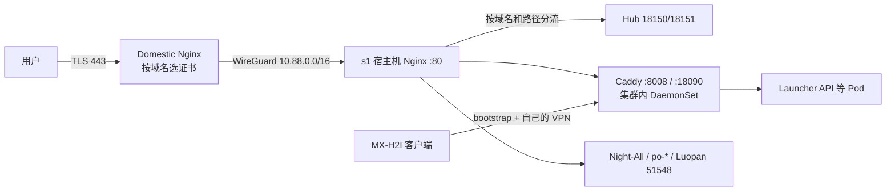

# 01. 背景、现状与目标

日期：2026-11-16。状态：归纳自用户口述、fstab 截图和各参考工程的文档，**没有登录任何服务器核对**。

## 这个工程是什么

`de-ladder2` 是 de-llaaddddeerr 的第二层：负责**集群架构**和**自身业务**，并保存整套架构的知识库（从 0 到 1 的环境部署、程序构建、事故记录）。

第一层（下文叫 L1）在 `/Users/qpjoy/workspace/qpjoy/de/de-llaaddddeerr/`，所有服务部署在一台内网服务器上。第二层（L2）要解决的是：新买了一台差不多的服务器，从一台变成两台，以后还会加机器和云服务器。

## 术语

| 叫法 | 指什么 |
|---|---|
| L1 | 现有部署：s1 上的 kubeadm 单节点集群 + Docker Compose + 宿主机服务 |
| L2 | 本工程要建的新集群和它周围的入口、数据库、存储 |
| s1 / s2 | 旧服务器 / 新服务器。详细登记在 `inventory/hosts.yaml` |
| Internal | 内网机房（s1、s2、NAS 所在的 LAN） |
| Domestic | 国内公网 VPS，目前唯一的公网入口 |
| 边缘 | 面向公网的那一层：Domestic，以及以后的云服务器 |

## 现状

### 硬件

| 机器 | 配置 | 使用情况 |
|---|---|---|
| s1 | 256G 内存；系统盘约 2T（根逻辑卷就是常说的"1T 盘"）；数据盘约 2T 挂在 `/data`；至少 4 块 GPU | 内存和硬盘都用到约 60% |
| s2 | 新买，和 s1 差不多 | 空 |
| NAS | 约 36T，NFS v3，挂在 `/mnt/nas` | 已存 infra 约 500 GiB、delta 约 937 GiB |
| Domestic | 2 vCPU / 4 GiB / 峰值 100 Mbps | 公网 443 + WireGuard 中继 |

### L1 上跑着什么

完整登记在 `inventory/projects.yaml`，这里只列关系。

| 项目 | 职责 | 数据库 | 现状 |
|---|---|---|---|
| mx-launcher | MX-H2I 全部功能；用户中心和 SSO；Internal 应用网关（Caddy） | 自己的 k8s 和 PG | 现役，最不能出事 |
| mx-insight-hub | 数据中心 | mx-common 的 PG / ES / Redis | 现役；正在把依赖 Night-All 的接口迁进来 |
| mx-dataport | 数港 | mx-common 的 PG | 现役 |
| mx-pay | 支付中心 | 专用 PG | 现役，Hub 和 DataPort 在用 |
| mx-rig | 测试中心（合并了 mx-auto-server、mx-test-framework） | 自己的 PG | 现役 |
| mx-embedding | 向量模型 | — | 因磁盘读写问题停掉，以后可能重开 |
| mx-ocr | OCR | — | 能部署，没有集成到工具 |
| mx-static | 静态文件服务 | SQLite 队列 | NAS 迁移做完了，**服务没上线** |
| mx-move | 把 etcd / k8s 数据迁到别的盘 | — | 迁移已完成 |
| Night-All、po-backend-java、po-infra | 旧数据源、Luopan 后端 | 宿主机 PG 16 等 | 现役，没上 k8s |

SSO（mx-launcher 的 auth）已经在 Hub、Launcher、DataPort、Pay 打通。

### 请求怎么进来

### L1 文档里记录过的事故和它们的结构原因

| 事故 | 结构原因 | L2 的对应做法 |
|---|---|---|
| 重启后 Caddy 抢了 80，Nginx 起不来（docs/50） | 一台机器上两个入口程序，端口归属靠启动顺序 | 集群不占宿主机 80/443，只开一个固定 NodePort（docs/05） |
| 部署后连到旧数据库（docs/51） | 数据位置由 `/etc/fstab` 的 bind 挂载决定，清单里看不出来 | 数据库由 CloudNativePG 声明，存储由 StorageClass 声明（docs/06） |
| Secret 丢失，从旧 etcd 副本里找 | 凭据只在 etcd 里，etcd 和业务数据在同一台机器 | etcd 快照和 Secret 备份放到另一台机器和 NAS（docs/06） |
| 冷备和原件在同一块盘 | 没有异机备份 | 同上 |
| HanLP OOM、504（docs/60） | 所有东西挤在一个节点，没有资源边界 | 每个命名空间有配额，重负载服务单独放（docs/04） |
| Embedding 因磁盘读写停掉 | 模型、数据库、镜像共用同一组盘 | 存储分层，模型和缓存不与数据库同盘（docs/07） |

## 硬约束

1. **任何改动不得影响 MX-H2I 现有用户登录和现有联网。** s1 上的 Launcher 栈在迁移路线里排最后，迁之前 s1 不重装、不改端口、不改地址。
2. mx-pay 保持独立：专用数据库、独立发布，其他服务出故障不能拖垮它。
3. 现有 SSO 链路（Hub、Launcher、DataPort、Pay）在迁移任一环节时都要重新验收。
4. 不删旧数据。迁移只复制，旧目录和旧副本保留到业务验收之后，由人显式清理（沿用 mx-move 的做法）。

## 目标

| 目标 | 衡量方式 |
|---|---|
| 两台服务器分担负载，以后能加机器 | s1 的内存和磁盘占用降到 50% 以下；加一台机器只需要一条 join 命令和改 inventory |
| 单台故障可恢复 | 两台阶段：人工切换，目标 1 小时内恢复；三成员阶段：无状态服务自动恢复 |
| 数据库有灾备和读写分离 | 每天验证过的备份；只读流量走独立入口 |
| NAS 静态文件有缓存层 | mx-static 上线，热文件不读 NAS |
| 整体按 1000 QPS 设计 | 每个环节有预算和压测脚本（docs/09） |
| 谁开发谁部署，但不散 | 每个项目一份可部署清单，放在统一的部署仓（docs/10） |
| 一个入口管理所有部署和编译 | `./scripts/manage.sh`，子项目保留自己的 manage.sh |
| 架构能讲清楚 | 每篇文档带图，另有可演示的图册（docs/13） |

## 不在范围内

- 改 MX-H2I、Luopan、Hub 的业务代码。
- 多机房、多活。只有一个内网机房。
- 服务网格、Argo CD、cert-manager。等出现实际需要再加，每多一个组件就多一个要备份和升级的东西。
