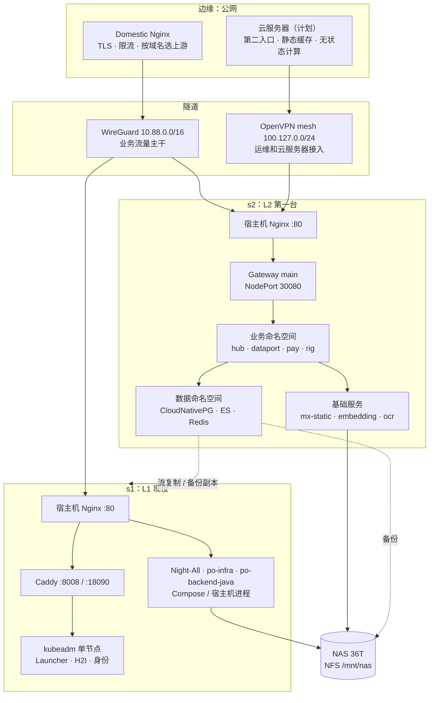

# 03. 目标架构总览

日期：2026-11-16。状态：设计。清单骨架在 `infra/`，**没有在任何集群上部署过**。 **k3s 的选择已被 16 取代（改用 kubeadm）；Gateway `main` 已按 18 拆成 `public` 和 `internal`。**

## 一张图

## 分层和每层的归属

| 层 | 组件 | 归谁管 | 配置放哪 |
|---|---|---|---|
| 1. 公网入口 | Domestic 的 Nginx（Compose），以后加云服务器 | 部署仓 | `de-mingxi/compass/deploy/nginx` |
| 2. 隧道 | WireGuard（业务）、OpenVPN mesh（运维、云服务器） | 本工程 | `docs/08`；工具在 L1 的 `tunnel-cli` |
| 3. 主机入口 | 每台内网服务器的宿主机 Nginx，占 80 | 部署仓出配置，本工程定规则 | `de-mingxi/compass/deploy/internal-nginx` |
| 4. 集群网关 | NGINX Gateway Fabric + Gateway API，NodePort 30080 | 本工程 | `infra/k8s/platform/gateway` |
| 5. 业务 | 每个项目一个命名空间，HTTPRoute 挂到 Gateway `main` | 各项目 | `de-mingxi/projects/de-ladder2/<项目>` |
| 6. 数据 | CloudNativePG、Elasticsearch、Redis | 本工程 | `infra/k8s/platform/postgres` 等 |
| 7. 基础服务 | mx-static、mx-embedding、mx-ocr | 本工程 | `infra/` 和 `services/`（接管后） |
| 8. 存储 | 本机 NVMe（数据库、etcd）、数据盘（镜像、缓存、模型）、NAS（媒体、备份） | 本工程 | `docs/07` |
| 9. 运维 | manage.sh、备份、监控、图册 | 本工程 | `scripts/`、`docs/` |

第 3 层是给不上 k8s 的程序留的位置。Night-All、po-infra、po-backend-java 和 L1 的 Caddy 都从宿主机 Nginx 直接转发，不经过集群网关。项目迁进集群时，只改宿主机 Nginx 里那个域名的上游。

## 两个集群并存期间谁在哪

| 位置 | 跑什么 | 原因 |
|---|---|---|
| s1（L1，不动） | mx-launcher 全栈（H2I、身份、产品网络、Caddy）、Night-All、po-*、宿主机 PG 5432 | H2I 登录和联网不能受影响；这些迁移风险最高或暂时不上 k8s |
| s2（L2，新建） | 网关、CloudNativePG、新部署的业务、mx-static、以后的 embedding / ocr | 新东西直接用新形态；把 s1 上最吃资源的 Hub 数据面搬过来 |

"两台做负载均衡"在这个阶段的含义是**按服务分担**，不是每个请求在两台之间轮询。原因和后续阶段见 `docs/04`。

## L2 的命名空间

| 命名空间 | 内容 |
|---|---|
| `nginx-gateway` | NGINX Gateway Fabric 控制器 |
| `gateway` | Gateway `main` 和它的数据面 Pod |
| `cnpg-system` | CloudNativePG 控制器 |
| `data` | 共享数据库集群 `pg-common`、Elasticsearch、Redis |
| `mx-pay` | 支付 API、console、专用数据库集群 `pg-pay` |
| `mx-insight-hub`、`mx-dataport`、`mx-rig` | 各业务项目，沿用 L1 的命名空间名 |
| `base` | mx-static 等基础服务 |
| `<项目>-staging` | 测试环境，与正式环境用同一份 base |

L1 里叫 `mx-internal-shadow` 的命名空间实际是正式环境。L2 不再用 shadow 这个名字，Launcher 迁过来时用 `mx-launcher`。

## 选定的组件和版本

版本只写在 `infra/k8s/versions.env`。下面的数字抄自 cc-studio 的 `infra/k8s/versions.env`（那边 2026-11-16 用 curl 核对过发布页），本工程**没有重新核对**，第一次安装前再查一遍。

| 层 | 选择 | 版本 | 理由 |
|---|---|---|---|
| 集群 | k3s，内置 etcd | v1.37.2+k3s1 | 单个二进制，证书自动轮换，自带 etcd 定时快照；一台起步，加到三台就是高可用，不用迁数据 |
| 集群网关 | NGINX Gateway Fabric | 2.8.1 | 数据面还是 Nginx，和边缘、宿主机同一种配置和日志；配置用 Gateway API |
| 数据库 | CloudNativePG | 1.30.1 | 主从、切换、备份都用清单声明 |
| 清单管理 | kustomize（kubectl 自带） | — | base + overlays 区分环境，不引入模板语言 |
| 扩缩 | HPA + k3s 自带 metrics-server | — | 无状态服务按 CPU 扩缩 |

k3s 和 L1 的 kubeadm 不一样，这是有意的：L1 的大量脚本是为了补 kubeadm 单节点的恢复能力（证书、kubelet 认证、etcd 迁移），k3s 把这些内置了。代价是团队要熟悉第二种发行版。如果以后决定统一成 kubeadm，业务清单不用改，只换 `infra/k8s/cluster/`。

## 相关文档

- 机器怎么加、高可用怎么来：`docs/04`
- 入口和网关：`docs/05`
- 数据库：`docs/06`
- 存储和静态文件：`docs/07`
- 隧道和云服务器：`docs/08`
- 容量：`docs/09`
