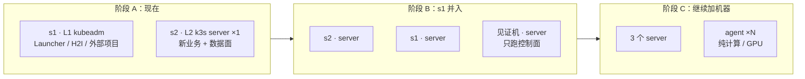

# 04. 集群拓扑与扩展：两台、三台、更多

日期：2026-11-16。状态：设计，没有实测。 **阶段 B / C、见证机方案和 k3s 配置要点已被 16 取代。**

## 先回答几个问题

| 问题 | 回答 |
|---|---|
| 两台能不能做负载均衡？ | 能分担负载。现在按服务分（重的搬到 s2）；s1 并入新集群后才能按请求分 |
| 两台能不能做高可用？ | 做不到自动的。etcd 要 3 个成员才能容忍 1 台故障，2 个成员比 1 个更差。两台阶段是人工切换的容灾 |
| 第三台来了，是扩容还是做高可用？ | 先做高可用，同时也扩了容：小集群里控制面节点照样跑业务。第四台起才是纯扩容 |
| 不想等第三台大机器，能早点有高可用吗？ | 能。买一台小的见证机（4 核 / 8G / SSD）当第三个 etcd 成员，不跑业务 |
| 单台到上限了，这台还能扩吗？ | 能纵向扩（加内存条、加盘，LVM 和 xfs 支持在线扩大），但更省事的是加节点。见文末 |

## 三个阶段

### 阶段 A：两台，两个集群（现在）

- s2 装 k3s，`cluster-init: true`，单节点也用内置 etcd。
- s1 保持 L1 原样。它是现役，不重装、不改端口。
- 分担负载的办法是**搬服务**：按 `docs/11` 的顺序把 Hub、mx-common 数据面、DataPort、Rig、Pay 从 s1 搬到 s2。s1 的内存和磁盘占用会从 60% 往下掉。
- 容灾是**人工的**：
  - s2 坏了：数据库用 s1 或 NAS 上的备份恢复；业务清单重新 apply 到恢复后的集群。Launcher 和 H2I 在 s1，不受影响。
  - s1 坏了：H2I 中断，按 L1 现有的恢复文档处理。L2 上的业务不受影响，但 SSO 登录依赖 Launcher，新登录会失败。
- 这个阶段 L2 只有一台机器，L2 上的服务**没有**节点级冗余。副本数写 2 只能防进程崩溃和滚动更新断流。

为什么不让 s1 现在就以 agent 身份加入 L2：s1 上跑着 kubeadm 的 kubelet 和 apiserver，同一台机器不能同时属于两个集群（6443、10250 端口和 CNI 都会冲突）。

### 阶段 B：s1 并入，三成员（s1 上的东西迁完之后）

前提：s1 上的 k8s 工作负载全部迁到 s2 并验收；见证机到位。

1. s1 上不进集群的程序（Night-All、po-*、宿主机 PG）可以继续留在 s1，它们和 k3s 不冲突。
2. 停掉并卸载 s1 的 kubeadm 集群（数据目录保留）。
3. s1 和见证机以 server 身份加入 L2，etcd 变成 3 成员。见证机打污点，不跑业务。
4. 网关改成每个节点一个副本；无状态服务副本数 ≥ 2 并按节点分散；CloudNativePG 实例数改成 2（一主一同步从）。
5. 边缘和宿主机 Nginx 的上游同时列出 s1 和 s2。

这时才有：一台故障后无状态服务自动在另一台继续、数据库自动切换、请求在两台之间分配。

没有见证机的退路：s1 以 agent 加入。请求能在两台之间分配，但控制面只在 s2。s2 坏了以后 s1 上已有的 Pod 还在跑，可是不能调度、不能发布，数据库也不会自动切换。这比阶段 A 多了容量，没多可靠性。

想在 s1 迁完之前就有控制面高可用，需要两台见证机（s2 加两台小机器凑 3 个成员）。一般不值得。

### 阶段 C：更多机器

| 新机器 | 角色 | 说明 |
|---|---|---|
| 第三台大服务器 | server，替换见证机（或让见证机留着，变成 3 大 1 小时把见证机退役，保持奇数） | etcd 成员数保持 3 或 5 |
| 第四台以后 | agent | 纯计算节点，加入只需要 token 和 server 地址 |
| GPU 机器 | agent，带 `gpu=true` 标签和污点 | embedding、ocr 只调度到这类节点 |
| 云服务器 | **不加入**这个集群 | 跨公网的节点会拖慢 etcd，也把公网机器放进了控制面。它的角色见 `docs/08` |

加一台机器要改的东西：`inventory/hosts.yaml`、该机器的 `/etc/rancher/k3s/config.yaml`、边缘和宿主机 Nginx 的 upstream。业务清单不改。

## 不建议的做法

- **两台 server 组一个集群**：2 个 etcd 成员，任何一台坏了集群就不可写。
- **两台 server 加外部数据库当 k3s 存储**：单点只是挪到了那个数据库。
- **把 Domestic 或云服务器拉进来当第三个 etcd 成员**：etcd 对延迟和磁盘很敏感，跨公网不稳定。
- **见证机用机械盘或放在 NAS 上**：etcd 每次写入都要落盘，慢盘会拖慢整个控制面。

## 调度规则

| 规则 | 做法 |
|---|---|
| 数据库不和重负载抢资源 | 数据库 Pod 设 requests = limits（Guaranteed）；HanLP、embedding 这类设内存上限 |
| 无状态服务跨节点分散 | `topologySpreadConstraints`，单节点时不阻止调度（模板里已有） |
| 每个项目有上限 | 每个命名空间一份 `ResourceQuota` 和 `LimitRange`（模板里已有） |
| 一个项目的故障不扩散 | 默认 `NetworkPolicy` 只放行网关和数据命名空间 |
| GPU | 只给带标签的节点；一块卡一个服务，沿用 L1 `.env.gpu` 的分配表 |

L1 的 HanLP 事故（8Gi 限额下 5 个 worker 被 OOM，后来提到 32Gi）说明：request 写 1Gi、limit 写 32Gi 的 Pod 并没有为峰值预留内存。L2 里这类服务的 request 按实测常驻量写。

## 单台服务器到上限怎么办

按便宜到贵的顺序：

1. **先搬**：把这台上最重的服务调度到别的节点。数据库用"加从库、切换、删旧主"的方式搬，不停机。
2. **清**：镜像缓存、构建缓存、旧迁移副本。s1 上 `mx-move` 保留的历史副本和 Docker 旧卷在业务验收后可以回收。
3. **纵向加硬件**：
   - 内存：看主板空插槽（s1 / s2 的插槽情况没核对过）。
   - 磁盘：新盘加进 LVM 卷组后 `lvextend` 加 `xfs_growfs` 在线扩容。xfs 只能扩不能缩。
   - 加盘比换盘安全。换盘要先把数据迁走。
4. **横向加节点**：阶段 C。

容量告警线定在 70%：内存或任一数据盘超过 70% 就开始做第 1、2 步，不等到 90%。

## k3s 配置要点

配置文件在 `infra/k8s/cluster/`，要点：

- `cluster-init: true`：第一台就用内置 etcd。
- 关掉自带的 Traefik 和 ServiceLB：Traefik 和 NGINX Gateway Fabric 重复；ServiceLB 会占宿主机 80 端口，重演 L1 的端口归属问题。
- `secrets-encryption: true`。
- etcd 每 6 小时一次快照，保留 20 份，并同步到 NAS 和另一台机器（见 `docs/06`）。
- etcd 留在系统盘（k3s 默认的 `/var/lib/rancher/k3s`），镜像和数据库卷放数据盘 `/data`，两者不同盘。L1 在 2026-10-19 把 etcd 从数据盘迁到系统盘就是为了这一点。目录在安装时用配置项指定，不用 bind 挂载事后搬（分盘方案见 `docs/07`）。
