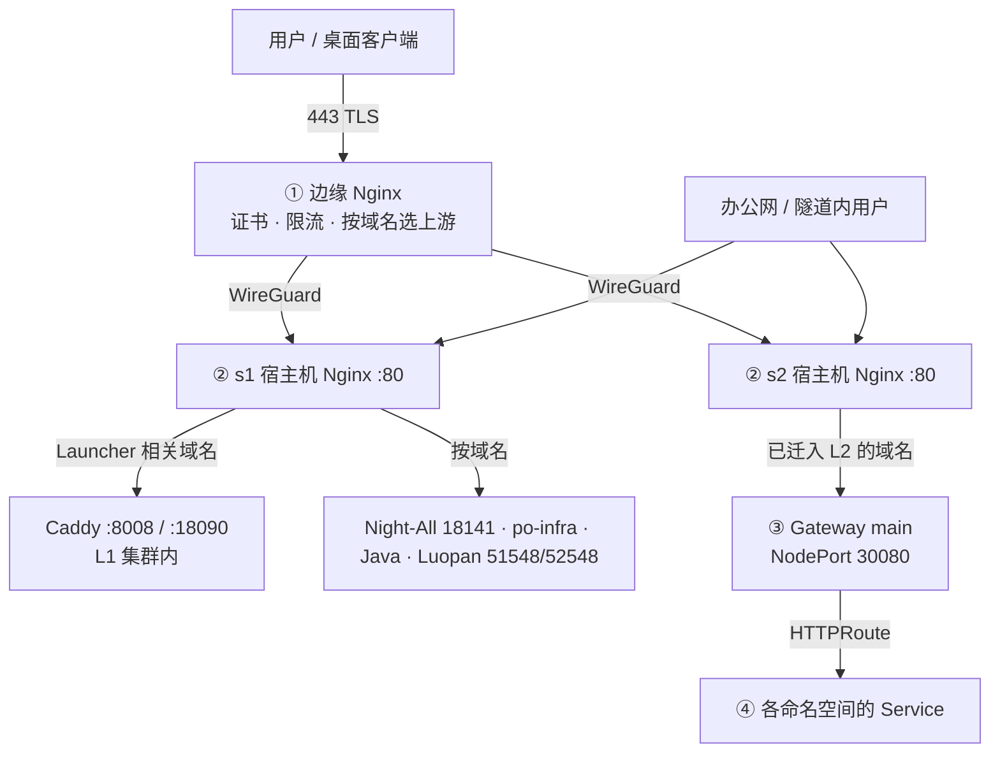

# 05. 入口与网关

日期：2026-11-16。状态：设计，没有实测。Ingress 退役的事实抄自 cc-studio `docs/03.k8s-gateway-and-dr.md`（那边列了出处），本工程没有重新查证。 **Gateway `main` 已按 18 改名为 `public`，并新增 `internal`；Caddy 的内网职责见 18。** 2026-11-17 第三轮：各层的名字和集群重启时的行为见 `docs/23`。

## 结论

1. 请求经过四层：边缘 Nginx → 隧道 → 宿主机 Nginx（80）→ 集群网关（NodePort 30080）。每层只做一件事。
2. 集群里用 **Gateway API**，实现选 NGINX Gateway Fabric。不装 ingress-nginx。
3. L1 的 Caddy 不动，继续在 s1 的 8008 / 18090 上服务 Launcher。Launcher 迁进 L2 时，Caddy 的路由改写成 HTTPRoute，Caddy 退役。
4. 不上 k8s 的程序从宿主机 Nginx 直接转发，不经过集群网关。

## Ingress 是不是过时了

- **Ingress API**（`networking.k8s.io/v1`）还是正式 API，没有移除计划，但不再加新功能。
- **ingress-nginx 控制器**（社区的 `kubernetes/ingress-nginx`）2025-11-11 宣布退役，2026 年 3 月之后没有新版本和安全补丁。不该再用于新集群。
- **Gateway API** 是官方后继。它把"网关归谁管"（Gateway）和"路由归谁管"（HTTPRoute）分开，正好对上本工程的分工：平台管 Gateway，各项目管自己的 HTTPRoute。

L1 没有装过任何 Ingress 控制器（入口一直是宿主机 Nginx 加 Caddy），所以这里没有"从 ingress-nginx 迁移"的工作，是直接采用 Gateway API。

## 四层入口



| 层 | 负责 | 不负责 |
|---|---|---|
| ① 边缘 Nginx | TLS 证书、公网限流、未知域名拒绝、把域名对到内网某台机器 | 路径级的业务路由 |
| ② 宿主机 Nginx | 这台机器上 80 端口的唯一主人；按域名分给集群网关、Caddy 或宿主机程序；办公网直连入口 | TLS（在边缘终结） |
| ③ 集群网关 | 集群内按域名和路径转给 Service；滚动更新时摘掉旧 Pod | 证书、公网限流 |
| ④ Service | 负载分到 Pod | — |

### 端口归属（每台机器一张表，写死）

| 端口 | s1 | s2 |
|---|---|---|
| 80 | 宿主机 Nginx | 宿主机 Nginx |
| 443 | 不监听（TLS 在边缘） | 不监听 |
| 8008、18090 | Caddy（L1） | 不用 |
| 18444 | 公网身份入口（L1 hostPort） | 不用 |
| 30080 | 不用 | 集群网关 NodePort |
| 6443 | kubeadm apiserver | k3s apiserver |

L1 的 80 端口事故（Caddy 和 Nginx 抢端口）根源是端口归属靠启动顺序决定。L2 的规则是：**集群里任何东西都不用 hostPort 和 hostNetwork 去占 80/443**，入口只有 30080。

### 为什么保留宿主机 Nginx 这一层

少一层当然更简单，但现在去不掉：

- 有一批程序暂时不上 k8s（Night-All、po-infra、po-backend-java），它们需要一个 80 上的分流点。
- 迁移是一个域名一个域名做的。改宿主机 Nginx 的一行 upstream 就能把一个域名从旧实现切到新实现，切回去也是一行。
- 办公网和隧道里的用户直接访问内网 80，不经过边缘。

等所有程序都进了集群，可以让边缘直接指向 30080，宿主机 Nginx 只留给办公网。

## 集群网关的配置

清单在 `infra/k8s/platform/gateway/`。

- 一个 Gateway，名字 `main`，命名空间 `gateway`，只有 80 的 HTTP 监听。
- 只有带标签 `ladder2/gateway: main` 的命名空间能往上挂路由。新项目的命名空间由平台创建并打标签。
- Service 类型 NodePort，`externalTrafficPolicy: Local`，这样网关看得到来源地址，才能只信任宿主机 Nginx 带来的 `X-Forwarded-For`。代价是只有跑着网关副本的节点能接流量，所以多节点时网关用 DaemonSet。
- 信任链：边缘用 `$remote_addr` **覆盖** `X-Forwarded-For`（不是追加）→ 宿主机 Nginx 原样传 → 网关只信任来自本机的转发。应用拿到的是真实客户端地址。

各项目写自己的 HTTPRoute，样板在 `templates/project/base/route.yaml`：

```yaml
apiVersion: gateway.networking.k8s.io/v1
kind: HTTPRoute
metadata:
  name: hub-public
spec:
  parentRefs:
    - name: main
      namespace: gateway
  hostnames: ["hub.minsight-ai.com"]
  rules:
    - matches:
        - path: { type: PathPrefix, value: /admin }
      backendRefs:
        - name: hub-admin
          port: 80
```

## 集群内部的调用

服务之间互相调用走 Service 的集群内域名（`<服务>.<命名空间>.svc`），不绕到网关。原因：少一跳，而且网关重启不影响内部调用。

需要跨集群的调用（L2 的 Hub 调 s1 上的 Launcher 做 SSO 内省、调 Night-All）在 L2 里建一个不带选择器的 Service 加 EndpointSlice 指向 s1 的 LAN 地址。业务代码里写的还是集群内域名，Launcher 迁过来那天只改这个 Service。

mx-pay 被 Hub 和 DataPort 调用，也走集群内域名，并用 NetworkPolicy 限定只有登记过的命名空间能访问。

## Caddy 的去向

| 时间 | Caddy 的状态 |
|---|---|
| 现在 | s1 上的 DaemonSet（hostNetwork），占 8008 和 18090；80 归宿主机 Nginx（`MX_INTERNAL_GATEWAY_PORT80_OWNER=host-nginx`） |
| 阶段 A 全程 | 不动。宿主机 Nginx 把 Launcher 相关域名二次反代到 8008 |
| Launcher 迁入 L2 | Caddyfile 里的每条路由改写成 HTTPRoute；18090 这种客户端写死的端口用宿主机 Nginx 的 `listen 18090` 转到 30080，保持客户端不用改 |
| 迁完并验收 | Caddy 退役 |

MX-H2I 客户端里写着的地址和端口在整个过程中不变。变的只是这些端口后面是谁在接。

## 没有决定的

- 限流和鉴权插件：现在放在边缘和应用里。如果以后要在网关做统一鉴权或按 Key 限流，再评估换成 APISIX / Kong 或 Envoy Gateway。HTTPRoute 清单可以原样带走。
- 办公网入口要不要一个漂移地址（keepalived VIP）：阶段 B 两台都能接流量后再定。
- gRPC、WebSocket、SSE 长连接经过四层后的超时配置，要在第一个真实服务上实测。
