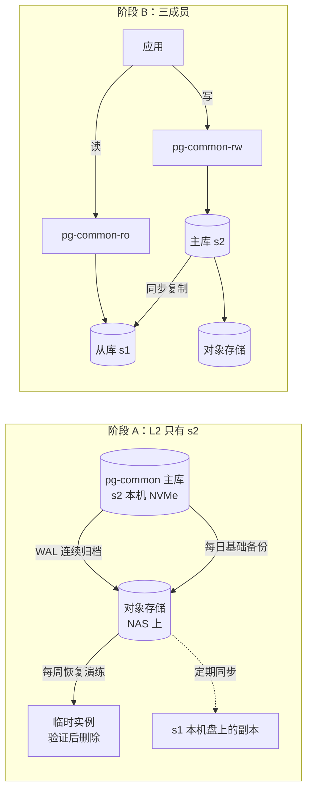

# 06. 数据库：高可用、灾备、读写分离

日期：2026-11-16。状态：设计，没有实测。清单目前只有单实例样板。 **"备份"和"恢复演练"两节已被 19 取代；对象存储不再自建。** 2026-11-17 第三轮：不是每个库都配副本，分级见 `docs/22`。

## 结论

1. PostgreSQL 由 **CloudNativePG** 管理。不再用 StatefulSet 加 hostPath 加 fstab。
2. 分三个数据库集群：`pg-common`（Hub、DataPort）、`pg-pay`（支付专用）、`pg-launcher`（Launcher 迁入时建）。Rig 用 `pg-common` 里的独立库，或保留自己的，迁移时定。
3. 灾备按"3 份、2 种介质、1 份不在本机"做，并且**每周自动做一次恢复演练**。没恢复过的备份不算备份。
4. 读写分离用 CloudNativePG 自带的读写 / 只读两个 Service，应用里用两个连接池。先用于隔离重查询，不是为了吞吐。
5. 两台阶段数据库切换是人工的；三成员阶段才自动。

## 现状和问题

| L1 的数据库 | 位置 | 问题 |
|---|---|---|
| Launcher PG | `mx-internal-shadow/mx-internal-postgres`，4 CPU / 4Gi | 单实例，hostPath |
| mx-common PG | `mx-common/mx-common-postgres`，16 CPU / 48Gi，Hub 和 DataPort 分库 | 分库不隔离故障：CPU、WAL、检查点、磁盘共享 |
| Pay PG | `mx-pay/mx-pay-postgres` | 单实例 |
| Rig PG | `mx-rig/mx-rig-postgres` | 单实例 |
| 宿主机 PG 16 | `127.0.0.1:5432` | Night-All / po-infra 的源数据，不在 k8s 里 |

共同的问题：没有从库；数据位置由 bind 挂载决定；备份和原件在同一台机器。

## 各阶段的数据库形态

| | 阶段 A | 阶段 B |
|---|---|---|
| 实例数 | 1 | 2（一主一同步从），有第三台大机器后 3 |
| 一台坏了 | 从备份恢复，人工，丢失的数据不超过最后一段未归档的 WAL（目标 5 分钟内） | 自动切到从库，同步复制下不丢已提交的数据 |
| 备份 | WAL 归档加每日基础备份到对象存储 | 同左，从从库取备份 |
| 读写分离 | 没有从库，`-ro` 指向主库 | `-ro` 指向从库 |

阶段 A 可以提前在 s1 上放一个流复制从库（s1 的 Docker 里起一个 PG 跟着 s2 的主库），这样 s2 整机坏了能少丢数据。但 s1 现在内存和磁盘已经 60%，是否值得等 Hub 数据面搬走之后再定。

### 两成员时的同步复制

只有一主一从时，同步复制有个取舍：从库断了，主库是停写还是降级成异步。本工程选**降级成异步继续写**（可用性优先），并在降级时告警。支付库 `pg-pay` 单独选**停写**（一致性优先），因为丢一笔已确认的付款比暂停几分钟更糟。具体参数在建 `pg-pay` 时按 CloudNativePG 当时的文档写，不凭记忆。

## 备份

| 层 | 内容 | 放哪 | 频率 | 保留 |
|---|---|---|---|---|
| 1 | WAL 连续归档 | 对象存储 | 持续 | 14 天 |
| 2 | 基础备份 | 对象存储 | 每天 | 14 天 |
| 3 | 逻辑备份（`pg_dump` 按库） | NAS 的普通目录 | 每天 | 30 天 |
| 4 | 异地副本 | 云服务器或云对象存储 | 每天同步第 2、3 层 | 30 天 |
| 5 | etcd 快照、Secret 导出（加密） | NAS 和另一台服务器 | 6 小时 | 20 份 |

说明：

- CloudNativePG 的物理备份要一个 S3 兼容的对象存储。候选：NAS 自带的对象存储功能（如果有）、Garage、SeaweedFS。**没选定**，选的时候要查各项目当前的维护状态。
- 第 3 层是为了能恢复单个库。L1 的文档指出过：物理恢复作用于整个实例，共享实例里不能只恢复一个产品的库。
- NAS 是单点，所以要有第 4 层。在云服务器租下来之前，第 4 层先用 s1 的数据盘顶替。
- 第 5 层对应 L1 那次"Secret 丢失要从旧 etcd 副本里找"。

### 恢复演练

每周一次，全自动：从对象存储恢复出一个临时数据库集群 → 跑一组核对查询（行数、最新一条记录的时间）→ 结果写进状态文件 → 删掉临时集群。演练失败和备份失败一样要告警。`./scripts/manage.sh db drill` 是这个动作的入口（还没实现）。

## 读写分离

CloudNativePG 给每个数据库集群三个 Service：`-rw`（主库）、`-ro`（只读从库）、`-r`（任意实例）。

| 流量 | 走哪 | 例子 |
|---|---|---|
| 写、读自己刚写的 | `-rw` | 下单、入库、任务认领 |
| 能接受几百毫秒延迟的读 | `-ro` | 列表、报表、导出、搜索结果回表核对 |
| 长时间分析查询 | `-ro`，单独的连接池和超时 | 统计、对账报表 |

做法：

- 应用里两个连接池，由代码决定这条查询走哪个。不用中间件自动拆 SQL，那种做法在事务和"刚写就读"的场景会出错。
- 连接池用 CloudNativePG 的 Pooler（PgBouncer，事务模式），放在应用和数据库之间，控制总连接数。
- `mx-common` 的 npm 包是加第二个池的地方，Hub 和 DataPort 一起受益。这是对 L1 仓库的改动，要单独立项。
- 队列（`mxq.jobs`、outbox）永远走 `-rw`。

Hub 图册里写过"连接池与 Worker 隔离不是物理读写分离"，现在仍然是这个状态。1000 QPS 对一台 16 核 48G 的 PG 不构成吞吐压力（见 `docs/09`），读写分离的第一个收益是让重查询不拖慢交易。

## 从 L1 迁数据库

每个库同样的步骤，沿用 `mx-move` "只复制、保留旧副本、可回退"的做法：

1. 在 L2 建空的数据库集群，角色和库名与 L1 一致。
2. 用逻辑复制或 `pg_dump | pg_restore` 做第一次全量。库不大、能接受几分钟停写的直接 dump。
3. 停应用写入 → 追平 → 核对行数和业务记录 → 应用的连接串改到 L2 → 恢复写入。
4. L1 的旧库**只停不删**，保留到业务验收之后。

顺序见 `docs/11`。Pay 的库单独安排窗口，迁移前后各做一次对账。

## Elasticsearch 和 Redis

- ES 的索引是 PG 的可重建投影（L1 的 ADR-0005）。所以 ES **不做高优先级备份**，坏了就从 PG 重建。迁移时在 L2 新建空 ES，触发 Hub 的索引重建，不搬索引文件。
- 重建很慢（要过 HanLP），所以迁移 Hub 之前先在 L2 把索引建完，再切流量。
- Redis 只做缓存和限流，不持久化重要数据。不备份。
- ES 阶段 A 单节点；阶段 B 是否上多节点看那时的搜索负载，单独立一篇文档。

## 宿主机 PG（5432）

它是 Night-All 和 po-infra 的源数据，留在 s1 不动。给它补两件事，不改它的运行方式：把它纳入第 3 层逻辑备份；在 L2 里用一个指向 s1 的 Service 给 Hub 访问。
