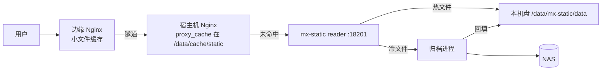

# 07. 存储分层、NAS 与静态文件服务

日期：2026-11-16。状态：设计，没有实测。mx-static 的数字抄自它自己的 `docs/capacity.md`，那份文档也注明是设计期估算。 **"静态文件服务"一节和"数据库永远不放 NFS"的表述已被 20 修订；s2 的目录以 16 的分卷方案为准。**

## 结论

1. 存储分三层：本机 NVMe 放数据库和 etcd；本机数据盘放镜像、缓存、模型；NAS 放媒体原件和备份。
2. **数据库、etcd、SQLite 永远不放 NFS。**
3. mx-static 上线分两步：先在 s2 以现有的 Compose 形态上线，前面加一层宿主机 Nginx 缓存；跑稳之后再考虑进集群。
4. NAS 是单点，而且是机械盘。设计目标是让线上请求**尽量不读 NAS**：热文件在本机盘，NAS 挂了只影响冷文件。

## 三层存储

| 层 | 介质 | 放什么 | 不放什么 |
|---|---|---|---|
| 热 | 系统盘（根逻辑卷，NVMe） | 操作系统、etcd、容器镜像（k3s 默认目录） | 业务数据 |
| 温 | 数据盘 `/data`（NVMe，xfs，noatime） | 数据库卷、构建缓存、静态文件热缓存、模型文件 | 备份（和原件同盘等于没备份） |
| 冷 | NAS `/mnt/nas`（NFS，机械盘，约 36T） | 媒体原件归档、数据库备份、etcd 快照、日志归档 | 任何数据库文件、任何需要低延迟随机读的东西 |

### s2 的目录规划

```text
/var/lib/rancher/k3s/          # k3s、etcd、容器镜像，系统盘（默认位置，不改）
/data/
├── k3s/
│   └── storage/               # local-path 的卷：数据库在这里（k3s 配置 default-local-storage-path）
├── cache/
│   └── static/                # 宿主机 Nginx 的静态文件缓存
├── models/                    # embedding / ocr / hanlp 的模型
├── mx-static/{data,state}/    # mx-static 的对象目录和 SQLite
└── tmp/                       # 构建临时目录（沿用 L1 的 TMPDIR=/data/tmp）
/mnt/nas/                      # NFS
```

etcd 和数据库分在两块物理盘上，互不抢 IO。镜像先跟 k3s 留在系统盘；如果镜像把系统盘占得太多，再查 k3s 当时的文档把镜像目录单独指到数据盘，这一点没核对过。L1 的 embedding 因为磁盘读写问题停掉，那时模型、数据库、镜像都在同一组盘上；s2 上模型放 `/data/models`，如果重开后仍然抢 IO，再给模型单独加盘。

### 集群里怎么声明存储

| StorageClass | 后端 | 用途 |
|---|---|---|
| `local-path`（k3s 自带） | `/data/k3s/storage` | 数据库、ES。卷跟着节点，所以数据库的高可用靠复制，不靠共享存储 |
| `nas-archive`（静态 PV，NFS） | `/mnt/nas` 下的子目录 | 备份、媒体归档。只给明确需要的命名空间 |

不引入 Longhorn、Ceph 这类分布式存储。两三台机器上它们带来的运维量超过收益，而数据库有自己的复制。

## NAS 的挂载

两台服务器用同一行 fstab（s1 现有的）：

```text
nas-storage:/volume1/data1 /mnt/nas nfs rw,_netdev,hard,vers=3,proto=tcp,rsize=524288,wsize=524288,timeo=600,retrans=2,sec=sys,x-systemd.mount-timeout=60s,x-systemd.before=docker.service 0 0
```

要知道的几点：

- `hard`：NAS 不可达时，读写它的进程会**一直挂住**而不是报错。这保护了写入不丢，但意味着任何在请求路径上同步读 NAS 的服务都会被拖死。所以请求路径上要有缓存和超时。
- `x-systemd.before=docker.service`：保证 Docker 启动前 NAS 已挂好。s2 上要对 k3s 加同样的依赖（`k3s.service` 的 drop-in），否则 Pod 可能把数据写进空的挂载点目录。
- 每个用 NAS 的服务启动时检查卷标记文件（mx-static 的 `attach` 已经这样做），发现挂载点是空目录就拒绝启动。
- NFS v3 没有强认证，靠来源地址。NAS 的导出规则只允许 s1、s2 的 LAN 地址。

NAS 上的目录按项目分，沿用 mx-static `nas_docs` 里已有的规划：`infra/`、`delta/`，新增 `backup/pg/`、`backup/etcd/`、`static/`。

## 静态文件服务

### 现状

mx-static 0.7.0：writer（18200）负责采集和落盘，reader（18201）负责读取和签名预览，都是单主机 Compose。NAS 迁移做完了，服务本身没上线，Hub 接入暂停。它的设计里 NAS 是可选归档层，不是 HTTP 主存储，这个方向不变。

### 目标读路径



| 层 | 作用 | 要点 |
|---|---|---|
| 边缘缓存 | 省隧道带宽 | 只缓存小图片；Domestic 只有 100 Mbps 和 4G 内存，缓存目录限到几个 G。视频不在这里缓存 |
| 宿主机 Nginx 缓存 | 挡住绝大多数读 | `proxy_cache_lock` 防止同一个文件并发回源；`proxy_cache_use_stale` 让后端或 NAS 出问题时继续发旧文件；按路径里的内容哈希做 key |
| mx-static reader | 鉴权、签名校验、Range | 文件名带内容哈希，所以可以设很长的缓存时间 |
| 本机对象目录 | 热文件 | 容量有上限，超过后把最久没访问的文件只留在 NAS |
| NAS | 冷文件和全量归档 | 按 mx-static 的估算，读只在 NAS 上的冷文件约 12 次每秒。要把冷读比例压到接近 0 |

签名预览链接里的签名参数要从缓存 key 里去掉（先验签，再按文件哈希查缓存），否则每个链接都是一次未命中。这一条在上线前要对着 reader 的实现确认。

### 上线步骤

1. s2 准备 `/data/mx-static/{data,state}` 和 NAS 挂载。
2. 用 mx-static 现有的 Compose 在 s2 部署 writer 和 reader（监听 127.0.0.1）。
3. s2 宿主机 Nginx 加 `/static/` 的转发和缓存（mx-static 的 `deploy/internal-locations.conf` 是起点）。
4. 用一个内部项目试写试读，按 mx-static `docs/capacity.md` 第 7 节量出目标主机的真实数字。
5. `attach` NAS 归档。
6. 恢复 Hub 接入。边缘加 `/static/` 转发（`deploy/edge-locations.conf`）。

s1 上现有的 infra、delta 媒体目录已经在 NAS 上，由 po-infra 等直接读，这次不动它们。mx-static 只管新接入的项目。

### 以后

- 公网静态流量变大时，瓶颈是 Domestic 的 100 Mbps。办法是把公开的静态文件同步到云对象存储加 CDN，mx-static 的签名链接改成指向 CDN。内网不变。
- mx-static 进集群：writer 单副本（它用 SQLite），reader 可以多副本，对象目录用 hostPath 固定在一个节点。在只有一两台机器时，这比 Compose 没多大好处，所以不急。

## 迁移数据的规矩

沿用 mx-move 和 mx-static 迁移工具的做法：

1. 先只读盘点，出报告。
2. 复制到新位置，校验内容和元数据。
3. 停写、追平、切换。
4. 旧数据保留。业务验收之后，由人带着明确的参数（L1 用的是 `--business-accepted`）执行清理。

工具本身不提供"自动删除旧数据"。
