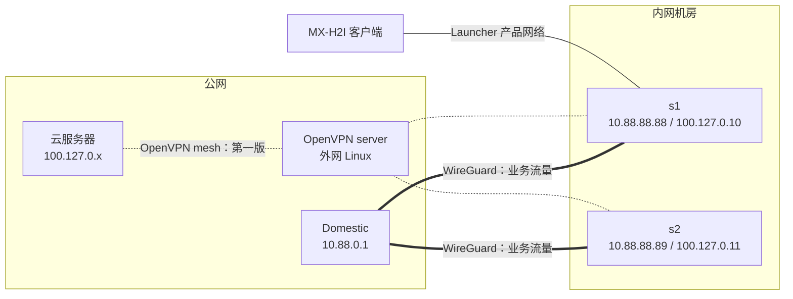

# 08. 网络：隧道、地址规划与云服务器

日期：2026-11-16。状态：设计。地址段抄自 L1 文档；云服务器还没租，规格未定。 **云服务器的角色和接入方式由 17 补充。** 2026-11-22：网段规划沿用 v1 的补充（`10.0.0.0/8` 归 Launcher 的应用、集群网段和 s1 一样、边缘隧道用 `100.127.200.0/24` 起）见 `docs/41`。

## 结论

1. 业务流量的主干用 **WireGuard**（已有，`10.88.0.0/16`）。
2. **OpenVPN mesh**（`qp-tunnel-cli open`，`100.127.0.0/24`）用于运维接入，以及云服务器的第一版接入。它能用，但走用户态转发，性能有上限。流量大了以后给云服务器建一条直连隧道。
3. 云服务器是**边缘和无状态计算**，不加入内网集群，数据留在内网。
4. 新增任何网段前先查冲突。现有网段登记在下表。

## 地址规划

| 网段 | 用途 | 来源 |
|---|---|---|
| `192.168.1.0/24` | 内网机房 LAN。s1 是 `.2`，NAS 是 `.3` | L1 文档 |
| `10.88.0.0/16` | WireGuard。Domestic 是 `10.88.0.1`，s1 是 `10.88.88.88` | L1 文档 |
| `100.127.0.0/24` | OpenVPN mesh，实例 `mx`。s1 是 `.10` | `openvpn.setup.md` |
| `100.127.10.0/24` | 预留：第二个 OpenVPN 星型网络（云服务器当 server 时用） | `openvpn.setup.md` 的建议 |
| `10.42.0.0/16`、`10.43.0.0/16` | k3s 默认的 Pod 和 Service 网段 | k3s 默认值，装之前在 s2 上确认和 s1 的 flannel 网段、Docker 网段不冲突 |
| MX-H2I / Luopan 的产品网络和 VIP | 由 Launcher 管理 | **本工程不碰** |

s2 建议的地址：WireGuard `10.88.88.89`，OpenVPN `100.127.0.11`。写进 `inventory/hosts.yaml` 之前要在现场确认没被占用。

## 三种隧道各管什么



| 隧道 | 承载 | 特点 |
|---|---|---|
| WireGuard | 公网入口到内网的全部业务请求 | 内核态，开销小。每台内网服务器各自拨出，各占一个地址 |
| OpenVPN mesh | 运维登录；云服务器访问内网服务（第一版）；外部开发机 | `client-to-client` 是经 server 中转的星型，不是点对点直连；固定走用户态（`disable-dco`）。只互通各自的固定 VPN 地址，不暴露 LAN、Docker、k8s 网段 |
| Launcher 产品网络 | MX-H2I 和 Luopan 用户的联网 | 由 Launcher 管，和本工程的隧道互不依赖 |

## 云服务器怎么接进来

### 第一版：加入现有 OpenVPN mesh

云服务器作为现有 server 的一个客户端 enroll，拿到固定地址，通过 `100.127.0.10` / `.11` 访问 s1、s2 上的服务。内网服务器不需要任何公网监听端口。

```bash
# 在 OpenVPN server 上签发
sudo qp-tunnel-cli open list --server --instance mx
sudo qp-tunnel-cli open create cloud-01 --instance mx --ip 100.127.0.30
# 在云服务器上
sudo qp-tunnel-cli open preflight --file cloud-01.ovpn
sudo qp-tunnel-cli open enroll --file cloud-01.ovpn
sudo qp-tunnel-cli open doctor
```

要让云服务器访问到某个内网服务，该服务（或 s2 的宿主机 Nginx）必须监听 `100.127.0.11` 或 `0.0.0.0`，并在防火墙里只对云服务器的 VPN 地址放行。建议只暴露宿主机 Nginx 的 80：云服务器通过它访问所有登记的域名，不直接连数据库。

### 这条路的性能上限

- 云服务器到内网的每个包要经过 OpenVPN server 中转一次，多一跳。
- 用户态转发受 server 单核性能限制。具体能跑多少**没测过**，先按"几十到一两百 Mbps"的量级估计，上线前用 iperf3 实测。
- 所以第一版适合：API 调用、小响应、管理流量。不适合：大文件、视频、数据库复制。

### 流量上来以后

按 `openvpn.setup.md` 里"One hub or two hubs"的做法二选一：

| 方案 | 做法 | 适合 |
|---|---|---|
| 云服务器直连 WireGuard | 云服务器当 WireGuard 中继，s1、s2 各加一个 peer 拨过去，和现在的 Domestic 一样 | 云服务器要成为第二个公网入口时（推荐） |
| 第二个 OpenVPN 星型 | 云服务器当 server（实例名如 `edge2`，网段 `100.127.10.0/24`），s1、s2 各 enroll 一个新实例 | 只想复用 tunnel-cli，不想动 WireGuard 配置 |

两条隧道并存不会叠加带宽，也不会自动互为备份。应用连哪个地址就走哪条路。

## 云服务器的角色

| 可以放 | 不放 |
|---|---|
| 第二个公网 Nginx 入口（证书、限流），Domestic 的后备 | etcd 成员、k3s 节点 |
| 静态文件缓存、CDN 回源 | 数据库主库、任何唯一的数据副本 |
| 无状态的计算：前端、渲染、对公网的 API 聚合 | Launcher、身份服务 |
| 数据库和 etcd 备份的异地副本（加密后） | 未加密的凭据 |

云服务器上的服务用 Docker Compose 或一个独立的单节点 k3s，和内网集群用同一份业务清单的另一个 overlay。它坏了，内网照常；内网断了，它只能发缓存。

现在只有 Domestic 一个公网入口，它是单点（L1 文档里已经指出）。云服务器到位后，DNS 把域名同时解析到两台或做人工切换，这个单点才消除。

## 防火墙规则的原则

- 内网服务器默认只对 LAN、WireGuard 的 `10.88.0.1`、登记过的 OpenVPN 地址开放端口。
- 数据库端口不出主机，除非是复制，而且只对对端的固定地址开放。
- k3s 的 6443 只对 LAN 和运维用的 VPN 地址开放。
- 改防火墙和路由之前，先在 s1 上确认不影响 Launcher 的产品网络规则。L1 有过 hostPort 的 DNAT 规则消失的故障（2026-10-21），原因没查明，所以 s1 上的 iptables 尽量不碰。

## 没有决定的

- s2 的 LAN 地址、WireGuard 地址。
- 云服务器的厂商、规格、带宽。按 `docs/09` 的估算，1000 QPS 至少要 200 Mbps 以上的公网带宽，或者静态文件走 CDN。
- OpenVPN server 现在在哪台外网机器上，和 Domestic 是不是同一台。
