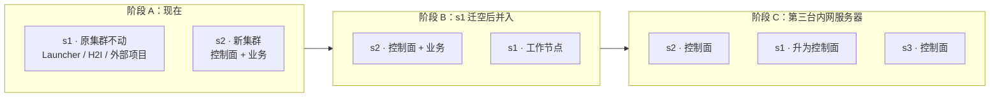

# 16. 第二轮决策：kubeadm、不设见证机、s1 暂不调整

日期：2026-11-17。状态：决策，没有实测。取代 `docs/03` 的"选定的组件和版本"里关于 k3s 的部分、`docs/04` 的阶段 B / C 和见证机方案、`docs/14` 的第 6 节。其余内容仍然有效。 2026-11-17 第三轮：GPU 一行已被 `docs/21` 取代（4 块现在全在 s1）。 2026-11-22："Pod / Service 网段"一行已被 `docs/41` 取代：`10.0.0.0/8` 都归 Launcher 的应用，L2 改用和 s1 一样的 `192.168.224.0/20` / `192.168.240.0/20`。

依据：用户 2026-11-17 的答复和 s1 的 `df -TH` 截图；L1 脚本的只读核对。

## 结论

1. **新集群用 kubeadm**，版本、CNI 和 s1 保持一致（v1.36、flannel），团队只需要懂一种发行版。
2. **s1 的集群现在不调整，s2 也不加入它。** s2 建一个新集群，从第一天就按多节点来配。
3. **不设见证机。** 控制面先只有 s2 一个，靠备份和一键还原兜底（`docs/19`）。等内网有第三台服务器时再升到三个控制面，那时不需要重建集群。
4. 门槛从简：内部自用，只保留会造成不可逆后果的那几道检查。

## 为什么 s2 不直接加入 s1 的集群

这本来是最简单的做法：一条 `kubeadm join`，一个集群，不用迁移。核对 L1 的脚本后发现行不通：

| 脚本 | 写死的检查 |
|---|---|
| `mx-launcher/scripts/identity-on.mjs` | "身份部署要求单节点集群"，节点数不是 1 就退出 |
| `mx-common/scripts/storage-preflight.mjs` | `nodes.length === 1` |
| `mx-insight-hub/scripts/manage.sh`、`recover-retained-storage.mjs` | 要求 kubectl 指向"同一台单节点主机" |
| `mx-dataport/scripts/operations.mjs` | 节点数不是 1 就拒绝构建和导入 |
| `mx-launcher/scripts/k8s-recovery-state.mjs` 等恢复脚本 | "只支持原单节点集群" |

另外 L1 的清单里有 22 处 `imagePullPolicy: Never`（镜像靠导入本机），Pod 一旦调度到 s2 就起不来。

也就是说，s2 一加入，Launcher 身份、Hub、DataPort 的发布脚本就全部拒绝执行。要改就得改 L1 仓库里几十个脚本，其中一半是保护 MX-H2I 登录的。所以结论和上一轮相同：**两个集群并存，一个服务一个服务地搬**，只是新集群从 k3s 换成 kubeadm。

## 见证机是什么，为什么现在不要

控制面的数据存在 etcd 里。etcd 靠多数票决定谁说了算：3 个成员坏 1 个还有 2 票，能继续；2 个成员坏 1 个只剩 1 票，不过半，整个集群不能写。所以两台机器各放一个 etcd 反而比只放一个更脆弱。见证机就是凑第三票用的小机器，只跑 etcd 和控制面，不跑业务。

不要它的理由：

- 多一台机器要装、要监控、要升级，换来的是"控制面自动切换"。对内部自用的系统，控制面坏了的后果是**暂时不能发布和调度**，已经在跑的服务不受影响。这个代价可以接受。
- 真正要防的是数据丢失，那靠备份（`docs/19`），不靠见证机。

**云服务器能不能当见证机？** 技术上可以让它通过 WireGuard 加入当第三个 etcd 成员，但不建议：

- etcd 每次写入都要等多数成员确认。云服务器在第三票的位置上，公网一抖动，内网两台就得靠彼此凑多数，这时再坏一台就全停。把集群的可用性绑在了公网质量上。
- 如果云服务器在海外或别的区域，延迟几十到几百毫秒，etcd 的心跳和选举超时都要调大，故障发现也跟着变慢。
- 公网机器进了控制面，被攻破的后果是整个集群。

如果以后确实想要自动切换，按便宜到贵：内网放一台小主机 → 等第三台大服务器 → 同城低延迟的云主机（最后的选择）。

## 各阶段的形态（修订）

| 阶段 | 控制面 | 一台坏了会怎样 |
|---|---|---|
| A | s2 一个 | s2 坏：新集群的服务停，从备份还原。s1 坏：H2I 停，按 L1 的文档恢复。两边互不牵连 |
| B | s2 一个，s1 是工作节点 | s1 坏：它上面的无状态服务在 s2 重新拉起，数据库切到 s2 的副本。s2 坏：s1 上已有的 Pod 继续跑，但不能发布、不能调度，数据库不会自动切换，要人工处理 |
| C | 三个 | 任意一台坏，自动恢复 |

阶段 B 是否值得做取决于 Launcher 迁不迁（`docs/11` 的 P7）。不迁的话系统长期停在阶段 A，这也是一个稳定状态。

为了以后从 B 升到 C 不用重建，s2 建集群时就把 `controlPlaneEndpoint` 设成一个固定名字（`k8s-api.ladder2.internal`，各节点的 `/etc/hosts` 里指向 s2）。kubeadm 的集群如果初始化时没设这一项，以后加控制面要改证书和配置，很麻烦。

## s2 的配置

| 项 | 值 | 说明 |
|---|---|---|
| 地址 | `192.168.1.4`（可调整） | |
| 系统 | Ubuntu 26.04 | s1 是 CentOS 系。混用没问题，脚本里不要写死包管理器 |
| 磁盘 | 预计 2T | 见下 |
| GPU | 规划 2 块 RTX 5090 | 见 `docs/21`：4 块现在全在 s1，s2 到位后各 2 块 |
| Kubernetes | v1.36，kubeadm | 和 s1 一致 |
| 容器运行时 | containerd | |
| CNI | flannel | 和 s1 一致。flannel 不执行 NetworkPolicy，所以不依赖网络策略做隔离 |
| Pod / Service 网段 | `10.244.0.0/16` / `10.96.0.0/12` | 故意和 s1 的 `192.168.224.0/20` / `192.168.240.0/20` 不同，也不和 WireGuard 的 `10.88.0.0/16` 重叠 |
| 本地卷 | local-path-provisioner，目录 `/data/k8s/storage` | kubeadm 不自带，要装 |

### etcd 和磁盘

s1 的经验是 etcd 和业务数据分盘，避免业务把磁盘读写打满时拖慢控制面。s2 如果只有一块 2T 盘，做不到物理分盘，按下面分：

| 挂载点 | 大小 | 内容 |
|---|---|---|
| `/` | 100G | 系统 |
| `/var/lib/etcd` | 20G，单独的逻辑卷 | etcd。单独分卷至少保证它不会被别人写满 |
| `/var/lib/containerd` | 300G | 镜像 |
| `/data` | 其余 | 数据库卷、缓存、模型 |

用 LVM，留 10% 不分配，哪个不够扩哪个。**如果能加一块小的 SSD（256G 就够）专门放系统和 etcd，比分卷好**，这是这台机器最值得的一笔小投入。

阶段 C 加控制面时，每个控制面节点各自在本机系统盘上放自己的 etcd 成员（kubeadm 的默认做法），不需要额外设计。

## 从简的地方

内部自用，下面这些上一轮设计里的门槛去掉或改成可选：

| 上一轮 | 现在 |
|---|---|
| 每个项目必须有测试命名空间 | 可选。项目自己决定要不要 |
| 每个命名空间默认 NetworkPolicy | 去掉（flannel 不执行） |
| 每周自动恢复演练 | 改成备份后自动校验包的完整性；完整恢复演练每季度手工做一次 |
| 写操作交互确认 `yes` | 只保留在"装平台组件""还原"这两类。日常发布不问 |
| 见证机 | 不设 |
| 对象存储选型（Garage / SeaweedFS） | 不自建。异地备份直接用已有的 OSS |

保留的：写集群必须带 `--context`；不碰 s1 上 Launcher 的端口和规则；不自动删旧数据；凭据不进 Git。
