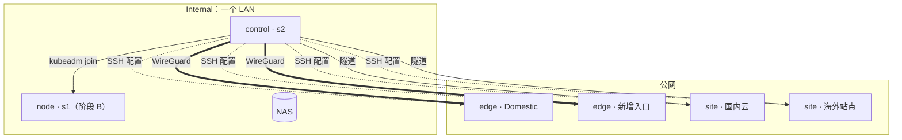

# 17. 机器怎么接入：节点、站点、多入口，以及面向公众的站点

日期：2026-11-17。状态：设计。`manage.sh node plan` 已实现（只打印计划），其余没有实现。**2026-11-21："加一台入口的步骤"已被 37 取代：边缘机器不走 `node prepare/join`，用 `qp-tunnel-cli edge` 推送部署。**补充 `docs/08`。 2026-11-17 第三轮："隧道能不能加速"一节被 `docs/24` 修订；站点名 `cloud` 取消，见 `docs/21`。 2026-11-17 第六轮："海外高性能服务器做站点"一节有了第一个真实站点，见 `docs/33`；`sites/<名字>/` 目录等 L2 真正开始管这台机器时再建。

## 结论

1. 机器分四种角色。只有**内网同一个 LAN 里的服务器**加入集群；云服务器和海外服务器是独立的"站点"，不进集群。
2. 接入方式：控制面在 Internal，通过 SSH 配置别的机器，和 Launcher 现有的 remote-ssh 做法一致。入口是 `./scripts/manage.sh node`，机器的事实写在 `inventory/hosts.yaml`。
3. 入口带宽不够时加入口机器，用 DNS 分流，**前面不要再放一台"入口主控"**。
4. 面向公众的站点：站点层放在离用户近的云上，数据通过同步和缓存过去，不要每个请求都跨隧道回内网读。

## 四种角色

| 角色 | 是什么 | 进集群吗 | 例子 |
|---|---|---|---|
| `control` | 集群控制面，也是发起一切操作的地方 | 是 | s2 |
| `node` | 集群工作节点 | 是 | 阶段 B 的 s1、以后的内网服务器 |
| `site` | 独立运行的机器，用 Docker Compose 或它自己的小集群，通过隧道使用内网服务 | 否 | 云服务器、海外站点、不上 k8s 的小机器 |
| `edge` | 公网入口，只跑 Nginx 和隧道 | 否 | Domestic、以后新增的入口 |

一台机器可以同时是 `site` 和 `edge`。



### 为什么远程机器不进集群

问题里提到"好像 k8s 的某个组件是基于 WireGuard 的"。准确的说法是：flannel、Calico、Cilium 这些 CNI 可以选 WireGuard 做节点之间的加密通道；kube-proxy 和 WireGuard 无关。所以技术上确实可以让一台云服务器通过 WireGuard 当工作节点。不这样做的原因：

- 节点和控制面之间断线超过几十秒，节点会被标成不可用，上面的 Pod 被驱逐到别处。跨公网尤其跨境的链路，这会反复发生。
- 集群里的服务默认认为彼此很近。一个在云上的 Pod 调内网数据库，每条查询多几十毫秒，页面一次几十条查询就是几秒。
- Pod 网络叠在隧道上，包头两层，MTU 要调，出了问题难查。

做成独立站点后，它和内网的关系很清楚：**只通过登记过的几个地址和端口调用内网服务**，断线时它自己还能用缓存继续服务。

## 新机器怎么加入

三种分发方式的比较：

| 方式 | 做法 | 评价 |
|---|---|---|
| 把 manage.sh 拷到新机器上运行 | 每台机器一份脚本 | 脚本版本会不一致，状态分散 |
| 发成 npm 包（像 `@qpjoy/tunnel-cli`） | 新机器 `npm i -g` 后运行 | 适合给**别人**装的工具。要先在新机器上装 Node，而且包里不能带内网的地址和凭据 |
| 控制面通过 SSH 推（像 Launcher 的 remote-ssh） | 在 s2 上执行，脚本经 SSH 在目标机器上跑 | 目标机器只需要 SSH。状态和记录都在 Internal。**选这个** |

```bash
# 在 s2 上。目标机器先在 inventory/hosts.yaml 登记角色和地址
./scripts/manage.sh node plan <主机>       # 只打印将要做什么（已实现）
./scripts/manage.sh node prepare <主机>    # 系统、磁盘、NAS、隧道、容器运行时（未实现）
./scripts/manage.sh node join <主机>       # node 角色：kubeadm join；site / edge 角色：部署它的 Compose 和 Nginx（未实现）
```

每个角色对应 `scripts/roles/<角色>/` 下的一组脚本，每个脚本可以重复执行。隧道这一步直接调用 `qp-tunnel-cli`，不重写。

### 以后包装成受控端软件

可以，而且上面的结构就是为它准备的：角色脚本是"做什么"，SSH 只是"怎么送过去"。以后要做成常驻的受控端（Linux 命令行、图形界面，或 Windows / macOS 上的小程序），把 SSH 换成受控端主动连回 Internal 领任务即可，角色脚本和 inventory 不用变。

叫法建议：Internal 上的叫**主控**，其他机器叫**受控端**。小机器当受控端时用 `site` 角色（Docker Compose），不装 k8s。

现在不做的原因：受控端要解决注册、鉴权、升级、断线重连，这是一个产品的工作量，Launcher 的运维中心已经在做同类的事（截图里的 remote-ssh、33 个允许的动作、29 个受门禁的动作）。等本工程的角色脚本稳定后，把它们登记成 Launcher 运维中心的动作，比另做一个受控端合理。

## 入口带宽：加入口，不加主控

现在所有流量走 Domestic 一台，峰值 100 Mbps。

**如果在几台入口前面放一台"入口主控"做分流，所有流量仍然先经过主控，受它那 100 Mbps 限制。** 所以不能这样做。

| 办法 | 做法 | 适合 |
|---|---|---|
| 静态和下载不走入口 | 放 OSS 加 CDN。MX-H2I 的发版下载已经这样做了 | 第一步就做，立刻卸掉最大的流量 |
| 按域名分 | 不同域名解析到不同入口：`hub.` 到入口一，`api.` 到入口二 | 最简单，出问题好查 |
| DNS 多条记录 | 一个域名解析到多台入口，云解析带健康检查，坏的自动摘掉 | 一个域名本身就超过 100 Mbps 时 |
| 云厂商的负载均衡 | 流量按量计费，不受单机带宽限制 | 流量再大时。它就是那个"主控"，只是带宽不是瓶颈 |

每台入口都是 `edge` 角色，配置相同，各自通过 WireGuard 连到内网。加一台入口的步骤：登记到 inventory、`node prepare`、`node join`、加 DNS 记录。

还有一个容易忽略的上限：**内网机房自己的上行带宽**。所有入口最后都要经隧道回到内网，内网宽带的上行有多少没核对过（`docs/15`）。入口加到三台，内网上行只有 100 Mbps，瓶颈就挪到了这里。

## 隧道能不能加速

不能。OpenVPN 和 WireGuard 都只是加密和封装，本身只会增加一点开销。"加速"来自线路：隧道两端之间走的是哪条路。

- 同一条线路上，WireGuard 比 OpenVPN 快，因为它在内核里转发。业务流量一律走 WireGuard。
- 跨境慢是线路问题。办法是换线路好的机房（比如对国内优化过的线路），或者中间加一台两边都快的中转。隧道协议换来换去没有用。
- OpenVPN mesh 留给运维接入和临时打通，这是它方便的地方。

云服务器不管在哪个区域，接入方式都一样：`site` 角色，一条到内网的 WireGuard（流量小时先用 OpenVPN mesh 也行，见 `docs/08`）。

## 面向公众的站点会不会有瓶颈

现在的路径是 用户 → Domestic → 隧道 → Internal。给内部和少量客户用没问题，面向公众时逐项看：

| 环节 | 会不会成为瓶颈 | 处理 |
|---|---|---|
| Domestic 带宽 100 Mbps | **会，最先到** | 上一节 |
| 内网上行带宽 | **很可能**，没核对 | 页面和静态资源不回内网；只有接口调用回内网 |
| 隧道 | WireGuard 不会 | |
| 集群和应用 | 128 核 256G 两台，不会 | 多副本 |
| 数据库 | 读多写少的站点不会 | 只读副本加缓存 |
| 磁盘 | 增长要规划（`docs/20`） | |
| NAS 冷读 | 会，机械盘 | 公众访问的文件一律同步到 OSS |
| 可用性 | 内网断电断网，站点就挂 | 站点层放云上，内网断了还能看缓存 |

结论：这套架构能做面向公众的站点，但**站点层不能放在内网**。内网做数据和计算的源头。

### 海外高性能服务器做站点

```mermaid
flowchart LR
  U[海外用户] --> W[海外站点 · site 角色<br/>页面 · 接口 · 缓存 · 只读副本]
  W -->|公开文件| OSS[(对象存储 + CDN)]
  W -. 少量必要调用 .->|隧道| I[Internal 服务]
  I -->|定时同步公开文件| OSS
  I -->|流复制或定时同步| W
  NAS[(NAS)] --> I
```

原则是**数据往外推，请求不往里拉**：

| 需求 | 做法 | 不要做 |
|---|---|---|
| 读 NAS 上的文件 | 内网把要公开的文件同步到海外的对象存储桶，站点从那里读 | 把 NAS 通过隧道挂载到海外。跨境 NFS 延迟高，而且 `hard` 挂载下隧道一断站点就卡死 |
| 读数据库 | 站点本地放一个只读副本（流复制），或者内网定时导出站点需要的那几张表 | 每个页面跨境查内网主库 |
| 写数据（注册、下单） | 写站点本地的库，再异步同步回内网；或者只有这几个接口跨隧道调内网 | 所有写都同步跨境 |
| 调内网服务（搜索、模型） | 经隧道调，站点侧加缓存和超时，失败时降级 | 让页面渲染依赖它 |

在本工程里，一个站点就是 `sites/<名字>/` 一个目录（Compose、Nginx、同步任务、隧道配置）加 inventory 里的一条。加一个站点不改集群。这个目录结构现在还没有建，第一个真实站点落地时建。

站点需要哪些内网服务，逐个登记，逐个开放端口。**不给站点开放整个内网网段。**
