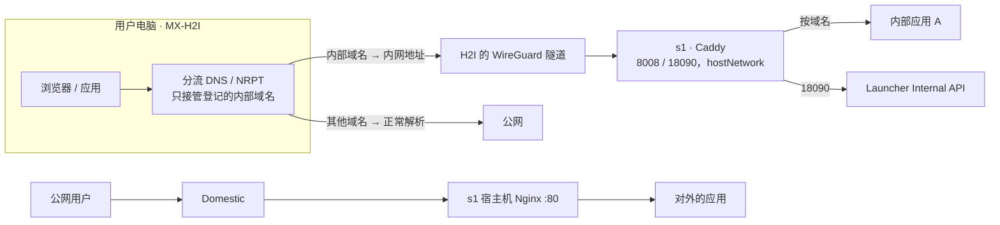

# 18. 内网专属入口：Caddy、分流 DNS 与"只有内网能访问"

日期：2026-11-17。状态：设计，没有实测。补充 `docs/05`。Caddy 的现状读自 L1 的 `mx-launcher/deploy/k8s/internal-shadow/45-internal-gateway.yaml` 和 `mx-launcher/docs/22`，不是登录服务器看到的。

## 结论

1. "只有内网能访问"现在由两样东西合起来实现：MX-H2I 下发的分流 DNS（Windows 上是 NRPT）把内部域名解析到内网地址；Caddy 在内网地址上按域名转发。这套机制**原样保留**。
2. 新集群里用**两个 Gateway** 表达同一件事：`public` 接公网来的流量，`internal` 只接内网和 H2I 用户的流量。一个应用想只对内网开放，就只把路由挂到 `internal` 上。
3. Caddy 换成 Nginx 是可以做的优化，但放在 Launcher 迁移那一步一起做，不单独动。

## 现在是怎么工作的



- 内部域名只存在于 H2I 下发的规则里。没连 H2I 的电脑解析不到，或者解析到公网的一个不提供该服务的地址。
- Caddy 的 18090 是 Launcher Internal API 的入口，它区分请求是不是从 Domestic（`10.88.0.1`）转来的；8008 是内部应用的入口；80 这一段是可选的，现在让给了宿主机 Nginx。
- 公网入口（Domestic → 宿主机 Nginx）是另一条路。一个应用不在这条路上配域名，公网就访问不到。

所以"某个应用只有内网能访问"= 它的域名只登记在分流 DNS 里，并且只在 Caddy 上有路由。

Caddy 在这里承担三件事，迁移时都要有去处：

| Caddy 的职责 | 迁移后谁来做 |
|---|---|
| 内部应用按域名转发（8008） | Gateway `internal` 上的 HTTPRoute |
| Launcher Internal API 入口（18090），区分来源 | Launcher 迁移时处理（`docs/11` 的 P7），在那之前不动 |
| Internal 发布路由时动态改 ConfigMap | 改成增删 HTTPRoute |

## 新集群里的两个 Gateway

| Gateway | NodePort | 谁能到达 | 挂在上面的路由 |
|---|---|---|---|
| `public` | 30080 | 边缘 Nginx 经隧道转来的公网流量 | 对外的应用 |
| `internal` | 30081 | 内网 LAN、H2I 用户（经 s1 的入口转来） | 只对内的应用；管理后台 |

一个应用的三种暴露方式：

```yaml
# 只对内网：只挂 internal
parentRefs: [{ name: internal, namespace: gateway }]
# 对外：只挂 public
parentRefs: [{ name: public, namespace: gateway }]
# 都开放，但管理路径只对内：两条 HTTPRoute，/admin 那条只挂 internal
```

这比现在清楚的地方在于：一个应用对谁开放，写在它自己的清单里，评审时一眼能看到，不用去翻 DNS 规则和 Caddy 配置。

`infra/k8s/platform/gateway/gateway.yaml` 已按这个结构改成两个 Gateway。上一轮文档里的 `main` 改名为 `public`。

### 过渡期：H2I 用户怎么访问到 s2 上的内部应用

H2I 的分流 DNS 现在把内部域名指向 s1 的入口。**这个指向不改**，改的是 s1 入口后面：

```text
H2I 用户 → 分流 DNS → s1 的内网入口（地址和端口不变）
        → s1 宿主机 Nginx 或 Caddy 里加一条：这个域名转到 192.168.1.4:30081
        → s2 的 Gateway internal → 应用
```

这样新应用放在 s2 上，H2I 客户端、DNS 规则、NRPT 都不用动。代价是多一跳，而且 s1 的入口仍然是内部应用的必经之路。等 Launcher 迁移时再把分流 DNS 的目标换成一个不绑定某台机器的地址。

需要在 s1 上加转发规则，这是对 s1 的改动。走 Launcher 现有的"Internal 发布路由"流程加，不手工改 Caddy 的 ConfigMap（L1 的文档写明发布路由会整体替换它）。

## Caddy 换不换

| | Caddy（现状） | Nginx / Gateway（目标） |
|---|---|---|
| 性能 | 对内部应用的流量足够。高并发下不如 Nginx | 更好 |
| 运维 | 团队里只有这一处用它，配置语法和日志是另一套 | 和边缘、宿主机、集群网关同一套 |
| 热更新 | 现在的部署关了 admin 接口，改路由要重建 Pod | HTTPRoute 增删不重启 |
| 风险 | 已经稳定运行 | 换的过程会碰 H2I 的入口 |

结论：值得换，理由主要是少维护一种东西，性能是次要的。但它在 MX-H2I 的登录路径上，**不单独为了性能去换**。顺序是：

1. 新应用从第一天就用 Gateway `internal`，不往 Caddy 上加新东西。
2. Caddy 上现有的内部应用，随各自迁到 s2 时一个一个挪走。
3. 最后只剩 18090 的 Launcher 入口，随 Launcher 迁移一起换，并做完整的 H2I 验收。

## 要注意的

- 分流 DNS 只是"找不到"，不是"进不来"。知道内网地址和域名的人，只要能到达内网地址，就能访问。所以 `internal` 的 30081 在防火墙上只对 LAN 和 s1 开放，不对 Domestic 的 `10.88.0.1` 开放。
- 内部域名用和公网域名不同的后缀，避免同一个域名在内外解析出不同结果时排查困难。现有的后缀沿用，不新造。
- Windows 上 NRPT 规则在升级、重启、切换网络后可能丢失（`mx-launcher/docs/22` 有排查顺序）。内部应用打不开时先查这个，再查网关。
