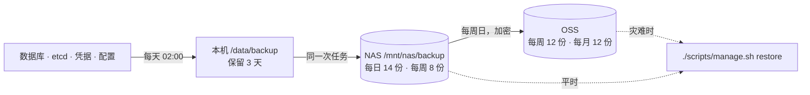

# 19. 备份与一键还原

日期：2026-11-17。状态：设计。备份清单在 `inventory/backup.yaml`，`manage.sh backup plan` 已实现（只打印）；真正的备份和还原**没有实现**。取代 `docs/06` 的"备份"和"恢复演练"两节。 2026-11-17 第三轮："存放和频率"一节被 `docs/22` 修订：每日备份直接写 NAS，不再默认落本机盘；只有一级和二级库传 OSS。

## 目标

**只要有备份包和源码，就能用 `manage.sh` 把整套系统还原出来。**

不设见证机之后（`docs/16`），这是兜底手段，所以它的优先级排在所有迁移之前。

## 结论

1. 三个存放位置：本机（快）、NAS（全）、OSS（异地）。OSS 用已有的那个，MX-H2I 的发版下载已经在上面。
2. 每天备份到 NAS，每周把最新一份加密后传到 OSS。全部自动。
3. 备份包自带说明文件，记录里面有什么、对应哪个版本的源码。还原时脚本按说明文件逐项还原。
4. 不自建对象存储，不引入备份平台。用 `pg_dump`、`pg_basebackup`、`etcdctl`、`tar` 和 OSS 的命令行工具。

## 备份什么

完整清单在 `inventory/backup.yaml`，下面是分类。

| 类别 | 内容 | 工具 | 为什么 |
|---|---|---|---|
| 集群状态 | etcd 快照；`/etc/kubernetes/pki` | `etcdctl snapshot save`、`tar` | 没有证书，快照还原不出能用的集群 |
| 凭据 | 所有命名空间的 Secret；各项目的 `.env`、`secrets/` 目录 | `kubectl get secret -o yaml`、`tar` | L1 有过 Secret 丢失、从旧 etcd 副本里找的事故 |
| 数据库 | 每个库一份逻辑备份；每个实例一份物理备份 | `pg_dump -Fc`、`pg_basebackup` | 逻辑备份能单独恢复一个库；物理备份恢复快 |
| 配置 | 宿主机 Nginx、fstab、systemd 的自定义 unit、隧道配置、防火墙规则 | `tar` | 这些不在 Git 里的现场配置最容易漏 |
| 清单的实际状态 | 每个命名空间导出的全部资源 | `kubectl get -o yaml` | 用来对照 Git 里的清单，发现手工改过的地方 |
| 源码版本 | 每个仓库当时的提交号 | `git rev-parse` | 还原时要检出同一个版本 |

不备份的：

| 内容 | 原因 |
|---|---|
| Elasticsearch 索引 | 是数据库的可重建投影，从数据库重建 |
| Redis | 只有缓存 |
| 容器镜像 | 从源码重新构建，或从镜像仓库拉 |
| 模型文件 | 重新下载。几十 G，不值得传 OSS |
| NAS 上的媒体 | 太大（现在 6.5T）。NAS 自身的保护另说，见文末 |

## 存放和频率



| 位置 | 频率 | 保留 | 能防什么 |
|---|---|---|---|
| 本机 `/data/backup` | 每天 | 3 天 | 误删、发布搞坏数据。还原最快 |
| NAS | 每天 | 每日 14 份，每周 8 份 | 一台服务器坏了 |
| OSS | 每周 | 每周 12 份，每月 12 份 | 机房出事（火、水、盗、NAS 坏） |

数据库另外开 WAL 归档到 NAS，这样能恢复到任意时间点，而不只是每天凌晨那一刻。

传 OSS 之前用 `age` 或 `gpg` 加密。**密钥不能只放在被备份的机器上**：打印一份放保险柜，另存一份到密码管理器。OSS 的桶关闭公开访问，开版本控制，用只有写入权限的子账号上传，这样服务器被攻破也删不掉已有的备份。

## 备份包的结构

```text
ladder2-backup-20261117-020000/
├── MANIFEST.json            # 见下
├── cluster/
│   ├── etcd-snapshot.db
│   └── pki.tar
├── secrets/
│   ├── k8s-secrets.yaml
│   └── project-env.tar
├── postgres/
│   ├── pg-common/
│   │   ├── mx_insight_hub.dump
│   │   └── mx_dataport.dump
│   ├── pg-pay/mx_pay.dump
│   └── host-pg/...
├── config/
│   ├── s2-nginx.tar
│   ├── s2-system.tar        # fstab、systemd unit、隧道、防火墙
│   └── resources/<命名空间>.yaml
└── SHA256SUMS
```

`MANIFEST.json` 记录：备份时间、每台主机名、Kubernetes 版本、每个仓库的路径和提交号、每个数据库的版本和大小、每个文件的校验和、生成它的 `manage.sh` 版本。还原脚本只认这个文件，不靠目录名猜。

## 命令

```bash
./scripts/manage.sh backup plan                 # 打印将备份什么、放哪（已实现）
./scripts/manage.sh backup run                  # 执行一次（未实现）
./scripts/manage.sh backup list                 # 三个位置各有哪些包（未实现）
./scripts/manage.sh backup verify <包>          # 校验和；每个 dump 用 pg_restore --list 读一遍（未实现）
./scripts/manage.sh restore plan <包>           # 打印将还原什么、到哪（未实现）
./scripts/manage.sh restore run <包> [--only postgres/pg-pay]   # 执行（未实现）
```

定时任务用 systemd timer，装在 s2 上，由 `backup install` 生成。

## 全部还原的步骤

在一台新机器上，从零开始：

1. 装系统，取得源码，检出 `MANIFEST.json` 里记录的提交号。
2. `./scripts/manage.sh node prepare <主机>`：磁盘、NAS、隧道、容器运行时。
3. 建集群。两条路：
   - **新建集群再还原数据**（默认）：`kubeadm init`，装平台组件，还原 Secret，重新 apply 各项目清单，还原数据库。结果是一个干净的集群。
   - **从 etcd 快照还原**：集群原样回来，包括所有资源对象。要求主机名和地址与原来相同。
4. `restore run <包>`：按顺序还原凭据 → 数据库 → 配置。
5. 各项目重新部署；Hub 触发搜索索引重建。
6. 验收：`docs/11` 的 H2I 验收表，加上每个库的行数和最新记录时间与 `MANIFEST.json` 对比。

默认走"新建再还原"，因为它不要求新机器和旧机器一模一样，也顺便验证了源码里的清单是完整的。

还原脚本的规矩：**目标位置已经有数据时拒绝执行**，除非显式指定覆盖。不会为了还原而清空一个现有的库。

## 怎么知道备份是好的

| 检查 | 频率 | 方式 |
|---|---|---|
| 包完整 | 每次备份后 | 校验和；`pg_restore --list` 能读出每个 dump 的目录 |
| 大小合理 | 每次 | 和上一次比，缩小超过 20% 就告警 |
| 传到了 OSS | 每周 | 上传后回读文件列表和大小 |
| 真的能还原 | 每季度，手工 | 把最新的包还原到一个临时库，核对行数 |
| 备份任务在跑 | 每天 | 最新的包超过 26 小时没更新就告警 |

告警发到哪（飞书群机器人是现成的）还没接。

## s1 上的东西

s1 的 L1 集群有自己的恢复脚本和事务记录，本工程不替换它们。但备份要覆盖 s1：

- Launcher、Pay、Rig、mx-common 的数据库：同样的 `pg_dump`，从 s2 通过集群地址或在 s1 上执行。
- s1 的 etcd 快照和 `/etc/kubernetes/pki`。
- 宿主机 PostgreSQL（5432）。

这些是**只读**操作，不影响 MX-H2I。在 s1 上执行的部分作为 `backup run --host s1` 单独触发。

## NAS 自身

NAS 是备份的存放地之一，但它上面的媒体原件（现在 6.5T，总量 32T）本身只有一份。这次不解决，记在这里：

- 确认 NAS 的磁盘阵列级别和有没有坏盘告警（`docs/15`）。
- 业务上不可再生的那部分（用户上传的、付费采集的）要另有一份，可以按项目同步到 OSS 的低频存储。量大，要先估费用。
