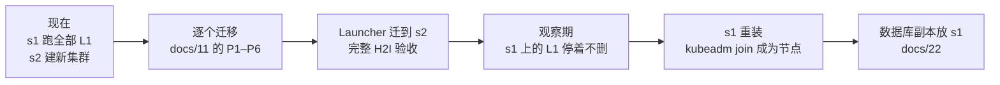

# 21. 第三轮决策：s1 的去向、命名、GPU、项目目录

日期：2026-11-17。状态：决策，没有实测。依据是用户 2026-11-17 的第三轮答复，以及对 L1 `mx-base/README.md`、`mx-launcher/docs/` 的只读核对。修订 `docs/16` 里关于 GPU 的一行、`docs/17` 的站点命名、`projects/README.md` 的目录结构；`docs/15` 的第 5、13 项就此关闭。 2026-11-17 第四轮："项目目录"拆成 `services/` 和 `projects/`，GPU 拆卡不排进计划，见 `docs/27`。

## 结论

1. **s1 的路线确认**：现在不动。s2 一步步接住 s1 的全部服务，切换并稳定运行后，s1 重装、作为节点加入 s2 的集群。这就是 `docs/16` 的阶段 B，不变。
2. **各项目的部署清单放本工程的 `projects/`。** `de-mingxi` 是上一版的部署仓，保留不动，只引用。
3. **GPU 一共 4 块 RTX 5090，现在全在 s1；s2 到位后每台 2 块。** L1 的 `.env.gpu` 里出现 GPU 3 是对的（编号 0–3）。
4. **命名沿用 L1**：Launcher、Hub、DataPort、mx-common、mx-base 里各服务的名字，Internal / Domestic / Oversea 三个站点名，原样使用。只有 L2 新增的东西才起新名字。
5. **平台服务按 mx-base 的样子组织**：一个服务一个目录，各有自己的 `README.md`、`deploy/`、`scripts/manage.sh`。
6. etcd 和 flannel 不在请求路径的瓶颈位置上，1000 QPS 不会让它们先出问题。说明在本篇后半。

## s1 的路线



两个要点：

- **s1 并入之前，L1 集群必须已经没有在用的服务。** L1 的脚本要求单节点（`docs/16`），所以不存在"s1 一边跑 L1 一边加入新集群"的中间状态。
- **观察期内 s1 的数据不动。** 重装之前，s1 上的数据库、etcd、凭据都要有一份通过校验的备份在 NAS 和 OSS（`docs/19`），并且在 s2 上实际还原过一次。重装是本工程里唯一会让旧数据消失的步骤，由人执行，不写进脚本。

并入之后 s2 是控制面，s1 是节点。两台都坏不了的东西只有数据库副本和备份，见 `docs/22`。

## GPU

| | 现在 | s2 到位后（规划） |
|---|---|---|
| s1 | 4 块（编号 0–3） | 2 块 |
| s2 | 没有 | 2 块 |

L1 的 `mx-base/README.md` 写着：显示器用 GPU 3，OCR 默认 GPU 2，Embedding 默认 GPU 1（实际有一个沿用 GPU 3 的共享实例）。容器里记的是 GPU 的 UUID，不是编号。

**拆卡之前要做的事**（会影响 L1 的 OCR 和 Embedding，不影响 MX-H2I：L1 文档写明登录、网络、DNS 不依赖这些服务）：

1. 在 s1 上记下每块卡的 UUID 和它上面跑的服务：`bash scripts/manage.sh gpu`（L1 的 mx-base 入口，只读）。
2. 决定哪两块留在 s1。接显示器的那块必须留下。
3. 拆走两块之后，s1 上剩下的卡编号会重排，`.env.gpu` 里的编号要跟着改；被拆走的那块上的服务起不来，要重新部署到留下的卡上，或者搬到 s2。
4. s2 的集群里装 NVIDIA 设备插件，服务声明要一块卡，由调度器分配（`docs/20`）。

哪两块留、OCR 和 Embedding 留在 s1 的 Compose 里还是搬进 s2 的集群，还没定，记在 `docs/15`。

## 命名

L1 的名字是和 Launcher 一起磨出来的，换名字只会让人对不上。规则：

| 类别 | 用的名字 | 出处 |
|---|---|---|
| 产品和服务 | Launcher、Hub、DataPort、mx-common、mx-pay、mx-static、mx-ocr、mx-embedding、mx-rig、mx-move、mx-device | L1 的目录名和命名空间名 |
| 站点 | Internal、Domestic、Oversea | Launcher 的站点模型 |
| 宿主机入口 | `host-nginx` | L1 的 `MX_INTERNAL_GATEWAY_PORT80_OWNER=host-nginx` |
| L1 的应用网关 | `mx-internal-gateway`（Caddy） | L1 的 DaemonSet 名 |
| 产品 | MX-H2I、MX-H2O | Launcher |

L2 新增、L1 里没有对应物的，才有新名字：

| 新名字 | 是什么 | 为什么不能沿用旧名 |
|---|---|---|
| Gateway `public`、Gateway `internal` | 新集群的两个入口（`docs/18`） | L1 没有 Gateway API |
| `pg-common`、`pg-pay` | CloudNativePG 的两个数据库集群 | L1 的是单个 StatefulSet |
| 角色 control / node / site / edge | 一台机器在 L2 里做什么 | 这是角色，不是站点。见下 |

**站点和角色是两回事。** 站点说的是机器在哪：Internal、Domestic、Oversea。角色说的是它在 L2 里做什么。上一轮 `inventory/hosts.yaml` 里另起了一个站点名 `cloud`，这是多余的：租来的机器在国内就属于 Domestic，在海外就属于 Oversea。

| 角色 | 通常在哪个站点 |
|---|---|
| control、node | Internal |
| edge（公网入口） | Domestic |
| site（独立部署一套业务） | Domestic 或 Oversea |

### Launcher 管什么，L2 管什么

| | Launcher | L2（本工程） |
|---|---|---|
| 管的对象 | 人和网络 | 机器和集群 |
| 具体内容 | 身份、登录、MX-H2I / MX-H2O、产品网络、分流 DNS、订阅、Oversea 节点的 SSH 管理和同步、Launcher Admin | 集群节点、Gateway、数据库集群、各项目的部署、备份还原、磁盘和链路探测 |
| 远程机器 | Oversea 的代理节点、Domestic 的中继，已经由 Admin 的 Sync Remote 管理 | 只管在这些机器上部署**业务**。隧道、代理、订阅不重做，用 Launcher 发出来的 |

不确定一个东西归谁时，问一句：它坏了影响的是用户登录联网，还是业务服务。前者归 Launcher，L2 不碰。

## 项目目录：借鉴 mx-base

mx-base 的做法是一个服务一个目录，自带说明、部署文件和入口脚本，父级只负责找到它并转调。L2 的 `projects/` 照这个样子：

```text
projects/
└── <名字，和 L1 一致>/
    ├── README.md            # 第一段日期和状态；在哪台机器、数据在哪、怎么启停
    ├── deploy/
    │   └── k8s/
    │       ├── platform/namespace.yaml
    │       ├── base/
    │       └── overlays/production/
    ├── scripts/manage.sh    # 可选。status | plan | deploy | build（docs/12）
    └── docs/                # 可选
```

非 k8s 的项目把 `deploy/k8s/` 换成 `deploy/compose/` 或 `deploy/systemd/`，再加 `deploy/nginx/<域名>.conf`。

平台服务（PostgreSQL、Elasticsearch、HanLP、Redis、mx-embedding、mx-ocr、mx-static、mx-pay）和业务项目放在同一个 `projects/` 下，用 `inventory/projects.yaml` 的类别区分。集群自身的组件（flannel、Gateway、CloudNativePG 的 operator）留在 `infra/k8s/platform/`，因为它们不是"一个服务"，是集群的一部分。

`templates/project/` 已按这个结构调整，`manage.sh app` 相应改了路径。

## etcd 和 flannel 在 1000 QPS 时会不会成为瓶颈

不会，原因是它们都不随请求量增长。

**etcd 不在请求路径上。** 一个请求从入口到 Pod 再到数据库，全程不读写 etcd。etcd 只在集群里的对象变化时才写：发布、Pod 启停、节点心跳、选主的租约。它的负载取决于有多少节点、多少 Pod、多久发布一次，和每秒多少请求无关。两三台机器、几百个 Pod 的集群，etcd 的写入量很小。

etcd 怕的是磁盘慢：它每次写都要等落盘。和数据库、构建放在同一块盘上，别人把磁盘读写打满时它会超时，表现为控制面卡顿、`kubectl` 变慢，**已经在跑的服务不受影响**。所以才要给它单独的卷或小 SSD（`docs/16`）。要盯的指标是 etcd 的 WAL 落盘耗时，99 分位超过 10 毫秒就要查（阈值出自 etcd 官方的硬件建议）。

**调度器也不在请求路径上。** 它只在新建 Pod 时工作一次。

**flannel 的开销很小。** 同一台机器上的 Pod 之间走网桥，不经过 flannel 的封装。跨机器才封装成 VXLAN，在内核里完成，每个包多 50 字节的头。千兆或万兆的内网里，1000 QPS 的流量离它的上限很远。

真正会在这个量级出问题的是下面这几处，都和 etcd、flannel 无关：

| 位置 | 现象 | 预防 |
|---|---|---|
| 连接跟踪表 | 短连接太多，内核丢包，日志里有 `nf_conntrack: table full` | 调大 `nf_conntrack_max`；入口到网关、网关到服务都用长连接 |
| 集群内 DNS | 每次调用都解析域名，默认配置下一次解析会发好几个查询 | 服务之间用长连接；必要时装节点本地 DNS 缓存 |
| host-nginx 到 NodePort | 不用长连接时本机端口耗尽 | `upstream` 里配 `keepalive`（样板已配） |
| 数据库连接数 | 每个 Pod 各开一批连接，副本一多就超过上限 | 连接池（`docs/06`） |
| MTU | 隧道里再套 VXLAN，大包被丢，表现为小请求正常、大响应卡住 | flannel 的 MTU 按最小的那段路径设 |

这些都要在压测时看（`docs/09`），现在都没测过。
