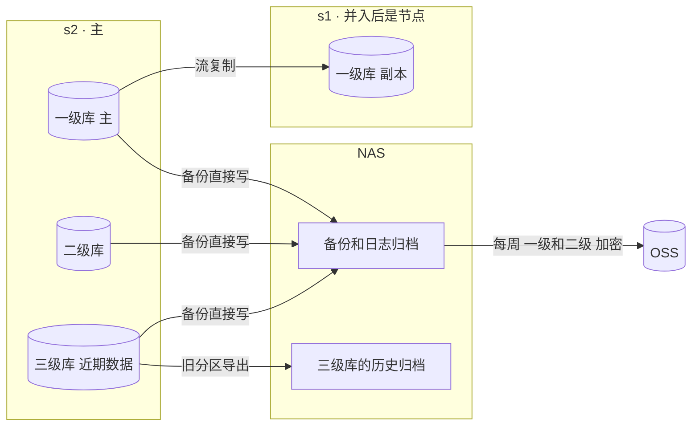

# 22. 数据库容灾分级与备份占用

日期：2026-11-17。状态：设计，没有实测。各个库的实际大小都还不知道（`docs/15`），本篇的容量只有公式，没有数字。修订 `docs/19` 的"存放和频率"一节（每日备份不再默认落本机盘）和 `docs/06` 里"每个库都配副本"的隐含假设。

## 要回答的两个问题

1. s2 给 s1 做灾备，程序和数据库都备份，s2 会不会变得和 s1 一样大、涨得一样快？
2. 数据量大，每天备份到本机，磁盘会不会涨得太快？放 NAS 行不行？

## 结论

1. **程序不占地方。** 镜像和代码能从源码重建，不算灾备的容量。占地方的只有数据库。
2. **副本和备份是两种东西，占用方式不同。** 副本是另一台机器上的一份在线拷贝，和主库一样大，一直是 1 倍。备份是历史，保留几份就是几倍。
3. **只有丢不起的库才配副本。** 按三级分，大头的原始数据不配副本，所以另一台机器不会长成第二个 s1。
4. **备份直接写 NAS，不落本机盘。** 本机只留小库的最近一份。大库用"每周一份完整的，加上持续归档的日志"，不每天整份导出。
5. **热库只留近期数据，旧的归档到 NAS。** 这是控制本机盘增速的主要手段。

## 三样东西的区别

| | 是什么 | 占多少 | 防什么 | 不防什么 |
|---|---|---|---|---|
| 副本 | 另一台机器上实时跟随主库的一份 | 主库的 1 倍 | 一台机器坏了，几分钟内切过去 | 误删。删除会同步到副本 |
| 备份 | 某个时间点的拷贝，加上之后的日志 | 保留份数 × 压缩后大小 | 误删、发布写坏数据、两台都坏 | 恢复要时间 |
| 归档 | 不再修改的旧数据，从热库移到 NAS | 压缩后 1 倍 | 热库无限增长 | 归档的数据查起来慢 |

"灾备"实际上是这三样的组合。全部库都配副本、每天整份备份、都不归档，才会出现"另一台和 s1 一样大"。

## 分级

| 级别 | 标准 | 副本 | 备份 | 传 OSS | 预计有哪些 |
|---|---|---|---|---|---|
| 一级 | 丢了无法重建，而且直接影响用户或钱 | 有，放另一台服务器 | 每天逻辑备份；日志持续归档，能恢复到任意时间点 | 每周 | Launcher 的身份库、mx-pay、Hub 的用户和租户数据 |
| 二级 | 丢了能重建但代价大 | 没有。坏了从备份还原 | 每周完整备份加日志归档 | 每周，如果大小允许 | Hub 的业务数据、DataPort、mx-rig |
| 三级 | 能重新采集或重新计算 | 没有 | 每周或每月完整备份到 NAS | 不传 | 宿主机 PG 的采集原始数据、清洗的中间结果 |
| 不备份 | 是别的数据的投影 | — | — | — | Elasticsearch、Redis |

每个库属于哪一级登记在 `inventory/projects.yaml`，由项目负责人定，不由平台猜。上表最后一列是我的推测，**没有和任何人确认过**。

一级库通常很小（用户、订单、配置），所以"每个一级库多 1 倍"加起来不大。大的是三级的原始数据，它不配副本。

## 两台机器各放什么



- 迁移期间（s1 还在跑 L1）：一级库的主库在哪台，副本就放另一台。Launcher 的库主在 s1，这时候不配流复制（那要改 L1），用每天的逻辑备份代替。
- s1 并入之后：s2 放所有主库，s1 只放一级库的副本和无状态服务。s1 的磁盘占用会比现在小很多。
- 第三台服务器来了之后：二级库也可以配副本，那时再定。

所以答案是：另一台机器的数据库占用约等于**一级库的总大小**，不是全部数据的大小。

## 备份放哪

每天把整个库导出一份放本机，保留 3 天，就是本机多占 3 倍，库越大越不可行。改成：

| 库的大小 | 做法 | 写到哪 | 本机占用 |
|---|---|---|---|
| 小（几十 G 以内） | 每天 `pg_dump -Fc`，自带压缩 | 直接写 NAS。本机只留最近 1 份，为了误操作后能最快还原 | 压缩后 1 份 |
| 大 | 每周一次 `pg_basebackup` 完整备份；日志（WAL）持续归档。PostgreSQL 17 起可以在两次完整备份之间做增量 | 全部直接写 NAS | 0 |

NAS 上的占用，按库估算：

```text
小库：压缩后大小 × （每日 14 份 + 每周 8 份）
大库：压缩后的完整备份 × 2 份 + 两次完整备份之间的日志量
```

压缩比和日志量都取决于数据本身，要在第一次备份后实测，这里不估。NAS 还有 26T 空闲，放得下；真正要注意的是三件事：

- **备份期间 NAS 在被顺序写**，同时读 NAS 的业务会变慢。定在凌晨，并限制备份的写入速度。
- **NAS 断开时备份会失败，日志归档会在本机堆积。** PostgreSQL 归档失败时不会丢日志，而是留在本机不删，磁盘会涨。要有告警：归档延迟超过 1 小时就报。
- **备份都在 NAS 上，NAS 就成了单点。** 一级和二级库每周加密传 OSS 就是防这个。三级库不传，NAS 坏了就重新采集，这是分级时已经接受的代价。

上传 OSS 受内网上行带宽限制。上行多少还不知道（`docs/15`）；知道之后才能算出每周能传多大的库，传不完的二级库降为每月传一次。

## 控制热库的大小

备份放 NAS 解决了备份占本机盘的问题。主库本身的增长靠归档：

1. 大表按时间分区（按月）。
2. 超过保留期的分区导出成压缩文件放到 NAS 的 `/mnt/nas/<项目>/archive/`，校验通过后登记。
3. 从热库里摘掉这个分区。**这一步由人确认后执行，脚本不自动删**（`CLAUDE.md` 的硬约束）。
4. 要查历史数据时，把归档文件导回一个临时库。

保留期由业务定。平台提供分区和归档的脚本模板，不替业务决定哪些数据算旧。

哪些表值得分区，要先看宿主机 PG 和 Hub 库里最大的几张表是什么，现在不知道。在库里查：

```sql
SELECT relname, pg_size_pretty(pg_total_relation_size(relid))
FROM pg_catalog.pg_statio_user_tables
ORDER BY pg_total_relation_size(relid) DESC LIMIT 20;
```

## 对 docs/19 的修订

| 原来 | 现在 |
|---|---|
| 每天备份到本机 `/data/backup`，保留 3 天，再同步到 NAS | 直接写 NAS。本机只留小库和 etcd、凭据、配置的最近 1 份 |
| 每个库都做逻辑备份加物理备份 | 小库做逻辑备份；大库做物理备份加日志归档 |
| 每周把最新一份传 OSS | 只传一级和二级 |

`inventory/backup.yaml` 已按这个改。备份和还原的命令仍然没有实现。
