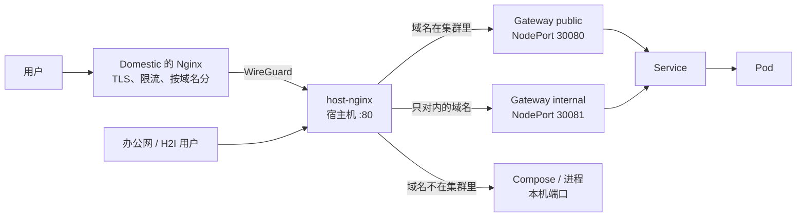

# 23. 两层 Nginx：host-nginx 和集群里的 Gateway

日期：2026-11-17。状态：设计，没有实测。补充 `docs/05` 和 `docs/18`，结论不变，这里把两层各自的名字、职责和"集群重启时会怎样"说清楚。

## 要回答的问题

Caddy 换成 Nginx 之后：宿主机上是不是还要一个 Nginx 给不在集群里的程序做反代，让集群重启时别的业务不受影响？流量进了集群之后，是不是由集群里的 Nginx 反代到各个服务？还是集群有更好的配套方式？

## 结论

1. **两层都要，各有名字。** 宿主机上的叫 `host-nginx`（沿用 L1 的名字），集群里的是 Gateway `public` 和 Gateway `internal`。
2. **host-nginx 不依赖集群。** 它是 systemd 管的普通进程。集群重启、升级、坏掉，不在集群里的程序照常访问。
3. **集群里那层不用手写 Nginx 配置。** 这就是集群的配套方式：每个项目提交一份 HTTPRoute，网关的控制器把它翻译成 Nginx 配置并热加载。底下跑的仍然是 Nginx。
4. Caddy（L1 的 `mx-internal-gateway`）的职责最后由 Gateway `internal` 接手，时机不变：随 Launcher 迁移一起，见 `docs/18`。

## 一个请求经过的每一层

| 层 | 名字 | 在哪运行 | 配置是谁写的 | 它决定什么 |
|---|---|---|---|---|
| 公网入口 | Domestic 的 Nginx | Domestic，Compose | 人手写，在部署仓 | 证书、限流、哪个域名回哪个内网入口 |
| 宿主机入口 | `host-nginx` | 每台内网服务器，systemd | 人手写，每个域名一个文件 | 这个域名在不在集群里；不在的话转到哪个本机端口；缓存 |
| 集群入口 | Gateway `public` / `internal` | 集群里的 Pod | **自动生成**，来源是各项目的 HTTPRoute | 域名和路径对应哪个 Service |
| 服务 | Service | 集群 | 各项目的清单 | 这个服务现在有哪几个 Pod，轮流发 |

## host-nginx 为什么留着

| 理由 | 说明 |
|---|---|
| 80 端口只能有一个主人 | L1 出过 Caddy 和 Nginx 抢 80 的事故（`mx-launcher/docs/50`）。规则是集群里任何东西都不占宿主机的 80 / 443 |
| 不是所有程序都进集群 | Night-All、po-*、GPU 的 Compose 服务、以后别人不愿意容器化的项目，都由它直接转到本机端口 |
| 集群出问题时还有一层能说话 | 集群重启时，集群里的域名返回一个明确的维护页，而不是连接超时；不在集群里的域名完全不受影响 |
| 缓存放在这层 | 静态文件的磁盘缓存（`docs/25`）放在集群外，集群重启不丢 |
| 迁移的开关在这层 | 一个域名从"转到本机端口"改成"转到 30080"就是迁进集群，改回去就是回退。一行配置，秒级生效 |

代价是多一跳。本机回环转发的耗时在亚毫秒级（估算），相比它带来的隔离可以忽略；实际多少用 `manage.sh probe` 量（`docs/26`）。

### 集群重启时各类请求的结果

| 请求去哪 | 集群正常 | 集群控制面坏了（s2 的 apiserver 停了） | 网关或业务 Pod 所在的机器重启 |
|---|---|---|---|
| 不在集群里的程序 | 正常 | 正常 | 那台机器上的不通，别的机器上的正常 |
| 集群里的服务 | 正常 | **正常**。已经在跑的 Pod 和网关继续工作，只是不能发布和调度 | 有两台节点时 host-nginx 自动转到另一台的 NodePort；只有一台时返回维护页 |

第二列是常被误解的一点：控制面坏了不等于服务停了。

## 集群这一层：Gateway API

它和手写 Nginx 的区别在于**谁来改配置**：

| | 手写 Nginx | Gateway API |
|---|---|---|
| 加一个域名 | 平台的人改配置文件，重载 | 项目在自己的清单里加一份 HTTPRoute，和应用一起发布 |
| 权限 | 能改配置的人能改所有域名 | 项目只能给自己命名空间里的服务挂路由；网关只接受打了标签的命名空间 |
| 后端地址 | 写死地址，Pod 换了要改 | 写 Service 名，Pod 增减自动跟上 |
| 灰度 | 自己写权重 | HTTPRoute 里写两个后端和权重 |
| 换实现 | 重写全部配置 | 路由是标准格式，网关实现可以换，路由不用改 |

选的实现是 NGINX Gateway Fabric，所以数据面还是 Nginx，团队已有的 Nginx 经验（日志格式、超时、缓冲的含义）都用得上。

配套的东西，按需要再加，现在不装：

| 需要 | 工具 | 什么时候加 |
|---|---|---|
| 集群内证书 | cert-manager | TLS 现在在 Domestic 终结。内网要 HTTPS 时再加 |
| 按路由采样的链路追踪 | 网关自带的 OpenTelemetry 支持 | 探测和日志（`docs/26`）不够用时 |
| 推送 Git 即发布 | Argo CD | 项目多到 `manage.sh app apply` 管不过来时 |

## 名字对照

为了以后说话不混：

| 说法 | 指的是 |
|---|---|
| host-nginx | 某台内网服务器宿主机上的 Nginx。s1 有一个（现役），s2 有一个（新建） |
| `mx-internal-gateway` | s1 上 L1 的 Caddy，监听 8008 和 18090。在 MX-H2I 的登录路径上 |
| Gateway `public` | 新集群的公网入口，NodePort 30080 |
| Gateway `internal` | 新集群的内网入口，NodePort 30081 |
| Domestic 的 Nginx | 公网 443 那一层，不在内网 |

"网关"这个词单独出现时有歧义，文档里一律带上名字。

## 还没验证的

- 两台节点时 host-nginx 在两个 NodePort 之间的故障转移（`proxy_next_upstream`）只写了思路，样板配置里只有本机一个后端。
- 维护页还没写。
- NGINX Gateway Fabric 的版本是否支持 v1.36，仍未核对（`docs/15`）。
