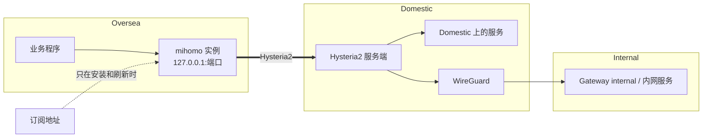
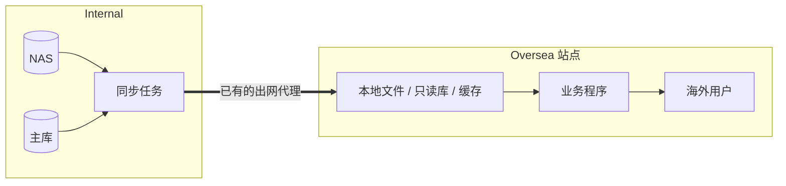

# 24. 隧道：WireGuard 会不会断、Hysteria2 能不能更快、Oversea 怎么访问内网

日期：2026-11-17。状态：设计，没有实测；协议之间的快慢没有在自己的线路上量过，本篇给的是原理和测法。依据：L1 的 `tunnel-cli/README.setup.md`（只读）、2026-11-17 的公开资料检索（文末）。修订 `docs/17` 的"隧道能不能加速"一节：那里说"隧道协议换来换去没有用"，对丢包严重的跨境线路不成立。 2026-11-17 第四轮：用户确认 Launcher Admin 能把 Domestic 当节点发订阅，见 `docs/27`。

## 结论

1. **WireGuard 没有"连接"可断，但会"不通"。** 原因都在线路和中间设备上，有固定的几种，都能监控和自动恢复。
2. **丢包严重的跨境线路上，Hysteria2 大概率比 WireGuard 快，比 OpenVPN 更快。** 线路干净时没有优势。这是原理推断加公开资料，不是实测。
3. **Hysteria2 是代理，不是网络。** 它适合"Oversea 上的程序调用几个 HTTP 接口"，不适合挂载 NAS、数据库复制这类需要一张网的用法。
4. **Oversea 走 Domestic 上的代理，能访问 Domestic 的服务，也能经它到内网。** 技术上可行，但等于在公网入口上开了一条通往内网的代理，必须限定能访问的目标。
5. **更稳妥的是反过来：用 Internal 已有的出网代理把数据推到 Oversea。** 不新增任何进入内网的路径。只在 NAS 上的数据也按这个方向处理。

## WireGuard 会不会因为网络情况断开

WireGuard 没有连接状态。两端各记着对方的公钥和地址，有包就加密发出去，没有"建立连接"和"断线重连"。所以它不会像 OpenVPN 那样掉线后重新握手几十秒，线路恢复后下一个包就通。

实际遇到的"不通"是这几种：

| 原因 | 现象 | 处理 |
|---|---|---|
| 中间的 NAT 设备忘了映射 | 一段时间没流量之后，公网一侧发不进来 | 在 NAT 后面的那端设 `PersistentKeepalive = 25` |
| 对端公网地址变了 | 一直不通，直到重启接口 | WireGuard 只在启动时解析一次域名。加一个定时任务，握手超时就重新解析并更新对端地址 |
| 运营商对 UDP 限速或丢弃 | 时通时不通，或者速度被压得很低，晚高峰更明显 | 换端口有时有用。跨境线路上最常见，协议本身解决不了 |
| MTU 不对 | 小包通，大包不通：能 ping，能建立连接，传大文件卡住 | 把接口 MTU 调小（常用 1380 或 1280） |
| 一端重启后没起来 | 完全不通 | systemd 开机自启；监控握手时间 |

Internal 到 Domestic 这一段在国内，L1 一直在用，属于前两种的概率大。跨境的是第三种。

监控只需要一个指标：`wg show <接口> latest-handshakes`。有流量的对端，握手时间超过 3 分钟就是不通了。这一项放进 `manage.sh probe`（`docs/26`）。

OpenVPN mesh 继续留着当运维的备用通道：WireGuard 不通时，至少还能通过它登录机器。

## Hysteria2 和 WireGuard、OpenVPN 比

| | WireGuard | OpenVPN（TCP） | Hysteria2 |
|---|---|---|---|
| 是什么 | 三层隧道，给你一张网 | 三层隧道 | 基于 QUIC 的代理，给你一个代理端口 |
| 在哪转发 | 内核 | 用户态 | 用户态 |
| 线路干净时 | 最快 | 慢 | 和 WireGuard 接近，CPU 占用更高 |
| 线路丢包时 | 里面的 TCP 遇到丢包就降速，吞吐掉得厉害 | 更差。TCP 套 TCP，两层都在重传 | 用自己的拥塞控制，按设定的带宽发，不因丢包降速 |
| 被 UDP 限速时 | 受影响 | 不受影响（走 TCP） | 受影响，但可以伪装端口 |
| 用法 | 程序无感，像在同一个内网 | 同左 | 程序要会用代理，或者开 TUN 模式 |

Hysteria2 快的原因：它在两端各自终结 TCP，中间那段丢包的线路用自己的协议传，丢了包不降速而是补发。公开资料里最严谨的一篇（2025 年 FOCI 论文）的结论是丢包率 20% 以上时它相对 BBR 有明显优势；没有找到它和 WireGuard、OpenVPN 在同一条线路上的对照测试。另一个要知道的点：带宽参数设得比线路实际能力大，效果反而变差，而且它会挤占同一条线路上别的流量。Domestic 只有 100 Mbps 峰值，上面跑 Hysteria2 时必须设上限。

**所以"会不会比 WireGuard 快"要测，不能猜。** 在 Oversea 和 Domestic 之间各跑一次，同一时段，晚高峰再测一次：

```bash
iperf3 -c <对端的 WireGuard 地址> -t 30                 # 走 WireGuard
iperf3 -c <对端的 OpenVPN 地址> -t 30                   # 走 OpenVPN mesh
QP_TUNNEL_MIXED_PORT=<端口> qp-tunnel-cli curl -o /dev/null -w '%{speed_download}\n' <一个大文件>   # 走 Hysteria2
```

三个数差不多，就用 WireGuard，因为它最简单。Hysteria2 明显快，就让 Oversea 上的 HTTP 调用走它。

## 你设想的方案：Oversea 订阅 Domestic 上的代理

按 `tunnel-cli/README.setup.md` 现有的机制理解：



逐条回答：

| 问题 | 回答 |
|---|---|
| 是不是只有安装或刷新订阅时才访问订阅地址，平时直连？ | 是。订阅只是一份配置。`qp-tunnel-cli install` 和 `update-subscription` 时拉取，之后数据直接发到节点。README 写明刷新失败时保留上一次的配置，所以订阅服务不可用不影响已经在跑的实例 |
| 比 WireGuard 快吗？ | 线路丢包多时大概率是，见上一节，要测 |
| 比 OpenVPN 呢？ | 几乎一定快。OpenVPN 走 TCP 时在差线路上最慢 |
| Oversea 的服务都走 Domestic 的代理，能访问 Domestic 的服务吗？ | 能。代理的出口在 Domestic，Domestic 能访问的它都能访问 |
| 能连到内网吗？ | 能，前提是 Domestic 到内网的 WireGuard 路由对这个代理的出口流量放行。内网域名要在出口一侧解析，客户端用 `socks5h://` |
| 反过来的架构可行吗？ | 可行，而且更好，见下一节 |

这个方案的问题：

- **Domestic 上多了一个能通往内网的代理服务。** Domestic 是公网机器。这个代理的账号泄露，或者服务端有漏洞，拿到的是内网的访问权。必须在 Hysteria2 服务端配访问控制，只放行列出来的内网地址和端口，其余拒绝。
- **和现有方向相反。** L1 里 Hysteria2 的服务端在 Oversea，Internal 是客户端，Launcher 的 Admin 管的也是这个方向的节点和订阅。在 Domestic 上架服务端是新的一类节点，Launcher 现在的"Oversea SSH 信息、Sync Remote、聚合订阅"是否直接支持，要看 Launcher 的实现，我没有核对。
- **流量挤 Domestic 的带宽。** 用户流量和这条回源流量共用 100 Mbps。

## 更稳妥的方向：从内往外推

Internal 现在已经能通过 Oversea 的 Hysteria2 节点出网（7788、7789 那两个代理实例）。数据同步用的就是这条路的同一个方向：



| | 从外往里拉（上一节） | 从内往外推（建议） |
|---|---|---|
| 进入内网的新路径 | 有 | 没有。连接都是内网发起的 |
| Oversea 被攻破的后果 | 能顺着代理访问放行的内网服务 | 只拿到已经推出去的那部分数据 |
| 用户请求的延迟 | 每次都跨境回源 | 读本地，和跨境线路无关 |
| 线路抖动的影响 | 用户直接感受到 | 只是同步慢一点 |
| 数据新鲜度 | 实时 | 有延迟，取决于同步频率 |
| 要改的东西 | Domestic 上架代理服务端、访问控制 | 写同步任务 |

### 只在 NAS 上的数据

| 情况 | 做法 |
|---|---|
| Oversea 要用的文件能提前知道（某个项目的目录、最近 N 天的） | 同步任务按目录推到 Oversea 的本地盘，或推到海外区域的 OSS 桶。增量同步，只传变化的 |
| 提前不知道要哪个文件，偶尔才取 | Oversea 上放一个带磁盘缓存的 Nginx，没命中时经隧道向内网的文件服务（`docs/25`）取一次，取回后缓存。这是唯一需要"从外往里"的情况，放行的目标只有这一个文件服务 |
| 量很大而且全都要 | 不适合放 Oversea。把这部分业务留在 Internal |

**不要跨隧道挂载 NAS。** NFS 在高延迟、会丢包的线路上，一次目录列表就是几十个来回；线路一断，硬挂载的进程全部挂住。

### 还要访问内网服务

先分清是哪种：

| 内网服务 | 做法 |
|---|---|
| 查数据（搜索、详情） | 推一份只读副本或导出的数据到 Oversea，本地查 |
| 必须实时的（登录校验、支付下单） | 经隧道调用 Gateway `internal` 上明确列出的那几个接口。调用方必须设超时，并且想好超时后怎么办 |
| 写入（用户在 Oversea 产生的数据） | 先写 Oversea 本地，异步送回内网。不要让用户的每次提交都等跨境往返 |

实时调用走哪条隧道，按上面的测试结果选。接口少、都是 HTTP，Hysteria2 更快时就用它；否则用 WireGuard。

## 资料

- [Hysteria2 与 BBR 在丢包线路上的对比（FOCI 2025）](https://www.petsymposium.org/foci/2025/foci-2025-0001.pdf)
- [Hysteria2 服务端配置和带宽参数的注意事项](https://lilting.ch/en/articles/hysteria2-server-client-overview)
- [WireGuard 和 OpenVPN 的速度对比](https://www.rtings.com/vpn/learn/wireguard-vs-openvpn)
