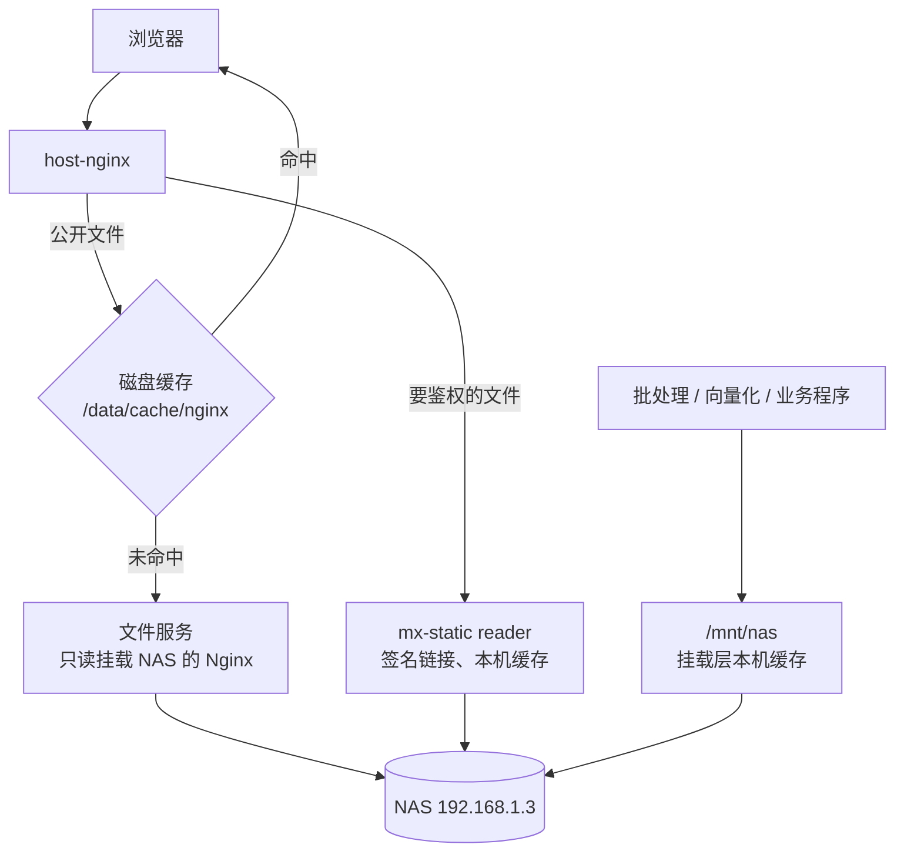

# 25. NAS 上的文件怎么更快地读，以及云上的 NAS 是怎么回事

日期：2026-11-17。状态：设计，没有实测。NAS 的型号、内存、网口、是否自带 HTTP 服务都没核对（`docs/15`）。云产品的信息来自 2026-11-17 检索到的 Google Cloud 官方文档（文末），没有查价格。细化 `docs/20` 的"业务怎么读写 NAS"一节，结论不冲突。

## 要回答的问题

资源在 NAS 上，极少数会上 OSS。是在集群这一层把静态文件的路由指到 NAS（`192.168.1.3`），还是把 mx-static 做完善，还是别的方案？Google Cloud 好像有机房里挂载的 NAS，速度像在同一台服务器上，那是什么，能不能用？

## 结论

1. **三种需求，三种做法，不是三选一。** 公开或半公开的文件走"host-nginx 加磁盘缓存"；要按用户鉴权、要签名链接的走 mx-static；程序自己读文件的继续直接读 `/mnt/nas`，平台在挂载这一层加本机缓存。
2. **不建议在集群的路由里直接指向 `192.168.1.3`。** 可以这样配，但 NAS 一慢，所有请求一起慢，没有缓存也没有超时兜底。中间要隔一层带缓存的 Nginx。
3. **云上的 NAS 快，是因为它和云主机在同一个机房、底下是 SSD。** 它解决不了内网这台 NAS 的速度；从内网去挂载它，速度由公网线路决定，比现在更慢。
4. **内网 NAS 慢的原因是机械盘随机读。** 对症的办法是让热文件不落到 NAS 上读：本机缓存，其次才是给 NAS 加 SSD 缓存或换万兆。

## NAS 为什么慢

| 环节 | 情况 | 影响 |
|---|---|---|
| 磁盘 | 机械盘（出自 `mx-static/docs/capacity.md`，待确认） | 顺序读每秒一两百兆，不慢。随机读每秒只有一两百次，许多人同时读不同的小文件时排队 |
| 内存 | 小（同上，待确认） | NAS 自己缓存不了多少文件 |
| 网络 | 千兆还是万兆没核对 | 千兆的上限约每秒 110 兆，大文件并发时会顶到 |
| 协议 | NFSv3，`rsize=524288` | 每打开一个文件要几个来回，小文件多时明显 |

所以批处理（顺序读大文件）不慢，在线服务（很多人随机读小文件）慢。优化的方向是：**热文件读本机盘，NAS 只在第一次读和冷文件时才碰。**

## 三种做法

### 一、公开文件：host-nginx 加磁盘缓存

适合图片、视频封面、下载包这类"知道地址就能看"的文件。

- 集群里（或宿主机上）起一个只读挂载 NAS 的 Nginx，叫**文件服务**，只做一件事：把 `/mnt/nas/<项目>/public/` 下的文件用 HTTP 发出来。
- host-nginx 把 `/files/` 这样的路径转给它，并开启磁盘缓存，缓存放本机 `/data/cache/nginx`。
- 命中缓存时根本不碰 NAS。没命中时读一次 NAS，回填缓存。
- host-nginx 对文件服务设超时，并配置"后端出错时返回过期的缓存"。NAS 断开时，缓存里有的文件照常能看，没有的快速失败，不会把 host-nginx 的进程拖住。

为什么不让 host-nginx 直接读 `/mnt/nas`：NFS 是硬挂载，NAS 不可达时读文件的进程会一直挂住。host-nginx 是所有流量的入口，不能让它的工作进程卡在 NAS 上。隔一层 HTTP，超时才管用。

**直接在路由里指向 `192.168.1.3`** 是这个做法的变体：如果 NAS 自带 HTTP 服务（群晖这类有），可以把它当文件服务用，省掉一个 Nginx。但要先确认 NAS 是什么型号、它的 HTTP 服务能不能只读地发布指定目录、并发多少。在确认之前按"自己起文件服务"设计，两者对 host-nginx 来说只是后端地址不同。

对外要大量分发的，仍然是同步到 OSS 加 CDN（`docs/17`），不走这条路。

### 二、要鉴权的文件：mx-static

"这个用户能不能看这个文件"是业务判断，Nginx 做不了。mx-static 已经有的能力正好是这一类：签名预览链接、内容哈希去重、流式下载、writer 和 reader 分开。

"完善 mx-static"要做的事（它现在是 Compose，没上线）：

| 事项 | 说明 |
|---|---|
| 上线 | 先按它自己的 Compose 部署在 s2，前面挂 host-nginx。进不进集群以后再说 |
| reader 的本机缓存 | 确认缓存目录在本机盘、有大小上限、会淘汰 |
| 读 NAS 的超时 | 确认 NAS 不可达时 reader 返回错误而不是挂住 |
| 容量 | 它的 `docs/capacity.md` 有估算，上线后用实际数字替换 |

它仍然是可选的（`docs/20`）：需要签名和鉴权的项目接它，不需要的走第一种。

### 三、程序自己读：挂载层加缓存

业务方有自己读 NAS 的方式，这些程序不改。平台能做的是在挂载这一层加速，对程序透明：

| 手段 | 效果 | 代价 | 状态 |
|---|---|---|---|
| Linux 的 NFS 本机缓存（挂载参数 `fsc` 加 `cachefilesd` 服务） | 读过的文件内容缓存在本机盘，再读时不走网络 | 只对读多写少的目录有用；缓存盘要留空间；会多一个要维护的服务 | 没试过。要在 s2 上实测效果再决定 |
| 挂载参数 `nconnect` | 一个挂载用多条 TCP 连接，并发读时吞吐更高 | 无。要求内核 5.3 以上，s2 的 Ubuntu 26.04 满足；s1 待确认 | 没试过 |
| 只读的项目单独用 `ro` 挂载 | 防误写；元数据缓存可以设得更久 | 无 | 设计 |
| NAS 上加 SSD 缓存盘 | NAS 自己的随机读变快，所有客户端受益 | 要买盘；取决于 NAS 型号支不支持 | 待确认型号 |
| 内网换万兆 | 大文件并发不再顶到千兆 | 网卡和交换机 | 先确认现在是不是千兆 |

前三项不花钱，s2 装好后先试这三项，用同一批文件对比读取耗时。

## 云上的 NAS

你记得的应该是 Google Cloud 的 **Filestore**：托管的 NFS 文件服务器，云主机像挂载普通 NAS 一样挂载它（NFSv3 或 NFSv4.1）。各家云都有同类产品。

| 产品 | 是什么 | 特点 |
|---|---|---|
| Filestore（Google Cloud） | 托管 NFS | 官方文档列的吞吐：基础档最高约 1.2 GiB/s，区域档最高约 26 GiB/s。可以通过 Cloud VPN 或专线从机房访问 |
| NetApp Volumes（Google Cloud） | 托管的 NetApp 存储 | 支持 NFS 和 SMB，功能更多（快照、克隆） |
| Cloud Storage FUSE | 把对象存储桶挂成目录 | 便宜，但不是完整的文件系统：官方文档说明不支持文件锁和硬链接，不适合当 NAS 用 |
| 阿里云 NAS、AWS EFS 等 | 同类的托管 NFS | 没有查，原理相同 |

**它为什么"像在同一台服务器上"**：文件服务器和云主机在同一个机房的同一张内部网络里，延迟不到 1 毫秒，底下是 SSD。快的原因是"近"和"SSD"，不是 NFS 协议有什么不同。内网这台 NAS 和服务器也在同一个机房，"近"已经有了，缺的是 SSD 和内存。

对这个项目：

| 想法 | 判断 |
|---|---|
| 内网服务器挂载云上的 NAS，代替本地 NAS | 不行。访问速度由内网到云的线路决定，延迟是几十毫秒，比本地机械盘还慢；而且按容量计费，32T 的量很贵（没查具体价格） |
| 把 NAS 的数据搬上云 | 只有业务整体搬上云才有意义。现在不是这个方向 |
| Oversea 站点在云上，站点自己用云 NAS | 可以，但通常没必要。站点的文件是从内网推过去的一份（`docs/24`），放站点的本地盘或对象存储就够了。多台站点机器要共享同一批文件时才需要云 NAS |

能借鉴的是它的思路：**文件存储和计算放在同一个机房，热数据在 SSD 上。** 对应到内网就是上一节的本机缓存和 NAS 加 SSD 缓存。

## 选哪种

| 文件是什么 | 用哪种 |
|---|---|
| 网页上直接显示的图片、封面，不需要登录就能看 | 一 |
| 需要登录、按用户或租户授权的原件 | 二 |
| 对公众大量分发 | OSS 加 CDN |
| 程序内部处理用的（清洗、向量化、导出） | 三 |
| Oversea 要用的 | 推过去，见 `docs/24` |

## 资料

- [Filestore 的连接方式，包括从机房经 VPN 或专线访问](https://docs.cloud.google.com/filestore/docs/how-to)
- [Google Cloud 上各种文件存储方案的对比，包括吞吐和 Cloud Storage FUSE 的限制](https://docs.cloud.google.com/architecture/filers-on-compute-engine)
