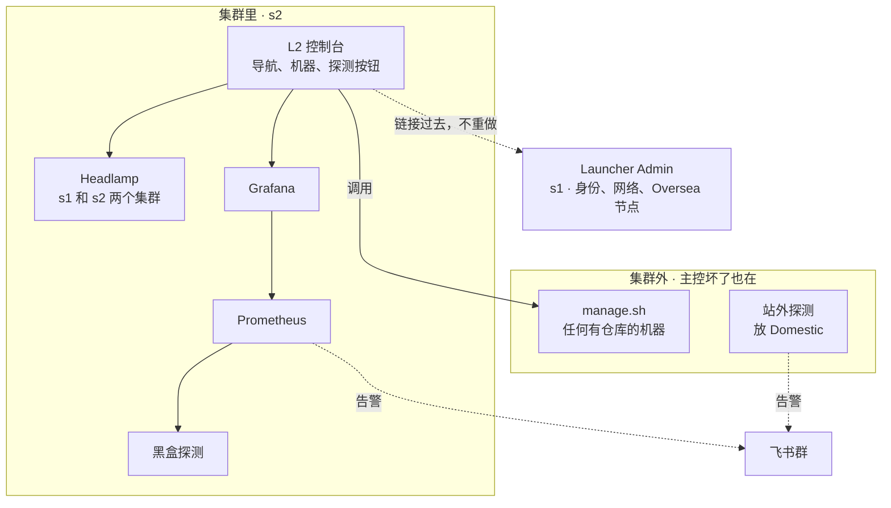

# 26. 管理面：用现成的工具，加一个薄的控制台和一键探测

日期：2026-11-17。状态：设计。`manage.sh probe` 已实现并在开发机上对公网地址跑通过；没有在任何服务器上、也没有对真实的链路跑过。控制台没有建。Neon Void 界面库已拷到 `console/ui-design/`。下面推荐的现成工具都没有安装过，版本没有核对。依据：L1 的 `mx-launcher/docs/52`（链路耗时量化方案）、`docs/38`（Neon Void 管理界面），2026-11-17 的公开资料检索（文末）。 2026-11-17 第四轮：各工具的作用、Launcher 的角色、自动化见 `docs/28`。

## 要回答的问题

1. 运维面能不能有一个按钮，一键测出一个请求在各段链路上花了多长时间？能不能用图呈现？
2. 管理后台是不是基于 Internal 的主控？主控宕机后，另一台会不会自动变成主控，后台还能打开吗？
3. 有没有体系完善的现成产品能覆盖这些，不过度设计的可以引进。
4. Launcher 的 SSH 设置和各种选项从上到下铺开，不好操作。

## 结论

1. **能。** 分三层做：随手测一次用 `manage.sh probe`（已有）；持续测并画图用 Prometheus 的黑盒探测加 Grafana；查某一个真实请求用各层日志里的同一个请求编号。
2. **主控宕机不会自动切换，这是不设见证机的直接后果**（`docs/16`）。业务不受影响，但集群里的管理界面可能打不开。所以"看得见"的那部分要有一份放在集群外面。
3. **引进三样现成的：Headlamp（看集群）、Prometheus 加 Grafana（指标、图、告警）、黑盒探测。** 自己只写一个薄的控制台，把它们和 `manage.sh` 串起来。不引进 Rancher、KubeSphere 这类整套平台。
4. **控制台按"对象"和"步骤"组织，不按"功能列表"组织。** 用 Neon Void。

## 管理面的组成



| 要做的事 | 用什么 | 自己写多少 |
|---|---|---|
| 看集群里有什么、日志、重启、回滚 | Headlamp | 不写 |
| 磁盘、内存、etcd 落盘耗时、网关的请求量和耗时 | Prometheus 加 Grafana，用 kube-prometheus-stack 这套现成的安装包和面板 | 只写告警规则 |
| 各段链路持续探测 | 黑盒探测（blackbox exporter） | 只写探测目标的清单 |
| 机器清单、项目清单、文档、图册 | 读 `inventory/`，链接到 `docs/atlas/` | 控制台的几个只读页面 |
| 加机器、部署项目、备份、还原 | `manage.sh` | 控制台只是给它套个界面 |
| 用户、身份、产品网络、Oversea 节点 | Launcher Admin | 不重做，链接过去（`docs/21`） |

### 为什么是这几样

| 工具 | 引进吗 | 理由 |
|---|---|---|
| Headlamp | 引进 | Kubernetes 官方的 Dashboard 已经归档停止维护，官方指向的继任者是它。一个界面能同时接 s1 和 s2 两个集群，正好对应现在两个集群并存的阶段。可以装在集群里，也有桌面版 |
| kube-prometheus-stack | 引进 | 监控的事实标准，装上就有节点、Pod、etcd 的现成面板。占几个 G 内存，对 256G 的机器不是问题 |
| 黑盒探测 | 引进 | 它输出的就是"DNS、建连、TLS、等待、传输"各阶段的耗时，正是要的那张图 |
| 链路追踪（OpenTelemetry 加 Tempo 或 Jaeger） | 暂不 | 能看到一个请求在每个服务里的耗时，但要每个业务接入。探测和日志不够用时再加，网关那层已经支持 |
| Argo CD | 暂不 | 项目少，`manage.sh app apply` 够用 |
| Rancher | 不引进 | 它要接管集群的创建和升级，等于在 kubeadm 上再套一层要维护的平台。团队小、集群少，用不上它的治理功能 |
| KubeSphere | 不引进 | 中文界面是优点，但同样是整套平台，装上去的组件比业务还多 |
| Ansible | 可选 | "主控通过 SSH 配置别的机器"（`docs/17`）成熟的做法就是它。角色脚本现在只有几个步骤，先用 shell；超过十几个步骤或机器超过五六台时换成它 |

原则：**每引进一样，就少写一样；不引进需要另学一整套概念的东西。**

## 主控坏了会怎样

先说 Launcher：我在 `mx-launcher/docs/` 里没有找到"Internal 主从"或自动切换的设定。Launcher Admin 运行在 s1 的集群里，s1 坏了它就打不开，没有第二台接替。如果你说的主从是别的东西，告诉我在哪。

L2 这边：

| 阶段 | 控制面在哪 | s2 坏了 | 管理界面 |
|---|---|---|---|
| A、B（现在的设计） | 只有 s2 | 不会自动切换。s1 上已经在跑的服务继续跑，但不能发布、不能调度、坏了的 Pod 不会被重建 | 装在 s2 上的控制台、Headlamp、Grafana 全部打不开 |
| C（三台内网服务器） | 三台各一个 | 另外两台自动接管，不需要人操作 | 控制台是普通的无状态服务，会在别的机器上重新起来 |

两台机器做不到自动切换，这是 etcd 多数票的要求，和用什么管理软件无关（`docs/16`）。

阶段 A、B 的对策不是让管理界面高可用，而是让**最需要它的时候不依赖它**：

- **站外探测放在 Domestic。** 监控不能和被监控的东西一起坏。Domestic 上放一个很小的探测，定时访问几个公网地址和 WireGuard 握手状态，异常时直接发飞书。s2 整台坏了，这条告警照样能发出来。
- **`manage.sh` 不依赖集群。** 它在任何有仓库的机器上都能跑。s2 坏了，在 s1 或开发机上照样能 `probe`、看清单、执行还原。
- **还原步骤是文档加脚本**（`docs/19`），不在某个要先打开的网页里。

## 一键探测

### 测什么

一个请求从用户到 Pod 经过四层（`docs/23`）。从同一台机器，依次从每一层的入口打进去，请求的路径相同：

```text
① 公网域名                 → Domestic → 隧道 → host-nginx → Gateway → 服务
② host-nginx 的内网地址                          host-nginx → Gateway → 服务
③ Gateway 的 NodePort                                         Gateway → 服务
④ 服务的集群内地址                                                       服务
```

相邻两行总耗时的差，约等于被跳过的那一层花的时间：①减②是公网、Domestic 和隧道，②减③是 host-nginx，③减④是 Gateway。

每一行内部，再拆成 DNS、建立连接、TLS、等待首字节、传输五段。

### 基础探测的约定

各个应用的业务不同，但都提供同样的两个地址，探测才能统一：

| 地址 | 含义 | 用来测什么 |
|---|---|---|
| `/healthz` | 进程活着就返回 200，不访问数据库和别的服务 | 链路本身的耗时，不含业务 |
| `/readyz` | 检查自己依赖的数据库、缓存能不能连上 | 和 `/healthz` 的差就是依赖的耗时 |

L1 的 Launcher 入口已经有 `/healthz`（`mx-launcher/docs/52`）；别的服务有没有，没有逐个核对。项目模板里的健康检查路径现在是 `/`，接入时改成这两个。

### 命令

```bash
./scripts/manage.sh probe url https://example.com/healthz          # 测一个地址，默认 5 次取中位数
./scripts/manage.sh probe url http://192.168.1.4:30080/healthz --host hub.example.com
./scripts/manage.sh probe list                                     # inventory/probes.yaml 里登记的链路
./scripts/manage.sh probe route <名字>                             # 按上面的四行依次测，打印对比表
```

链路登记在 `inventory/probes.yaml`。每次探测带一个请求编号（`X-Request-Id: probe-…`），打印在结果里。

`probe` 是只读的：只发 GET 请求。某一层不通时显示"不通"并返回非零，不会显示成 0 毫秒。

### 三层手段各管什么

| | `manage.sh probe` | 黑盒探测加 Grafana | 请求编号加日志 |
|---|---|---|---|
| 什么时候用 | 现在慢不慢，慢在哪一层 | 过去一周什么时候慢过，哪一层在变差 | 某个用户说的那一次请求慢在哪 |
| 数据 | 人工触发的探测请求 | 每 30 秒一次的探测请求 | 真实的用户请求 |
| 图 | 终端里的表 | 每一层、每一段一条曲线 | 按编号查出各层的一行日志 |
| 状态 | 已实现 | 设计 | 设计 |

第三种是 `mx-launcher/docs/52` 已经定下的方法，这里沿用：入口生成请求编号，每一层原样往后传，并在自己的访问日志里记下编号和耗时。host-nginx 的日志格式要包含这几个字段：

```nginx
log_format ladder2 '$time_iso8601 $request_id $host "$request" $status '
                   'rt=$request_time uct=$upstream_connect_time '
                   'uht=$upstream_header_time urt=$upstream_response_time';
```

`rt` 是这一层总共花的时间，`urt` 是后面所有层花的时间，差就是这一层自己的开销。样板配置 `infra/nginx/host-ladder2.conf.example` 已加上。

**不要在 MX-H2I 用户的机器上做会断开重连的探测**（`mx-launcher/docs/52` 的保护边界）。`probe` 只发 HTTP 请求，不碰隧道、DNS 和路由。

## L2 控制台

### Launcher 那个页面的问题出在哪

"SSH 设置和各种选项从上到下铺开"，是把**一台机器的所有属性和所有操作**放在了同一个长表单里。使用的人每次只想做一件事，却要在整页里找到相关的那几项，还要自己判断先后顺序。

### 怎么组织

| 原则 | 做法 |
|---|---|
| 先选对象，再看它能做什么 | 左边导航是对象：机器、项目、数据库、备份、探测、文档和图。不是功能：SSH、部署、配置 |
| 进去先看状态，不是先看表单 | 一台机器的首页是：角色、是否在线、磁盘、最近一次操作的结果。设置项收在"编辑"里 |
| 有先后顺序的事做成步骤 | 加一台机器是四步：连接（地址和密钥）→ 检查（只读）→ 准备 → 加入。一屏一步，上一步通过才能下一步，每一步显示将要执行什么 |
| 不常改的和危险的分开放 | 连接信息填一次就折叠。还原、重装这类操作单独一个区域，要输入确认 |
| 界面只是 `manage.sh` 的外壳 | 每个按钮对应一条命令，界面上显示这条命令。界面坏了，照着命令在终端里一样能做 |

最后一条决定了控制台很薄：它没有自己的业务逻辑，不存自己的状态，机器和项目的事实仍然只在 `inventory/`。以后包装成受控端软件（`docs/17`）时，这层界面可以直接搬过去。

### 界面库

用 Launcher 的 Neon Void（`@qpjoy/ui-design-neon-void`，2.3.19）。已从 `mx-launcher/ui-design/` 拷到本工程的 `console/ui-design/`，以后随本工程演变，不再回头同步；来源和版本记在 `console/README.md`。这是 `CLAUDE.md` "不拷贝 L1 源码"的一个明确例外：它是界面库，不是业务代码，而且用户明确要求拷贝。

它已有的组件够搭上面的结构：`qp-shell` 和 `qp-sidebar`（左导航）、`qp-status` 和 `qp-tag`（状态）、`qp-setting-row`（设置项）、`qp-dialog`（确认）、`qp-code-block`（显示将要执行的命令）。步骤条没有现成的，要加。

### 现在有什么

| | 状态 |
|---|---|
| `manage.sh probe` | 有 |
| `console/ui-design/` | 已拷贝，没有改动 |
| 控制台页面 | 没有 |
| Headlamp、Prometheus、Grafana、黑盒探测的安装清单 | 没有 |
| Domestic 上的站外探测 | 没有 |

建的顺序：先装 Headlamp 和监控（装上就能用），再做控制台的只读页面，最后才是带按钮的操作页。

## 资料

- [Kubernetes 官方博客：从 Dashboard 迁到 Headlamp](https://kubernetes.io/blog/2026/06/01/dashboard-to-headlamp/)
- [Rancher 与 Kubernetes Dashboard 的功能对比](https://oneuptime.com/blog/post/2026-03-20-rancher-vs-kubernetes-dashboard/view)
- [NGINX Gateway Fabric 的链路追踪配置](https://docs.nginx.com/nginx-gateway-fabric/monitoring/tracing/)
