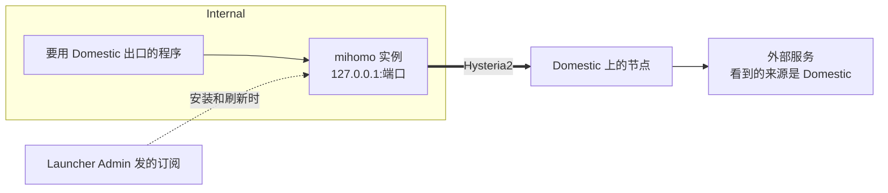

# 27. 第四轮决策：经 Domestic 出网、目录拆分、数据库实例怎么分

日期：2026-11-17。状态：决策，没有实测。依据是用户 2026-11-17 的第四轮答复。修订 `docs/21` 的"项目目录"和"GPU"两节、`docs/24` 里"在 Domestic 上架服务端是新的一类节点"的判断；`docs/15` 的 a–c 三项就此关闭。

## 结论

1. **Internal 出口地址要是 Domestic 时，用订阅加本地端口，不再用两层 Nginx 转发。** 用户确认：Launcher Admin 可以把 Domestic 当成一个节点来管理和发订阅；Hysteria2 服务端现在只在 Oversea，Domestic 上有没有要现场看。
2. **这条代理不适合传 NAS 上的视频和大文件给用户。** 它是"Internal 主动出网"的路，而且和用户流量共用 Domestic 的 100 Mbps。
3. **目录拆成两个**：`services/` 放 L2 自己负责的服务（从 L1 迁过来的 MX 项目和平台服务），`projects/` 只放别人的业务项目。
4. **GPU 怎么拆不固定，现在不考虑。** `docs/21` 的拆卡步骤留作以后参考，不排进计划。
5. **数据库不合并成一个实例。** 按"坏了影响谁"分成四五个实例；平台只管实例这一层，表结构和数据归业务。

## 经 Domestic 出网

以前为了让 Internal 的出口地址是 Domestic，做了两层 Nginx 转发。现在的机制本来就能做这件事：

做法和现有的 `xjp01` 实例一样（L1 的 `tunnel-cli/README.setup.md`）：`qp-tunnel-cli install --instance <名字> --mixed-port <端口> --node <节点全名> --url <订阅>`，程序把代理指到这个端口。

要守的几条：

| 事项 | 说明 |
|---|---|
| 每个实例一个名字、一个端口 | 7788、7789 已经在用。新的端口登记到 `inventory/hosts.yaml`，不靠记忆 |
| 订阅地址是凭据 | 不写进 Git、不出现在命令行历史。推送安装时在目标机器上读取 |
| 节点坏了请求就失败 | `--node` 固定出口后不会自动改走别的地区，这正是要的行为（出口地址不能悄悄变），但调用方要有超时 |
| 由 Internal 推送安装 | Internal 有所有机器的 SSH。把"装 qp-tunnel-cli、装订阅实例"做成角色脚本里的一步（`docs/17`），不再手工登录每台机器。还没实现 |

Domestic 上现在有没有 Hysteria2 服务端、Admin 里要怎么建这个节点，在现场确认（`docs/15`）。

### 大文件和视频

先分清方向。这条代理是 **Internal 主动向外发起连接**时用的（调第三方接口、拉镜像、同步数据）。用户看 NAS 上的视频是**外面进来的请求**，走的是 Domestic 的 Nginx 经 WireGuard 到内网，和订阅代理无关。

两条路最后都受同一个限制：Domestic 的带宽峰值 100 Mbps，流量按量计费（0.8 元每 GB，出自 `mx-launcher/docs/53`）。

| 问题 | 回答 |
|---|---|
| 代理本身传大文件行不行 | 行。它是流式转发，不会把文件读进内存，断点续传也正常 |
| 订阅限速有什么用 | 限速就是为了保护 Domestic 的带宽。Hysteria2 会按设定的速率发，不因为拥堵让路。不限速时一次大文件同步能把用户的请求挤慢 |
| 该不该不限速 | 不该。所有订阅的限速加起来，应该明显小于 100 Mbps，给用户流量留出余量 |
| 默认限速是多少 | 用户记得是 30 Mbps；README 里写的是 JP01 提示 50 Mbps。没有核对，按节点在 Admin 里看 |
| 30 Mbps 能看几路视频 | 1080p 按每路 5–8 Mbps 估算，四到六路。这是估算 |

所以视频和大文件给外部用户看，仍然是 `docs/25` 的结论：同步到 OSS 加 CDN，不经 Domestic。经 Domestic 只适合小文件和偶尔的访问。内网和 H2I 用户访问 NAS 上的文件不经过 Domestic，不受这个限制。

## 目录拆分

上一轮把所有东西都放进 `projects/`。用户指出 `projects/` 本来是给别人的业务项目进集群或做集成用的。拆开：

| 目录 | 放什么 | 谁负责 | 例子 |
|---|---|---|---|
| `infra/k8s/platform/` | 集群自身的组件 | 平台 | flannel、Gateway、CloudNativePG 的 operator |
| `services/` | L2 自己负责的服务：从 L1 迁过来的 MX 项目，和平台服务 | 平台 | mx-insight-hub、mx-dataport、mx-pay、mx-rig、host-pg、mx-embedding、mx-ocr、mx-static |
| `projects/` | 别人的业务项目 | 各项目自己，平台只建命名空间和配额 | 以后接入的项目 |

两个目录里每个服务的结构相同（`docs/21`，借鉴 mx-base）。`manage.sh app` 两个目录都找，名字不能重复。`services/` 里的名字和 L1 一致。

## 数据库实例怎么分

现状：mx-common 的 PostgreSQL 放的是 Hub 的业务数据；Launcher 有自己的库；mx-pay、mx-rig 各有自己的库；宿主机还有一个 PG。业务方各用各的。

### 平台管到哪

| 平台管 | 业务管 |
|---|---|
| 实例：在哪台机器、版本、参数、磁盘 | 库里的表、索引、迁移脚本 |
| 备份、还原、日志归档（`docs/22`） | 每个库属于哪一级 |
| 连接数上限、连接池 | 自己的查询写得好不好 |
| 监控和告警：磁盘、复制延迟、慢查询数量 | 慢查询怎么改 |

先只管架构层和平台自己的数据，是对的。别人的业务库，平台提供实例和备份，不看里面的内容。

### 多个实例好不好，要不要合成一个

不要全合到 mx-common 里。两种极端各自的问题：

| | 全部一个实例 | 每个应用一个实例 |
|---|---|---|
| 一个应用写出坏查询或占满连接 | 所有应用一起慢 | 只影响自己 |
| 恢复到某个时间点 | 整个实例一起回退，别的应用的数据也回去了。只恢复一个库要先还原到旁边再导出 | 各恢复各的 |
| 升级 PostgreSQL | 所有应用同一天升，一起回归 | 一个一个来 |
| 磁盘被日志撑满 | 全停 | 停一个 |
| 内存 | 省，只有一份缓存 | 每个实例各占一份 |
| 要管的备份、监控、版本 | 一套 | 很多套 |

折中的办法是**按"坏了影响谁"分组**：

| 实例 | 放什么 | 为什么单独 |
|---|---|---|
| Launcher 的库 | 身份、产品网络 | 在 MX-H2I 的登录路径上。不动，不和任何东西合并 |
| `pg-pay` | 支付 | 硬约束：独立、稳定 |
| `pg-common` | Hub、DataPort，各一个库 | 同一个团队、同一套发布节奏，本来就在一起 |
| `host-pg` | Night-All / po-infra 的采集原始数据 | 量大、三级数据，不该拖累别人的备份和恢复时间 |
| `pg-apps`（以后） | 别人的业务项目，每个项目一个库 | 别人的查询不能影响 Hub。项目少时先不建，放 `pg-common` |

mx-rig 的库很小，迁移时并进 `pg-common` 当一个库，少一个实例。

新集群里这些实例都由 CloudNativePG 用同一种清单创建，备份和监控是同一套配置，所以"实例多了难管"的成本比 L1 手工建的 StatefulSet 低。四五个实例是合适的数量；到十几个时再考虑合并小的。

Launcher 的库现在在 s1 的 L1 集群里，迁移排最后，在那之前平台只给它做只读的备份（`docs/19`）。
