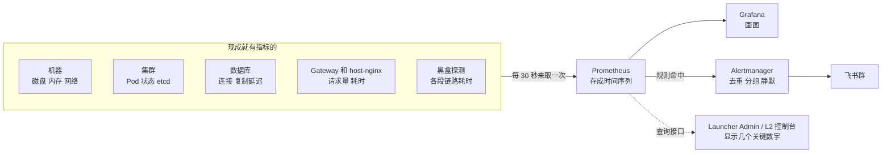

# 28. 监控用现成的还是 Launcher 自己做；自动化运维和测试放哪

日期：2026-11-17。状态：设计，没有安装和实测。资源占用的数字都是估算。L1 的 mx-test-framework 我只在 `mx-base/README.md` 里看到一句描述，没有读它的代码。补充 `docs/26`，结论不冲突。 2026-11-17 第五轮：Jenkins 挪到 L2 的运维面，见 `docs/30`。

## 结论

1. **Headlamp 很轻。** 一个无状态的 Pod，没有自己的数据库，估算占一两百兆内存。不用就删，不留痕迹。
2. **Prometheus 和 Grafana 不要求业务按它的格式改造。** 机器、集群、数据库、网关的指标都是现成的组件自动给出；业务什么都不做也有一套完整的监控。
3. **采集、存储、告警规则这三件事不要让 Launcher 自己做。** Launcher 可以做"看"的那一层：链接过去，或者查出几个关键数字显示在 Admin 里。
4. **不把 Launcher 当成集群的控制面。** Launcher 是门面，不是引擎。引擎是 kubeadm、`manage.sh` 和 Prometheus。
5. **自动化不绑定在某个 CI 产品上。** 每一步都是一条 `manage.sh` 命令，Jenkins、测试框架、Launcher 的按钮、人，调的是同一条。测试框架和业务分开。

## 各自是做什么的

| 组件 | 作用 | 一句话 |
|---|---|---|
| Prometheus | 定时到各处取数字，存下来 | 监控的数据库 |
| 各种 exporter | 把机器、数据库、Nginx 的状态变成 Prometheus 能取的格式 | 翻译 |
| Grafana | 画图 | 只读 Prometheus，自己不存监控数据 |
| Alertmanager | 告警发给谁、同一个问题别重复发、维护时静默 | 告警的调度 |
| Headlamp | 看集群里的对象、日志，点按钮重启和回滚 | `kubectl` 的图形界面 |

### 要不要按它们的格式来建

| 对象 | 要做什么 |
|---|---|
| 机器、集群、etcd、PostgreSQL、Gateway | 什么都不用做。安装包自带采集和面板 |
| 业务应用，只想知道活没活、慢不慢 | 什么都不用做。黑盒探测从外面访问 `/healthz`（`docs/26`） |
| 业务应用，想看自己的业务数字（队列长度、每分钟订单数） | 加一个 `/metrics` 地址，输出几行文本。各语言都有现成的库。可选，想加再加 |

所以不存在"所有项目都要按它的格式重建"。

### 压力大不大

两三台机器、几百个 Pod 的规模，整套（Prometheus、Grafana、Alertmanager、几个 exporter）估算占 2–4G 内存、不到 1 个核、保留 15 天数据用几十 G 磁盘。对 256G 内存的机器可以忽略。数据放 s2 本机盘，不放 NAS，不用备份（丢了只是丢历史曲线）。

### 告警能不能做好

能，这是它最成熟的部分：规则是文本，放在 Git 里；同一个问题合并成一条；能设"持续 5 分钟才报"；能在维护时静默。第一批规则：

| 规则 | 出处 |
|---|---|
| 磁盘超过 70% 提醒、80% 告警；按增速预测几天后写满 | `docs/20` |
| 备份超过 26 小时没更新；日志归档延迟超过 1 小时 | `docs/19`、`docs/22` |
| etcd 落盘耗时偏高 | `docs/21` |
| WireGuard 握手超过 3 分钟 | `docs/24` |
| 某条链路探测不通，或耗时是平时的几倍 | `docs/26` |
| NAS 挂载不可用 | `docs/25` |
| MX-H2I 的登录入口不通 | 硬约束，优先级最高 |

发到飞书要一个转发的小服务，Alertmanager 自己不支持飞书的消息格式。用哪个没有选定。

## 由 Launcher 自己做行不行

| | Launcher 自己做 | 用现成的 |
|---|---|---|
| 采集各种指标 | 每种（机器、etcd、PG、Nginx）都要自己写 | 现成 |
| 存历史、画曲线 | 要自己设计存储和查询 | 现成 |
| 告警规则、去重、静默 | 要自己写一个规则引擎 | 现成 |
| 界面和 Launcher 一致 | 是 | 不是。Grafana 是另一套界面 |
| 监控和被监控的一起坏 | 会。Launcher 在 s1，s1 坏了监控也没了 | 监控在 s2，再加 Domestic 上的站外探测 |
| 对 MX-H2I 的风险 | 往登录路径上的服务里加功能 | 不碰 Launcher |

效果能达到，但等于重写一遍监控系统，而且做出来的东西和 Launcher 的登录功能绑在同一个进程里。不值得。

**不冗余的分法**：

| 层 | 谁做 |
|---|---|
| 采集、存储、告警 | Prometheus 这一套 |
| 深入排查用的图 | Grafana |
| 日常看一眼的总览（几个关键数字、红绿灯） | Launcher Admin 或 L2 控制台，通过 Prometheus 的查询接口取数，用 Neon Void 画。不存数据 |

这样 Launcher 里看到的界面是统一的，背后没有重复造的东西。

### 要不要把 Launcher 当成集群和各服务的控制面

不建议，三个原因：

- **它在自己要控制的集群里。** 集群坏了，控制面先没了，正是最需要它的时候。
- **L1 的 Launcher 部署脚本要求单节点**（`docs/16`），它目前不理解多节点的集群。
- **它在 MX-H2I 的登录路径上。** 运维功能加得越多，发布越频繁，登录的风险越大。

可以做的是让 Launcher **当门面**：Admin 里加一个"L2"入口，按钮通过它已有的 remote-ssh 执行器去调 `manage.sh` 的命令，结果显示回来。逻辑仍然在 `manage.sh` 里，Launcher 不可用时在终端里照样能做。这一步放到 L2 的命令都稳定之后；在那之前 L2 控制台先独立做只读页面，不改 Launcher。

独立的 L2 控制台和"Launcher 里的 L2 入口"用的是同一个界面库和同一批命令，以后合并进去成本很低。现在不用二选一。

## 自动化运维和测试

问题是：以后的自动化做进 Launcher，还是引进 Jenkins、CI/CD、Git 流程，或者测试框架和业务分开设计。

**三样东西分开看：谁触发、谁执行、执行什么。**

| | 是什么 | 放哪 |
|---|---|---|
| 执行什么 | 构建、部署、探测、备份、压测的具体步骤 | `manage.sh` 和各服务自己的 `scripts/manage.sh`。唯一的一份 |
| 谁执行 | 一台能连到集群的机器 | s2，或以后的构建机 |
| 谁触发 | 人在终端、Launcher 的按钮、定时任务、代码合并 | 可以有很多个，都调同一条命令 |

这样控制链路不依赖任何一个产品。Jenkins 坏了，人照着同一条命令做。

| 工具 | 建议 |
|---|---|
| Git 流程 | 从简：主分支加标签就是一次发布。清单在 Git 里，部署的是某个提交。不引入多分支的流程 |
| Jenkins | L1 的 mx-base 里已经有，是可选的。需要"合并后自动构建"时用它当触发器和执行机，任务里只写一行调 `manage.sh`，不把逻辑写进 Jenkins 的任务脚本 |
| Argo CD 这类 | 暂不（`docs/26`） |
| 做进 Launcher | 只做触发和展示：按钮、进度、结果、历史 |

**测试框架和业务分开**，各管一段：

| 测什么 | 谁写 | 谁跑 |
|---|---|---|
| 业务功能对不对 | 业务项目自己，放在自己的仓库 | 测试框架（L1 的 mx-test-framework）调度，对着预发环境跑 |
| 服务活没活、链路通不通、慢不慢 | 平台，`manage.sh probe` 和黑盒探测 | 一直在跑 |
| 扛不扛得住 | 平台，`manage.sh loadtest`（没实现） | 发布前和扩容前 |
| 发布后验收 | 业务提供 `/healthz`、`/readyz` 和几条冒烟用例；平台在部署命令的最后调用 | 每次部署 |

业务和测试框架之间的约定只有两条：服务提供健康检查地址；测试用例能用一条命令对着一个指定的地址跑。框架换了，业务不用改。

mx-test-framework 现在能做到哪一步、和 Jenkins 怎么分工，我没有读它的代码，下次设计这部分之前要先看。
