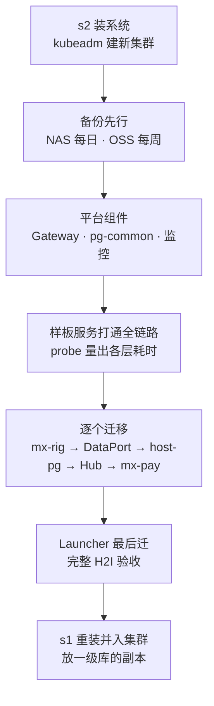

# 29. 交接：现在到哪了，下次从哪继续

日期：2026-11-17。状态：进度记录。四轮设计结束时写的，目的是下次不用重新描述背景就能接着做。每做完一批，新增一篇交接并在这里的状态行写"已被 NN 取代"。 2026-11-17 第五轮补充见 `docs/30`：运维面 `mx-ops`、内网 300 Mbps、`design/architecture/` 的图；"最需要用户提供的"里内网带宽一项已有答案。 2026-11-17 第六轮：海外的 toC 站点（arguseek、Delta 海外实例）见 `docs/33`，和 s2 无关，可以并行做；它的待确认事项是 `docs/15` 第 31、33、35–39 项；海外的 Delta 已定为给 arguseek 新开一个实例。区域按实测选、NAS 要能读写见 `docs/34`。 2026-11-19：**要在 s2 上动手，先读 `docs/35`**：14 个阶段，每个阶段 `node prepare` 做、`node verify` 验，最后每一层压 1000 QPS。下表第 5、6 项（角色脚本、flannel / local-path 清单）已写，`node join` 还没有；都没在 s2 上跑过。 2026-11-20：**Launcher 改为第一个在 s2 上复刻**，L1 源码拷到了 `ladder1/`，见 `docs/36`；下面"主线"图里"Launcher 最后迁"只剩切换这一步还排最后。 2026-11-21：加第二台 Domestic 和边缘推送工具 `qp-tunnel-cli edge`（写在 L1 的 tunnel-cli 里），见 `docs/37`；`ladder1/` 已移出本工程的 Git。 2026-11-21 第十轮：edge 按技术栈分目录（`wg-nginx`、`open-nginx`、`hy2-mihomo`），Hysteria2 服务端能推了，`edge status` 看本机和每台机器，Ubuntu 和 CentOS 分两族处理，见 `docs/38`；只在本机容器里实测过，L1 仓库里的改动没提交。新的待定事项是 `docs/15` 第 58–61 项。 2026-11-21 第十一轮：每台 Internal 都能当推送机（origin），机器记着谁管哪个组件、换推送机要 `--take-over`，`edge relations` 看关系，配置目录放推送机的 `/var/lib/qp-tunnel/edge`，有 v1 组件的机器整台不推，hy2 镜像固定，s1 是 CentOS Linux 8 且不换，见 `docs/39`；同样只在本机容器里实测过、没提交。待定事项是 `docs/15` 第 62–65 项。 2026-11-22 第十二轮：domestic02 到 internal02 的隧道照 L1 的 `10.88.0.1` / `10.88.88.88` 做成 `edge link`（`wg-nginx` 的回源改用它，站点可选），从 internal02 部署的命令见 `docs/40`；两台容器里实测过真 WireGuard，没提交，用户会发 npm 2.1.16 后在服务器上装。网段建议 `10.87.<n>.0/24`，待定（`docs/15` 第 53 项）；新增第 66 项（集群网段在 Launcher 产品网段范围里）。 2026-11-22 第十三轮：`10.*` 都归 Launcher 的应用，集群网段改成和 s1 一样的 `192.168.224.0/20` / `192.168.240.0/20`；边缘隧道改用 `100.127.(200+n).0/24`（domestic02 是 `100.127.202.0/24`）；网卡名改成 `qpjoy-*`；`qp-tunnel-cli edge setup` 一步步问、给默认值，缺的工具先问再装。见 `docs/41`。容器里实测过整个向导，没提交、没发 npm。 2026-11-22 第十四轮：用户发了 2.1.17，在 internal02 上跑 `edge setup` 时 domestic02 只有密码。照 v1 的 Bootstrap Key 加了密码登录：密码只输进 ssh 自己的提示，用一次装上推送机的 edge 密钥，之后都用密钥；提示行开头多出的 `[` 也去掉了。见 `docs/42`。要发下一个版本才有；2.1.17 上先用 `ssh-copy-id`。 2026-11-22 第十五轮：internal02 → domestic02 在真机上握不上手，最可能是阿里云安全组没放行 UDP 51820，还没确认。拓扑定为只走 Domestic → Internal（s1 先不加，nginx 分后端，DNS 分 Domestic），网段改成共享的 `100.127.200.0/24`（domestic02 `.2`，s2 `.89`）；`edge link check` 会说明握不上手的原因；`--replace` 重建隧道。见 `docs/43`，要发下一个版本才有。 2026-11-22 第十六轮：真机上 internal02 → domestic02 通了（2.1.17，`100.127.202.0/24`）。按用户要求，默认地址改回 Launcher 的编号：s2 `10.88.88.89`，domestic02 `10.88.0.2`，`10.88.0.1` 留给现在那台，只路由 `/32`；`100.127.200.0/24` 作为 isolated 方案保留，可以切换。见 `docs/44`。 2026-11-22 第十七轮：用户说 domestic02 `10.88.0.2` ↔ internal02 `10.88.88.89` 已通。**做 Launcher v2 和 MX-H2I v2 之前先读 `docs/45`**：控制面仍只有 s2，s1 以后作为 node 加入；组件不换，部署方式要改；先补镜像仓库、镜像、密钥、备份、smoke 的命令行；v2 客户端以 MinCave 为底。挡在最前的是 `docs/15` 第 45 项（镜像仓库）和第 56 项（ladder1 的版本记录），新的待定事项是第 67–72 项。 2026-11-22 第十八轮：**开始实施，不在 `ladder1/` 里改，一个个项目迁进本工程**（`docs/46`）：和 k8s 高度集成的平台放 `architecture/`，业务项目连源码放 `projects/`。第一个是 Launcher：从 L1 `1d9555e8` 拷到 `architecture/mx-launcher/`，写了 Dockerfile、`pg-launcher`、API、Caddy、HTTPRoute 的清单，`manage.sh` 加了 `image`、`secret`、`app status`，host-nginx 加了 18090 的入口；本机构建、迁移、启动、Caddy 和 nginx 的行为都测过，**没在集群上部署过**。在 s2 上的步骤见 `docs/46` 第 6 条。 2026-11-22 第十九轮：服务放哪台交给调度器，人只定 GPU、service peer、数据库、分散副本几类，`k8s capacity` 看依据；Launcher 去掉 Caddy（API 少一跳，应用网关换成 nginx）；部署改用 `app deploy`（检查 → 一次性步骤 → apply → 等滚动 → 验证，跑过的一次性步骤记台账、可归档）；host-runner 和分流 DNS 装上了，在 Launcher 管理界面上操作。发现 Launcher 把 `10.88.88.88` 写死成 Internal 的地址，s2 用 `.89` 要改代码，待用户定（`docs/15` 第 75 项）。都只在本机测过。见 `docs/47`。 2026-11-22 第二十轮：用户选了 A，`.88` / `.1` 是 Launcher 的角色地址，跟着角色走；s2 那套也用 `.88`，切换时换生产 Domestic 上这个对端的公钥；tunnel-cli 的 launcher 方案保留 `.88`，s1 以后的边缘地址是 `.87`（`docs/48`，tunnel-cli 要发下一个版本）。

## 现在到哪了

| 部分 | 状态 |
|---|---|
| 设计文档 01–28 | 写完。四轮：01–15、16–20、21–26、27–28 |
| `inventory/` | 主机、项目、备份、探测四份登记。标"待确认"的不是事实 |
| `infra/k8s/` | kubeadm 配置、两个 Gateway、`pg-common` 的清单。能渲染，没在集群上跑过 |
| `templates/project/` | 一个服务的样板，结构借鉴 mx-base |
| `services/`、`projects/` | 只有说明，没有任何服务 |
| `console/` | 只有界面库 Neon Void，没有页面 |
| `scripts/manage.sh` | 只读命令和 `probe` 可用；`node prepare/join`、`backup run`、`restore`、`loadtest` 没有实现 |
| 图册 `docs/atlas/` | 4 张，对应第二轮。第三、四轮的内容没有画 |
| 服务器上 | **什么都没做过。** s2 还没装 |
| Git | 没有提交过 |

## 已经定下来的主线

读这一节就够恢复上下文，细节在括号里的文档。

- 两个集群并存，s2 不加入 s1 的集群；kubeadm v1.36 加 flannel；不设见证机（`docs/16`）。
- s1 最后重装并入；命名沿用 L1；Launcher 管人和网络，L2 管机器和集群（`docs/21`）。
- 入口四层：Domestic 的 Nginx → 隧道 → host-nginx → Gateway `public` / `internal`（`docs/18`、`docs/23`）。
- 数据库按"坏了影响谁"分四五个实例，不合并；副本只给一级库；备份直接写 NAS（`docs/22`、`docs/27`）。
- 远程机器不进集群；Oversea 要的数据从内往外推；经 Domestic 出网用订阅加本地端口（`docs/17`、`docs/24`、`docs/27`）。
- NAS 文件三种读法；视频和大文件对外走 OSS 加 CDN（`docs/25`）。
- 监控用 Prometheus 这一套，Launcher 只当门面；自动化的每一步都是 `manage.sh` 命令（`docs/26`、`docs/28`）。
- 硬约束不变：不影响 MX-H2I 登录和联网；mx-pay 独立；不删旧数据。

## 下次从哪继续

按这个顺序。前三项不需要服务器，可以直接做。

| # | 做什么 | 产出 | 依赖 |
|---|---|---|---|
| 1 | 第一次提交 Git | 一个基线 | 用户同意 |
| 2 | 监控和 Headlamp 的安装清单，核对版本是否支持 v1.36 | `infra/k8s/platform/monitoring/`、`headlamp/`，第一批告警规则（`docs/28` 的表） | 用户同意引进（`docs/15` 第 26 项） |
| 3 | 控制台的只读页面：机器、服务、探测 | `console/` 下的静态页面，读 `inventory/` | 无 |
| 4 | `backup run`、`backup verify`、`restore plan` | 能对一个本地的测试库跑通 | 无。真正的库要等 s2 |
| 5 | 角色脚本和 `node prepare`、`node join` | `scripts/roles/` | s2 到位才能测 |
| 6 | flannel、local-path、NFS 卷、文件服务的清单 | `infra/k8s/` | 无，测试要等 s2 |
| 7 | 图册补第三、四轮的图 | 数据库分级、Oversea 数据流、管理面 | 无 |
| 8 | 读 L1 的 mx-test-framework，定测试这一段的设计 | 一篇新文档 | 无 |

s2 到位后的第一天：按 `docs/14` 装机 → `manage.sh doctor` → 建集群 → 装 Gateway → 样板服务 → `probe route sample`。

## 最需要用户提供的

完整列表在 `docs/15`。挡住后面设计的是这几个：

| 要什么 | 挡住什么 |
|---|---|
| 各个数据库的大小和最大的表 | 分级、备份方式、`host-pg` 放哪 |
| 内网上行带宽 | 每周能往 OSS 传多大；入口加几台有意义 |
| s1 的 `/home` 那 478G 是什么 | 磁盘规划 |
| NAS 的型号 | 文件服务用谁、能不能加 SSD 缓存 |
| Domestic 上有没有 Hysteria2 服务端；订阅的默认限速 | 经 Domestic 出网的做法 |
| 同不同意引进 Headlamp 和 Prometheus 这一套 | 第 2 项 |

## 接手时要知道的

- 所有文档都属于"源码或文档里写着"和"设计"，没有一条是在服务器上看到的。
- 两处说法不一致时以编号大的为准；旧文档的状态行标了哪部分被取代。
- 对 L1 的概念不确定时问用户，不要猜。用户说过这套方案是一步步调出来的。
- 第三、四轮的 Mermaid 图没有用渲染器验证过。
