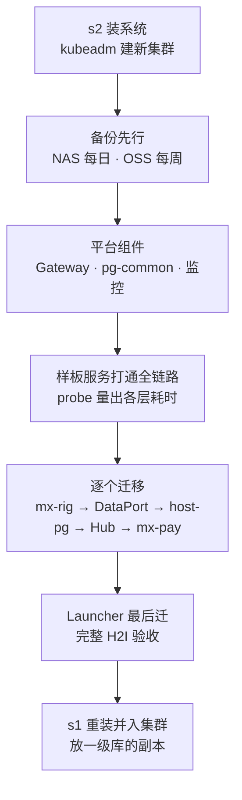

# 29. 交接：现在到哪了，下次从哪继续

日期：2026-11-17。状态：进度记录。四轮设计结束时写的，目的是下次不用重新描述背景就能接着做。每做完一批，新增一篇交接并在这里的状态行写"已被 NN 取代"。 2026-11-17 第五轮补充见 `docs/30`：运维面 `mx-ops`、内网 300 Mbps、`design/architecture/` 的图；"最需要用户提供的"里内网带宽一项已有答案。

## 现在到哪了

| 部分 | 状态 |
|---|---|
| 设计文档 01–28 | 写完。四轮：01–15、16–20、21–26、27–28 |
| `inventory/` | 主机、项目、备份、探测四份登记。标"待确认"的不是事实 |
| `infra/k8s/` | kubeadm 配置、两个 Gateway、`pg-common` 的清单。能渲染，没在集群上跑过 |
| `templates/project/` | 一个服务的样板，结构借鉴 mx-base |
| `services/`、`projects/` | 只有说明，没有任何服务 |
| `console/` | 只有界面库 Neon Void，没有页面 |
| `scripts/manage.sh` | 只读命令和 `probe` 可用；`node prepare/join`、`backup run`、`restore`、`loadtest` 没有实现 |
| 图册 `docs/atlas/` | 4 张，对应第二轮。第三、四轮的内容没有画 |
| 服务器上 | **什么都没做过。** s2 还没装 |
| Git | 没有提交过 |

## 已经定下来的主线

读这一节就够恢复上下文，细节在括号里的文档。

- 两个集群并存，s2 不加入 s1 的集群；kubeadm v1.36 加 flannel；不设见证机（`docs/16`）。
- s1 最后重装并入；命名沿用 L1；Launcher 管人和网络，L2 管机器和集群（`docs/21`）。
- 入口四层：Domestic 的 Nginx → 隧道 → host-nginx → Gateway `public` / `internal`（`docs/18`、`docs/23`）。
- 数据库按"坏了影响谁"分四五个实例，不合并；副本只给一级库；备份直接写 NAS（`docs/22`、`docs/27`）。
- 远程机器不进集群；Oversea 要的数据从内往外推；经 Domestic 出网用订阅加本地端口（`docs/17`、`docs/24`、`docs/27`）。
- NAS 文件三种读法；视频和大文件对外走 OSS 加 CDN（`docs/25`）。
- 监控用 Prometheus 这一套，Launcher 只当门面；自动化的每一步都是 `manage.sh` 命令（`docs/26`、`docs/28`）。
- 硬约束不变：不影响 MX-H2I 登录和联网；mx-pay 独立；不删旧数据。

## 下次从哪继续

按这个顺序。前三项不需要服务器，可以直接做。

| # | 做什么 | 产出 | 依赖 |
|---|---|---|---|
| 1 | 第一次提交 Git | 一个基线 | 用户同意 |
| 2 | 监控和 Headlamp 的安装清单，核对版本是否支持 v1.36 | `infra/k8s/platform/monitoring/`、`headlamp/`，第一批告警规则（`docs/28` 的表） | 用户同意引进（`docs/15` 第 26 项） |
| 3 | 控制台的只读页面：机器、服务、探测 | `console/` 下的静态页面，读 `inventory/` | 无 |
| 4 | `backup run`、`backup verify`、`restore plan` | 能对一个本地的测试库跑通 | 无。真正的库要等 s2 |
| 5 | 角色脚本和 `node prepare`、`node join` | `scripts/roles/` | s2 到位才能测 |
| 6 | flannel、local-path、NFS 卷、文件服务的清单 | `infra/k8s/` | 无，测试要等 s2 |
| 7 | 图册补第三、四轮的图 | 数据库分级、Oversea 数据流、管理面 | 无 |
| 8 | 读 L1 的 mx-test-framework，定测试这一段的设计 | 一篇新文档 | 无 |

s2 到位后的第一天：按 `docs/14` 装机 → `manage.sh doctor` → 建集群 → 装 Gateway → 样板服务 → `probe route sample`。

## 最需要用户提供的

完整列表在 `docs/15`。挡住后面设计的是这几个：

| 要什么 | 挡住什么 |
|---|---|
| 各个数据库的大小和最大的表 | 分级、备份方式、`host-pg` 放哪 |
| 内网上行带宽 | 每周能往 OSS 传多大；入口加几台有意义 |
| s1 的 `/home` 那 478G 是什么 | 磁盘规划 |
| NAS 的型号 | 文件服务用谁、能不能加 SSD 缓存 |
| Domestic 上有没有 Hysteria2 服务端；订阅的默认限速 | 经 Domestic 出网的做法 |
| 同不同意引进 Headlamp 和 Prometheus 这一套 | 第 2 项 |

## 接手时要知道的

- 所有文档都属于"源码或文档里写着"和"设计"，没有一条是在服务器上看到的。
- 两处说法不一致时以编号大的为准；旧文档的状态行标了哪部分被取代。
- 对 L1 的概念不确定时问用户，不要猜。用户说过这套方案是一步步调出来的。
- 第三、四轮的 Mermaid 图没有用渲染器验证过。
