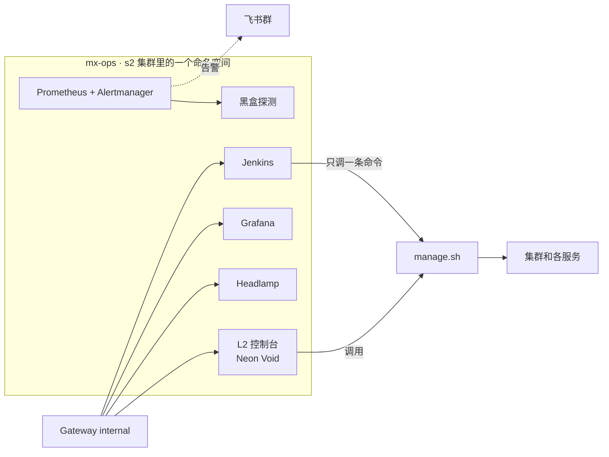

# 30. 运维面的归属、内网带宽、架构图

日期：2026-11-17。状态：决策和图。依据是用户 2026-11-17 的第五轮答复。运维面的组件都没有安装过；`design/architecture/` 的三张图通过了 Archify 的校验，三张都用无头浏览器截图看过。01 里有几条长连线穿过 s1 的区域，能读但不够整洁。补充 `docs/26`、`docs/28`；修订 `docs/28` 里"Jenkins 在 mx-base 里，需要时用它"的说法；`docs/15` 第 4 项就此关闭。

## 结论

1. **Jenkins 挪到 L2 的运维面**，和 Headlamp、Prometheus、Grafana、黑盒探测、L2 控制台一起规划。mx-base 里放的是业务项目，不再放它。
2. **运维面作为一组，起名 `mx-ops`**（暂定，等用户确认）：一个命名空间，清单放 `services/mx-ops/`。需要定制的部分做成 mx-* 的形式，不定制的直接用上游的安装包。
3. **内网带宽约 300 Mbps**（用户口述，上下行是否对称没有确认）。
4. 当前设计的架构图在 `design/architecture/`，三张。

## 运维面 mx-ops

| 组件 | 定制吗 | 说明 |
|---|---|---|
| L2 控制台 | 自己写 | `console/`，界面库 Neon Void |
| Headlamp | 不定制 | 上游安装包。接 s1、s2 两个集群 |
| Prometheus、Alertmanager、Grafana | 只写告警规则和几张面板 | kube-prometheus-stack |
| 黑盒探测 | 只写探测目标 | 目标来自 `inventory/probes.yaml` |
| Jenkins | 镜像和任务配置定制 | 从 L1 的 `mx-base/jenkins/`（Dockerfile、`casc.yaml`、`plugins.txt`）迁过来，那里已经是"配置即代码"。任务里只写一行调 `manage.sh`（`docs/28`） |

规矩：

- 全部只挂 Gateway `internal`，不对公网开放。
- 运维面坏了不影响业务；业务不依赖运维面里的任何东西。
- Jenkins 的构建会占大量磁盘和 CPU，给它单独的卷和资源上限，不和 etcd、数据库同盘（`docs/21`）。
- L1 的 Jenkins 现在在 s1 的 `mx-base` 命名空间（默认 NodePort 30880，L1 的 README 写着"未自动启用"）。迁移是在 s2 上新建，s1 上的不动；有没有正在用的任务要先在现场确认。

"定制的 mx-*"我的理解是：运维面这一组对外是一个有名字的整体（`mx-ops`），和 mx-common、mx-base 并列；里面的组件能用上游的就用上游的，只有控制台和 Jenkins 的配置是自己的。如果你的意思是每个组件都包一层成为独立的 mx-* 服务，告诉我。

## 内网带宽 300 Mbps 意味着什么

以下都是按 300 Mbps 上行算的，上行如果更小要重算。

| 事项 | 结论 |
|---|---|
| 公网入口加几台有意义 | Domestic 单台峰值 100 Mbps，所以最多三台。第四台起瓶颈在内网（`docs/17`） |
| 每周传 OSS | 满速约每秒 37 MB，一小时约 135 G（计算值，没有实测）。夜里 8 小时理论上能传 1T 左右。一级和二级库的备份传得完 |
| 备份上传和用户流量抢带宽 | 会。上传要限速，放在凌晨，给回源留余量 |
| 面向公众的站点回源 | 300 Mbps 是所有入口回源的总和。视频和大文件必须在 OSS 加 CDN，不回源 |
| Oversea 的数据同步 | 同样占这 300 Mbps，定时在低峰做 |

## 架构图

位置：`design/architecture/`，用浏览器打开 `.html`。源文件是同名的 `.architecture.json`。

| 图 | 回答什么 |
|---|---|
| `01-overview` | 外部流量和内部流量各走哪条路；宿主机、Docker、Kubernetes 里各放什么；s1 和 s2 的关系；NAS、OSS、Oversea 的位置 |
| `02-onboarding` | 自己的服务、别人的项目、Compose 应用、宿主机进程，各自怎么接到 host-nginx 和 Gateway；怎么部署 |
| `03-evolution` | 阶段 A、B、C；向外加入口和面向公众的站点；带宽上限 |

生成：`./scripts/manage.sh diagrams` 现在同时处理 `docs/atlas/` 和 `design/architecture/`。

和 `docs/atlas/` 的分工：`docs/atlas/` 是随各篇文档配的图，第二轮画的；`design/architecture/` 是当前整体设计的图，以后设计变了改这里。

图里没有画的：数据库的分级和副本（`docs/22`）、备份流向的细节（`docs/atlas/03-backup`）、运维面内部（本篇的 Mermaid）。
