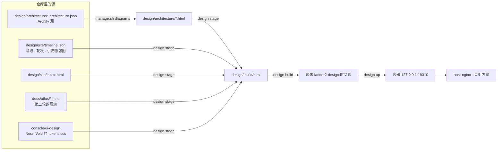

# 31. 架构图站点：打成 Docker 镜像，带演变时间线

日期：2026-11-17。状态：在开发机（macOS，Docker 28.0.4）上构建镜像、启动容器、访问每个页面都通过了，两种网络模式都试过。在 s1 上 `design build` 成功，第一版的 `design up` 失败（见"在 s1 上运行"），修改后的版本还没在 s1 上跑过。host-nginx 的转发没有配过。依据是用户 2026-11-17 第六轮的要求。 2026-11-17 修订：站点只是查看工具，不属于 L2 架构，见 `docs/32`。本篇里"放 s2、由 host-nginx 对内网转发、登记到 inventory、以后进集群挂 Gateway internal、版本写在 versions.env"的说法已被 32 取代。

## 结论

1. `design/` 打成一个只有静态文件的 Nginx 镜像 `ladder2-design`，在 s2 宿主机上用 Docker 运行，只监听 `127.0.0.1:18310`，由 host-nginx 对内网转发。
2. 首页是**演变时间线**：现状 → 阶段 A → 阶段 B → 阶段 C，点哪个阶段就在页面里看那个阶段的图；下面是每一轮设计定了什么。
3. 内容是数据，不是代码：改架构时改 Archify 的源文件和 `design/site/timeline.json`，重新 `design build`、`design up`。
4. 图和站点上不用"别人的"这类说法，统一叫"业务项目""协作业务"，或者直接举服务名。

## 结构



| 文件 | 作用 |
|---|---|
| `design/site/index.html` | 首页。读 `timeline.json` 画时间线和阶段面板，图用 iframe 嵌入；浅色或深色跟系统 |
| `design/site/timeline.json` | 阶段、每个阶段的说明和要点、引用的图、每一轮设计的记录 |
| `design/architecture/` | 五张图的 Archify 源和生成的 HTML；`gen.py` 是写这五个源文件用的脚本 |
| `design/deploy/Dockerfile` | `FROM` 的镜像版本由 `infra/k8s/versions.env` 的 `DESIGN_NGINX_IMAGE` 传入 |
| `design/deploy/default.conf.template` | 容器里的 Nginx：gzip、`/healthz`、不长期缓存。监听地址 `DESIGN_LISTEN` 在启动时填入，同一个镜像在开发机和服务器上都能用 |
| `design/deploy/compose.yml` | 公共部分：只读根文件系统、健康检查 |
| `design/deploy/compose.host.yml` | Linux 服务器：host 网络，只听 `127.0.0.1:18310` |
| `design/deploy/compose.bridge.yml` | macOS 开发机：Docker 自带的默认 bridge 加端口映射 |
| `design/deploy/host-nginx.conf.example` | host-nginx 的转发样板，只监听 LAN 地址 |
| `design/.build/` | `design stage` 组装出来的站点，不进 Git |

## 命令

```bash
./scripts/manage.sh diagrams                # 改了 Archify 源之后重新生成图
./scripts/manage.sh design serve            # 不用 Docker，本机预览 http://127.0.0.1:8310/
./scripts/manage.sh design build            # 组装并打镜像 ladder2-design:<时间戳>，同时标 latest
./scripts/manage.sh design up               # 在这台机器上启动（或换成新镜像）
./scripts/manage.sh design status           # 容器状态和 /healthz
./scripts/manage.sh design stop             # 停止，保留容器
./scripts/manage.sh design export           # 导出镜像成 tar.gz，带到不能联网或没有仓库的机器
```

`design stage` 会检查 `timeline.json` 引用的每一张图都存在，缺一张就失败，不会发布一个点开是 404 的站点。

## 部署到 s2

两种办法：

1. **服务器上有仓库**：`git pull`，`PROXY=http://127.0.0.1:7788 ./scripts/manage.sh design build`，`design up`。`PROXY` 的说明见下一节。
2. **服务器上没有仓库**：在开发机 `design build`、`design export`，把 tar.gz 拷过去，`gunzip -c <文件> | docker load`，再 `design up`（这一步需要仓库里的 `compose.yml`，或者照它手写一条 `docker run`）。

### 内网服务器出网：PROXY

```bash
PROXY=http://127.0.0.1:7788 ./scripts/manage.sh design build
```

构建里有两件事要出网，`PROXY` 只能管其中一件：

| | 谁去访问外网 | `PROXY` 管不管 |
|---|---|---|
| 拉基础镜像 `nginx:1.27-alpine` | Docker 守护进程 | **不管**。守护进程只认自己的代理配置，命令行传不进去 |
| Dockerfile 里的 `RUN` 步骤（现在没有，以后加了才有） | 构建容器 | 管。用 `--build-arg` 传入；代理在 `127.0.0.1` 时构建自动用宿主机网络，否则连不上 |

所以 `design build` 先检查基础镜像：

- 已经在本机：不拉，直接构建。第一次拉到之后，以后的构建都不需要出网。
- 不在本机、设置了 `PROXY`、守护进程却没配代理：直接失败，并列出三个办法：用 `sudo qp-tunnel-cli docker-build-proxy on` 让守护进程走代理；在能联网的机器上拉好再 `docker save` 拷过来；或者在开发机上打好整个站点镜像拷过来。
- 守护进程配了代理但不是 `PROXY` 那个：提醒一句，照常拉。

**`manage.sh` 不自动改守护进程的代理。** 改它要重启 `docker.service`，同一台机器上的 Compose 应用（mx-ocr、mx-embedding、mx-static）会跟着重启。这一步由人决定。

`design up` 只用本机已有的镜像，不会去拉。

**`design build` 只打镜像，不启动。** 2026-11-17 在 s1 上 `design build` 成功后直接访问 18310，连接被拒绝，原因就是还没有 `design up`。build 结束时现在会提示下一步。

### 在 s1 上运行要知道的

这个站点本来计划放 s2。s2 还没就绪，用户决定先在 s1 上展示（2026-11-17）。

**在 s1 上看到的（2026-11-17）**：第一版的 compose 会给项目新建一个 Docker 网络，`design up` 失败：

```text
failed to create network ladder2-design_default: Error response from daemon:
could not find an available, non-overlapping IPv4 address pool among the defaults to assign to the network
```

原因是 s1 上已经有很多网段（集群的 Pod 和 Service 网段、LAN、WireGuard、OpenVPN、已有的 Docker 网络），Docker 默认的地址池全都和它们重叠。**在 s1 上不要新建 Docker 网络。** 就算换一个地址池能建出来，也是在 s1 上加一块网卡、一条路由和一批 iptables 规则，碰到 `CLAUDE.md` 的硬约束。

**现在的做法：不建网络。**

| | Linux 服务器（默认） | macOS 开发机（默认） |
|---|---|---|
| 网络 | `network_mode: host`，和宿主机共用网络 | `network_mode: bridge`，Docker 自带的默认 bridge |
| 监听 | Nginx 直接在宿主机上听 `127.0.0.1:18310` | 容器里听 18310，端口映射到 Mac 的 `127.0.0.1:18310` |
| 新建 Docker 网络 | 不建 | 不建 |
| iptables | 不加规则，就是一个普通的本机进程 | Docker 加一条端口映射规则（开发机上无所谓） |

用 `DESIGN_NETWORK=host|bridge` 可以强制指定。macOS 不用 host 模式，是因为 Docker Desktop 的 host 网络默认不通到 Mac 本机。

在 s1 上：

```bash
git pull
PROXY=http://127.0.0.1:7788 ./scripts/manage.sh design build    # 镜像要重新打，旧镜像会被 design up 拒绝
./scripts/manage.sh design up
./scripts/manage.sh design status
```

`design up` 做的检查：

- 镜像是不是新版本（旧版本把监听地址写死在镜像里，拒绝启动）。
- host 模式下端口 18310 有没有别的程序在听，有就不启动，并显示是谁。
- 启动后 10 秒内 `/healthz` 不通，就打印容器最后 20 行日志并返回非零。

这样在 s1 上新增的只有一个只听本机回环的端口 18310，不改已有的端口、地址和 iptables 规则。

**从自己电脑上看。** 只听回环，别的机器访问不到。临时看用 SSH 端口转发：`ssh -L 18310:127.0.0.1:18310 root@<s1>`，然后打开 http://127.0.0.1:18310/ 。

**想让办公网直接打开**，要用户明确决定，因为这是在 s1 的 LAN 地址上开一个新端口：

```bash
DESIGN_BIND=192.168.1.2 ./scripts/manage.sh design up
```

s1 的防火墙如果拦着 18310，还要放行，那是 iptables 的改动，脚本不做。不经 s1 的 Caddy，也不给它加路由。

不再需要时 `design stop`，容器保留，端口随之释放。

然后在 host-nginx 加 `design/deploy/host-nginx.conf.example` 那段，域名用现有的内部后缀。

规矩：

- 只对内网开放。不挂 Gateway `public`，不经 Domestic。
- 不往 s1 的 Caddy 上加路由（`CLAUDE.md`）。s2 还没装之前，要给别人看就用 `design serve` 或在开发机上 `design up`。
- 端口 18310 登记在 `inventory/hosts.yaml` 的 s2 下。
- 以后集群稳定了，可以改成集群里的一个服务，HTTPRoute 挂 Gateway `internal`；镜像不用改。

## 更新架构的流程

1. 改设计：新增一篇 `docs/NN`。
2. 改图：编辑 `design/architecture/<名>.architecture.json`（或改 `gen.py` 再运行它），`./scripts/manage.sh diagrams <名>`。新的图要通过 Archify 的 showcase 校验。
3. 改时间线：在 `timeline.json` 里改阶段说明、加图的引用；`rounds` 里加一行，写清这一轮定了什么。
4. `design build`、`design up`。首页右上角显示生成时间和 Git 版本，带"有未提交的改动"的说明这版没有提交。

## 措辞

图和站点是给人看的，不用"别人的项目""别人的库"这类见外的说法：

| 不用 | 用 |
|---|---|
| 别人的项目 | 业务项目、协作业务，或直接写服务名 |
| 别人的库 | 业务项目库、业务各一个库 |

编号文档里仍有"别人的业务项目"的写法（`docs/27` 等），那是记录用户当时原话的上下文，不改写旧文档；新写的文档按上表。

## 已验证和没验证的

| | 状态 |
|---|---|
| 五张图通过 Archify 的 showcase 校验 | 是 |
| 开发机上构建镜像、启动容器 | 是。基础镜像 `nginx:1.27-alpine` |
| bridge 模式：页面、`/healthz`、容器健康检查 | 是，开发机 |
| host 模式：Nginx 只听 `127.0.0.1:18310`，不新建 Docker 网络（前后都是 23 个），容器健康检查通过 | 是，开发机上在容器里看的（Docker Desktop 的 host 网络从 Mac 访问不到） |
| 旧镜像被 `design up` 拒绝 | 是，开发机 |
| 在 s1 上 host 模式启动 | 否，等 s1 上重新 build 后再跑 |
| 首页、时间线、五张图、四张旧图册、`/healthz`、不存在的路径返回 404 | 是，在开发机上访问过 |
| HTML、JSON、CSS 走 gzip | 是。单张图约 850K，压缩后约 260K |
| 首页在内置浏览器里看过阶段 B | 是，浅色主题。深色和手机宽度没有看 |
| 在 s2 上拉镜像、运行 | 否 |
| host-nginx 转发 | 否 |
| `PROXY`：基础镜像已在本机时跳过拉取，带着代理参数构建成功 | 是，开发机 |
| `PROXY`：基础镜像不在本机、守护进程有代理时提醒并去拉；拉不到时给出三个办法 | 是，开发机（用一个不存在的标签试的） |
| `PROXY`：守护进程没配代理时直接失败 | 否。开发机的 Docker Desktop 自带代理，测不到这条路 |
| 7788 代理真的能拉到镜像 | 否。开发机上没有 7788 |
| Dockerfile 构建时有一条警告（`ARG` 没有默认值） | 是，不影响结果。版本只能从 `versions.env` 传入，这是故意的 |
