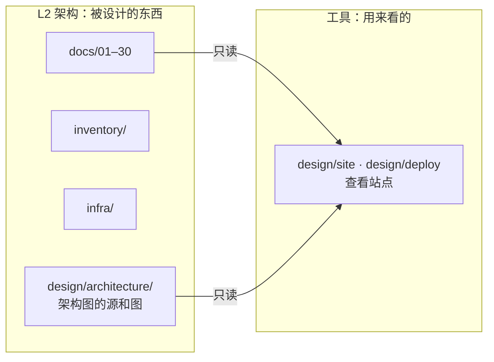
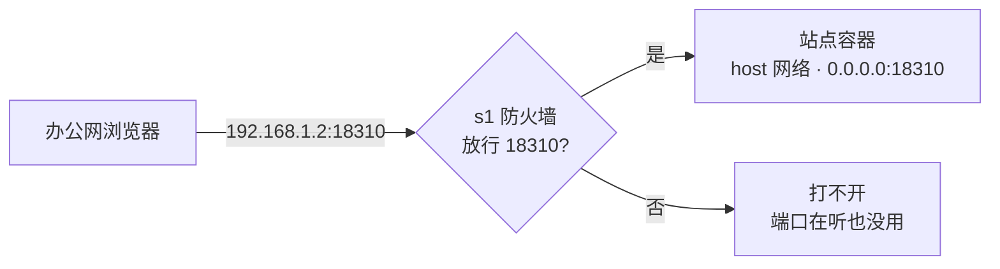

# 32. 查看站点只是工具，不属于 L2 架构

日期：2026-11-17。状态：决策。依据是用户 2026-11-17 的说明："这个 docker 应用主要是用来看当前项目设计文档的，应该不参与整体架构设计。"取代 `docs/31` 里把站点当成 L2 一个服务来部署的部分；`docs/31` 里怎么构建、怎么运行、为什么不建 Docker 网络、`PROXY`、措辞这些仍然有效。 同日修订：监听地址默认改为 0.0.0.0，见文末。

## 结论

`design/site/`、`design/deploy/` 和 `manage.sh design` 是**查看本工程设计文档和架构图的工具**，和 `docs/atlas/` 的图册、`manage.sh docs` 一样，服务于"读设计"，本身不是被设计的对象。

架构图（`design/architecture/`）仍然是架构内容，改设计时要同步改。站点只是把这些图和时间线摆出来给人看。

## 具体怎么处理

| 事项 | 以前（`docs/31`） | 现在 |
|---|---|---|
| 主机清单 | 18310 登记在 s1、s2 的 `inventory/hosts.yaml` | 不登记。`inventory/` 只放架构里的东西 |
| 版本号 | `infra/k8s/versions.env` | `design/deploy/design.env`。`versions.env` 只管集群清单 |
| 放在哪 | 计划放 s2，s2 就绪前临时放 s1 | 哪台方便放哪台：开发机、s1、s2 都行。不排进迁移路线 |
| 怎么访问 | host-nginx 对内网转发，以后进集群挂 Gateway `internal` | 不接 host-nginx，不接 Gateway。默认只听本机回环，用 SSH 端口转发看；要办公网直接打开，用户明确决定后用 `DESIGN_BIND` |
| host-nginx 样板 | `design/deploy/host-nginx.conf.example` | 删了 |
| 架构图和容量 | — | 不画进架构图，不算进容量和带宽预算 |
| 时间线的"设计轮次" | 第五轮写着"架构图做成可部署的站点" | 拿掉。轮次只记架构上定了什么 |

## 仍然要守的

站点不属于架构，但放在哪台机器上，就要守那台机器的规矩：

- 放 s1 时，硬约束照样适用：不新建 Docker 网络、只听 `127.0.0.1`、不改已有端口和 iptables（`docs/31` 的"在 s1 上运行"）。
- 不往 s1 的 Caddy 上加路由。
- 文档和图里不放密码、token，站点也就不会有。

## 还没做的

站点现在能看的是架构图和演变时间线；时间线里写的"依据：docs/16"只是编号，**`docs/` 下的设计文档本身还不能在站点里读**。既然站点的用途是看设计文档，这是下一步该补的，要用户确认后再做。

## 修订（2026-11-17）：默认监听 0.0.0.0

用户要求从其他机器能直接打开站点，不再走 SSH 端口转发。监听地址改为 `0.0.0.0`，写在 `design/deploy/design.env` 的 `DESIGN_BIND`。上面"怎么访问"一行里"默认只听本机回环"、"仍然要守的"里"只听 `127.0.0.1`"的说法由这条取代；不新建 Docker 网络、不改已有端口和 iptables 仍然有效。

| 设置 | 谁能打开 |
|---|---|
| `0.0.0.0`（默认） | 能到这台机器任一网卡的人：办公网，也包括经 WireGuard、OpenVPN 隧道到达的机器 |
| 这台机器的 LAN 地址，比如 s1 的 `192.168.1.2` | 只有办公网 |
| `127.0.0.1` | 只有本机，别处用 SSH 端口转发 |

临时换一种：`DESIGN_BIND=192.168.1.2 ./scripts/manage.sh design up`。

站点上只有架构文档和图，没有凭据，但有内网地址和端口这类信息，而且没有登录。只想给办公网看，用 LAN 地址比 `0.0.0.0` 更合适。

在 s1 上听 `0.0.0.0:18310` 是在 s1 上新增一个对外的端口。按 `CLAUDE.md` 的硬约束，这需要用户明确要求，用户这次的要求就是依据。不改已有的端口、地址和 iptables 规则。

**防火墙。** 端口在听，其他机器也可能因为防火墙打不开。`design up` 启动后会查 firewalld（CentOS 系，比如 s1）或 ufw（Ubuntu，比如 s2）有没有放行 18310，没有就提示放行命令。**脚本只查不改**：放行是 iptables 的改动，由人执行。

在开发机上验证过：默认设置下经 Mac 的 LAN 地址能打开首页和图；host 模式下容器里 Nginx 听 `0.0.0.0:18310`，健康检查通过。s1 上的防火墙状态没有看过。

