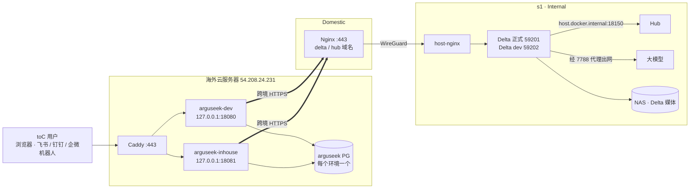
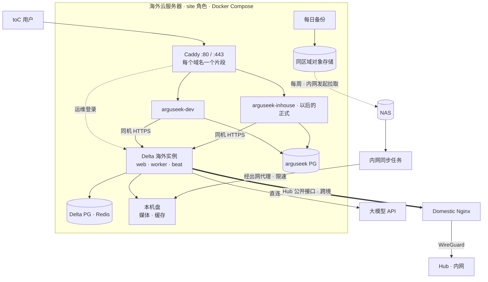
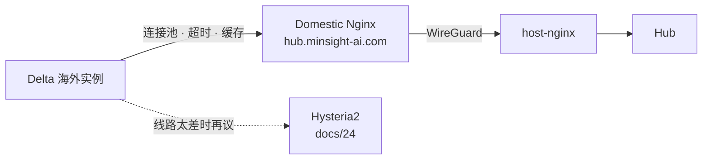

# 33. toC 海外站点：arguseek 和 Delta 放在海外云服务器上

日期：2026-11-17。状态：设计。依据是 arguseek 仓库的 `README.md`、`compose.yaml`、`ops/README.md`、`ops/lib.sh`、`backend/internal/config/config.go`，和 po-infra 仓库的 `docs/release_directories.md`、`docs/hub-internal-direct-and-web-threads-20261022.md`、`docs/dev_nas_migration.md`、`deploy/public-ghcr.env.example`（都只读）。全部属于"源码或文档里写着"：没有登录过这台云服务器，海外现在有没有 Delta 在跑也没核对。延续 `docs/17`（海外站点）、`docs/24`（数据从内往外推）、`docs/25`（NAS 的读法）、`docs/27` 和 `docs/30`（带宽）。 同日用户确认结论第 2 条：海外的 Delta 给 arguseek 新开一个实例（原 `docs/15` 第 32 项）。 同日第二次修订：站点区域不再默认美东、NAS 改为能读写，这两部分被 `docs/34` 取代。

## 要回答的问题

用户 2026-11-17：把 toC 的 arguseek 迁到本工程的 `projects/`；Delta（po-infra）也有一部分在海外云服务器上，云服务器可以买大一点；它们有一部分数据依赖 Hub，一部分依赖 NAS。这台海外云服务器上的架构怎么做；架构图里加一张专门的 toC 图。

## 结论

1. **海外云服务器是 Oversea 的一个站点，不进集群**（`docs/17` 的 `site` 角色，兼 `edge`：自己终结 arguseek 域名的 TLS）。arguseek 现在就在上面，arguseek 的发布脚本默认连 `54.208.24.231`（`ops/lib.sh`）。
2. **Delta 在这台机器上跑一个单独的实例，给 arguseek 用。** s1 上的正式（59201）和 dev（59202）不动。这样 arguseek 调 Delta、Delta 调大模型都留在海外，跨境的只剩调 Hub 和 NAS 上的数据。**不要把同一个 Delta 实例拆到两边**。
3. **调 Hub 走 Hub 已有的公开接口**（`hub.minsight-ai.com`，经 Domestic → WireGuard 回内网），凭 API Key，和合作方一样。不新开任何进内网的路。跨境时每个新连接都要多付几个往返，所以要复用连接、设超时、加缓存。
4. **NAS 上的数据由内网推出去，不跨境挂载 NAS。** 站点自己采集的新媒体就写站点本机盘；内网已有的历史文件按需推送，偶尔要的文件按需取一次再缓存。
5. **站点自己的数据都在本机盘**：两个应用各自的 PostgreSQL、Delta 的 Redis 和媒体文件。备份每天写同区域的对象存储，每周由内网拉一份回 NAS，连接都由内网发起。
6. **一台大机器加 Docker Compose，不装 Kubernetes。** 规格估算从 16 核 64 GiB、1 TiB SSD 起，按 s1 上 Delta 实际用量再定。
7. **arguseek 的登记和部署说明在 `projects/arguseek/`。** 源码不拷，发布仍用它自己的 `ops/`，谁开发谁部署不变。L2 管的是这台机器、备份、探测和跨境的那几条路。

## 现在是什么样

| 事实 | 出处 |
|---|---|
| arguseek：React SPA、Go 后端、PostgreSQL 16，Docker Compose | arguseek `README.md`、`compose.yaml` |
| 两个环境 `dev.arguseek.com`、`inhouse.arguseek.com`，各一个 Compose 项目，只听回环 18080、18081，Caddy 终结 TLS | arguseek `ops/README.md` |
| 密钥在服务器的 `/etc/arguseek/<环境>.env`，发布包在 `/opt/arguseek/<环境>/releases/` | 同上 |
| 发布脚本默认 SSH 到 `root@54.208.24.231` | arguseek `ops/lib.sh` |
| arguseek 只调 Delta，浏览器不直接持有 Delta 和 Hub 的凭据；默认 Delta 地址是 `https://dev.delta.minsight-ai.com` | arguseek `compose.yaml`、`docs/developer-onboarding.md` |
| 研究过程、报告文件都存在 arguseek 自己的 PostgreSQL 里，arguseek 本身不读 NAS | arguseek `README.md` |
| Delta 正式 59201、dev 59202，都在 Internal；公网域名经 Domestic 转进来 | po-infra `docs/release_directories.md`、de-mingxi `compass/deploy/README.md` |
| Delta 和 Hub 在同一台机器时，Delta 用 `host.docker.internal:18150` 直连 Hub | po-infra `docs/hub-internal-direct-and-web-threads-20261022.md` |
| Delta 调大模型先走 7788、7890 代理，最后直连 | po-infra `deploy/public-ghcr.env.example` |
| Delta 的采集媒体（`data_hub_raw_media`）正式环境在 NAS 上，约 937 GiB；部署脚本缺 NAS 就停 | `inventory/hosts.yaml`、po-infra `docs/dev_nas_migration.md`、`docs/developer-onboarding.md` |

现在每个研究都要跨境两次：arguseek 在美国（地址段看起来像 AWS 美东，没核对），Delta 在内网，Delta 调大模型又经代理出境。

## Delta 放在哪：跨境的分别是什么

| 链路 | Delta 在内网（现在） | Delta 在站点（建议） |
|---|---|---|
| arguseek ↔ Delta | 跨境。研究的事件流、轮询都跨，研究最长跑 1 小时 | 本机 |
| Delta ↔ 大模型 | 跨境。经 7788 出网，受订阅限速（`docs/27`），提示词和流式输出量最大 | 直连，不跨境 |
| Delta ↔ Hub | 本机 | 跨境。每次查询一个来回 |
| Delta ↔ NAS 媒体 | 本机挂载 | 不能挂载，要推或按需取 |
| 内网断电断网 | arguseek 整个不能用 | arguseek 能登录、看历史；新研究里查数据的那一步失败 |
| 站点坏了 | 内网不受影响 | 同左 |

大模型的流量最大，放在海外直连最划算；代价是 Hub 的调用跨境。Hub 的返回是 JSON，量比模型小得多（估算），可以用连接复用和缓存压下去。

**不要拆实例。** "一部分 Delta 在海外"如果是指 Celery worker 在海外、PostgreSQL 和 Redis 留在内网：一个任务要上百次数据库和队列的来回，每次都跨境，比整个实例留在内网还慢；线路一抖，队列里的任务全挂住。要放就整个实例放，数据库、Redis、worker、web 一起。

## 站点上放什么

| 组件 | 监听 | 数据在哪 | 谁发布 |
|---|---|---|---|
| Caddy | `:80`、`:443` | 证书 | L2 管主配置，各项目放自己的片段 |
| arguseek-dev | `127.0.0.1:18080` | 自己的 PostgreSQL（Compose 卷） | arguseek 的 `ops/deploy.sh` |
| arguseek-inhouse | `127.0.0.1:18081` | 同上，和 dev 分开 | 同上 |
| arguseek 正式 | 待定 | 同上 | 同上 |
| Delta 海外实例 | 回环的一个端口，由 po-infra 定 | 自己的 PostgreSQL、Redis、媒体目录，都在本机盘 | po-infra 的 `scripts/deploy_public_ghcr.sh` |
| 备份任务 | 不监听 | 写同区域对象存储 | L2 |

几条做法：

- **每个应用一个 Compose 项目**，只听回环，Caddy 是唯一对外的进程。安全组只开 80、443 和限定来源的 22。
- **Caddy 由 L2 管主配置**：主 Caddyfile 只 `import` 各项目的片段。arguseek 的 `ops/README.md` 本来就要求"共享主机上装成片段"，Delta 上来后按同样的办法加一个片段。
- **不装 Kubernetes。** 只有一台机器，k8s 带不来高可用，却要多管一个控制面；两个应用的发布、回滚、迁移检查都是围绕 Compose 写的，换成 k8s 要重写。以后要第二台站点机器时再议（`docs/08` 说过可以用单节点集群跑同一份清单的另一个 overlay）。
- **规格**：估算从 16 核、64 GiB 内存、1 TiB SSD 起。依据只是 Delta 的配置示例：PostgreSQL 上限 300 连接、`shared_buffers` 8GB，worker 并发 16–32。实际要在 s1 上看 Delta dev 实例的 `docker stats` 和磁盘用量再定。带宽和到国内的线路比 CPU 重要（`docs/17`）。

## arguseek 调 Delta

同一台机器，有两种接法：

| 做法 | 要改什么 | 说明 |
|---|---|---|
| 走 Delta 海外实例自己的 HTTPS 域名，Compose 里用 `extra_hosts` 把这个域名指到宿主机（`host-gateway`） | arguseek 部署时加一个 Compose 覆盖文件；`ARGUSEEK_DELTA_BASE_URL` 改成这个域名 | 证书照常校验，不绕公网。**建议这个** |
| `http://host.docker.internal:<端口>` | 同上，并设 `ARGUSEEK_DELTA_ALLOW_INSECURE_HTTP=true` | arguseek 只对回环地址放行明文 HTTP（`config.go` 第 499 行），容器到宿主机不算回环，要显式打开开关 |

切换时先切 dev，再切 inhouse。回退就是把 `ARGUSEEK_DELTA_BASE_URL` 改回 `https://dev.delta.minsight-ai.com` 重新发布。Delta 那边的 Agent 版本、会话在两个实例之间不通用，切换前要等进行中的研究跑完（arguseek 的发布脚本本来就会检查进行中的任务）。

## 调 Hub

- **走公开接口，不开新路。** Hub 本来就用 API Key 服务合作方，海外站点只是又一个调用方。站点用一把**单独的 Key**，配额单独设，站点上出了失控的循环也拖不垮 Hub。
- **连接复用是必须的。** po-infra 2026-10-22 的文档记着 Delta 每次调 Hub 都新建再关闭连接；现在改没改没核对。跨境时一次 TLS 新连接要多 2–3 个来回，美东到国内一个来回约 200–300 ms（估算），每次调用平白多出半秒以上。这是 po-infra 里的改动，由他们做。
- **超时和降级。** Hub 不通时，研究要明确报"数据源暂时不可用"，不能挂到 1 小时的研究超时。
- **缓存。** Delta 已经有按 Hub 地址分的时间线缓存（`DATA_QUERY_HUB_TIMELINE_CACHE_BASE_URL_ALIASES`）。海外实例用公开域名，缓存要单独预热。
- **先量再定要不要 Hysteria2。** 在站点上对 `hub.minsight-ai.com/healthz` 白天和晚高峰各量一次（`manage.sh probe url`）。丢包严重时才考虑 `docs/24` 的 Hysteria2，那要在 Domestic 上新架服务端，等于新开一条进内网的路，到时单独决定。
- **带宽。** Hub 的回包和所有用户共用 Domestic 的 100 Mbps，再共用内网约 300 Mbps 的上行（`docs/30`）。按 JSON 的量估算占比不大，上线后看 Domestic 的流量图核实。

## NAS 上的数据

**不跨境挂载 NAS。** 理由在 `docs/24`：跨境 NFS 一次目录列表几十个来回，线路一断，硬挂载的进程全部卡住。

| 数据 | 做法 |
|---|---|
| 海外实例自己采集下载的新媒体 | 写站点本机盘。Delta 的部署脚本对正式环境要求 NAS，海外实例要用本地存储模式（po-infra 的 dev 实例就是本地模式），这是 po-infra 那边的配置 |
| 内网已有的历史媒体，能按目录或日期圈出来的 | 内网的同步任务按目录增量推到站点（rsync，只加不删），经已有的出网代理，**限速**（`docs/30`） |
| 偶尔要一个文件，事先不知道是哪个 | 站点上一层带磁盘缓存的反代，没命中时经已有的公网入口取一次（要鉴权，走 Domestic），只适合图片 |
| 视频和大文件要给用户看 | 同步到对象存储加 CDN，不经 Domestic（`docs/25`、`docs/27`） |
| 站点产生、内网也要留档的 | 随每周的备份由内网拉回 NAS |

全量推过去不现实：937 GiB 按 30 Mbps 推要 3 天左右，按 100 Mbps 也要将近一天（估算），而且占满出网代理。所以先弄清海外实例到底要哪些目录（`docs/15` 第 33 项）。

## 数据库和备份

| 库 | 在哪 | 级别（`docs/22`，待业务确认） | 备份 |
|---|---|---|---|
| arguseek 各环境的 PostgreSQL | 站点本机，Compose 卷 | 用户账号和研究记录，按一级对待 | 每天 `pg_dump` → 同区域对象存储；每周内网拉一份到 NAS |
| Delta 海外实例的 PostgreSQL | 站点本机 | 二级 | 同上 |
| Delta 海外实例的 Redis | 站点本机 | 队列和缓存，可重建 | 不备份 |

- **身份 HMAC 密钥要和数据库一起保管。** arguseek 的邀请码摘要、飞书凭据的加密都派生自 `ARGUSEEK_IDENTITY_HMAC_SECRET`；只还原了库、丢了这把钥匙，等于数据还不回来。它放密码管理器，不进 Git，不明文放进备份桶。
- arguseek 发布前已经会备份数据库，但它的 README 写着"正式环境的自动备份还没做"。每日备份由 L2 补上，不改 arguseek 的发布脚本。
- 拉回 NAS 的任务在内网跑，经出网代理，限速。放 `/mnt/nas/backup/sites/<站点>/`，和 `docs/19` 的备份目录同一棵树。
- 还原演练在内网做：拿 NAS 上的备份起一个临时库，跑 arguseek 的迁移检查。

## 谁管什么

| 事 | 谁 | 用什么 |
|---|---|---|
| arguseek 的发布、回滚、邀请码 | arguseek 的开发者 | 它自己的 `ops/`（`projects/arguseek/README.md` 里有入口） |
| Delta 海外实例的发布、Agent 版本 | po-infra 的开发者 | `scripts/deploy_public_ghcr.sh` |
| 机器本身：系统、Docker、Caddy 主配置、安全组、磁盘 | L2 | 以后的 `manage.sh node`，现在手工，步骤记在本篇 |
| 每日备份、拉回 NAS、还原演练 | L2 | 以后的 `manage.sh backup`（`docs/19`，还没实现） |
| 探测和告警 | L2 | `inventory/probes.yaml` 登记公网地址；`mx-ops` 的黑盒探测，告警发飞书 |
| Hub 给站点的 Key 和配额 | Hub | Hub 的 Admin |

站点登录走 SSH，OpenVPN mesh 作备用（`docs/08`）。arguseek 现在用开发者自己电脑上的部署密钥，保持不变。

## 出问题时

| 情况 | 影响 | 怎么办 |
|---|---|---|
| 内网断电或断网 | 能登录、看历史项目和报告；新研究里查 Hub 的步骤失败 | Delta 明确报错；arguseek 页面提示数据源不可用 |
| Domestic 坏了 | 同上，另外内网的公网服务也一起断 | Domestic 的单点问题（`docs/17`） |
| 跨境线路抖 | 查 Hub 变慢、偶尔超时 | 连接复用、重试幂等的查询、缓存 |
| 站点机器坏了 | arguseek 和 Delta 海外实例全停；内网不受影响 | 新开一台，按备份还原。HMAC 密钥在密码管理器里 |
| 站点被攻破 | 拿到站点上的数据、Hub 的那把 Key | Key 单独、配额单独，能在 Hub 上一键吊销；站点没有进内网的路 |

## 落地顺序

1. **登记**（本篇已做）：`inventory/hosts.yaml` 的 `oversea-toc`、`inventory/projects.yaml` 的 `arguseek`、`projects/arguseek/`、`inventory/probes.yaml` 的两条链路、架构图 `06-toc-oversea`。
2. **现场核对，只读**：云厂商和区域、规格、磁盘、Docker 和 Caddy 的配置、上面已有的 Compose 项目，以及海外现在有没有 Delta 在跑。
3. **备份先行**：arguseek 两个环境的库每天备份，每周拉回 NAS，做一次还原演练。
4. **量跨境**：在站点上测 `hub.minsight-ai.com`，白天和晚高峰各一次。
5. **Delta 海外实例**：po-infra 按本地存储模式部署；单独的 Hub Key；大模型直连；先确认连接复用。
6. **切 arguseek-dev**，跑一轮完整研究验收；稳定后切 inhouse。
7. **按需推 NAS 数据**：先弄清要哪些目录。

这些都不碰 s1：不改 s1 的端口、地址和防火墙，不影响 MX-H2I 的登录和联网。

## 在本工程里放在哪

| 内容 | 位置 |
|---|---|
| 这台机器 | `inventory/hosts.yaml` 的 `oversea-toc`（替换原来的占位 `cloud`） |
| arguseek 的登记 | `inventory/projects.yaml` 的 `arguseek`，`l2_state: site` |
| arguseek 的部署说明 | `projects/arguseek/README.md`。源码和 Compose 文件留在 arguseek 仓库，不拷贝 |
| 探测 | `inventory/probes.yaml` 的 `arguseek-dev`、`arguseek-inhouse`，只登记了公网那一层 |
| 架构图 | `design/architecture/06-toc-oversea` |
| 站点自己的配置（Caddy 主配置、备份任务） | `docs/17` 说的 `sites/<站点>/`。L2 真正开始管这台机器时（落地顺序第 2、3 步）再建，现在不建空目录 |

## 待确认

列在 `docs/15` 第 31、33–37 项（第 32 项已定：新开一个实例）。挡住后面的是这两个：海外实例要 NAS 上的哪些数据（第 33 项）；arguseek 的用户主要在国内还是海外（第 34 项）。最后一项决定站点该不该在美国：国内用户访问美东，每个页面请求都要多付一个跨境来回。
