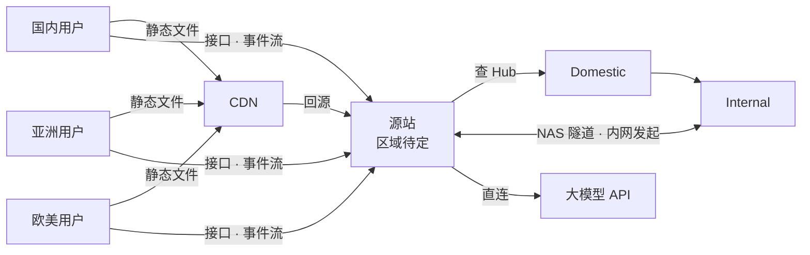
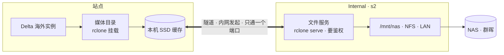
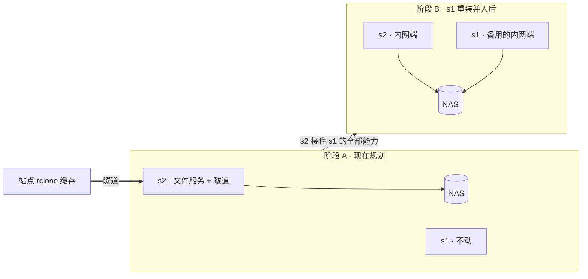

# 34. toC 站点：区域按"访问快"选；NAS 要能读写

日期：2026-11-17。状态：设计，没有实测。依据是用户 2026-11-17 第六轮的答复："arguseek 各个地方用户都有 toC 的。服务器区域暂时未定，只要访问快就可以了，nas 应该是需要读写的，稍微慢一些可以接受。"NAS 是四盘位群晖、管理凭据已遗忘、SSH 连不上，出自 mx-static 的 `nas_docs/operations/nas-health-and-oss.md`（源码里写着）。文中的延迟和带宽数字都是估算；rclone 的参数是按我对它的了解列的，用之前对照官方文档，也没在本工程试过。修订 `docs/33`：站点区域不再默认美东；"不跨境挂载 NAS"收窄为"不跨境用 NFS 挂 NAS"。`docs/33` 的其余部分仍然有效。 2026-11-18 用户确认：内网这一端放 s2，s1 不动，见文末修订。

## 结论

1. **一个源站，各地用户都连它；前端的静态文件走 CDN。** 现在不做多区域：多区域要让数据库跨区域同步，代价大。等哪个地区的用户明显慢了再议。
2. **区域选离国内近、又能直连大模型的地方：东京、新加坡优先。** 不选美东：国内用户访问和查 Hub 每次都要多付 150 ms 以上（估算）。香港离国内最近，但按我所知 OpenAI、Anthropic 都不对香港提供服务，只有在模型调用全经 `llm.minsight-ai.com` 中转时才考虑。**最后按实测定**，同一个区域，不同厂商到国内的线路差别很大。
3. **NAS 读写：站点上用 rclone 挂一个带本机缓存的目录。** 读命中走本机盘；写先落本机盘，几秒后在后台传回 NAS。不用 NFS 跨境。
4. **通往 NAS 的路由内网发起**：内网一台机器主动连到站点，建一条只通文件服务一个端口的隧道。不经 Domestic，不占用户那 100 Mbps；占内网约 300 Mbps 的上行，要限速。
5. **内网这一端放 s2。** NAS 自带的服务用不了（管理密码丢了、SSH 不通）；放 s1 要在 s1 上新开端口和隧道网卡，按硬约束要你明确同意。所以 NAS 读写要等 s2 就绪，除非你同意先放 s1。
6. **站点只写自己的目录，别处只读。** 两边不写同一个目录，就不会有冲突；rclone 没有跨机器的文件锁。

## 区域怎么选

| 区域 | 到国内用户 | 到欧美用户 | 到 Domestic 和内网（查 Hub、NAS） | 大模型 | 看法 |
|---|---|---|---|---|---|
| 美东（现在这台） | 200–300 ms | 好 | 同左，慢 | 能直连 | 不建议 |
| 美西 | 150–200 ms | 美国好，欧洲一般 | 同左 | 能直连 | 欧美用户多时的备选 |
| 东京 | 50–100 ms，看线路 | 150–250 ms | 较好 | 能直连 | 首选之一 |
| 新加坡 | 60–120 ms，看线路 | 160–250 ms | 较好 | 能直连 | 首选之一 |
| 香港 | 20–50 ms | 150–250 ms | 最好 | OpenAI、Anthropic 不对香港提供服务（按我所知，选前核对） | 只在模型全经中转时考虑 |

表里的延迟都是估算的往返时间。**晚高峰的丢包比平均延迟更要紧**，同一个区域，带国内优化线路的机房和普通线路差别很大（`docs/17`）。

### 怎么测

挑两三个候选（厂商加区域），各开一台最小规格的机器跑一天：

| 测什么 | 怎么测 | 看什么 |
|---|---|---|
| 国内用户访问 | 电信、联通、移动各找一个点，`curl -o /dev/null -w '%{time_connect} %{time_starttransfer}\n'`，白天和 20–23 点各一次 | 连接时间、首字节时间的 p95 |
| 海外用户访问 | 欧美各一个点，同上 | 同上 |
| 查 Hub | 在候选机器上 `./scripts/manage.sh probe url https://hub.minsight-ai.com/healthz` | 各阶段耗时 |
| NAS 隧道 | 内网到候选机器 `iperf3`，白天和晚高峰 | 吞吐和重传 |
| 大模型 | 在候选机器上调一次模型 API | 能不能用、首字延迟 |

按"国内晚高峰的 p95"和"大模型能直连"两条定，其余做参考。

### CDN

arguseek 的前端是单页应用，JS、CSS 这些静态文件放 CDN，各地用户就近取。接口和研究的事件流（SSE）走源站，不能缓存，也不能被缓冲（站点 Caddy 已经设了 `flush_interval -1`）。没有 ICP 备案的域名用不了 CDN 在内地的节点，国内用户会落到香港或日本的节点，仍然比直连源站快。

### 从现在这台迁过去

arguseek 的 README 写了上云迁移的做法，照着做：新机器装好 Caddy 和 Compose → 停写 → 导出导入数据库 → 原样带过去身份 HMAC 密钥 → 跑迁移任务 → 切 DNS。飞书、钉钉、企微的回调地址按域名配置，换机器不用改。旧机器上的数据保留一段时间再说，不删。

## NAS 怎么读写

### 为什么不用 NFS 跨境

| | NFS 跨境 | rclone 加本机缓存 |
|---|---|---|
| 读已经读过的文件 | 每次都要问 NAS 文件变了没有 | 本机盘 |
| 写 | 每次写都等 NAS 确认 | 先落本机，后台传 |
| 列目录 | 几十个来回 | 有目录缓存 |
| 线路断了 | `hard` 挂载：进程全部卡住；`soft` 挂载：可能写坏文件 | 已缓存的照读；新写的排队，通了再传；没缓存的读超时报错，不卡住 |

### 用起来是什么样

| 操作 | 怎么走 | 快慢 |
|---|---|---|
| 读缓存里有的文件 | 本机盘 | 和本地一样 |
| 读缓存里没有的文件 | 经隧道从 NAS 取整个文件，放进缓存 | 一个往返加传输时间；NAS 是机械盘，并发随机读本来就慢（`docs/25`） |
| 写新文件 | 写进本机缓存，几秒后后台传回 NAS | 程序感觉和本地一样；NAS 上晚几秒到几分钟才出现 |
| 隧道断了 | 见上表 | 断开期间写的文件在本机排队 |

这就是"稍微慢一些"慢在哪：第一次读和 NAS 上的可见时间。

### 要定的参数

按我对 rclone 的了解列出，用之前对照官方文档；没有试过，数值都是起点：

| 参数 | 起点 | 为什么 |
|---|---|---|
| `--vfs-cache-mode full` | | 读写都经过本机缓存 |
| `--vfs-cache-max-size` | 缓存盘的一半 | 留空间给库和别的 |
| `--vfs-write-back` | 默认几秒 | 写完多久开始往回传 |
| `--bwlimit` | 白天 `5M`（约 42 Mbps），夜里 `20M`（约 168 Mbps），用它的时间表写法 | 和用户流量、备份共用内网上行 |
| `--timeout`、`--contimeout` | 几十秒 | 线路断了报错，不无限等 |
| `--dir-cache-time` | 几分钟 | 列目录少跑隧道 |

挂载由 systemd 管，在 Docker 之前起来；挂进容器时要设挂载传播，rclone 重启后容器才看得到新挂载。

### 几条规矩

- **站点只写自己的目录。** NAS 上给站点一个 `sites/oversea-toc/`，下面怎么分跟 po-infra 商量。要读内网 Delta 的历史媒体，另挂一个只读的。
- **缓存里还没传回去的文件，站点的盘坏了就丢。** Delta 的媒体能重新下载，可以接受；arguseek 的报告在它自己的库里，不走这条路。
- **Delta 的部署脚本对 NAS 有准入检查**（认 mx-static 的登记）。海外实例要么用本地存储模式指向这个挂载目录，要么 po-infra 加一种"远程缓存"模式。这是 po-infra 的改动。

### 隧道

- **内网主动连站点**：站点有公网地址，内网在 NAT 后面，用 WireGuard，内网一侧设 `PersistentKeepalive`（`docs/24`）。站点进不了内网的别处：隧道上只放行"站点 → 文件服务"这一个端口，文件服务要鉴权，账号只给这个站点。
- **跨境 UDP 被限速时**，换成走 TCP 的反向隧道。po-infra 已经在用 frp（`delta-frpc`），可以沿用。
- **不经 Domestic**，不占用户的 100 Mbps；占内网的上行（约 300 Mbps，上下行是否对称待确认，`docs/15` 第 4 项）。

### 内网这一端放哪

| 位置 | 行不行 |
|---|---|
| s2 | **建议**。s2 是 L2 的控制面，挂着同一个 NAS。要等 s2 就绪 |
| NAS 自带的 WebDAV 或 SFTP | 现在不行：管理凭据丢了，SSH 22 连不上（mx-static 的记录） |
| s1 | 技术上可以，但要在 s1 上新开端口和隧道网卡。按硬约束要你明确同意；s1 最后还要重装 |
| 内网另一台小机器 | 有的话可以，挂上 NAS 就行 |

## 对 docs/33 的修订

| `docs/33` 写的 | 现在 |
|---|---|
| 站点在美东，`54.208.24.231` | 现在那台算过渡。区域按上面的实测选，选定后 arguseek 迁过去 |
| 不跨境挂载 NAS；历史文件由内网推、偶尔的按需取 | 不跨境用 NFS 挂 NAS。读写走 rclone 本机缓存加内网发起的隧道。只读的批量数据仍可以按目录推 |
| 落地顺序 | 加两步：先测区域选点；NAS 读写等 s2 |

## 落地顺序

1. **测区域**：两三个候选，各开最小规格跑一天，按上面的表测。
2. **开正式的机器**，把 arguseek 迁过去；旧机器保留。
3. **备份先行**（`docs/33`）。
4. **Delta 海外实例**（`docs/33`）。先用本机盘，不接 NAS。
5. **s2 就绪后接 NAS**：s2 上起文件服务和隧道 → 站点挂载 → 先只读试一周 → 再开写。

都不碰 s1。

## 待确认

`docs/15`：第 33 项改成"哪些目录要读写、多大"；新增第 38–40 项（区域实测、模型中转在哪、内网这一端放哪）。

## 修订（2026-11-18）：内网这一端放 s2，s1 不动

用户 2026-11-18："直接先规划在s2做，s1先不动。s2稳定之后，并能cover住s1的全部能力之后，再迁移到s1上。"

- 文件服务和隧道的内网端只放 s2。s1 上不加端口、不加隧道网卡、不加防火墙规则。
- 结论第 5 条里"除非你同意先放 s1"这个选项取消；"内网这一端放哪"表里 s1 那一行不再考虑。
- s2 就绪之前站点不接 NAS。Delta 海外实例先只用本机盘，落地顺序第 4 步本来就是这样，不受影响。
- 后半句我理解为：等 s2 接住 s1 的全部能力、s1 重装并入之后（阶段 B，`docs/16`、`docs/21`），s1 上再起一个同样的内网端。两台挂的是同一个 NAS，一台坏了站点切到另一台。这是阶段 B 的事，现在不做。

