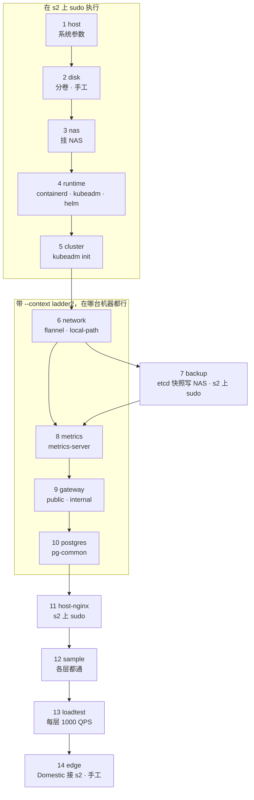
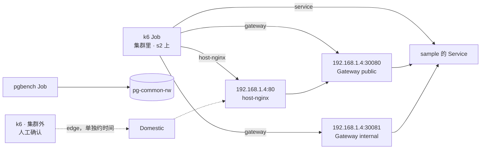

# 35. s2 落地：14 个阶段，每个阶段一条命令做、一条命令验，最后每一层压 1000 QPS

日期：2026-11-19。状态：计划和脚本。**没有在 s2 上执行过**（s2 还没装）。在本机（macOS）测过：脚本语法、清单渲染、kubeadm 配置渲染、两份 Nginx 配置的 `nginx -t`、本机 Docker 里"host-nginx → 样板服务"这条链路上用 k6 跑 300/s 的压测和结果记录、各项防护（不在 s1 上做、不压 s1、不写 s1 的集群）。取代 `docs/14` 第 6–9 节的手工步骤和 `infra/nginx/host-ladder2.conf.example`；`docs/29` 的第 5、6 项按本篇做了。2026-11-22：cluster 阶段多给节点打一个 `mx.ladder2/site-peer=true`（host-runner 用，`docs/47`）；host-nginx 的模板多了 18090（Launcher API）、8008，80 的兜底对 H2I 网段转 Gateway internal（`docs/46`、`docs/47`）。

用户 2026-11-19："帮我开始做之前规划的 s2，并能够一步步通过命令验证各个阶段完成，各个服务启动，目标是能各个地方能承受 1000qps。"

## 结论

1. s2 分 **14 个阶段**落地。每个阶段：`node prepare s2 <阶段>` 做，`node verify s2 <阶段>` 验。verify 只读，逐项打 ✓ / ✗，从当前机器查不到的打 UNKNOWN，有 ✗ 或 UNKNOWN 就返回非零。`node verify s2` 不带阶段时把 14 个阶段都查一遍，最后给一张汇总表。
2. **没有"全部做"的命令**，一次一个阶段（CLAUDE.md）。每个阶段都可以重复执行，已经是目标状态就不动。
3. **1000 QPS 的验收是逐层的**：样板服务的 service、Gateway public、Gateway internal、host-nginx 各自以固定速率 1000/s 压 2 分钟，pg-common 1000 事务/s。每层都要过门槛（下面的表，估算），`node verify s2 loadtest` 才算完成。
4. **边缘（Domestic）不在 s2 的验收里。** 它和 MX-H2I 的用户共用 2 vCPU、峰值 100 Mbps（`docs/09`），压它会影响 H2I 的登录和联网。接到 s2 之后单独约时间压，速率从 100 起，脚本会要求人工确认。
5. 三件事脚本不做，要人做：分卷（会清空磁盘）、边缘的 WireGuard 对端和测试域名（共用的边缘）、NAS 上给 s2 开 NFS 权限（NAS 的管理员密码找不到，`docs/34`）。
6. 写这些脚本时改了几处之前的设计，见"和之前设计不同的地方"。

## 阶段



| # | 阶段 | 做什么 | 怎么做 | verify 查什么 |
|---|---|---|---|---|
| 1 | host | `/etc/hosts` 加 `k8s-api.ladder2.internal`、关 swap、内核模块、内核参数（含 1000 QPS 的几项）、时间同步 | `sudo ./scripts/manage.sh node prepare s2 host` | 每个参数的实际值；路由不和 Pod / Service 网段重叠；打印核数、内存，供补 `inventory/hosts.yaml` |
| 2 | disk | 按 `docs/16` 分卷 | 手工，见下 | `/data`、`/var/lib/etcd` 是单独的卷；各卷用量低于 70% |
| 3 | nas | 装 NFS 客户端，按登记的 fstab 挂 `/mnt/nas`，kubelet 等 NAS 挂好再启动 | `sudo ... node prepare s2 nas` | fstab 和登记一致；5 秒内可读；kubelet 的依赖文件在 |
| 4 | runtime | containerd（systemd cgroup、沙箱镜像和 kubeadm 一致）、kubeadm / kubelet / kubectl 锁版本、helm | `sudo PROXY=http://127.0.0.1:7788 ... node prepare s2 runtime` | 三个版本一致且是 v1.36；已锁定；helm 版本 |
| 5 | cluster | 渲染 `kubeadm-init.yaml`、`kubeadm init`、去掉控制面污点、context 叫 `ladder2` | `sudo ... node prepare s2 cluster` | `/readyz`、四个控制面组件、没有污点、kube-proxy 模式 |
| 6 | network | flannel、local-path（数据目录 `/data/k8s/storage`）、默认存储类 `local-retain` | `./scripts/manage.sh node prepare s2 network --context ladder2` | flannel 就绪、节点 Ready、CoreDNS、存储类是 Retain 且默认 |
| 7 | backup | etcd 快照和 pki 每天 02:00 写 NAS，装完先跑一次 | `sudo ... node prepare s2 backup` | 定时器启用、上次成功、最近一份不超过 26 小时、校验和对得上 |
| 8 | metrics | metrics-server | `... node prepare s2 metrics --context ladder2` | `kubectl top node` 有数 |
| 9 | gateway | NGINX Gateway Fabric，Gateway `public`、`internal` | `... node prepare s2 gateway --context ladder2` | 两个 Gateway 都 Programmed；各自的 Service 在 30080 / 30081；两个端口有响应 |
| 10 | postgres | CloudNativePG、`pg-common` | `... node prepare s2 postgres --context ladder2` | 集群 Ready、主库能 `select 1`、数据卷是 `local-retain` |
| 11 | host-nginx | s2 的宿主机 Nginx，80 端口，连接数调到 16384 | `sudo ... node prepare s2 host-nginx` | `/gateway-health` 200；80 只有 nginx；443 没监听；配置和模板一致 |
| 12 | sample | 样板服务 `services/sample`，同时挂两个 Gateway | `... node prepare s2 sample --context ladder2` | 副本 ≥ 2；路由挂上两个 Gateway；service、两个 Gateway、host-nginx 四层都 200；**网关认出的客户端地址对不对** |
| 13 | loadtest | 依次压 service、gateway public、gateway internal、host-nginx、pg-common | `... node prepare s2 loadtest --context ladder2` | 本机压测记录里五项最近一次都通过、速率 ≥ 1000 |
| 14 | edge | Domestic 加 s2 的 WireGuard 对端和一个测试域名 | 手工 | `inventory/probes.yaml` 的 `sample.edge` 登记了且 200；s2 有 WireGuard 对端 |

`./scripts/manage.sh node plan s2` 打印这张表的命令。verify 要在 s2 上运行才查得到机器上的项；在运维机上运行时，机器上的项显示 UNKNOWN，集群上的项照常查（运维机要有 `ladder2` 这个 context）。

## 第一天的顺序

在 s2 上（装好 Ubuntu 26.04、地址 `192.168.1.4`、主机名设好之后）：

```bash
git clone <本仓库> && cd de-ladder2
```

```bash
./scripts/manage.sh node plan s2
```

```bash
sudo ./scripts/manage.sh node prepare s2 host && ./scripts/manage.sh node verify s2 host
```

分卷（下一节）做完后：

```bash
./scripts/manage.sh node verify s2 disk
```

```bash
sudo ./scripts/manage.sh node prepare s2 nas && ./scripts/manage.sh node verify s2 nas
```

```bash
sudo PROXY=http://127.0.0.1:7788 ./scripts/manage.sh node prepare s2 runtime && ./scripts/manage.sh node verify s2 runtime
```

```bash
sudo ./scripts/manage.sh node prepare s2 cluster && sudo ./scripts/manage.sh node verify s2 cluster
```

之后集群上的阶段用 root 的 kubeconfig（`/root/.kube/config` 里已经有 `ladder2`），或者把 `/root/.kube/ladder2.conf` 拷给自己的用户：

```bash
sudo PROXY=http://127.0.0.1:7788 ./scripts/manage.sh node prepare s2 network --context ladder2
```

```bash
sudo ./scripts/manage.sh node prepare s2 backup
```

依次 metrics、gateway、postgres、host-nginx、sample、loadtest。最后看全部：

```bash
sudo ./scripts/manage.sh node verify s2
```

`sudo` 默认会丢掉环境变量，所以 `PROXY` 要写在 `sudo` 后面。代理是 s2 本机的出网代理（qp-tunnel-cli 的 7788 实例），s2 上没有就先装，或者不设 `PROXY`、把 `versions.env` 的 `K8S_IMAGE_REPOSITORY` 改成国内镜像（L1 用过 `registry.aliyuncs.com/google_containers`）。

## 分卷（阶段 2，手工）

最好在装 Ubuntu 时用安装程序的 LVM 自定义布局，按 `docs/16` 的表分：`/` 100G、`/var/lib/etcd` 20G、`/var/lib/containerd` 300G、`/data` 其余，卷组留 10% 不分配。装完再分的话，卷组里要有空闲空间（`vgs` 看），然后：

```bash
vg=$(vgs --noheadings -o vg_name | head -1 | tr -d ' ')
lvcreate -L 20G -n etcd "$vg" && mkfs.xfs "/dev/$vg/etcd"
lvcreate -L 300G -n containerd "$vg" && mkfs.xfs "/dev/$vg/containerd"
lvcreate -l 85%FREE -n data "$vg" && mkfs.xfs "/dev/$vg/data"
```

再把三行写进 `/etc/fstab`（`noatime`），`mkdir -p` 三个挂载点后 `mount -a`。`mkfs` 只格式化新建的卷，但仍然先 `lsblk -f` 确认没有拿错设备。必须在阶段 4（containerd 写 `/var/lib/containerd`）和阶段 5（etcd 写 `/var/lib/etcd`）之前做。

## 1000 QPS 怎么量



- **工具**：HTTP 用 k6（`scripts/loadtest/http.js`），固定到达速率：不管响应快慢每秒都发 1000 个，后端跟不上请求会被丢弃，算没扛住。数据库用 pgbench（CloudNativePG 的镜像里自带）。
- **在哪跑**：默认作为 Job 跑在集群里（`--from cluster`），压测程序和被压的服务在同一台 s2 上抢 CPU，量出来的数字偏保守。`--from here` 在当前机器上跑（本机的 k6，或 Docker 里的 `grafana/k6`），边缘只能这样压。
- **压什么**：样板服务的 `/healthz`，不访问数据库，只量"入口到 Pod"这一段本身的能力。业务接口的压测等迁进来的服务再做（`docs/09` 的第 3、4 步）。
- **pg-common**：单独建一个库 `ladder2_loadtest`（只建不删），pgbench 规模 50（约 750 MB），默认只读（`-S`），`--mode write` 压写（`-N`）。32 个连接。
- **结果**：每次一行记在跑压测那台机器的 `~/.local/state/de-ladder2/loadtest/results.tsv`，日志在同一目录。`loadtest results` 看每条链路每一层最近一次；`node verify s2 loadtest` 读同一份记录。

门槛（**估算**，没有依据的地方用了保守的经验值，用 `LOADTEST_P95`、`LOADTEST_P99` 覆盖）：

| 层 | 速率 | p95 | p99 | 错误率 | 达到速率 |
|---|---|---|---|---|---|
| service | 1000/s，2 分钟 | < 20 ms | < 50 ms | < 0.1% | ≥ 99% |
| gateway（public、internal 各一次） | 1000/s | < 30 ms | < 100 ms | < 0.1% | ≥ 99% |
| host-nginx | 1000/s | < 30 ms | < 100 ms | < 0.1% | ≥ 99% |
| pg-common | 1000 事务/s | 超过 50 ms 的不到 1% | | 没有失败 | ≥ 99% |
| edge（不在验收里） | 从 100/s 起 | < 300 ms | < 800 ms | < 0.1% | ≥ 99% |

单独压一层：

```bash
./scripts/manage.sh loadtest run sample --hop host-nginx --context ladder2
```

```bash
./scripts/manage.sh loadtest pg --mode write --context ladder2
```

```bash
./scripts/manage.sh loadtest results
```

为了 1000 QPS 调的东西：内核的连接跟踪表、监听队列、文件句柄（阶段 1）；host-nginx 的 `worker_connections 16384` 和到网关的长连接池 256（阶段 11）；样板服务 2–8 个副本，HPA 按 CPU 70% 扩（要 metrics-server，阶段 8）。本地端口范围故意不改：默认 32768–60999 正好避开 NodePort 的 30000–32767。

## 和之前设计不同的地方

| 之前 | 现在 | 为什么 |
|---|---|---|
| host-nginx 转到 `127.0.0.1:30080`（`docs/14` 第 7 节、`infra/nginx/host-ladder2.conf.example`） | 转到本机 LAN 地址 `192.168.1.4:30080` | kube-proxy 的 nftables 模式不支持回环地址上的 NodePort，iptables 模式也要靠 `route_localnet`。用 LAN 地址两种模式都行 |
| 网关的 `trustedAddresses` 是占位值，装之前要实测（`docs/15`） | 写成 `10.244.0.1/32`（s2 的 flannel 网桥）和 `192.168.1.4/32`；2026-11-22 Pod 网段改成 `192.168.224.0/20`，网桥地址随之是 `192.168.224.1/32`（`docs/41`） | 本机发往 `externalTrafficPolicy: Local` 的 NodePort 的流量会被 SNAT 成网桥地址。这是按原理推的；阶段 12 用 `/whoami` 实测网关认出的客户端地址，不对就按提示改 |
| `pg-common` 用存储类 `local-path` | 新建默认存储类 `local-retain`（同一个 provisioner，回收策略 Retain），`pg-common` 用它 | 上游 `local-path` 是 Delete：删了 PVC，磁盘上的数据目录跟着删。和"不删旧数据"冲突 |
| 平台组件只有网关和数据库 | 加 metrics-server | 模板里的 HPA 没有它不工作，`kubectl top` 也要它。不是 `docs/26` 里待定的 kube-prometheus-stack |
| 样板服务是模板里的 nginx 默认页 | `services/sample`：同一个镜像，自己的 `nginx.conf`，有 `/healthz`、`/readyz`、`/whoami` | 默认页没有 `/healthz`；`/whoami` 回显网关传来的客户端地址，用来查信任链 |
| 拉镜像的办法没定 | containerd 走 `PROXY`（设了才配），`K8S_IMAGE_REPOSITORY` 默认官方仓库 | s2 是新机器，containerd 只给集群用，配代理不影响别的程序。和 L1 不同：L1 是导入镜像 |
| metrics-server 校验 kubelet 证书 | 加 `--kubelet-insecure-tls` | kubeadm 的 kubelet 证书是自签的。内部自用从简（`docs/16`）；要校验就得开 kubelet 证书轮换并批准 CSR |

## 防护

- 角色脚本和 `node prepare` 发现本机有 s1 的地址就退出；目标主机是 `l1` 角色就退出；本机不是目标主机就退出。
- 所有写集群的命令（`k8s platform`、`app apply`、`node prepare` 的集群阶段、`loadtest`）都要 `--context`，并且 context 指向 s1 的 API 地址时拒绝。
- `loadtest` 不在 s1 上发起，目标是 s1 的地址时拒绝（`docs/09`："不对 s1 和 Launcher 的接口压测"）。
- 改系统文件之前留一份 `<文件>.ladder2-<时间>`；内容没变就不写。
- 备份只写新目录，不清理旧的；压测的库只建不删；Job 一天后自己清掉（结果已经记在本机）。

## 防火墙（只查不改）

脚本只报告 ufw 有没有在运行。s2 要开的端口（由人决定、执行）：80（LAN 和 Domestic 的 WireGuard 地址 `10.88.0.1`）、6443（只 LAN，运维用）、30080 / 30081（只本机和 LAN，host-nginx 和测试用；30081 不对 `10.88.0.1` 开，`docs/18`）、10250 和 8472/udp（阶段 B s1 并入时，只对 s1）。

## 版本

都在 `infra/k8s/versions.env`。这次新加的：

| 组件 | 版本 | 出处 |
|---|---|---|
| helm | v3.21.0 | 2026-11-19 搜到的发布文件列表（helm 镜像站），没在 s2 上装过 |
| local-path-provisioner | v0.0.37 | 2026-11-19 搜到的发布记录 |
| metrics-server | v0.8.1 | 2026-11-19 搜到的 GitHub 发布页 |
| k6 | `grafana/k6:1.8.2` | 2026-11-19 搜到的发布说明；在本机 Docker 里拉下来跑过 |
| `K8S_VERSION` | 空 | 要和 s1 的补丁版本一致，s1 上 `kubectl version` 看到后填（`docs/16`） |

## 还没验证的

本篇的脚本在 s2 上第一次跑时逐个核对，结果补回这里：

- Ubuntu 26.04 的包名（`containerd`、`nfs-common`）和 `containerd config default` 的格式；`SystemdCgroup`、沙箱镜像的替换在 containerd 2.x 的配置里是否生效（verify 会查 `SystemdCgroup = true`）。
- 网关看到的来源地址是不是 cni0 的地址（2026-11-22 起是 `192.168.224.1`，`docs/41`）；NGINX Gateway Fabric 会不会传 `X-Real-IP`（不传时 verify 退回看 `X-Forwarded-For` 的最后一个地址，两样都没有显示 UNKNOWN）。
- 两个 Gateway 各自的 Service 是否分别落在 30080、30081（`docs/15` 原有的假设，verify 会查）。
- etcd 镜像里有没有 `etcdctl`、`etcdutl`（备份脚本用 `kubectl exec` 调它们；没有 `etcdutl` 时只少一项校验信息）。
- NAS 的 NFS 是否允许 s2 的地址挂载。不允许的话阶段 3 会失败并提示，而 NAS 管理员密码现在找不到（`docs/15` 第 41 项）。
- 1000 QPS 的门槛是不是合适。第一次跑出来的数字替换上面"估算"的表，结果写成新的一篇（`docs/09` 的要求）。

本机测过的：脚本语法；所有 kustomize 清单渲染；kubeadm 配置渲染后是合法的三段 YAML、没有剩下的占位；样板服务和 host-nginx 的配置 `nginx -t` 通过；本机 Docker 里 host-nginx → 样板服务的链路通，`/whoami` 回显地址和请求编号；k6 脚本在 300/s 下通过、门槛过严时退出码 99；`loadtest run --from here`、`loadtest results`、`node verify s2` 的输出；不在 s2 上运行时显示 UNKNOWN 并返回非零；指向 s1 的 context、目标是 s1 的压测、在 s1 上 prepare 都被拒绝。
