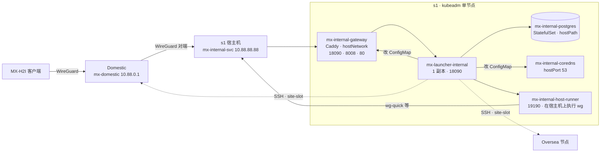
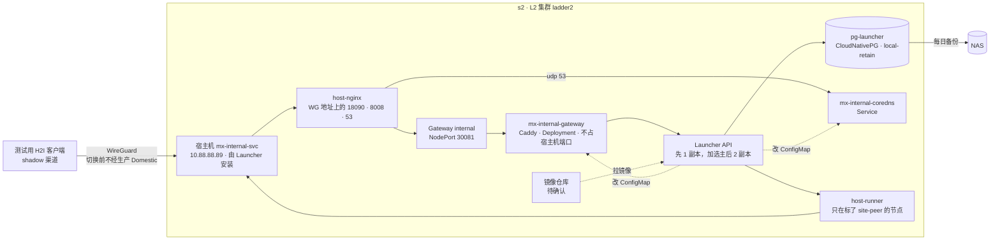
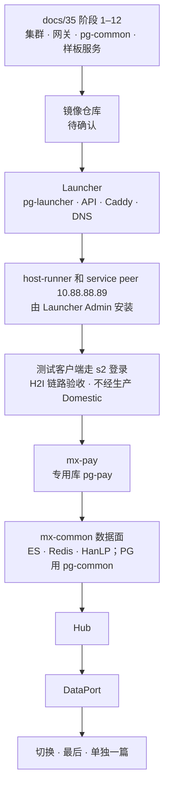

# 36. Launcher 先上 L2：ladder1 副本，s2 上复刻 Launcher 控制面

日期：2026-11-20。状态：决策和设计。`ladder1/` 已从 L1 的 `pro` 分支导出（本机做的，见 `ladder1/LADDER2.md`）；其余全部是设计，**没有在 s2 上跑过**（s2 还没装，`docs/35`）。L1 的情况来自 `ladder1/` 里的源码和文档，没有登录 s1 核对。2026-11-21：`ladder1/` 已移出本工程的 Git（`docs/37`）。取代 `docs/02` 的"不整批拷贝"，取代 `docs/11`、`docs/21`、`docs/29` 里"Launcher 最后迁"的顺序；**"s1 上的切换排最后"不变**。2026-11-22 第十七轮：`docs/45` 补充了多节点之后的部署方式、要先补的命令行、MX-H2I v2 和测试用的 Domestic，本篇结论不变；"切换前必须关掉的"那张表，`docs/45` 提了一个可选的例外（site-slot 只对 domestic02 打开），等用户定。 2026-11-22 第十八轮：第 1 条"以后的改动都在 `ladder1/` 里做"已被 `docs/46` 取代：`ladder1/` 只作对照、不再改，Launcher 从 L1 `1d9555e8` 拷进 `architecture/mx-launcher/` 再改；"L2 上的形态"里 Caddy"改成 Deployment、2 副本"改成仍用 DaemonSet、不占宿主机端口（`docs/46` 第 4 条）。 2026-11-22 第十九轮：应用网关换成 nginx，API 不经过它；host-runner 由 Launcher 在界面上建（DaemonSet 加节点选择）；分流 DNS 用 `externalIPs`；"service peer `10.88.88.89`"已被 `docs/48` 取代：`.88` 是 Launcher 写死的 Internal 角色地址，s2 那套也用 `.88`，切换时换的是生产 Domestic 上这个对端的公钥。 2026-11-22："不开 site-slot 远程执行"已被 `docs/53` 取代：常开，只能到白名单里的 domestic02。

用户 2026-11-20：先移植 Launcher 控制面，功能按最新代码迁，控制面要重新设计；基于 pro 分支把代码原样复刻到 `ladder1`，再基于 ladder1 改造；在 s2 上先把 Launcher、Hub、DataPort 等 de-llaaddddeerr 自己的服务跑起来；做成 k8s 集群，以后多台机器，用一台或两台 master 管理。

## 结论

1. **拷贝。** `ladder1/` 是 L1 `pro` 分支 `0a92448` 的原样副本（Git 跟踪的文件，去掉了 `.ovpn` 和带私钥的 `wireguard-clients-test/`）。以后 L2 对这些服务的改动都在 `ladder1/` 里做，L1 仓库不动。L1 还在提交，两份会分叉，这是 `docs/02` 当初不拷的原因；现在的做法是人工比对后挑着合，不自动同步（`ladder1/LADDER2.md`）。
2. **"复刻"和"切换"分开。** Launcher 栈在 s2 上**先跑起来**，但它是一套独立的环境：自己的库、自己的 WireGuard 地址、不连生产的 Domestic。MX-H2I 的用户在切换之前一直用 s1。切换（Domestic 把转发目标从 s1 换到 s2）仍然排最后，单独写一篇再做。硬约束一条没变。
3. **s2 上跑什么，按什么顺序：** Launcher（含它的库、应用网关、分流 DNS、host-runner）→ mx-pay → mx-common 的数据面 → Hub → DataPort。Launcher 排第一，因为 Hub、DataPort、mx-pay 的登录都靠它的 SSO（`docs/01`）。
4. **master 一台，不是两台。** 两台 master 各放一个 etcd，坏一台就不过半，整个集群不能写，比一台更脆弱（`docs/16`）。s2 先做唯一的 control；以后加机器用 `node join` 加成 node；第三台内网服务器到了再变成三台 control（`docs/16` 阶段 C）。
5. **高可用和负载均衡逐层做**，见"各层怎么做到高可用"一节。s2 单台时能做的是：每层有固定入口、能加副本、坏了能从备份还原。真正的"一台坏了另一台接着跑"要等第二台机器（s1 重装并入或新买）。
6. **Launcher 只是一个业务，不是集群的控制面**（`docs/28`）。它管人和网络；机器和集群归 L2。Launcher Dashboard 里的 Internal 这一格，以后对应的是整个 L2 集群，不是某一台机器。

## L1 的 Launcher 控制面现在长什么样

依据 `ladder1/electron-dock/mx-launcher/deploy/k8s/internal-shadow/` 和它的 `docs/05`、`docs/16`。命名空间叫 `mx-internal-shadow`，但它是正式环境（`CLAUDE.md`）。

| 组件 | L1 的形态 | 放到多节点集群上的问题 |
|---|---|---|
| Launcher API `mx-launcher-internal` | Deployment 1 副本，镜像 `qpjoy/mx-launcher-server:shadow`，`imagePullPolicy: Never`；按 `MX_ENABLED_MODULES` 开 15 个模块 | 镜像靠本机导入，Pod 调度到别的机器起不来。`launcher-network.controller.ts`、`identity/index.ts` 里有 `setInterval` 定时任务，没有选主，开 2 副本会重复执行 |
| Launcher 的库 | `postgres:16-alpine` StatefulSet，hostPath `/var/lib/mx-launcher/k8s/postgres` | 绑死一台机器的目录；没有副本；备份靠 L1 的恢复脚本 |
| 应用网关 `mx-internal-gateway` | Caddy DaemonSet，`hostNetwork`，占宿主机 18090、8008、80；Launcher 运行时改它的 ConfigMap 发布应用路由 | 占宿主机 80，正是 L1 docs/50 事故的结构原因；L2 规定集群不占 80 / 443（`docs/18`） |
| 分流 DNS `mx-internal-coredns` | 命名空间 `mx-dns`，hostPort 53；Launcher 运行时改它的 ConfigMap | hostPort 在哪台机器上取决于调度 |
| host-runner | DaemonSet，19190；Launcher 让它在宿主机上执行 WireGuard 的安装和配置 | 只能在持有 service peer 的那台机器上跑；Pod 访问宿主机要放行 Pod 网段（L1 docs/16 记过这个坑） |
| service peer `mx-internal-svc` | s1 宿主机上的 WireGuard 接口，`10.88.88.88` | 地址只有一个，s1 和 s2 不能同时用 |
| 三个 PV | SSH 密钥、发布制品、site-slot 产物，都是 hostPath | 同库 |
| 部署脚本 | `mx-launcher/scripts/manage.sh ops internal-production deploy` 和几十个恢复脚本 | `identity-on.mjs` 等要求节点数为 1，绑定 s1 的集群 UID 和地址（`docs/16` 的清单） |

## L2 上的形态

| 组件 | L2 的做法 | 改动放哪 |
|---|---|---|
| Launcher API | 命名空间沿用 `mx-internal-shadow`。镜像从 ladder1 构建，推到镜像仓库，`imagePullPolicy: IfNotPresent`。先 1 副本；给两处定时任务加选主（用库里已经在用的 `pg_advisory` 锁，抢到锁的副本才执行），之后开 2 副本加 PodDisruptionBudget | 代码：`ladder1/electron-dock/mx-launcher/server`；清单：`services/mx-launcher/` |
| Launcher 的库 | CloudNativePG 的 `pg-launcher`，存储类 `local-retain`，一级库（`docs/22`）。有第二台机器后加一个副本。每日备份写 NAS | `services/mx-launcher/`，沿用 `infra/k8s/platform/postgres/` 的写法 |
| 应用网关 `mx-internal-gateway` | Caddy 改成普通 Deployment、ClusterIP，不用 hostNetwork，2 副本。前面是 Gateway `internal`。Launcher 照旧改它的 ConfigMap，应用路由的功能不用改代码。以后再考虑让 Launcher 直接写 HTTPRoute，去掉 Caddy 这一层 | 清单：`services/mx-launcher/` |
| 客户端访问的地址 | H2I 客户端访问的是 `<service peer 地址>:18090`。s2 上由 host-nginx 监听 WG 地址的 18090、8008，转给 Gateway `internal` 的 NodePort（LAN 地址，`docs/35`）。地址的样子和 s1 一样，只是 `.88` 换成 `.89` | `infra/nginx/s2/` |
| 分流 DNS | CoreDNS 用 Service（NodePort），host-nginx 的 stream 模块在 WG 地址的 udp/tcp 53 上转过去，不用 hostPort | 清单 + `infra/nginx/s2/`；待确认（`docs/15` 第 49 项） |
| host-runner | DaemonSet 加 `nodeSelector`，只在标了 `mx.ladder2/site-peer=true` 的节点上跑（现在就是 s2）。Pod 网段访问宿主机 19190 的放行写进 `node prepare` 的 host 阶段 | 清单；`scripts/roles/` |
| service peer | s2 上一个新的 WireGuard 接口 `10.88.88.89`（`inventory/hosts.yaml` 里建议的值）。**由 Launcher Admin 通过 host-runner 安装，不由 L2 的脚本装**：隧道归 Launcher（`docs/21`） | 不改代码，改的是 s2 这套环境的配置 |
| 三个 PV | PVC 用 `local-retain`。发布制品体积大，以后可以挪到 NAS（不是数据库，可以放 NFS，`docs/20`） | 清单 |
| AWX | 先不装（L1 的配置里 AWX 的三个开关也是关的） | — |
| 部署 | 不用 L1 的 `manage.sh ops internal-production deploy` 和它的恢复脚本，所以"节点数必须为 1"的检查挡不住。用本工程的 `./scripts/manage.sh` 加 `services/mx-launcher/` 的 kustomize；迁移 Job 沿用 L1 `30-migration-job.yaml` 的做法 | `services/mx-launcher/`、`scripts/manage.sh` |

### 切换前必须关掉的

s2 这套在切换前是复刻，不能碰生产的机器和用户。下面这些开关在 s2 上默认关，切换时再逐个打开：

| 开关（L1 的 ConfigMap 里的名字） | s2 上 | 为什么 |
|---|---|---|
| `SITE_SLOT_RUNNER_REMOTE_EXECUTION_ENABLED`、`SITE_SLOT_WORKER_REMOTE_SSH`、`SITE_SLOT_CONFIRM_REMOTE_EXECUTION` | `0` | 打开的话，s2 的 Launcher 会拿库里的 SSH 密钥去改生产的 Domestic 和 Oversea |
| `MX_ENABLED_MODULES` 里的 `edge-sync` | 去掉 | 同上，会往边缘推配置 |
| `SITE_SLOT_DOMESTIC_WG_SECRET_EXPORT_ENABLED` | `0` | 不往外导出 WireGuard 密钥 |
| `RUNNER_DRY_RUN_DEFAULT` | `1`（L1 也是 1） | — |
| `MX_ENVIRONMENT` | 不用 `shadow`，换一个新的环境名（待确认，`docs/15` 第 44 项） | 库里的锁、配置、渠道都按环境名区分，两边不能混 |

如果用的是 s1 库的快照（下一节），库里有生产 service peer 的 WireGuard 私钥。s2 绝不能拿这把私钥去和生产的 Domestic 握手，否则会顶掉 s1 的对端，H2I 用户断网。s2 的 service peer 必须用自己的新密钥。

## 数据怎么过来

| 做法 | 什么时候用 | 风险 |
|---|---|---|
| 空库，迁移 Job 建表 | 第一次在 s2 上跑通、压测 | 没有用户，只能测功能链路 |
| s1 库的只读快照：在 s1 上 `pg_dump`，复制到 s2 还原 | 演练：用真实数据验 SSO、Hub 和 DataPort 的登录 | `pg_dump` 只读，不改 s1；但快照里有生产的密钥和用户，按上面"必须关掉的"执行。快照文件不进 Git，用完按 `docs/19` 的规矩放 NAS |
| 冻结写入后的最终复制 | 切换那一次 | 单独写一篇 |

旧数据一份都不删，s1 的库在切换验收之后由人决定怎么处理（`CLAUDE.md`）。

## s2 上的顺序

接在 `docs/35` 的第 12 阶段（样板服务）之后，一个一个做。每一步都要有 verify。

Hub、DataPort、mx-pay 在 s2 上同样从 ladder1 构建，同样不用它们 L1 的部署脚本（那些要求单节点、本机导入镜像、s1 的目录）。每个服务的清单放 `services/<服务名>/`，迁移、凭据、就绪检查沿用各自 L1 脚本里的做法。

## 各层怎么做到高可用

| 层 | s2 单台时 | 第二台机器加入后 | 三台内网服务器后 |
|---|---|---|---|
| 公网入口 Domestic | 不动，仍指向 s1 | 切换后，Nginx 的上游可以写两台的 service peer | 公网入口最多三台（`docs/30`） |
| host-nginx | s2 一个 | 每台一个，Domestic 两个上游 | 同左 |
| Gateway `public` / `internal` | 2 副本 | 分到两台 | 同左 |
| Launcher API | 1 副本 → 加选主后 2 副本 | 两台各一个 | 同左 |
| 应用网关 Caddy | 2 副本 | 分到两台 | 同左 |
| pg-launcher、pg-pay | 单实例，每日备份写 NAS | 主库加一个流复制副本，坏了人工提升（`docs/22`） | 可以自动切换 |
| host-runner 和 service peer | s2 | 仍只有一台持有 `10.88.88.x`，换机靠 Launcher 重新安装 | 同左 |
| 控制面 | s2 一个 control | 仍一个；坏了服务不停、不能发布（`docs/26`） | 三个 control，自动切换 |

## 和之前设计不同的地方

| 之前 | 现在 | 原因 |
|---|---|---|
| `docs/02`：不整批拷贝 L1 | 拷到 `ladder1/`，在副本上改 | 用户要求，改造需要改 Launcher 的代码（选主、镜像） |
| `docs/11` P7、`docs/21`、`docs/29`：Launcher 最后迁 | Launcher 第一个在 s2 上**跑起来**；**切换**仍然最后 | 其他服务的 SSO 都依赖它，先有它，后面的服务才能在 s2 上完整验收 |
| `docs/11` 的顺序 mx-rig → DataPort → host-pg → Hub → mx-pay | Launcher → mx-pay → mx-common → Hub → DataPort；mx-rig、host-pg 往后放 | 用户点名先跑 Launcher、Hub、DataPort 这一组 |

## 还没验证的

- Launcher 两处定时任务加选主之后能不能安全地开 2 副本。要读完 `launcher-network.controller.ts`，看还有没有别的进程内状态（例如内存里的租约）。
- Caddy 去掉 hostNetwork 之后，Launcher 发布的应用路由是否还对。L1 的路由里可能写了宿主机地址。
- H2I 客户端能不能指向 `10.88.88.89` 测试，而不影响生产用户：需要 shadow 渠道或一个测试账号的配置，归 Launcher 那边定。
- host-nginx 的 stream 转发 DNS 在 1000 QPS 下够不够。

要你决定或提供的事列在 `docs/15` 第 42–49 项。
