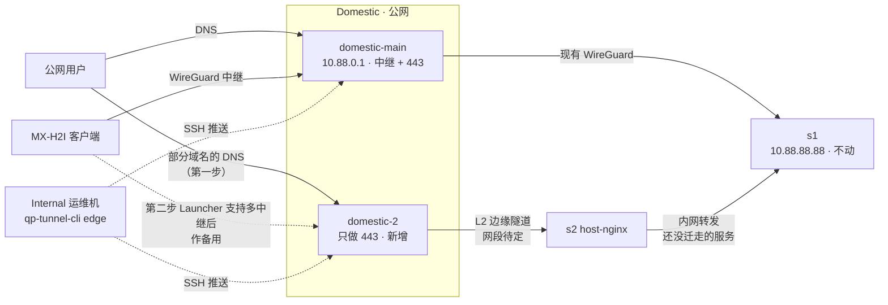
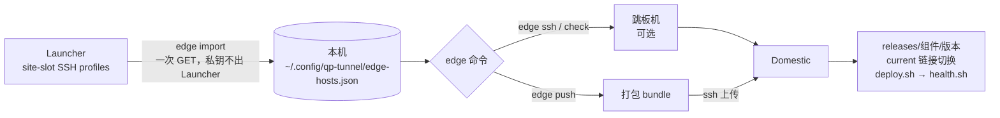

# 37. 多台 Domestic 怎么分担和容灾；从 Internal 推送部署到边缘的工具 `qp-tunnel-cli edge`

日期：2026-11-21。状态：前半是设计；后半的工具已写好。工具按用户要求写在 L1 仓库的 `electron-plugin/packages/tunnel-cli`，**没有对任何真实的 Domestic 执行过**。本机测过两样：tunnel-cli 的测试（edge 的 15 项加原有的，共 144 项通过、3 项跳过）；本机 Docker 里两台 Ubuntu 24.04 的 sshd（一台当跳板机，一台模拟 Domestic，非 root 用户加免密 sudo），实跑了 check、push、再 push、rollback。取代 `docs/17` 里"加一台入口的步骤"。`ladder1/` 从本工程的 Git 里移出（用户要求），见文末。工具的目录和推送方式已被 `docs/38` 取代：`resources/edge-remote.sh` 改为 `resources/edge/remote.sh`，推送多了 `--stack`、`--state-dir`、`--image`，多了 `edge status`；本篇的结论不变。

用户 2026-11-21：如果多台 Domestic 作为外网进入服务器的跳板机，也要能负载；现在一台 2 核 4 GiB 的 CPU 已经 96%，是不是加一台做容灾和路由。先起一个工具，放在 tunnel-cli 里，专门处理跳板机、堡垒机的连接，以后配新机器不用装 k8s 一整套，用命令行部署。Domestic 有公网 IP，可以从 Internal 直接推送部署，借鉴 v1 Launcher 的推送部署，但不要那么繁杂。Launcher 界面上存着每台机器的 SSH 信息，命令行在脚本界面里提示。

## 结论

1. **加一台 Domestic，对。** 现在只有一台，它就是单点：坏了，H2I 用户断网，公网站点也打不开。96% 的 CPU 说明它已经超载，排队的请求会变成登录慢和超时（`mx-launcher/docs/53` 讲过登录链路上的串行步骤）。
2. **加之前先看 CPU 花在哪。** `qp-tunnel-cli edge check <Domestic>` 会给出 CPU 的分项和最耗 CPU 的进程。不同的原因，办法不一样，见下表。如果是云主机抢回 CPU（steal 高），加机器之前先换规格。
3. **公网 HTTPS 和 H2I 的 WireGuard 中继分开处理。** HTTPS 无状态，两台配置相同，用 DNS 分就行。WireGuard 中继有状态：每个客户端连的是固定的一台、固定的地址。客户端连哪台、坏了换哪台，由 Launcher 决定（Launcher 管网络，`docs/21`；Launcher 自己的规划在它的 `docs/05` "Phase E：多 Domestic"）。L2 不重做这部分。
4. **第一步不碰 H2I：** 新的一台（暂名 `domestic-2`）先接一部分公网 HTTPS 域名，按域名改 DNS，改回 DNS 就是回退。H2I 的中继留在原来那台。原来那台卸掉一部分 TLS 和反代的负载。第二步等 Launcher 支持多中继，两台互为备份，才算真正的容灾。
5. **`domestic-2` 回源走 s2，不在 s1 上加 WireGuard 对端。** s1 不改端口、地址、iptables（硬约束）。`domestic-2` 用一条新隧道连到 s2 的 host-nginx。还在 s1 上的服务，由 s2 在内网转给 s1。这条隧道是 L2 的边缘隧道，不是 Launcher 的 service peer，网段另定，不占 Launcher 的 `10.88.0.0/16`（`docs/15` 第 53 项）。
6. **上限：最多三台入口。** 所有入口回源共用内网约 300 Mbps 上行（`docs/30`）。入口前面也不再放一台"入口主控"，否则所有流量又先挤进那一台（`docs/17`）。
7. **工具 `qp-tunnel-cli edge`：** 存机器、经跳板机连接、只读体检、推送部署、回退。边缘机器不装 Kubernetes，也不进集群（`docs/16`）。Launcher 里存的 SSH 信息可以一次导入。没给机器名时，在终端里列出已存的机器让人选。

## 现在和以后的入口



## CPU 96% 先看什么

`edge check` 输出里 `== cpu` 一行是 1 秒采样的分项，下面是进程排行、网卡收发速率、监听端口、WireGuard 对端数。

| 看到的 | 意思 | 办法 |
|---|---|---|
| `softirq` 高 | 内核在收发包，WireGuard 的加解密就算在这里 | 中继流量太大。加机器分中继（要 Launcher 支持），或换主频高的规格 |
| `user` 高，排前面的是 nginx / caddy | TLS 握手和反代 | 加 `domestic-2` 分域名，效果最直接；同时查长连接复用和 `keepalive` |
| `user` 高，排前面的是 mihomo / hysteria | 经 Domestic 出网的代理（`docs/27`） | 订阅限速；代理和用户流量分到不同机器 |
| `steal` 高 | 云主机在抢回 CPU，机器本身被超售 | 换实例规格或独享型。加机器意义不大 |
| `tx` 接近 100 Mbps | 瓶颈是带宽，不是 CPU | 大文件走 OSS 加 CDN（`docs/25`）；加机器分流量 |

这些办法是按原理列的，没有对着这台 Domestic 的实测数据挑过。

## 两步走

| | 第一步：分域名 | 第二步：中继也能切换 |
|---|---|---|
| 改什么 | 买 `domestic-2`；用 `edge push` 部署和 Domestic 一样的 Nginx 配置；把选中的域名 DNS 指过去 | Launcher 给客户端下发主、备两个中继（它的 Phase E）；两台 Domestic 各有自己的中继地址和客户端网段 |
| 谁做 | L2（本工程） | Launcher |
| 影响 H2I 吗 | 不影响：中继和登录还在原机 | 影响，要按 H2I 的验收走 |
| 回退 | 把 DNS 改回去 | 由 Launcher 的方案定 |
| 坏一台会怎样 | `domestic-2` 坏了，它那几个域名不通，改 DNS 切回；原机坏了，和现在一样 | 客户端切到备用中继 |

DNS 多条记录加健康检查（坏了自动摘掉）要云解析支持，用哪家没定（`docs/15` 第 55 项）。没有健康检查时，按域名分比一个域名两条记录更好排查（`docs/17`）。

## 工具：`qp-tunnel-cli edge`

### 为什么放在 tunnel-cli

用户指定的位置。tunnel-cli 本来就是 npm 包，Internal 和 Domestic 上都在用（v1 的 Launcher 也把它推到 Domestic 的 `/opt/mx/current/qp-tunnel-cli`）。边缘机器不进集群（`docs/16`），所以不用 `manage.sh node`；`node` 子命令只管集群里的 control 和 node。

### 做什么



| 命令 | 做什么 | 会不会改机器 |
|---|---|---|
| `edge add / remove / hosts` | 在本机存机器：地址、用户、端口、私钥路径、跳板机、角色。不存密码 | 不会 |
| `edge import --launcher-url …` | 读 Launcher 的 `GET /internal/v1/config-center/site-slot-ssh-profiles`，合并进本机文件。Launcher 的私钥在它自己的卷里，只记下路径；本机要用哪把私钥，`edge add <名字> --key …` 再指定 | 不会 |
| `edge ssh [名字] [-- 命令]` | 登录或执行一条命令；不给名字时在终端里列出已存机器让人选 | 看你执行什么 |
| `edge check [名字,…] [--role domestic]` | 只读体检：CPU 分项、进程排行、网卡速率、监听端口、WireGuard 对端数、Docker 容器、已推送的版本 | 不会 |
| `edge push 名字,… --bundle 目录` | 打包上传，解到 `/opt/mx/releases/<组件>/<版本>`，切 `/opt/mx/current/<组件>`，依次跑包里的 `deploy.sh`、`health.sh`。多台按顺序推，第一台失败就停 | 会 |
| `edge releases` / `edge rollback` | 列版本；把 `current` 切回上一个版本并重跑它的两个钩子 | rollback 会 |

借鉴 v1 的地方：`/opt/mx/{incoming,releases,state,current}` 这套目录，版本目录不覆盖，状态目录跨版本保留，切链接上线。没有照搬的：Launcher 那套计划、证据、门禁和逐步审批。这里只在 push 和 rollback 前问一次 `y/N`（`--yes` 跳过），`--dry-run` 只打印计划。主机上什么都不删。

### 用法

```bash
qp-tunnel-cli edge import --launcher-url http://10.88.88.88:18090
```

```bash
qp-tunnel-cli edge add domestic-main --key ~/.ssh/domestic
```

```bash
qp-tunnel-cli edge check domestic-main
```

```bash
qp-tunnel-cli edge push domestic-2 --bundle ./domestic --dry-run
```

### 还没做的

- **Domestic 的部署包（bundle）还没有。** 下一步：从 `de-mingxi/compass/deploy` 的 Domestic Nginx 配置做一个 `domestic` 包，带 `deploy.sh`、`health.sh`。证书和密钥放 `state/`，不进 Git。**第一次只推到 `domestic-2`**；推到现在那台等于改生产的 H2I 边缘。
- Launcher 界面上给每台机器显示对应的命令（例如 `qp-tunnel-cli edge ssh domestic-main`）。这要改 Launcher，没做。
- 本工程的 `./scripts/manage.sh` 还没有转到 `qp-tunnel-cli edge` 的入口；机器的事实目前在本机的 `edge-hosts.json`，没和 `inventory/hosts.yaml` 打通。
- 改动在 L1 仓库里，没有提交，也没有发新版 npm 包。`ladder1/` 里的 tunnel-cli 是 `0a92448` 的，没有 `edge`。

## ladder1 移出 Git

用户 2026-11-21 要求把 `ladder1/` 从暂存区移出。做法：`git rm -r --cached ladder1`（只从索引里拿掉，磁盘上的文件不动），并在 `.gitignore` 里加 `ladder1/`，免得 `git add -A` 又加回去。代价是 ladder1 里的改造不再由本工程的 Git 记录；要记录，得给 ladder1 单独建仓库，或者直接在 L1 仓库开分支（`docs/15` 第 56 项）。

## 还没验证的

- 工具没有对真实的 Domestic 或跳板机跑过；只在本机 Docker 里的两台 sshd 上跑过。
- `edge check` 的 CPU 分项来自 `/proc/stat`，在 2 vCPU 的云主机上和厂商控制台的数字是否一致，没对过。
- s1 的宿主机 Nginx（80 端口）是否接受来自内网 s2 的请求，没看过；这决定第 5 条的转发能不能成立。
