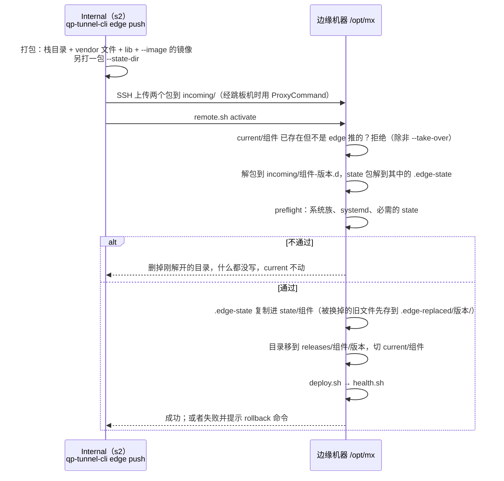

# 38. 边缘部署按技术栈分目录；hy2 服务端推送；统一的状态视图；不同的操作系统

日期：2026-11-21。状态：工具按用户要求写在 L1 仓库的 `electron-plugin/packages/tunnel-cli`（`resources/edge/`、`src/edge.ts`），**没有提交，也没有发 npm 包，没有对任何真实机器执行过**。本机 Docker 里实测过：两台 Ubuntu 26.04 的 systemd 容器，一台推了 `wg-nginx`（含失败回退），一台推了 `hy2-mihomo`（容器里再跑 Docker）；一台 CentOS Stream 9 的 systemd 容器推了 `open-nginx`（第一次撞上 curl 包冲突，修了以后通过）。tunnel-cli 的测试 23 项 edge 加原有的全部通过。补充 `docs/37` 的工具部分：37 的结论不变，工具的目录和推送方式以本篇为准。 2026-11-21 第十一轮：第 8 条已被 `docs/39` 取代（用户说的"双 master"是两台推送机；s1 保持 CentOS Linux 8，不改装 Ubuntu）；"系统差异"一节最后一段对 s1 版本的推测，事实见 39（CentOS Linux 8）；`hy2-mihomo` 的镜像改为固定版本（39）；状态视图里的 `pushed-by=edge` 现在显示推送机的名字（39）；"还没做的"里 Internal 端用 `wg enroll` 的说法是错的，已被 39 的"更正"一节取代（那是全隧道客户端）。 2026-11-22 第十二轮：`wg-nginx` 的回源不再用 `qp-tunnel-cli wg` 的服务端实例，改为 `edge link` 生成的中继，形状照 Launcher 的 `mx-domestic` / `mx-internal-svc`，见 `docs/40`；站点可选，可以先只起隧道。

用户 2026-11-21：放在 resources 里的话，是不是要起一个子文件夹专门做跳板机服务，再按技术栈分开，例如但不限于 `edge/wg_nginx`、`edge/open_nginx`；性能要求高的用 WireGuard，要网络加密等用 OpenVPN。现在的 `qp-tunnel-cli install` 是基于 Hysteria2 的，成熟项目在 `docker/hysteria2-mihomo-stack`，目前只有 enroll、install 客户端开本地代理，最好也能用命令行推送部署服务端。要有一个统一的命令行界面，查看当前服务器上部署的，和推送到的服务器上的服务。先在 v1 里做，不影响原来的线上服务，从 internal2 的 Ubuntu 上做；internal1 跑的是 CentOS，假设做 k8s 双 master、后续方便扩展 node 的话，推送部署时也要考虑不同的操作系统。

## 结论

1. **起子目录，按技术栈分。** `resources/edge/` 下放远端脚本、系统适配库和 `stacks/<栈名>/`。先有三个栈：`wg-nginx`、`open-nginx`、`hy2-mihomo`。名字沿用 L1：`open` 是 tunnel-cli 里 OpenVPN 的命令名，`hy2-mihomo` 是 `docker/hysteria2-mihomo-stack` 的容器名前缀；用连字符不用下划线，L1 的名字都是连字符。以后加栈就是加一个目录。
2. **一个栈是四样东西：** `stack.env`（支持哪些系统族、要不要 systemd、要开哪些端口、首次推送前必须有哪些配置）、`deploy.sh`、`health.sh`、`state.example/`。密钥、证书、真实域名不进包，由 `--state-dir` 推到机器上的 `state/<组件>/`。
3. **Hysteria2 服务端能推了：** `hy2-mihomo` 原样运行 `docker/hysteria2-mihomo-stack` 的 `manage.sh`，不改它，只替它做了非交互的那几步。连不上 Docker Hub 的机器，可以用 `--image` 把镜像随包带过去。用户 2026-11-17 说过 Hysteria2 服务端现在只在 Oversea（`docs/27`），所以这个栈的第一台目标是 Oversea 或新的 Domestic，不是现在那台 Domestic。
4. **统一视图是 `qp-tunnel-cli edge status`。** 不带参数时，列出本机和所有已存机器上的东西：推上去的版本、tunnel-cli 建的 WireGuard / OpenVPN / mihomo 实例、别的 WireGuard 网卡（例如 v1 的中继）、在跑的容器，以及 nginx、docker、kubelet 这类宿主机服务。查不到的机器显示 UNKNOWN 并返回非零。
5. **不同系统分两族：** `debian`（Ubuntu、Debian，apt）和 `rhel`（CentOS、Rocky、Alma、RHEL、Fedora，dnf，没有 dnf 时用 yum）。推送时先在机器上检查系统族、systemd 和必需的配置，三样都过了才写配置、切链接。不支持的系统一样都不动。
6. **不影响线上，体现在三处：**
   - 不推现在那台 Domestic（`docs/37`）。
   - 机器上已有一个不是 edge 推的 `current/<组件>` 时（v1 Launcher 推的 `current/domestic` 就是这样），拒绝切换，要显式加 `--take-over`。
   - 机器上什么都不删。
7. **从 s2 操作：** s2 是 Ubuntu 26.04（`inventory/hosts.yaml`），装 Node 18 以上和 tunnel-cli 就能用，不需要别的。
8. **"双 master"不改 `docs/16` 的结论。** 两台控制面比一台更容易出事：etcd 两个成员坏一个就停。要高可用就上三台。不过系统混用的问题照样要处理：
   - **集群节点：** 建议 s1 在阶段 B 重装时装和 s2 一样的 Ubuntu。这样 `node prepare` 只写 apt 的做法仍然成立（`scripts/roles/lib.sh` 的 `need_apt`），见 `docs/15` 第 60 项。
   - **边缘机器：** 云厂商给什么系统都有可能，所以 edge 工具两族都支持。

## 目录

```
electron-plugin/packages/tunnel-cli/resources/edge/
  remote.sh            远端那一半：check、status、releases、activate、rollback
  lib/edge-os.sh       系统适配：系统族、apt/dnf/yum、systemd、防火墙和 SELinux 报告、Docker
  lib/edge-nginx.sh    nginx 站点文件：从 state 生成、nginx -t 不过就恢复、reload
  stacks/
    wg-nginx/          stack.env  deploy.sh  health.sh  state.example/
    open-nginx/        同上
    hy2-mihomo/        同上；STACK_VENDOR 列出要带上的仓库文件
  vendor/              打 npm 包时从仓库复制（prepack），不进 Git
  README.md            栈的约定、stack.env 每个键的意思
```

`docs/37` 里的 `resources/edge-remote.sh` 改名为 `resources/edge/remote.sh`。推送时它和 `lib/edge-os.sh` 拼成一段，经 SSH 送到 `bash -s` 执行，机器上仍然只需要 bash、tar 和 coreutils。

## 三个栈，怎么选

| 栈 | 回源隧道 | 对外 | 适合 | 不适合 |
|---|---|---|---|---|
| `wg-nginx` | WireGuard 服务端实例（tunnel-cli `wg`），Internal 当客户端连进来 | nginx 80/443，站点文件来自 state | 吞吐大、每包 CPU 少；Domestic 分担 HTTPS（`docs/37` 第一步） | CentOS/RHEL 7：内核没有 WireGuard，`deploy.sh` 直接拒绝 |
| `open-nginx` | OpenVPN 服务端实例（tunnel-cli `open`） | 同上 | 要走 TCP、要 TLS 包着的隧道、内核没有 WireGuard 的机器 | 追求吞吐：OpenVPN 在用户态，比 WireGuard 费 CPU |
| `hy2-mihomo` | 不需要，它本身就是代理 | Hysteria2 UDP 端口 + 订阅站（Caddy，带 Basic Auth） | 给客户端发 Hysteria2 订阅 | 当回源隧道用：Hysteria2 是代理，不是网络（`docs/24`） |

两条隧道都是"边缘机器有公网地址，Internal 主动连过去"，和现在 Domestic `10.88.0.1` 与 service peer `10.88.88.88` 的方向一样。隧道网段还没定（`docs/15` 第 53 项）。`state.example` 里的 `100.127.60.0/24`、`100.127.70.0/24` 只是示例。

## 推送时机器上发生什么



回退（`edge rollback`）会把目标版本推送时带的那份 `.edge-state` 再复制回 `state/`，然后切链接、重跑那个版本的两个钩子。所以配置推错了，回退也能把配置带回去；运行时产生的数据（hy2 的用户表、自签证书、订阅文件）不在 `.edge-state` 里，回退不会动它们。

## 统一的状态视图

```bash
qp-tunnel-cli edge status
```

```bash
qp-tunnel-cli edge status domestic-2,oversea-main --health
```

| 看什么 | 怎么认出来 |
|---|---|
| 推上去的版本 | `/opt/mx/current/*`。`pushed-by=edge` 表示 edge 推的；`other` 表示别的工具推的，例如 v1 Launcher |
| tunnel-cli 建的实例 | `/etc/qp-wireguard/{server,client}/*`、`/etc/qp-openvpn-server/*`、`/etc/qp-openvpn/*`、`/etc/mihomo-client`，以及对应的 systemd 单元 |
| 别的 WireGuard 网卡 | `wg show interfaces`（要 root），v1 Domestic 的中继会出现在这里 |
| 容器 | 只列在跑的；停了的和 `k8s_*` 的 Pod 容器各汇总成一行，`--all` 才逐个列出 |
| 宿主机服务 | nginx、caddy、docker、containerd、kubelet，有单元就列出状态和版本 |

`--health` 会逐个跑各版本的 `health.sh`。它只读，但要 root，所以远端经 `sudo -n` 执行。本机那一行用当前用户跑：不是 root 就显示 "live (health needs root)"，不会显示成不健康。

## 系统差异，工具怎么处理

| 差异 | debian 族 | rhel 族 | 工具里怎么做 |
|---|---|---|---|
| 包管理 | apt-get | dnf，没有就 yum | `edge_pkg_install` 只装缺的 |
| nginx、openvpn 在哪 | 发行版自带 | openvpn 在 EPEL；7 上 nginx 也在 EPEL | 需要时先装 `epel-release` |
| curl | `curl` | 9 默认是 `curl-minimal`，再装 `curl` 会冲突 | 按命令在不在判断，不按包名 |
| Docker | `docker.io` + `docker-compose-v2` | Docker CE 仓库，地址可用 `EDGE_DOCKER_REPO` 换成镜像站 | 只在没有时装；不改 daemon 配置（同 `docs/31`） |
| SELinux | 一般没有 | enforcing 时 nginx 反代会 502 | 只提示 `setsebool` 命令；在 state 里写 `EDGE_SELINUX_ALLOW_PROXY=1` 才替你执行 |
| 防火墙 | ufw | firewalld | 只报告每个端口开没开、打印开端口的命令，不替你开。tunnel-cli 自带的 WireGuard、OpenVPN 脚本按它们原来的做法加规则 |
| WireGuard 内核模块 | 5.6 以上都有 | 7 没有 | `wg-nginx` 在 7 上直接拒绝，建议用 `open-nginx` |
| systemd 版本 | 新 | 7 是 219，`systemctl show --value` 不能用 | 不用 `--value` |
| 精简镜像缺命令 | — | Stream 9 的容器镜像里没有 `hostname`、`cmp` | 退到 `uname -n`；比较文件用 `cksum` |

s1 的具体版本还标着"待确认"（`inventory/hosts.yaml`），要看一眼 `/etc/os-release`（`docs/15` 第 58 项）。卷组叫 `cl` 是 CentOS 8 以后的默认名，所以多半不是 7，但这是推测。

## 实测（本机 Docker，2026-11-21）

全部在 macOS 上的 Docker Desktop 里，容器跑 systemd，sshd 只听 `127.0.0.1`。用的是临时私钥和单独的 known_hosts，没碰 `~/.ssh`。arm64 架构，真实的服务器是 x86_64：脚本和架构无关，镜像要选对架构。

| 机器 | 推了什么 | 结果 |
|---|---|---|
| Ubuntu 26.04，登录用户 `ops` + 免密 sudo | `wg-nginx` r1 | apt 装了 nginx 和 WireGuard 工具；WireGuard 实例 `edge` 起来了；站点文件里的 `@STATE_DIR@` 换成了证书路径；`health.sh` 里 `https://127.0.0.1/healthz` 返回 200。按 deploy 打印的命令建了一个 peer |
| 同上 | `wg-nginx` r2：故意推一个 `nginx -t` 不通过的站点 | `nginx -t` 拒绝，旧站点文件被移回，nginx 继续返回 200；`deploy.sh` 报错并给出回退命令 |
| 同上 | `rollback` | state 里的站点文件换回 r1 推送时的那份，r2 的那份存进 `.edge-replaced/rollback-…-to-r1/`；健康检查通过 |
| Ubuntu 26.04，容器里装 Docker | `hy2-mihomo` r1，带 `--image tobyxdd/hysteria:latest --image caddy:2-alpine` | apt 装了 docker.io 和 docker-compose-v2；镜像从包里加载，没去 Docker Hub 拉；两个容器起来；按 `HY2_USERS` 加了 alice、bob；订阅站不带密码返回 401，带密码返回含 `type: hysteria2` 的订阅 |
| 同上 | r2、r3 原样再推 | `hy2.env` 没变，`.env` 保留；r3 起代码和 `.env` 都没变，两个容器没有重建（客户端不掉线）；用户表还在 |
| CentOS Stream 9，root 登录 | `open-nginx` r1 | preflight 认出 `family=rhel pkg=dnf`；装了 `epel-release`；装 `nginx curl` 时和预装的 `curl-minimal` 冲突，dnf 报错，`deploy.sh` 失败，current 留在 r1 并打印回退命令 |
| 同上 | `open-nginx` r2（修了 curl 之后） | dnf 装了 nginx；OpenVPN 服务端实例 `edge` 起来（EPEL 的 openvpn，`qp-openvpn-server@edge` active）；`https://127.0.0.1/healthz` 返回 200 |
| 同上 | r3 原样再推，再 `rollback` 回 r2 | 修了 `cmp` 之后，state 显示 0 个文件写入；OpenVPN 实例没动；回退后健康检查通过 |
| 本机 + 三台 | `edge status --health` | 一张表列出本机和三台机器：两种系统族、三个栈都是 healthy，WireGuard / OpenVPN 实例、容器、nginx 和 docker 的版本 |

测出来并修掉的问题：
- 容器里的 Docker 把镜像存在容器自己的 overlay 文件系统上，挂不了第二层 overlay。这是测试环境的问题，给 `/var/lib/containerd` 挂卷后解决。它顺带验证了 `deploy.sh` 失败时 current 留在新版本、并打印回退命令。
- 非 root 跑 `status` 时读不到 root 专用的 `state/`，把 edge 推的版本误报成 `other`。改为经 `sudo -n` 读。
- hy2 的 `manage.sh start all` 每次都重建容器，原样再推也会让客户端掉线。改为代码和 `.env` 没变、容器都在跑时，不再调用它。
- CentOS 精简镜像没有 `hostname` 命令；RHEL 9 的 `curl-minimal` 和 `curl` 包冲突（实测撞上了）。
- CentOS 精简镜像没有 `cmp`（diffutils 没装），state 文件内容一样也被当成改了。改为没有 `cmp` 时用 coreutils 的 `cksum` 比较。

没测的组合：`wg-nginx` 在 rhel 上、`open-nginx` 在 debian 上、`hy2-mihomo` 在 rhel 上（Docker CE 仓库那条路），以及经跳板机推送（`docs/37` 时测过跳板机，这次没重测）。

## 还没做的

- 改动在 L1 仓库里，没有提交，没有发版。`ladder1/` 里的 tunnel-cli 是 `0a92448`，没有这些改动。
- 没有对真实的 Domestic、Oversea、跳板机跑过；没有在 x86_64 上跑过；没有在开着 SELinux 的机器上跑过。
- `hy2-mihomo` 用的镜像是 `tobyxdd/hysteria:latest`，版本会漂。要不要在推送时固定版本，见 `docs/15` 第 59 项。
- 每台机器的 `--state-dir` 放在 s2 的哪里、怎么备份，没定（第 61 项）。
- Launcher 界面上显示 edge 命令、本工程 `manage.sh` 转到 `edge`、和 `inventory/hosts.yaml` 打通，都还是 `docs/37` 里列的状态，没做。
- `wg-nginx`、`open-nginx` 只负责建隧道的服务端；Internal 那一端仍要人按 deploy 打印的两条命令做一次（`wg create`、`wg enroll`）。
