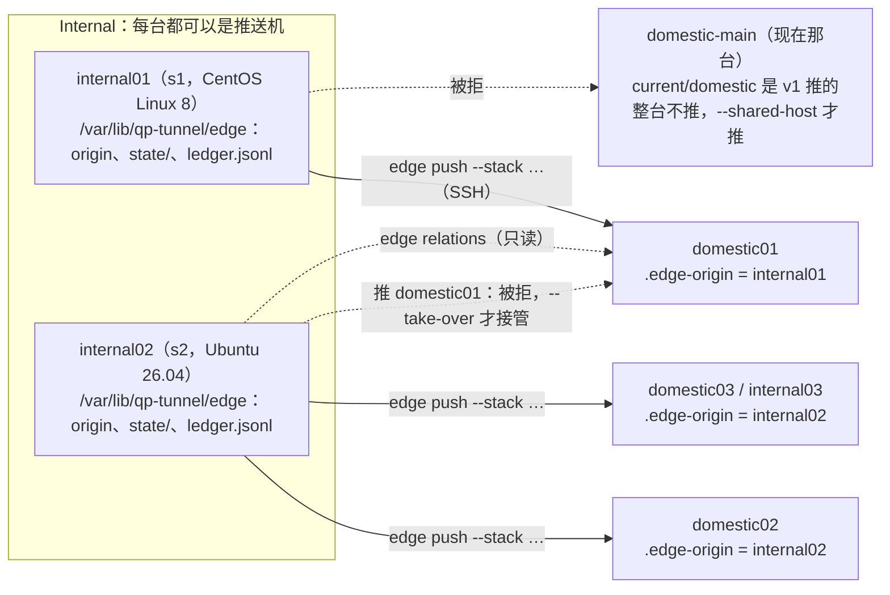
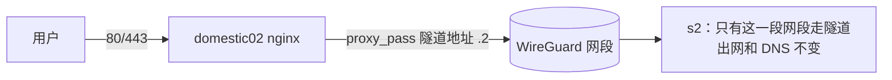

# 39. 多台 Internal 推送（推送机）、关系列表、配置目录；固定镜像版本；s1 是 CentOS Linux 8

日期：2026-11-21。状态：工具仍写在 L1 仓库的 `electron-plugin/packages/tunnel-cli`（同 `docs/38`），**没有提交，没有发 npm 包，没有对任何真实机器执行过**。本机实测过：
- 一台 Ubuntu 26.04 容器（登录用户 `ops`，免密 sudo），从两个推送机身份跑了完整流程：推送、被拒、接管、关系列表、拉回配置。
- `docker compose config` 确认固定版本的覆盖文件会被自动读入。
- CentOS 8 容器没跑成（拉镜像卡住），只有单元测试，见"实测"一节。

tunnel-cli 的测试共 161 项：158 项通过，3 项跳过，0 项失败。其中 edge 29 项。本篇补充 `docs/38`：38 第 8 条对"双 master"的理解和"s1 重装时装 Ubuntu"的建议被本篇取代，38 其余内容不变。 2026-11-22：下面"更正"一节的做法（`wireguard.sh create` 加手改配置）已被 `docs/40` 取代，改用 `edge link`；"更正"指出的问题（`wg enroll` 是全隧道客户端）仍然成立。

用户 2026-11-21 的说法："双 master"的意思是任意一台 internal 都可以在本机上，往其他服务器推送安装服务。例如 internal01 推送安装它自己的 domestic01，并且可以选装哪个技术栈。用户会在 internal02 上推送安装 domestic02，还要保证 internal02 能装 internal03、domestic03 等，并且要有关系列表。同时答复了 `docs/15` 第 58–61 项：
- 第 58 项：s1 是 CentOS Linux 8，用户贴了 `/etc/os-release`。
- 第 59 项：镜像版本要固定。
- 第 60 项：s1 还用原来的系统。
- 第 61 项：配置目录放在配置机上不容易删掉的地方。

## 结论

1. **"双 master"指两台（以上）推送机，不是两个 Kubernetes 控制面。** `docs/16` 不受影响：控制面仍是一台，三台才做自动切换。edge 工具里把推送机叫 origin，每台 Internal 都可以是一台。

2. **每台推送机有自己的名字。**
   - 用 `qp-tunnel-cli edge origin set internal02` 设，名字存在这台推送机的 edge home 里。
   - 没设时用短主机名；主机名是 `localhost` 时要求先设。
   - 环境变量 `QP_EDGE_ORIGIN` 优先于文件。
   - `edge`、`other`、`manual`、`local` 是机器那一侧要用的词，不能拿来当名字。

3. **目标机上记着"谁管这个组件"。**
   - 推送或回退成功后，目标机写 `state/<组件>/.edge-origin`；`.edge-history` 每行多两列：推送机名、`push` 或 `rollback`。
   - 另一台推送机来推送或回退同一个组件时被拒绝：什么都不写，刚上传的包也删掉。加 `--take-over` 才接管。
   - 所以 internal01 管 domestic01、internal02 管 domestic02，互不覆盖。internal01 坏了，internal02 用 `--take-over` 接手（配置怎么拿见第 5 条）。

4. **关系列表是 `qp-tunnel-cli edge relations`。**
   - 它和 `status` 一样只读地问每台已存的机器，按"推送机 → 机器 → 组件（栈、版本、从什么时候）"列出来。
   - 再和本推送机的台账对照，标出三种情况：
     - 组件被别的推送机接管了；
     - 台账里有，机器上已经没有了；
     - 机器连不上：用台账里最后一次的记录，状态显示 UNKNOWN，命令返回非零。
   - `--offline` 只看台账，不连机器。
   - 只问本推送机存了的机器。两台推送机都从 Launcher `edge import`，看到的就是同一张图。

5. **配置目录放在推送机的 edge home 里（第 61 项）。**
   - **位置：** Linux 上默认 `/var/lib/qp-tunnel/edge/`。它不在家目录、Git 工作区、npm 安装目录或 `/tmp` 里，重装 tunnel-cli、清家目录、`git clean` 都碰不到它。`QP_EDGE_HOME` 可以换位置。
   - **内容：**
     - `origin`：推送机的名字。
     - `state/<机器>/<组件>/`：证书、密钥、站点文件。目录 700，文件 600。
     - `ledger.jsonl`：推送台账，只追加。工具里没有改写或删减它的命令。
   - **怎么建：** 第一次推送时自动建。没有权限时提示 `sudo install -d -m 700 -o "$(id -un)" /var/lib/qp-tunnel/edge`；脚本自己不跑 sudo。
   - `edge state init <机器> --stack <栈>` 把模板写到那里，已有的文件不覆盖。
   - `edge push <机器> --stack <栈>` 不带 `--state-dir` 时用那里的配置；几台一起推时，每台用自己的目录。
   - **丢了怎么办：** `edge state pull <机器> --component <组件>` 从目标机拿回来。
     - 只拿推送带过去的那些文件（取机器上现在的内容），运行时数据不拿（hy2 的用户表、`deploy.sh` 写的标记）。
     - 本地已有文件时，写到旁边的 `<组件>.pulled-<时间>/`，不覆盖。
     - 另一台推送机接手时，也是这样拿到配置。
   - **备份：** 目标机上本来就有两份（`state/<组件>/`，以及每个版本里的 `.edge-state`），先靠 `state pull` 兜底。要不要随每日备份加密写 NAS，还没定（`docs/15` 第 64 项）。

6. **推送到 internal03 和推送到 domestic03，对工具没有区别。**
   - 只要推送机能 SSH 过去：`edge add internal03 --host <LAN 地址> --role internal`，再选栈推送。系统不同时照 `docs/38` 分两族处理。
   - 但现在的三个栈都是边缘用的：对外的 nginx、回源隧道的服务端、Hysteria2。
   - internal03 如果是要加入 L2 集群的 node，用的是 de-ladder2 的 `node prepare`（`docs/35`）。它现在只能在那台机器上本机 sudo 跑，而且只有 apt 的做法。要不要让推送机远程做 `node prepare`，要你定（第 62 项）。

7. **有别的工具部署过组件的机器，整台不推。**
   - 目标机的 `current/` 里只要有一个组件不是 edge 推的（v1 Launcher 用的是同一套目录，现在那台 Domestic 就是这样），往这台推任何组件都会被拒，连它还没有的新组件也一样。加 `--shared-host` 才推。
   - 原因：`wg-nginx` 这类栈会往机器上的 nginx 加站点并 reload，在生产 Domestic 上做就是改生产。
   - 如果用户说的 domestic01 就是现在那台（`docs/37` 里的 `domestic-main`），internal01 往它上面推，属于 `docs/37` 定的"第一次推送只推新机器"之外的事（第 65 项）。

8. **镜像版本固定了（第 59 项）。**
   - `hy2-mihomo` 用 `tobyxdd/hysteria:v2.14.0` 和 `caddy:2.11.9-alpine`，就是 2026-11-21 那天 `latest` 和 `2-alpine` 指向的版本：digest 一致，见下表。
   - **做法：** 栈里带一个 `docker-compose.override.yml`，部署时放进 stack 目录。compose 不带 `-f` 时会自己读这个文件，`manage.sh` 正是这样调用的，所以以后手工跑 `manage.sh` 用的也是这两个版本。
   - L1 的 `docker/hysteria2-mihomo-stack/docker-compose.yml` 一个字没改，已经在跑的 Oversea 不受影响。
   - **固定的是 tag，不是 digest。** 用 `--image` 带过去、经 `docker load` 加载的镜像，不一定带 registry 的 digest；compose 里写 digest 的话会再去拉。另外，Docker 官方镜像（caddy）在基础镜像更新时，会用同一个 tag 重新发布。所以 caddy 的版本号是固定的，字节不一定一样。

9. **s1 是 CentOS Linux 8，保持这个系统（第 58、60 项）。**
   - **edge 工具认得它：** `rhel` 族、版本 8、用 dnf。`edge check`、`edge status`（`eol=yes`）和推送前的检查都会提示：
     - CentOS Linux 8 已在 2021-12-31 停止维护，镜像站都挪到了 vault.centos.org；
     - 要装包，只能靠机器上已经配好的 vault 或本地镜像仓库；
     - 工具不改仓库文件。
   - **s1 当推送机：**
     - 需要 Node 18 以上。CentOS 8 自带仓库里的 Node 最高到 16（按记忆，没核对）；nodejs.org 的官方 Linux 包要求 glibc 2.28，CentOS 8 正好是 2.28。s1 上现在有没有 Node 要看一眼（第 63 项）。
     - 在 s1 上跑 tunnel-cli 只往外发 SSH，不改 s1 的监听端口、地址和 iptables。
   - **阶段 B：** s1 并入 L2 时，de-ladder2 的 `node prepare` 现在只有 apt 的做法，要先补一份 rhel 的。`docs/38` 第 8 条"s1 重装时装 Ubuntu"的建议作废。

## 关系



## 推送时机器上多检查了什么

`docs/38` 的顺序不变，只在解包前多了三道检查，任何一道不过都不写东西，并删掉这次上传的包。

| 顺序 | 检查 | 不过时 | 跳过的办法 |
|---|---|---|---|
| 1 | 这个版本号已经有了 | 拒绝（版本不覆盖） | 换 `--revision` |
| 2 | `current/<组件>` 存在但不是 edge 推的 | 拒绝 | `--take-over` |
| 3 | 机器上有别的组件不是 edge 推的 | 拒绝整台 | `--shared-host` |
| 4 | 组件由另一台推送机管（`.edge-origin`） | 拒绝 | `--take-over` |
| 5 | preflight：系统族、systemd、必需的 state（`docs/38`） | 拒绝 | `--force-os`（只对系统族） |

回退（`edge rollback`）也查第 4 项。

## 命令

```bash
qp-tunnel-cli edge origin set internal02
```

```bash
qp-tunnel-cli edge state init domestic02 --stack wg-nginx
```

```bash
qp-tunnel-cli edge push domestic02 --stack wg-nginx --dry-run
```

```bash
qp-tunnel-cli edge relations
```

```bash
qp-tunnel-cli edge state pull domestic02 --component wg-nginx
```

`edge relations` 的输出（下面这几行来自本机测试）：

```
This origin: internal01 (from QP_EDGE_ORIGIN). Ledger: …/home-a/ledger.jsonl

ORIGIN      HOST        COMPONENT  STACK  REVISION  SINCE                 STATE  NOTE
internal02  domestic03  demo       demo   r2        2026-11-21T13:15:29Z  live   this origin pushed r1 at 2026-11-21T13:15:28.204Z; internal02 took it over since
```

## 固定的镜像

| 镜像 | 固定为 | 2026-11-21 看到的多架构 digest |
|---|---|---|
| Hysteria2 | `tobyxdd/hysteria:v2.14.0`（`latest` 当天是它，容器里 `version` 显示 v2.14.0） | `sha256:b15cedc3de200ae7a4f177908a83ef23ed3de2935458b22b7d46a7a8697038a9` |
| 订阅站 | `caddy:2.11.9-alpine`（`2-alpine` 当天是它，`caddy version` 显示 v2.11.9） | `sha256:003a97808e781aa9f7e75cc2f43d34d461099031faf5e20faefb9f61126836f0` |

digest 是在本机用 `docker buildx imagetools inspect` 查 Docker Hub 得到的。版本同时写在两处：栈的 `stack.env` 的 `STACK_IMAGES`，和 `docker-compose.override.yml`。改版本时两处一起改，有一项测试专门检查两处一致。

## 实测（本机 Docker，2026-11-21）

macOS 上的 Docker Desktop，arm64 架构。用的是临时私钥和单独的 known_hosts，没碰 `~/.ssh`。

| 做了什么 | 结果 |
|---|---|
| Ubuntu 26.04 容器，`ops` 登录、免密 sudo；以 internal01 推一个 demo 组件，配置来自 internal01 的 edge home | 配置 2 个文件写进 `state/demo/`；输出 `managed from internal01` |
| 以 internal02 推同一个组件 | 被拒：`demo on this host is managed from internal01`；`current` 没动，没有新版本目录，`incoming/` 里没有留下上传的包 |
| internal02 加 `--take-over` | 输出 `take-over: demo moves from origin internal01 to internal02`，切换成功；`.edge-history` 两行分别记着 internal01、internal02 |
| 非 root 的 `ops` 跑 `edge status` | 经 `sudo -n` 读到 root 才能读的 `.edge-origin`，显示 `pushed-by=internal02` |
| 以 internal01 跑 `edge relations` | 列出 internal02 管着 domestic03，备注里写着"这台推送机推过 r1，后来被 internal02 接管" |
| internal02 的 edge home 是空的，跑 `edge state pull` | 拿回 2 个推送过的文件（目录 700、文件 600）；`deploy.sh` 在机器上写的 `deployed` 没拿；再拉一次就写到 `demo.pulled-<时间>/`，原来的不动 |
| 把栈里的 compose 文件和覆盖文件放进一个目录，跑 `docker compose config --images` | 有覆盖文件时是 `tobyxdd/hysteria:v2.14.0`、`caddy:2.11.9-alpine`；没有时是 `latest`、`2-alpine` |
| `centos:8` 容器里跑只读的 `remote.sh status`、`check` | 没跑成，见下一段 |

CentOS 8 那一行**没跑成**：本机拉 `centos:8` 和 `quay.io/centos/centos:8` 都卡住，等了 15 分钟以上，就停了。现在能证明的只有两样：
- 用户贴的那份 `/etc/os-release` 放进单元测试，识别结果是 `rhel` 族、版本 8，并带上停止维护的提示；推送前检查照常通过，只多一行 warning。
- `remote.sh` 在 CentOS Stream 9 容器里实跑过（`docs/38`）。

CentOS 8 的 bash 4.4、coreutils 8.30 上没跑过。

测试修掉的问题：拉回的子目录权限是 755（macOS tar 解包不保留目录权限），现在拉回后统一改成目录 700、文件 600。

## 更正：`wg-nginx` 回源隧道的 Internal 端不能用 `wg enroll`

2026-11-21 准备在 internal02 上验证 domestic02 时，读 `scripts/wireguard.sh` 发现：
- `qp-tunnel-cli wg enroll` 建的是全隧道客户端，`AllowedIPs = 0.0.0.0/0, ::/0`，DNS 也走隧道；
- 它不接受只写一段网段的配置文件（源码里写着，没在机器上跑过）。

`docs/38` 和 `wg-nginx` 部署完打印的提示都让 Internal 端跑 `wg enroll`。照做的话，s2 的出网和 DNS 都会改走那台边缘机器。

改成：
- 边缘机器上仍用 `wireguard.sh create <对端>` 建对端；
- Internal 端拿到配置后删掉 `DNS` 行，`AllowedIPs` 只写隧道网段，用 `wg-quick` 起一张单独的网卡。

`deploy.sh` 打印的提示已经改了。OpenVPN 那条不受影响：tunnel-cli 的 OpenVPN 客户端用 `route-nopull`，本来就只路由网段。



## 还没做的

- 两个仓库都没提交，没有发 npm 包。没有对任何真实机器执行过。
- s1 上没跑过 tunnel-cli：Node 有没有、什么版本，都不知道（第 63 项）。CentOS 8 的容器也没跑成。
- 让推送机远程跑 de-ladder2 的 `node prepare`：没做，要你定（第 62 项）。
- `node prepare` 的 rhel 版本：没写。s1 在阶段 B 并入前要有。
- edge home 的备份：没做（第 64 项）。
- Launcher 界面上显示关系列表：没做。现在只有命令行，加 `--json` 可以给界面用。
- `relations` 只问本推送机存了的机器。两台推送机存的机器不一样，看到的图就不一样，靠两边都从 Launcher `edge import` 对齐。
