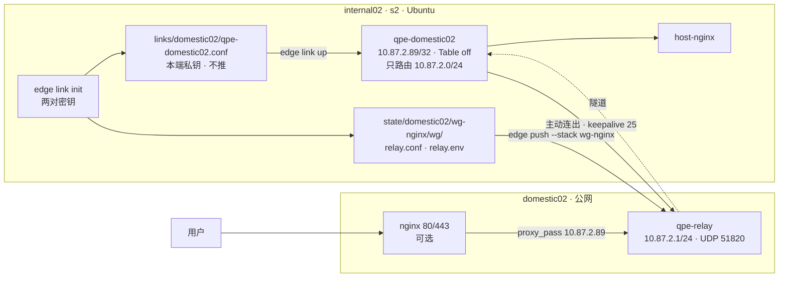
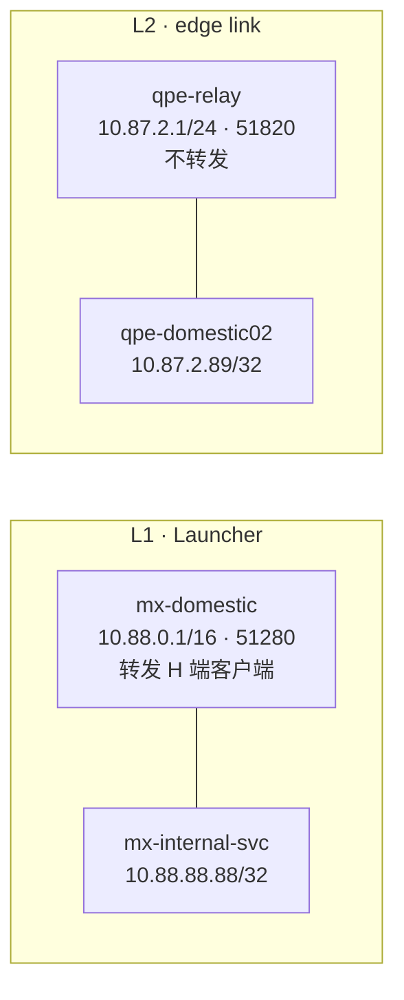

# 40. domestic02 到 internal02 的隧道：照 L1 的 10.88.0.1 / 10.88.88.88 做（`edge link`）

日期：2026-11-22。状态：工具仍写在 L1 仓库的 `electron-plugin/packages/tunnel-cli`（同 `docs/38`、`39`），**没有提交，没有发 npm 包，没有对任何真实机器执行过**。

本机实测过：两台 Alpine 3.23 容器，用 Docker Desktop 的真内核 WireGuard，分别当 domestic02 和 internal02。
- 推送：`edge push` → `remote.sh` → `deploy.sh` → `health.sh` 整条跑通，systemd 用一个替身脚本代替。
- internal02 端：`edge link up` 跑通。
- 结果：双向能 ping，握手正常，internal02 的默认路由没变。各种拒绝的情况见"实测"一节。

tunnel-cli 的测试共 165 项：162 项通过，3 项跳过，0 项失败，其中 edge 33 项。

本篇取代两处：
- `docs/38` 里 `wg-nginx` 用 `qp-tunnel-cli wg` 服务端实例做回源的部分；
- `docs/39`"更正"一节的做法（`wireguard.sh create` 加手改配置）。

`docs/38`、`39` 的其余内容不变。

2026-11-22 第十三轮：第 3 条的网段建议（`10.87.<n>.0/24`）已被 `docs/41` 取代，因为 `10.*` 都归 Launcher 的应用，改为 `100.127.(200+n).0/24`，domestic02 是 `100.127.202.0/24`。第 2 条和下文的网卡名 `qpe-relay` / `qpe-<机器>` 改成了 `qpjoy-relay` / `qpjoy-<机器>`（domestic02 缩成 `qpjoy-d02`）。第 4 条的冲突已经不存在：集群网段改成了和 s1 一样。`edge setup` 可以一步步做完下面这些命令，缺的工具会先问再装（`docs/41`）。本篇其余内容不变。

用户 2026-11-22 的说法：
- 之后会发到 npm，例如 2.1.16，再到服务器上安装。`package.json` 里已经是 2.1.16。
- 现在人在 internal02 上，想先把 domestic02 的 WireGuard 和内网连接设起来。
- 借鉴 de-llaaddddeerr 里 Domestic `10.88.0.1` 和 Internal `10.88.88.88` 的设置方式。
- 要一套从 internal02 上部署的脚本。

## L1 是怎么设的

下表来自源码，没在服务器上看过：
- 配置生成：`mx-launcher/server/scripts/site-slot-artifact-materializer.mjs` 的 `createWireGuardTemplate`；
- 安装脚本：`mx-internal-service-peer-apply.sh`；
- 设计说明：`mx-launcher/docs/14` 的 "V2 的 systemd/interface 命名"一节。

| | Domestic：`mx-domestic` | Internal：`mx-internal-svc` |
|---|---|---|
| 地址 | `10.88.0.1/16` | `10.88.88.88/32` |
| 端口 | 监听 UDP 51280 | 不用监听（可选的直连监听也是 51280） |
| 路由 | `Table = off`。地址自带 `10.88.0.0/16` 的直连路由；PostUp 再加产品网段（默认 `10.89.0.0/16`、`10.90.0.0/16`） | `Table = off`。PostUp 加 `10.88.0.1/32`、`10.88.0.0/16` 和产品网段。`/32` 是故意的：mihomo / Clash 的 TUN 装了更细的路由时，到 Domestic 的包仍进这张网卡 |
| 转发 | `ip_forward=1`；FORWARD、DOCKER-USER 放行同网卡进出；放行 53 端口。原因是 H 端客户端要经它到 Internal | 没有 |
| 对端 | Internal 的公钥，`AllowedIPs = 10.88.88.88/32` | Domestic 的公钥，`Endpoint = 公网地址:51280`，`AllowedIPs` 同上面的路由，`PersistentKeepalive = 25` |
| DNS | 没有 | 不写 `DNS` 行，免得 `wg-quick` 调 `resolvconf` 改宿主机的 DNS |
| 密钥 | 都由 Internal 生成，存在 Internal 的 secret 里，生成配置时填进去 | 同左 |
| 开机 | `systemctl enable --now wg-quick@mx-domestic` | `systemctl enable --now wg-quick@mx-internal-svc` |

方向是 Internal 主动连出去：Internal 没有公网入口，靠 keepalive 维持握手。

## 结论

1. **domestic02 和 internal02 之间用同样的形状**，新命令叫 `qp-tunnel-cli edge link`，在 internal02 上执行：
   - `init` 在 internal02 上生成两对密钥和两边的配置；
   - `edge push --stack wg-nginx` 把 domestic02 那一端推过去；
   - `link up` 装 internal02 这一端；
   - `link check` 两端一起查。
2. **和 L1 不同的地方有三处**：
   - **不转发，不做 NAT。** 回源只是 domestic02 本机的 nginx 到 internal02，没有第三方经过，所以不开 `ip_forward`，不加 iptables 规则。
   - **网卡名不同。** domestic02 上叫 `qpe-relay`，internal02 上叫 `qpe-<机器名>`（不超过 15 个字符）。
   - **端口默认 51820。** 不用 Launcher 的 51280，免得以后 domestic02 也跑 `mx-domestic`（Launcher 的多中继，`docs/15` 第 57 项）时两个抢同一个端口。
3. **网段不能放在 Launcher 的分配范围里。** Launcher 给每个 standalone 产品分一段 `/16`：MX-H2I 是 `10.89`，其余是 `10.(90+n)`，n 最大 164（`mx-launcher/server/src/store/domain.ts` 的 `defaultLauncherProductNetworkShape`，源码里写着）。也就是说 `10.88.0.0`–`10.254.255.255` 都归 Launcher，`edge link init` 一律拒绝这一段。
   - **建议**用 `10.87.<n>.0/24`，每台 Domestic 一段，Domestic 用 `.1`，Internal 的末位沿用 L1 的习惯：s1 `.88`、s2 `.89`。
   - 按这个建议，domestic02 是 `10.87.2.0/24`：domestic02 `10.87.2.1`，internal02 `10.87.2.89`。
   - `100.64.0.0/10` 也不建议，原因有两条：
     - 阿里云的元数据、DNS 等内部地址在这一段。tunnel-cli 的 no-proxy 里列着 `100.100.100.200`，那是阿里云的元数据地址。
     - OpenVPN 也用 `100.127.0.x`（`docs/08`）。
   - 这只是建议，网段由你定（`docs/15` 第 53 项）。工具不写死网段，`--subnet` 必须给。
4. **新发现的潜在冲突**：L2 集群的 Service 网段 `10.96.0.0/12` 和 Pod 网段 `10.244.0.0/16`（`docs/16`）也在 Launcher 的分配范围里。从 n=6 起（`10.96`），产品网段就会和集群网段重叠。
   - 现在 service peer 只路由默认的两个产品网段 `10.89`、`10.90`，不冲突。
   - 以后 s2 同时跑 Launcher 的 service peer 和集群，Launcher 又加到第 7 个 standalone 产品时会撞上。登记为 `docs/15` 第 66 项。
5. **密钥都在 internal02 上生成**（node:crypto 的 X25519）。实测和 `wg pubkey` 算出的公钥一致。
   - domestic02 的私钥写在 `state/domestic02/wg-nginx/wg/relay.conf`，随推送到 domestic02 的 `/opt/mx/state/wg-nginx/`（权限 600）。
   - internal02 自己的私钥只在 `links/domestic02/` 下，不推。实测：推出去的包里有 domestic02 的私钥，没有 internal02 的。
6. **nginx 可选。** state 里没有 `nginx/*.conf` 时只起隧道，不装 nginx、不改 nginx。先把隧道接通，站点以后再加。
7. **三道检查，不覆盖别人的东西**：
   - `init` 拒绝 Launcher 的范围，也拒绝本机已经有路由的网段；
   - `link up` 和 `deploy.sh` 在各自机器上再查一次路由；
   - `/etc/wireguard/<网卡>.conf` 开头没有 `# qp-tunnel-cli edge link` 的不覆盖。本工具自己写的配置变了，先备份到 `/etc/wireguard/qp-edge-backup/` 再换；
   - `init` 对已有的连接不覆盖，要重来得先手动把目录移开。
8. **`edge link up` 默认设成开机自启**，和 L1 一样 `systemctl enable`。`--no-boot` 只起这一次。`link down` 停掉网卡，配置文件留着。



和 L1 对照：



## 从 internal02 部署

前提：
- tunnel-cli 2.1.16 已装上；
- `edge origin set internal02` 已执行；
- `/var/lib/qp-tunnel/edge` 已建好（`docs/39`）；
- domestic02 是新机器，`edge status domestic02` 里没有 `pushed-by=other`。

```bash
sudo apt-get install -y wireguard-tools        # internal02 这一端要 wg、wg-quick
qp-tunnel-cli edge add domestic02 --host <公网IP> --user root --key ~/.ssh/<私钥> --role domestic
qp-tunnel-cli edge check domestic02            # 只读：系统族、51820 有没有被占
qp-tunnel-cli edge link init domestic02 --subnet 10.87.2.0/24 --ip 10.87.2.89
# 云安全组放行 domestic02 的 UDP 51820
qp-tunnel-cli edge push domestic02 --stack wg-nginx --dry-run
qp-tunnel-cli edge push domestic02 --stack wg-nginx --yes
qp-tunnel-cli edge link up domestic02          # 会要 sudo 密码
qp-tunnel-cli edge link check domestic02
```

`link check` 全部 `ok` 才算通：
- internal02 端：网卡在、有握手、`10.87.2.1` 走这张网卡、`1.1.1.1` 不走这张网卡、ping 通 domestic02；
- domestic02 端：`wg-quick@qpe-relay` 在跑、有握手、ping 通 `10.87.2.89`。

之后加站点：
- 在 `state/domestic02/wg-nginx/nginx/` 里放 `<名字>.conf`，`proxy_pass http://10.87.2.89:80`，再推一次；
- s2 的 host-nginx 要在 `10.87.2.89` 上听；
- ufw 要放行来自 `10.87.2.1` 的 80（`docs/35` 的端口表要补这一条）。

## 实测（本机 Docker，2026-11-22）

两台 `lscr.io/linuxserver/wireguard` 容器，Alpine 3.23。node 22 从 `node:22-alpine` 里拷进来。domestic02 用一个 `systemctl` 替身，把 `wg-quick@X` 映射成 `wg-quick up X`。没有新建 Docker 网络，用的是默认 bridge。

| 做了什么 | 结果 |
|---|---|
| 两个私钥分别算 `wg pubkey` | 和 `link.env` 里记的公钥一致 |
| `edge push domestic02 --stack wg-nginx --force-os`（Alpine 不是 debian / rhel） | `qpe-relay` 起来，`10.87.2.1/24`，监听 51820，只有一个对端 `10.87.2.89/32`；没有站点，nginx 没装；health 报"还没握手"，不算失败 |
| 容器里第一次推送 | 失败：镜像的 `/etc/wireguard` 是指向不存在目录的软链接。真机不会这样，但两个脚本都改成直接说明原因 |
| internal02 上 `edge link up domestic02` | 写入配置、`wg-quick up`；握手、路由、`1.1.1.1` 不进隧道、ping 全部 `ok` |
| domestic02 上 ping `10.87.2.89` | 通，握手时间更新 |
| 再推一次、再 `link up` 一次 | 配置"unchanged"，网卡不重启 |
| `link down` | 网卡没了，路由没了，配置文件还在 |
| internal02 上先加一条 `10.87.2.0/25 dev eth0` 再 `link up` | 拒绝，列出那条路由，什么都没改 |
| `/etc/wireguard/qpe-domestic02.conf` 换成别人的再 `link up` | 拒绝（退出码 3），文件没动 |
| domestic02 的 `qpe-relay.conf` 换成别人的再推送 | `deploy.sh` 拒绝，文件没动。`current` 已经切到新版本，这是 edge 原有的做法（先切再跑 deploy.sh），要 `edge rollback` |

容器里没有覆盖到的：
- 真 systemd 下的 `systemctl enable / start wg-quick@…`；
- Ubuntu、CentOS 上装 `wireguard-tools`；容器里已经自带。

## 还没做的

- 两个仓库都没提交，没有发 npm 包。没有对任何真实机器执行过。
- 网段是建议，要你定（`docs/15` 第 53 项）。Launcher 产品网段和集群网段的重叠记为第 66 项。
- 第二台 Internal 连同一台 Domestic（例如 internal01 也连 domestic02 做备份）：`relay.conf` 现在只有一个对端。要做的话，`init` 得能往已有的 relay 加对端，而组件归谁管（`docs/39` 的推送机）要先说清楚。
- s2 的 host-nginx 在 `10.87.2.89` 上听、ufw 放行 `10.87.2.1`：没写进 `docs/35` 的阶段脚本。
- `open-nginx` 还是用 `qp-tunnel-cli open` 的服务端实例，没有改成同样的形状。OpenVPN 客户端用 `route-nopull`，只路由网段，没有 `wg enroll` 那种问题。
- npm 包会带上旧的 `resources/edge/vendor/scripts/wireguard.sh`。那是 gitignore 掉的构建产物，现在没有栈用它；发布前可以手动删掉，不影响功能。
