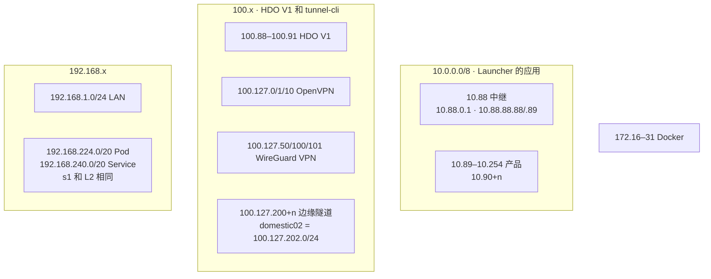

# 41. 网段沿用 v1；边缘隧道用 100.127、网卡改名 qpjoy；`edge setup` 一步步执行，缺的工具自动装

日期：2026-11-22。状态：分两部分。

**tunnel-cli 部分**仍写在 L1 仓库的 `electron-plugin/packages/tunnel-cli`（同 `docs/38`–`40`），**没有提交，没有发 npm 包，没有对任何真实机器执行过**。本机实测过 `edge setup` 从头到尾：
- 一个 privileged 的 Alpine 容器，默认网络命名空间当 internal02，另一个命名空间当 domestic02，两者用 veth 相连，WireGuard 用 Docker Desktop 的真内核；
- 由一个 pty 脚本逐个回答提示，大多数直接回车用默认值；跑通，退出码 0；
- 第二次运行沿用了已存的主机和隧道。

tunnel-cli 的测试共 166 项：163 项通过，3 项跳过，0 项失败，其中 edge 34 项。

**de-ladder2 部分**（集群网段）：`./scripts/manage.sh check` 通过。这只证明能渲染，没有在任何集群上跑过。

本篇取代以下内容：
- `docs/16` 的"Pod / Service 网段"一行；
- `docs/40` 第 3 条的网段建议（`10.87.<n>.0/24`）和第 2 条里的网卡名（`qpe-*`）；
- `docs/15` 第 53、66 项的建议。

`docs/40` 的其余内容不变。

2026-11-22 第十四轮：`edge setup` 第 3 步多了"现在怎么登录"（password / key file），第 4 步遇到密钥被拒时会问要不要用一次密码；提示行不再写光标控制序列。见 `docs/42`，本篇其余内容不变。

2026-11-22 第十五轮：第 3 条"每台 Domestic 一个 `/24`（`100.127.(200+n).0/24`）"已被 `docs/43` 取代，改成共享的 `100.127.200.0/24`，每台机器一个固定地址（Domestic `.N`，Internal `.87+N`）。

用户 2026-11-22 的说法：
- qp-tunnel-cli 能不能自动检查、安装必须的工具，例如 wireguard-tools。
- 把 `qpe` 的名字改成 `qpjoy`。
- 这些命令都能以 TUI 的形式一步步执行：需要输入的地方提醒，并给默认值，包括端口、网段等。
- `10.*` 好像都分配给了 Launcher 的应用；集群网段可以改，借鉴目前 v1 的网段规划。

## v1 的网段规划（源码和文档里写着）

| 网段 | 给谁 | 出处 |
|---|---|---|
| `10.88.0.0/16` | Launcher 的中继：Domestic `10.88.0.1`，service peer `10.88.88.88` | `mx-launcher/server/scripts/site-slot-artifact-materializer.mjs` |
| `10.89.0.0/16`–`10.254.0.0/16` | Launcher 的产品，MX-H2I `10.89`，其余 `10.(90+n)`，n ≤ 164 | `mx-launcher/server/src/store/domain.ts` |
| `10.0.0.0/8` 其余 | 用户说都给了 Launcher 的应用（2026-11-22）。s1 上另有一个 `10.8.0.0/24` 的 OpenVPN（tunnel-cli `docs/01`） | 用户口述 |
| `100.88.0.0/14` | HDO V1（`100.88`–`100.91`） | `mx-launcher/setup/production.topology.md` |
| `100.127.0.0/24` 起 | tunnel-cli 的 OpenVPN mesh（instance mx，s1 `.10`），每台海外服务器一段：`100.127.0`、`100.127.1`……另见 `100.127.10` | tunnel-cli `docs/01`、`openvpn.setup.md` |
| `100.127.50.0/24`、`.100`、`.101` | tunnel-cli 的 WireGuard VPN 默认和备选 | `scripts/wireguard.sh` |
| `192.168.224.0/20` | s1 的 Pod 网段（flannel） | `mx-launcher/docs/11-k8s-deployment-runbook.md`、`scripts/install-k8s-centos.sh` |
| `192.168.240.0/20` | s1 的 Service 网段 | 同上 |
| `172.16.0.0/12` | Docker 常用；s1 上 15 个网桥已经用完默认池，又溢出到 `192.168.0.0/20` 等 | runbook、tunnel-cli `docs/01` |

runbook 里选 `192.168.224/240` 的理由（原话大意）：
- 避开 HDO V1 的 `100.*`，避开 MX-H2I / WG 规划里的 `10.88`–`10.254`；
- 不用 `172.88`、`172.89`，它们不是私网段；
- `172.16`–`172.31` 是私网段，但 Docker 常用。

## 结论

1. **L2 的集群网段和 s1 一样**：Pod `192.168.224.0/20`，Service `192.168.240.0/20`。改在 `infra/k8s/versions.env`、`cluster/kubeadm-init.yaml`、`platform/gateway/ngf-values.yaml`（cni0 变成 `192.168.224.1`）。`manage.sh check` 和 `node verify s2 host` 不再写死网段，按 `versions.env` 算。
   - **为什么照搬，不选相邻的两段**：这两段已经在 s1 上和那边的 Docker 网桥共存过，阶段 B s1 `kubeadm reset` 后并入 L2 时不会撞。相邻的 `192.168.192.0/20`、`192.168.208.0/20` 有没有被 s1 的 Docker 溢出网桥占用，不知道（s1 的 `ip route` 没有完整记录）。
   - **两套集群同时存在时网段相同，没有问题**：两个集群的 Pod 网段之间不互通。s1 和 s2 之间都走 LAN 地址，flannel 会把 Pod 出集群的流量伪装成节点地址。
   - **代价有两个**：
     - 日志里同一个 Pod 地址可能来自两个集群，看的时候要分清是哪台；
     - Docker 以后在 s2 上建网桥，可能落进 `192.168.240.0/20`：Service 网段没有路由，Docker 看不出它被占了。s1 现在也是这样。
   - **想要两套集群网段不同**：改用 `192.168.192.0/20` / `192.168.208.0/20`，前提是先在 s1 上确认这两段空着。
2. **`docs/15` 第 66 项不再成立**：集群网段已经离开 `10.*`。
3. **边缘隧道用 `100.127.(200+n).0/24`**，和 v1 一样把 tunnel-cli 的隧道放在 `100.127` 里，n 取机器名末尾的数字：
   - domestic02 是 `100.127.202.0/24`，domestic02 自己 `.1`；
   - Internal 的末位是 87 加推送机名字末尾的数字：s1 / internal01 `.88`，s2 / internal02 `.89`，和 Launcher 的 `10.88.88.88` / `.89` 一样。
   - 这是按用户"10.* 都归 Launcher、借鉴 v1"推出来的。`docs/15` 第 53 项按这个答复划掉，不对再改。
4. **`edge link init` 拒绝这些网段**：`10.0.0.0/8`、`100.88.0.0/14`、`100.127.0.0/24`、`192.168.224.0/19`。另外也拒绝：
   - 同一台推送机上另一条隧道已经用的网段或网卡名；
   - 本机已有路由的网段。

   原来只拒绝 `10.88`–`10.254`。
5. **网卡名改成 `qpjoy-`**：
   - domestic02 上是 `qpjoy-relay`；
   - internal02 上是 `qpjoy-<机器名>`。Linux 网卡名最多 15 个字符，`qpjoy-domestic02` 有 16 个，所以缩成 `qpjoy-` + 首字母 + 末尾数字，也就是 `qpjoy-d02`。
6. **`qp-tunnel-cli edge setup` 一步步做完**，每个问题都带默认值，回车即用，Ctrl-C 停下。已经做完的步骤保留，再跑一次会沿用已存的主机和隧道。
7. **缺的工具自动装，先问**：
   - 推送要 `ssh`、`tar`。设了 `QP_EDGE_SSH_BIN` 时查它指向的那个 ssh；
   - 隧道要 `wg`、`wg-quick`、`ip`、`ping`：apt 装 `wireguard-tools iproute2 iputils-ping`；dnf / yum 装 `wireguard-tools iproute iputils`，EL 上先装 `epel-release`；
   - 在终端里问，默认是"装"；不在终端时要 `--yes` 才装，否则只打印要执行的命令；
   - 用 sudo 装，所以 `PROXY` / `HTTPS_PROXY` 作为参数传进去，apt 另加 `Acquire::http(s)::Proxy`；
   - CentOS Linux 8 会多打印一句：仓库要指向 vault 或本地镜像；
   - 边缘机器那头本来就由 `deploy.sh` 自动装 `wireguard-tools`。

`edge setup` 的 8 步：

| 步 | 做什么 | 问什么，默认值 |
|---|---|---|
| 1 | 本机工具 | 缺什么、装不装（默认装） |
| 2 | edge home 和推送机名字 | 父目录写不了时问要不要 `sudo install -d`；名字默认是主机名（internal02） |
| 3 | 边缘机器 | 从已存的里选，或新加：名字（internal02 推出 domestic02）、公网地址（必填）、用户 root、端口 22、私钥（`~/.ssh/id_ed25519` 等，有哪个用哪个）、跳板机（无）、角色 domestic |
| 4 | 只读地看一眼 | 不问。连不上就停；有别的工具部署的组件（现在那台 Domestic）也停 |
| 5 | 技术栈 | 默认 wg-nginx |
| 6 | 隧道（wg-nginx）或 state 文件（其他栈） | 网段 `100.127.202.0/24`、对方 `.1`、本机 `.89`、UDP 51820、拨号地址 `公网IP:51820`、网卡 `qpjoy-relay` / `qpjoy-d02`；输错了说明原因再问一次 |
| 7 | 推送 | 提醒安全组放行哪些端口（回车继续）；打印推送计划，问推不推（默认推） |
| 8 | 本机这一端 + 两端检查 | 开机自启（默认是）。其他栈这一步是 `status --health` |



## 从 internal02 部署（装上 2.1.16 之后）

```bash
qp-tunnel-cli edge setup
```

一路回车，只有 domestic02 的公网地址要自己填。要一条一条做，看 `docs/40` 的命令；`edge link init domestic02` 不带 `--subnet` 时，在终端里也会一项项问。

## 实测（本机 Docker，2026-11-22）

| 做了什么 | 结果 |
|---|---|
| privileged 容器 + `d2` 命名空间，`QP_EDGE_SSH_BIN` 换成 `ip netns exec d2`，systemd 用替身脚本 | — |
| pty 脚本跑 `edge setup`，故意先输入 `10.95.2.0/24` | 提示"overlaps 10.0.0.0/8, Launcher applications"，又问了一次；其余全用默认值 |
| 第 7 步推送 | `qpjoy-relay` 在 `100.127.202.1/24` 起来；没有站点，nginx 没装 |
| 第 8 步 | `/etc/wireguard/qpjoy-d02.conf` 写入并设成开机自启；本机这端 5 项全部 `ok`；domestic02 那端 3 项全部 `ok`；退出码 0 |
| 第二次跑 `edge setup` | 选中已存的 domestic02，问"Use this link?"；推送一个新版本，两边配置都是"unchanged"，网卡没重启，检查全部 `ok` |
| 第一次跑时容器里没有 ssh | 发现工具检查写死了 `ssh`，没看 `QP_EDGE_SSH_BIN`，已经改了 |
| 自动安装（单元测试，假的 `apt-get`） | 不在终端、没加 `--yes`：只打印命令，什么都没装；加 `--yes`：执行 `apt-get update`、`install -y -q wireguard-tools`，然后继续 |
| 自动安装（真的 apt） | 没测成：本机的 Debian 容器连不上网，apt 卡住了 |

## 还没做的

- 两个仓库都没提交，没有发 npm 包。没有对任何真实机器执行过。
- 真机上用 apt / dnf 自动装 `wireguard-tools`。在 s2（Ubuntu 26.04）上第一次跑 `edge setup` 时就会走到。
- 集群网段的改动没在集群上跑过：`kubeadm init` 用 `192.168.224.0/20` / `192.168.240.0/20`，flannel 跟着改（`install.sh` 按 `POD_CIDR` 替换），网关信任 `192.168.224.1`，都要在 s2 第一次装集群时核对（`docs/35`）。
- 阶段 B 并入前，要在 s1 上 `ip -4 route` 确认 `kubeadm reset` 后这两段没被留下的路由占着（`cni0`、`flannel.1` 要删干净）。
- `edge add` 本身不问问题。要一步步问，用 `edge setup`。
- `open-nginx` 的隧道还是 `qp-tunnel-cli open` 的服务端实例，模板里的 `100.127.70.0/24` 没改成按机器分段。
