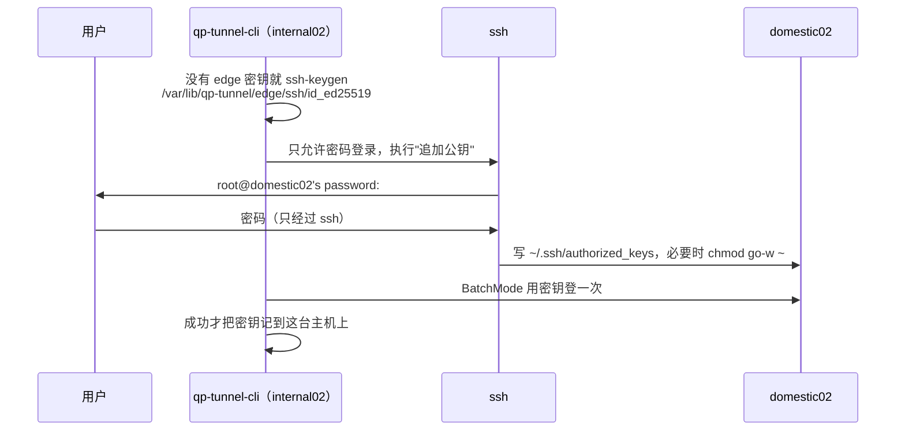

# 42. 边缘机器只给了密码：用一次密码装上推送机的 edge 密钥（照 v1 的 Bootstrap Key）

日期：2026-11-22。状态：工具写在 L1 仓库的 `electron-plugin/packages/tunnel-cli`，**没有提交，没有发 npm 包**。用户已经发了 2.1.17，本篇的内容不在里面，要发下一个版本才有。没有对任何真实机器执行过。

本机实测过：
- 两台 `nicolaka/netshoot` 容器，domestic02 的 sshd 只接受密码；
- 由 pty 脚本驱动 `edge setup`：新主机选"password"、已存主机被拒后补装，两条路都跑通了；
- tunnel-cli 的测试共 167 项：164 项通过，3 项跳过，0 项失败，其中 edge 35 项。

本篇补充 `docs/41`，41 的结论不变。

用户 2026-11-22 在 internal02 上跑 `edge setup`，走到"SSH private key [none]"时说：需要支持密码登录。同一张截图里，每个提示行开头多出一个 `[`。

## 结论

1. **不保存密码，照 v1 的 Bootstrap Key 做。**
   - `mx-launcher/setup/production.topology.md` 写着：一次性密码只用来把 Internal 生成的公钥写进远端的 `~/.ssh/authorized_keys`，不作为长期凭据保存。
   - 这边一样：密码由用户输进 ssh 自己的提示，tunnel-cli 看不到、不经手、不落盘。
   - 之后所有连接都用密钥，原来的 BatchMode（不交互）不变。
2. **每台推送机一把 edge 密钥**：放在 `/var/lib/qp-tunnel/edge/ssh/id_ed25519`，第一次用到时由 `ssh-keygen` 生成。ed25519，不设口令，因为 edge home 本身就是 700、只属于推送机用户。`ssh-keygen` 不在时按 `docs/41` 的做法先问再装（`openssh-client`）。
3. **装公钥的那次登录做这些事**：
   - 建 `~/.ssh`（700）和 `authorized_keys`（600）；
   - 已有同一行就不再追加；
   - 有 `restorecon` 就恢复 SELinux 标签；
   - 家目录要是组或其他人可写，就去掉写权限，并在输出里写明。sshd 默认的 StrictModes 遇到这种家目录会拒绝所有密钥，测试镜像就是这样，权限是 770。
4. **装完立刻用密钥登一次**：成功才把密钥记到这台主机上。登录用户不是 root 时，再查一下能不能免密 sudo，不能就提示：推送要 root。
5. **密码登录不了时，把公钥打印出来**：云镜像常设 `PermitRootLogin prohibit-password`，这时不会改远端的 sshd 配置，只把公钥打印出来，让用户从云控制台或别的方式加上。
6. **`edge setup` 两处会问到密码**：
   - **第 3 步新加主机时**，问"现在怎么登录"：password 或 key file。`~/.ssh` 里有私钥、或推送机已有 edge 密钥时，默认 key file，否则默认 password。
   - **第 4 步已存的主机拒绝密钥时**（Permission denied、密钥文件不存在等），问要不要用一次密码补装。连接超时、拒绝连接这类网络问题照旧直接停下。
7. **命令行版**：
   - `qp-tunnel-cli edge key` 显示密钥、公钥和哪些主机在用；
   - `qp-tunnel-cli edge key install <名字>` 做第 3 条。必须在终端里跑，因为 ssh 要在终端上问密码。
8. **提示行开头的 `[`**：原因是 readline 在每个提示前写了光标控制序列 `ESC[1G`（回到行首）和 `ESC[0J`（清掉下面），本机用 pty 抓字节看到的。有的终端会把它显示成多出来的一个字符。提示改成普通的行输入，不再写这两个序列，实测输出里已经没有了。行内编辑交给终端自己，方向键在这种模式下不能移动光标。



## 现在（2.1.17）怎么办

2.1.17 还没有这个功能。下一个版本发出来之前，可以先用系统自带的 `ssh-copy-id` 手动做一样的事：

```bash
test -f ~/.ssh/id_ed25519 || ssh-keygen -t ed25519 -N '' -f ~/.ssh/id_ed25519
ssh-copy-id -i ~/.ssh/id_ed25519.pub root@<domestic02公网IP>
qp-tunnel-cli edge add domestic02 --host <domestic02公网IP> --user root --key ~/.ssh/id_ed25519 --role domestic
qp-tunnel-cli edge setup
```

## 实测（本机 Docker，2026-11-22）

| 做了什么 | 结果 |
|---|---|
| domestic02：sshd 只开密码；internal02：没有任何私钥 | 不交互的登录被拒，和用户的情况一样 |
| `edge setup` 新加主机，选 password，在 ssh 的提示里输入密码 | 生成 edge 密钥，公钥写进 `authorized_keys`；但密钥登录被拒，sshd 日志写着"bad ownership or modes for directory /root"（镜像的 `/root` 是 770） |
| 加上"家目录去掉组和其他人的写权限"后重跑，选已存的 domestic02 | 第 4 步说密钥被拒，问要不要用密码；输入密码后打印"removed group/other write permission from /root"，密钥登录成功，`authorized_keys` 仍只有一行，进入第 5 步 |
| 抓终端输出的字节 | 没有 `ESC[1G` / `ESC[0J` |
| `edge key` | 显示密钥路径、公钥，"used by domestic02" |
| 单元测试 | 还没用过时 `edge key` 显示"还没有"；不在终端时 `edge key install` 拒绝，也不连接 |

## 还没做的

- 没提交，没发 npm 包（下一个版本，例如 2.1.18）。没有对真实机器执行过。
- 不处理 sshd 不允许密码登录的情况，只打印公钥，因为不改远端的 sshd 配置。
- 每台推送机一把密钥。要换密钥，目前得手动生成并重新 `edge key install`，没有"轮换"命令。
