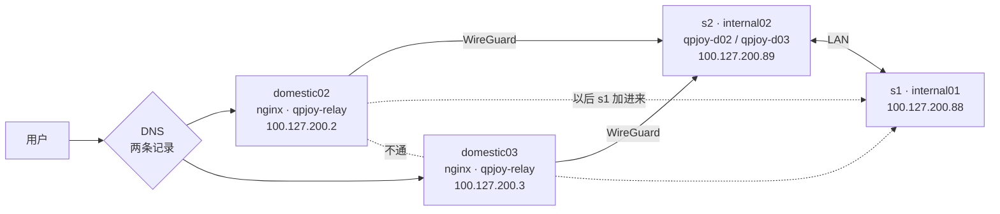

# 43. 边缘拓扑：只走 Domestic → Internal，nginx 分后端，DNS 分 Domestic；一段共享网段，每台机器一个固定地址

日期：2026-11-22。状态：分三部分。

**决策**：用户 2026-11-22 定的。

**工具**：写在 L1 仓库的 `electron-plugin/packages/tunnel-cli`，没有提交，没有发 npm 包。用户装的 2.1.17 里没有这些，要发下一个版本。本机实测过：
- 一个 privileged 容器里放三个网络命名空间（internal02、domestic02、domestic03），WireGuard 用真内核；
- tunnel-cli 的测试共 168 项：165 项通过，3 项跳过，0 项失败，其中 edge 36 项。

**真机情况**：internal02 → domestic02 在真机上握不上手，原因还没确认，见"internal02 上的那次失败"。

本篇取代 `docs/41` 第 3 条（每台 Domestic 一个 `/24`，`100.127.(200+n).0/24`）和 `docs/15` 第 53 项的答复。`docs/41` 其余内容不变。

2026-11-22 第十六轮：第 3 条的地址表已被 `docs/44` 取代。默认改成沿用 Launcher 编号的 10.88（domestic02 `10.88.0.2`，s2 `10.88.88.89`）；`100.127.200.0/24` 留作可切换的 isolated 方案。中继改成只占自己的 `/32`。真机上 internal02 → domestic02 已经通了（2.1.17，`100.127.202.0/24`）。本篇其余结论不变。

用户 2026-11-22 的说法：
- 为了 s1 和 s2 做容灾和负载，问 domestic02 的 wg 地址和 internal 的地址要不要和 v1 一样；
- domestic01 和 domestic02 之间、domestic 和 internal01/02 之间要不要都用 wg 连通，开销大不大，不大就做成 mesh；
- 正常只有 domestic → internal 的流量，问能不能跨 internal。

我回答之后，用户定了：s1 先不加进来；只走 domestic → internal；nginx 做负载；DNS 做 domestic 之间的切换。

## 结论

1. **只连 Domestic → Internal**：
   - Domestic 之间不连：没有流量需要，而它们是最暴露的机器；
   - Internal 之间不走 WireGuard：s1、s2 在同一个机房的 LAN 里，"跨 internal"走 LAN。
2. **容灾和负载在两层做**：
   - 每台 Domestic 的 nginx 在多个 Internal 之间分流、摘掉坏的；
   - 多台 Domestic 之间靠 DNS 切换（`docs/15` 第 55 项）。
   - s1 先不加。现在每台 Domestic 只有 s2 一个后端；还在 s1 上的服务由 s2 经 LAN 转过去（`docs/37` 第 5 条）。s1 加进来要在 s1 上新建网卡和路由，属于硬约束，要用户明确同意。
3. **一段共享网段 `100.127.200.0/24`，每台机器一个固定地址**，末位照 v1 排：

   | 机器 | 地址 | 对照 v1 |
   |---|---|---|
   | domestic01 | `100.127.200.1` | `10.88.0.1` |
   | domestic02 | `100.127.200.2` | |
   | domestic03 | `100.127.200.3` | |
   | internal01（s1，暂不加） | `100.127.200.88` | `10.88.88.88` |
   | internal02（s2） | `100.127.200.89` | `10.88.88.89` |

   - 规则：Domestic 名字末尾是 N，地址就是 `.N`（1–86）；Internal 末尾是 N，地址就是 `.87+N`。
   - 不直接用 v1 的 `10.88`：s1 上的 `mx-internal-svc` 已经占了 `10.88.88.88`，s2 复刻 Launcher 时会占 `.89`（`docs/36`）。同一台机器上两张网卡用同一段地址会抢路由；而且同一个 `/32` 不能同时属于两个对端。`10.0.0.0/8` 本来就归 Launcher（`docs/41`）。
   - 每台 Domestic 上 nginx 的后端都写同样的地址：`.89`，以后加上 `.88`。
4. **Internal 上每台 Domestic 一张网卡**（`qpjoy-d02`、`qpjoy-d03`），地址都是 `.89/32`，只给对应 Domestic 的那个 `/32` 加路由，不给整段 `/24`。效果：
   - Domestic 之间互相不通：实测 domestic02 去 ping domestic03，内核报 "Required key not available"；
   - 加一条、拿掉一条隧道不会影响别的隧道。
5. **Domestic 上一张网卡**（`qpjoy-relay`），地址 `.N/24`，监听 UDP 51820，对端是 Internal（现在只有 s2）。
   - 等 s1 加进来时，domestic02 要有两个 Internal 对端，而这个组件归先推送的那台推送机管（`docs/39`）。那时再做"每台推送机只管自己那个对端"，现在不做。
6. **WireGuard 的开销**：这些是协议本身的数字和由此推出的估算，不是实测。
   - 空闲对端只有 keepalive，每 25 秒一个约 60 字节的包；
   - 每个数据包多约 60 字节头，按 1420 的 MTU 算约 4%；
   - 加解密按流量算，和对端个数无关；
   - 真正的成本是配置分发和暴露面，所以按第 1 条只连需要的方向。
7. **`edge link check` 会说明为什么握不上手**。它对比三类信息，然后写出最可能的原因：
   - internal02 发出了多少字节；
   - domestic02 收到多少、回了多少；
   - domestic02 的 firewalld / ufw / iptables 状态。domestic02 上装了 tcpdump 时，还会抓 7 秒 UDP 包。tcpdump 在主机防火墙之前看包，所以能分清"包根本没到"和"到了被本机防火墙挡掉"。

   能指出的原因：

   | 两端看到的 | 写出的原因 |
   |---|---|
   | 包没到 domestic02 | 云安全组没放行 UDP 51820，阿里云在"安全组 → 入方向" |
   | 包到了，被本机拦下 | 本机 firewalld / ufw / iptables 拦了，附上放行命令 |
   | domestic02 上的中继不是这次推送的那个 | 中继密钥对不上，要重新推送 |
   | domestic02 回了包，internal02 没收到 | 回包在 internal02 这边被丢了 |
8. **重建隧道不删文件**：`edge link init <机器> --replace`，或 `edge setup` 里对"Use this link?"答 n。
   - 先用新参数做完所有检查，通过以后才把旧文件挪到 `/var/lib/qp-tunnel/edge/replaced/<时间>-<机器>/`；
   - 再推一次，domestic02 上的配置先备份再替换；
   - 新旧网卡不同名时，旧网卡会被停掉，配置文件保留。

## internal02 上的那次失败（2.1.17，真机）

用户 2026-11-22 贴的输出说明：
- 两端的网卡都在，`wg-quick@qpjoy-relay` 在跑，路由正确；
- 但两端都没有握手，ping 不通。

两边的配置是同一次 `init` 一起生成的，所以最可能是 UDP 51820 在路上被挡了。domestic02 是阿里云的机器，最常见的原因是安全组入方向没放行。还没确认，2.1.17 上按下面的方法确认。

1. 在 internal02 上执行 `sudo wg show qpjoy-d02`。如果显示 "received 0 B"、sent 不是 0，说明包发出去了，没有回来。
2. 在 domestic02 上执行 `timeout 15 tcpdump -ni any -c 3 udp port 51820`：
   - 没抓到包：是安全组的问题（或者机房出口挡了出站 UDP 51820）；
   - 抓到了包：是 domestic02 本机的防火墙（ufw / firewalld / iptables）挡了。

安全组放行后不用重新推送，直接 `edge link check domestic02` 再查一次。

## 实测（本机 Docker，2026-11-22）

| 做了什么 | 结果 |
|---|---|
| internal02 连 domestic02、domestic03，都用 `100.127.200.0/24` | domestic02 `.2`、domestic03 `.3`，internal02 两条隧道都是 `.89`；internal02 上只有两条路由：`.2 dev qpjoy-d02`、`.3 dev qpjoy-d03`；两条隧道的检查都通过 |
| domestic02 ping internal02、ping domestic03 | 前者通；后者内核报 "Required key not available" |
| domestic02 上 `iptables -I INPUT -p udp --dport 51820 -j DROP`，然后 `--replace`、推送、`link up` | 本机发出 592 字节、收到 0；why 里写着"an iptables rule on domestic02 drops udp 51820"；退出码 1 |
| 删掉那条规则，8 秒后 `link check` | 两端都有握手，退出码 0；domestic03 全程不受影响 |
| 第一次试 `--replace` | 发现一个 bug：旧隧道先被挪走，之后的路由检查认不出旧网卡还是自己的，新隧道被拒，而旧的已经挪走。已改成先做完所有检查再挪，并加了"被拒的 `--replace` 什么都不挪"的测试 |

## 还没做的

- 没提交，没发 npm 包。真机上那次失败的原因还没确认。
- s1 加进来：要用户同意改 s1；也要先做"一台 Domestic 上有多个推送机的对端"（第 5 条）。
- nginx 的多后端配置（upstream、`max_fails`）还没有模板。现在只有一个后端，等 s1 加进来时一起做。
- DNS 在多台 Domestic 之间切换，取决于用哪家解析（`docs/15` 第 55 项）。
- 已经用 2.1.17 建好的 `100.127.202.0/24` 隧道，换到共享网段要 `--replace` 一次。
