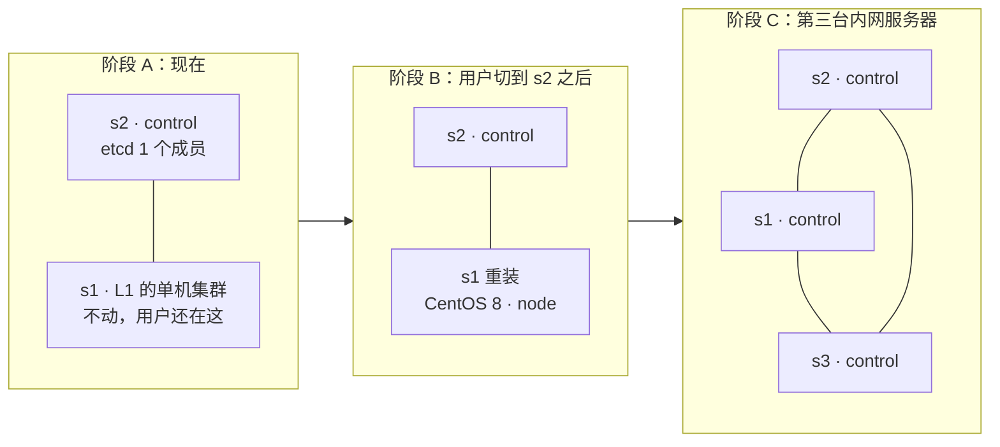
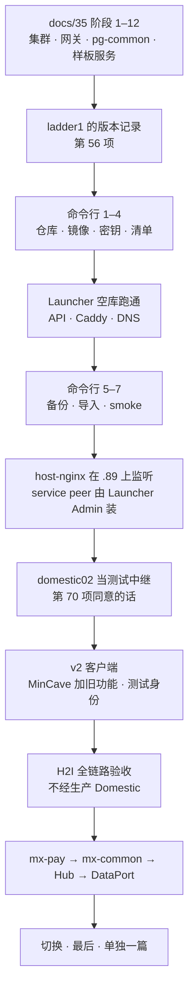

# 45. 动手做 Launcher v2 之前：一台 control、组件不换、部署方式要改、先补命令行，MX-H2I v2 以新界面为底

日期：2026-11-22。状态：设计和建议，没有在任何机器上执行。2026-11-22 第十八轮：第 5 条"代码放 `ladder1/…`"和第 56 项已被 `docs/46` 取代：代码从 L1 拷进本工程的 `architecture/`（Launcher）和 `projects/`（业务项目），`ladder1/` 不再改；第 7 节的命令行 2–4（镜像、密钥、清单）有了，镜像先导入节点、不装仓库。

**依据**：
- MX-H2I 和 Launcher 的情况来自 `ladder1/`（L1 `pro` 分支 `0a92448`）和 L1 仓库的提交记录，属于源码里写着的，没有装客户端核对；
- 集群部分沿用 `docs/16`、`docs/36` 的结论，这里只补理由和多节点之后要改的做法。

**真机**：用户 2026-11-22 说 domestic02 `10.88.0.2` ↔ internal02 `10.88.88.89` 已经通了，用的是 launcher 方案（`docs/44`）。npm 上 tunnel-cli 最新是 2.1.19。

本篇补充 `docs/36`，不改它的结论。第 6 条给"切换前必须关掉的"那张表提了一个可选的例外，要用户定。

用户 2026-11-22 的说法：
- 要移植 mx-launcher 和 mx-h2i 的能力；
- mx-h2i 3.0.0 之后是新界面，一些功能和高级功能在之前的版本里，基于新界面做进 v2，不影响 de-llaaddddeerr 里的版本；
- 实现 v2 之前，先补命令行的必要功能，并考虑怎么把 mx-launcher 融进之前设计的架构；
- 问：internal02 和现在在用的 internal 做成双 master，以后加的机器都当 node；还是 internal02 当主，internal（s1）以后作为 node 加入；
- 问：k8s 组件沿用 etcd、flannel、CoreDNS 这些，还是做成集群后要换一种部署方式。

## 结论

### 1. 一台 control（s2），s1 以后作为 node 加入；不做双 master

- **两台 control 比一台更脆。** 两台各放一个 etcd 成员，要 2 票才能写，坏任何一台集群就不能写（`docs/16`）。
- **s1 现在加不进来。** s1 自己是一个 kubeadm 集群，加入 L2 要先 `kubeadm reset`，MX-H2I 的登录和联网会全停。L1 的部署脚本也要求节点数为 1（`docs/16`）。所以 s1 只能等用户切到 s2 之后，重装再加入，就是阶段 B。系统还是 CentOS Linux 8，`node prepare` 要补 rhel 的做法（`docs/39`）。
- **控制面高可用等第三台内网服务器**，三台都做 control，就是阶段 C。
  - s2 的 kubeadm 配置里已经写了 `controlPlaneEndpoint: k8s-api.ladder2.internal:6443`，所以升到三台不用重建集群（`docs/16`）。
  - 到时 s1 也可以从 node 改成 control：先 drain，再 `kubeadm reset`，再 `kubeadm join --control-plane`。这是 kubeadm 文档里的做法，本工程没试过。
- **用户以前说的"双 master"是两台推送机**（`docs/39`），在边缘这一层已经是这样：每台 Internal 都能往别的机器推送。这和 Kubernetes 的控制面是两回事。
- **服务的高可用不靠控制面。** control 坏了，已经在跑的 Pod 和网关照常工作（`docs/26`）。高可用靠三样：副本分到两台机器、数据库有流复制副本、Domestic 的 nginx 有两个后端。

### 2. 组件不换，沿用 s1 的那一套

| 组件 | 用什么 | 写在哪 |
|---|---|---|
| 发行版 | kubeadm v1.36 | `infra/k8s/versions.env` |
| 容器运行时 | containerd | `infra/k8s/cluster/kubeadm-init.yaml` |
| etcd | kubeadm 默认的 stacked，和 control 在同一台，单独分卷 `/var/lib/etcd` | `kubeadm-init.yaml`、`docs/16` |
| DNS | CoreDNS，kubeadm 自带 | — |
| kube-proxy | kubeadm 默认，配置里没改 | — |
| CNI | flannel，版本在 `versions.env` | `docs/16` |
| 网段 | Pod `192.168.224.0/20`，Service `192.168.240.0/20`，和 s1 一样 | `docs/41` |

多台机器之后也不用换：
- flannel 的 vxlan 在节点之间走 LAN 上的 UDP 8472，和宿主机上的 WireGuard 不冲突，因为边缘隧道只路由 `/32`（`docs/44`）。
- `/20` 的 Pod 网段按 flannel 默认每台 `/24`，能分 16 台。这是按网段算的。
- 有一个限制：flannel 不执行 NetworkPolicy。以后要用它隔离 mx-pay 这类服务，得另加组件，那时单独写一篇。

### 3. 要变的是部署方式

L1 有些做法只在单机上成立，多节点之后要改：

| L1 单机的做法 | 多节点时的问题 | L2 的做法 | 状态 |
|---|---|---|---|
| 镜像用 `ctr import` 在本机导入，`imagePullPolicy: Never` | Pod 调度到别的机器就起不来 | 镜像仓库 `registry:2`，放 s2，只对内网（`docs/15` 第 45 项）；`image build`、`image push` | 没做，等用户同意 |
| hostPath 卷 | 绑死一台机器的目录 | 数据库用 `local-retain`；文件类用 NFS，数据库不放 NFS（`docs/20`） | 存储类写了，没跑过 |
| hostNetwork / hostPort 占 80、18090、53 | 落在哪台取决于调度，还占了 80 | 两个 Gateway 的 NodePort 加 host-nginx（`docs/18`、`docs/35`） | 写了，没跑过 |
| 只能在一台机器上跑的 host-runner、service peer | — | `nodeSelector: mx.ladder2/site-peer=true` | 设计 |
| 进程内的定时任务 | 开 2 副本会重复执行 | 先选主（`pg_advisory` 锁），再开 2 副本（`docs/36`） | 设计 |
| 部署入口是各项目的 `manage.sh`，它要求单节点 | — | 本工程 `manage.sh app apply <服务> --context ladder2`，清单在 `services/<服务>/` | `app apply` 有，Launcher 的清单没写 |
| 密钥由 L1 脚本在 s1 上生成或读本机文件 | — | `secret apply`：从推送机本地目录建 Secret，不进 Git | 没做 |
| 备份靠 L1 的恢复脚本 | — | `backup run`、`backup verify`、`restore`（`docs/19`） | 没做 |

不引进 Argo CD 这类 GitOps：现在一个人用，`manage.sh` 一条命令做一件事就够（`docs/16` 门槛从简）。镜像构建以后可以交给 `mx-ops` 里的 Jenkins（`docs/30`）。

### 4. MX-H2I：新旧界面在同一个包里，大部分功能还在

源码里看到的：
- **新界面（MinCave）**：在 `ui/` 下，React 加 TypeScript，约 2300 行。它通过旧界面的控制器暴露的 `window.MxH2iView` 读状态、发命令。
- **旧界面**：`src/renderer.js`，约 5200 行。启动前设 `MX_H2I_UI=legacy` 就能切回去。
- **主进程**：`src/main-runtime.cjs`，约 2 万行，两套界面共用。
- MinCave 是 L1 提交 `9e0c2925`（2026-11-10）加的。那次是在旧界面旁边加了新界面，旧界面的函数没删。
- **版本号**：`package.json` 一直是 2.1.20。3.0.0 是 Release Center 上 MinCave 安装包的版本，打包时另外指定。出处：L1 mx-launcher 的 `docs/23` 和 release 模块的测试，例如 `MinCave-3.0.0-mac-universal.dmg`。

| 功能 | 旧界面 | 新界面（MinCave） | 主进程 |
|---|---|---|---|
| 飞书登录 | 有 | 有 | 有 |
| 账号密码登录、匿名（访客）入口 | 有 | 登录页只有飞书。L1 的 README 写着：账号密码和匿名留在旧界面的兼容路径 | 有 |
| 工作台：Delta、Night-All、Hub、Compass、Compass 管理后台、Argus | — | 有 | — |
| 设备；管理控制台：总览、应用、成员、策略 | — | 有，用 MinCave 专属角色 | 有 |
| 高级：匿名访问、安装身份、Windows 网络归属修复、诊断日志、WireGuard 诊断、配置表单 | 有 | 有。把旧界面的 HTML 原样嵌进来，去掉说明文字（`LegacyPanel`） | 有 |
| 更新：说明、历史、回滚 | 有 | 有，历史和回滚也是嵌进来的 | 有 |
| H2O 管理：模式、代理、订阅、规则、测试窗口、日志、插件、调优（TUN 装卸）、节点选择、开通海外、更新运行时、启停 | 有 | 只有"海外订阅"弹窗：Clash 链接和复制 | 有 |
| AppCenter：目录、分类、搜索，以及调试面板（包名、版本、networkScope、权限、入口、安装路径、日志） | 有 | 工作台不显示 AppCenter；装 H2O 时自动装依赖 | 有 |
| Launcher Foundation 抽屉：contract、foundation 的细节 | 有 | 没有 | 有 |
| 恢复步骤面板；窄窗口和顶部吸附 | 有 | 去掉了 | 有 |
| 状态备份的列出和还原（`list-state-backups`、`restore-state-backup`） | 没有界面 | 没有界面 | preload 里有 |

所以"在之前版本里的高级功能"主要是四块：H2O 管理、AppCenter 的目录和调试、Foundation 抽屉、账号密码和匿名入口。它们的命令都还在主进程里。

### 5. v2 客户端的做法（建议）

- **代码放 `ladder1/electron-dock/mx-launcher/demos/mx-h2i`**，L1 仓库不动（`CLAUDE.md`）。
  - 先解决 ladder1 的版本记录（`docs/15` 第 56 项），否则改动没有历史。这一项现在挡住了 v2 的第一行代码。
- **以 MinCave 为底**，把上表"新界面没有"的功能做成新页面。
  - 页面调用已有的命令（`window.MxH2iView` 和 preload 里的 IPC），主进程尽量不改。
  - 普通员工看到的和现在一样。高级页按角色或"高级模式"开关露出。哪些功能进、给谁看，要用户定（第 69 项）。
- **不搬**：MinCave 原型里的演示内容。L1 的 README 写着不迁：演示员工选择、今日和月度流量、演示通知、城市网关切换、没实现的应用卡片。
- **测试版不能碰现有用户**：
  - 不发到生产的 Release Center（s1 的 Launcher），只发到 s2 那套；
  - 测试版的 bootstrap 指向 s2 那套，不指向 `h2i.minsight-ai.com`；
  - 同一台电脑上已经装了正式版时，Windows 网络服务、本地代理端口 `127.0.0.1:2053`、userData 目录和网卡都会冲突。L1 的 README 也写着，本地验收前要先退出已装的 MX-H2I；
  - 建议测试版用一套单独的身份：appId、userData、服务名、端口都单独。切换那一次再按原来的身份发正式版，现有用户原地升级（第 67 项）。
- **版本号**：生产已经是 3.0.x，v2 用什么版本号要用户定（第 68 项）。

### 6. Launcher 怎么接进 L2（补充 `docs/36`）

1. **控制面的放法沿用 `docs/36`**：
   - 库用 CloudNativePG 的 `pg-launcher`；
   - Caddy 改成普通 Deployment；
   - DNS 走 NodePort，由 host-nginx 的 stream 转；
   - host-runner 用 nodeSelector 固定在一台；
   - 镜像从仓库拉。
2. **s2 的 `10.88.88.89` 上会有两张网卡**：
   - L2 的边缘网卡 `qpjoy-d02` 已经在用这个地址；
   - Launcher 的 service peer `mx-internal-svc` 以后也用 `.89`。
   
   两张网卡各自只路由自己对端的 `/32`，容器里验过可以共存（`docs/44`）。host-nginx 在 `.89` 上同时接两路：
   - 80：domestic02 的 HTTPS 回源；
   - 18090、8008、53：H2I 客户端。
3. **测试用的 Domestic，建议用 domestic02**（回答 `docs/15` 第 47 项）。
   - 它不是生产机器，现在只有 edge 工具在管。
   - 做法：让 s2 的 Launcher 把 domestic02 当成自己的中继，地址就用 `10.88.0.2`，和边缘隧道同一个（`docs/44`）。这就是 Launcher Phase E（多个 Domestic 中继，L1 mx-launcher `docs/05`；`docs/15` 第 57 项）的第一步。
   - 代价：s2 的 site-slot 远程执行要对 domestic02 打开，所以要加一个"只允许这几台机器"的白名单。其余 Domestic、Oversea 照旧关（`docs/36`）。用 s1 库的快照时，库里有生产 Domestic 的 SSH 密钥，所以白名单是硬条件。
   - 不这么做的话，切换前只能在 LAN 上测 Launcher 的 API，测不了 H2I 全链路。
   - 要用户定（第 70 项）。
4. **往边缘机器推东西的只留一个工具**。
   - Launcher 的 site-slot 现在随包带了一份 qp-tunnel-cli（`site-slots/domestic/qp-tunnel-cli`，2.1.15）。
   - 建议 v2 里 site-slot 改成调 `qp-tunnel-cli edge push`：组件名用 Launcher 自己的（例如 `launcher-relay`），记进同一本台账，`edge relations` 能看到谁管什么。这样 domestic02 上 L2 的 `wg-nginx` 和 Launcher 的中继不会互相覆盖。
   - Launcher 的界面和策略不变，只把执行这一步换成 edge。tunnel-cli 要为它加一个栈。
   - 这是设计，没写；要用户定（第 71 项）。
5. **Launcher Dashboard 里 Internal 那一格对应整个 L2 集群**：从 Prometheus 和 L2 控制台的只读接口读节点和服务的状态，不自己 SSH 到机器上（`docs/28`）。

### 7. 动手写 v2 之前要补的命令行

按顺序列。没注明的都是 de-ladder2 的 `./scripts/manage.sh`。

| # | 命令 | 做什么 | 为什么现在就要 | 依赖 |
|---|---|---|---|---|
| 1 | `k8s platform registry --context ladder2` | 装 `registry:2`，存储 `local-retain`，只对内网 | 多节点要能拉镜像 | 用户同意 `docs/15` 第 45 项 |
| 2 | `image build <服务>`、`image push <服务> --context ladder2` | 从 ladder1 构建（出网走 `PROXY`），推到仓库，tag 用 ladder1 的提交号 | 没有它 Launcher 起不来 | 1；ladder1 的版本记录 |
| 3 | `secret apply <服务> --from <目录> --context ladder2` | 从推送机本地目录建 Secret；不打印值；目录不在 Git 里 | Launcher 要数据库密码、JWT、飞书凭据、SSH 密钥 | 无 |
| 4 | `app apply mx-launcher --context ladder2`（命令已有），加上 `services/mx-launcher/` 的清单 | 先等迁移 Job 跑完，再等 rollout 就绪 | Launcher 本身 | 2、3 |
| 5 | `backup run pg-launcher`、`backup verify`、`restore plan` | 每日备份写 NAS（`docs/19`） | 放真实数据（s1 的快照）之前必须先有 | NAS 挂载（阶段 nas） |
| 6 | `db import pg-launcher --from <dump 文件> --context ladder2` | 把 s1 的只读 `pg_dump` 还原到 s2。s1 上的 `pg_dump` 由人执行 | 用真实数据演练 SSO | 5 |
| 7 | `launcher status`、`launcher smoke`，`inventory/probes.yaml` 加 launcher 的链路 | 查 API、Caddy、DNS、host-runner、service peer 的握手；`probe route launcher` 逐层测 | 每一步都要能验 | 4 |
| 8 | `node prepare s2 host-nginx` 补 `.89` 上的监听，ufw 放行 `10.88.0.x` | 80、18090、8008、53 | `docs/44` 第 7 条 | 无 |
| 9 | tunnel-cli：`edge link` 支持多台推送机的对端、nginx 多后端模板、Launcher 的中继栈 | s1 加进来；第 6 节的第 3、4 条 | — | s1 加入；第 70、71 项 |
| 10 | `node join` | s1 或第三台加入集群 | 阶段 B 才要 | — |

L1 Launcher 自己的命令（`mx-launcher/scripts/manage.sh ops …`）分两类：
- 绑定 s1 的，在 L2 上不用（`CLAUDE.md`）：`internal-production`、`identity on`、`k8s … internal-shadow`；
- 走 Launcher API 的，例如 `ops config feature-*`、`ops admin …`、`ops site-slot … plan/preflight`。它们能不能指向 s2 的 Launcher，要读脚本核对，还没核对。

### 8. 顺序

## 要用户定的

写进 `docs/15`：
- 新增第 67–71 项：测试版的身份、v2 的版本号、旧功能进哪些和给谁看、domestic02 当测试中继、site-slot 改用 edge 推送；
- 新增第 72 项：s2 现在装到 `docs/35` 的哪个阶段了；
- 第 45 项（镜像仓库）、第 56 项（ladder1 的版本记录）现在挡住了 v2，排在最前。

## 还没做的

- 本篇只是设计。上面的命令行一条都没写，`services/mx-launcher/` 的清单也没写。
- 没有装 MX-H2I 客户端核对两套界面，表里的内容来自源码和 L1 的 README。
- 第 6 节第 3、4 条（domestic02 当测试中继、site-slot 改用 edge）还要和 Launcher 那边的设计对一遍，例如中继的地址分配、H 端快照里怎么带主备中继。
