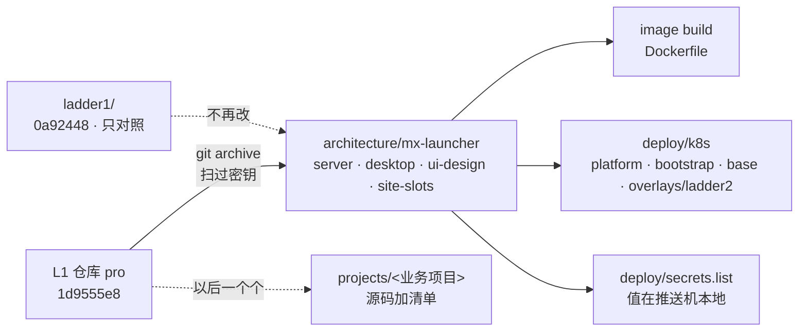
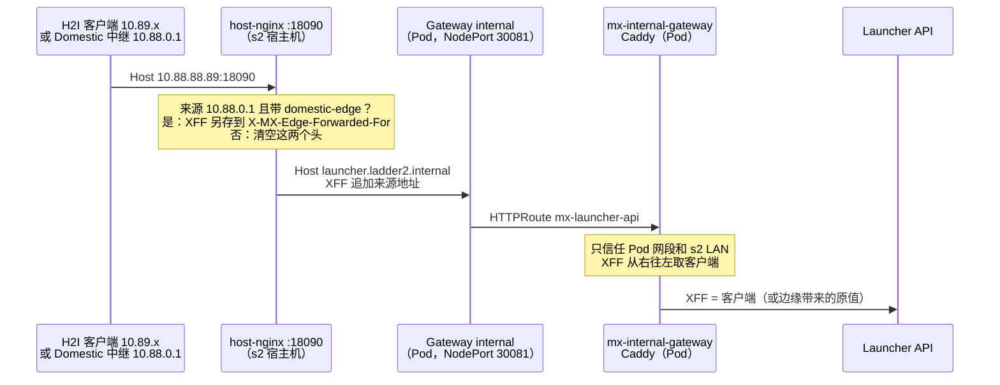

# 46. 项目一个个迁进本工程：Launcher 放 architecture/，业务项目放 projects/；Launcher 的第一步（服务端、库、应用网关）

日期：2026-11-22。状态：分两部分。2026-11-22 第十九轮：下面几处已被 `docs/47` 取代：应用网关从 Caddy 换成 nginx，Launcher API 不再经过它（Launcher 用 `MX_HTTP_TRUST_PROXY_CIDRS`），host-nginx 18090 段不再另存 `X-MX-Edge-Forwarded-For`；`MX_PUBLIC_BASE_URL` 从 `.89` 改成 `.88`（Launcher 写死的角色地址，待定）；host-runner 和分流 DNS 装上了；部署改用 `app deploy`。

**目录约定**：用户 2026-11-22 定的。

**Launcher 的第一步**：代码和清单写好了，在本机实测过下面这些，**没有在 s2 或任何集群上部署过**：
- 镜像构建；
- 镜像对着一个临时 PostgreSQL 跑迁移、启动，`/healthz`、`/readyz`、`/admin/` 都是 200；
- 服务端单元测试 314 项：298 项通过、14 项跳过、2 项失败（原因见"实测"）；
- Caddy 2.8.4 对新写法的校验，以及按来源地址的行为；
- host-nginx 新加的 18090 段：`nginx -t` 和按来源地址的行为。

本机的 `docker-desktop` 集群里有用户自己的 `mx-internal-shadow`、`mx-dns`、`mx-awx`，所以没有往里面部署。

本篇取代：
- `docs/36` 第 1 条"以后 L2 对这些服务的改动都在 `ladder1/` 里做"，改成在本工程的 `architecture/`、`projects/` 里做；`ladder1/` 只作对照，不再改；
- `docs/27`、`services/README.md`、`projects/README.md` 里"迁过来的 MX 项目放 `services/`，只放部署、源码留在 L1"；
- `docs/15` 第 56 项（ladder1 怎么留版本记录）：代码进本工程的 Git，不用另开分支或仓库；
- `docs/45` 第 5 条里"代码放 `ladder1/…`"。

`docs/36` 的其余结论都不变：Launcher 先在 s2 上复刻、切换排最后、"切换前必须关掉的"开关。

用户 2026-11-22 的说法：
- 开始实施，不要在 ladder1 里改；
- 一个个项目迁过来，加上之前的架构设计，可以在 projects 里新建项目；
- Launcher 和 k8s 部署、网关、DNS、鉴权这些功能都集成在一起，可以和其他引入 k8s 的项目分开，放进类似 architecture 的文件夹，专门做和 k8s 高度集成的网站工具平台。

## 结论

### 1. 三个放项目的目录

| 目录 | 放什么 | 现在有 |
|---|---|---|
| `architecture/<名字>/` | 和 k8s 高度集成的平台：自己改集群里的东西（网关路由、DNS、身份和鉴权、发布、往机器上推）。源码、镜像、清单都在这里 | `mx-launcher` |
| `projects/<名字>/` | 迁过来的业务项目，源码加清单，例如以后的 Hub、DataPort、mx-pay；别人的业务项目只放清单或说明 | `arguseek`（只有说明） |
| `services/<名字>/` | 没有自己源码的服务 | `sample` |

规则：
- **一个个迁。** 迁哪个，才从 L1 拷哪个，用 `git archive` 拷提交过的文件。每个项目写一份 `SOURCE.md`，记三件事：从 L1 哪个提交拷的、拷了哪些路径、L2 改了什么。
- **`ladder1/` 不再改**，只用来对照 L1 在 `0a92448` 时的样子。L1 仓库也不改（`CLAUDE.md`）。
- **代码进本工程的 Git。** 拷之前先扫一遍有没有私钥、令牌。凭据只放推送机本地的目录，用 `secret apply` 建成 Secret（第 4 条）。
- 目录名 `architecture/` 照用户的说法起。它和 `design/architecture/`（架构图的源）是两回事，提到时都带全路径。



### 2. Launcher 第一步迁了什么

- **从哪来**：L1 `pro` 分支 `1d9555e8`（2026-11-20）。比 `ladder1/` 的 `0a92448` 新：这几个目录多了一个提交 `c9db16af fix: launcher release`。
- **拷了哪些**：`server/`、`desktop/`、`ui-design/`、`site-slots/`，共 315 个文件。只有两处像私钥的字符串，都是测试里写死的假数据。
  - `desktop/`、`ui-design/` 提供管理界面（Launcher Dashboard）的静态文件；
  - `site-slots/` 是 Launcher 找自己根目录、生成 site-slot 产物要用的。
- **没拷**：
  - L1 的 `scripts/`（`manage.sh`、`identity-*.mjs`、`k8s-*.mjs`）：写死了 s1、单节点、本机导入镜像（`docs/16`）；
  - `deploy/`：L2 的清单是重写的；
  - `packages/`、`demos/`：客户端，放到 MX-H2I v2 那一步（`docs/45`）。

**L2 加的**：

| 文件 | 做什么 |
|---|---|
| `Dockerfile` | 一次构建出管理界面加服务端。L1 是先在宿主机上跑脚本拷管理界面，再构建 |
| `scripts/manage.sh` | 项目入口，只转调本工程的 `manage.sh`。服务端靠"`server/package.json` 加 `scripts/manage.sh`"认自己的根目录，所以必须有这个文件 |
| `deploy/k8s/platform/namespace.yaml` | 命名空间 `mx-internal-shadow`（名字沿用 L1，代码里写死了）、配额 |
| `deploy/k8s/base/` | `pg-launcher`（CloudNativePG）、API、应用网关 Caddy、HTTPRoute、配置 |
| `deploy/k8s/bootstrap/` | Caddy 的初始 Caddyfile。只在没有时建，之后归 Launcher 改 |
| `deploy/k8s/overlays/ladder2/` | 镜像名和版本号（只写在这里） |
| `deploy/secrets.list` | 要哪些 Secret |

**L2 改的代码**，只有一处：Launcher 生成应用网关 Caddyfile 的函数。下一条解释为什么要改。

### 3. 唯一的代码改动：Caddy 前面多了两层，客户端地址要原样传到 Launcher

- **L1**：Caddy 用 hostNetwork，是请求进来的第一站。Launcher 生成的 Caddyfile 有两条规则：
  - 来源地址是 `10.88.0.1`（Domestic 中继）、又带着 `X-MX-Forwarded-By: domestic-edge` 的，算边缘转来的，沿用它带来的 `X-Forwarded-For`；
  - 其余的把来源地址写进 `X-Forwarded-For`。
- **L2**：路径是 host-nginx → Gateway `internal` → Caddy（`docs/18`），Caddy 看到的来源都是网关的 Pod。照旧生成的话，所有请求都会被当成网关自己发的，边缘判断也永远不成立。
- **做法**，分两边：
  - **host-nginx 是第一站**，由它替 L1 的 Caddy 做边缘判断。是边缘转来的，就把边缘带来的 `X-Forwarded-For` 另存到 `X-MX-Edge-Forwarded-For`；否则把 `X-MX-Forwarded-By` 和这个头都清空；
  - **Caddy 用 `trusted_proxies` 加 `trusted_proxies_strict`**：只信任 Pod 网段和 s2 LAN 地址带来的 `X-Forwarded-For`，从右往左取第一个不可信的地址当客户端。客户端自己在最左边填的地址不算数。边缘判断从 `remote_ip` 改成 `client_ip`。
  - 这组地址和网关 `ngf-values.yaml` 的 `trustedAddresses` 是同一套，`manage.sh check` 会核对。
- **开关**：只有设了环境变量 `GATEWAY_TRUSTED_PROXY_CIDRS` 才生效。不设时生成的内容和 L1 逐字相同，有测试守着。
  - 另有两个可选变量：`GATEWAY_CLIENT_IP_HEADER`（默认不设，用 `X-Forwarded-For`）和 `GATEWAY_EDGE_FORWARDED_FOR_HEADER`。
  - 改动在 `server/src/config.ts`、`types.ts`、`store/domain.ts`，测试是 `store/gateway-caddyfile-trusted-proxies.test.ts`。



### 4. 清单和 L1 不同的地方

| 项 | L1 | L2 | 为什么 |
|---|---|---|---|
| 镜像 | `qpjoy/mx-launcher-server:shadow`，`imagePullPolicy: Never`，本机导入 | `localhost/ladder2/mx-launcher-server:l2-1`，`IfNotPresent`，`image import` 导入每个节点 | 版本号能区分；名字以 `localhost/` 开头，节点上没有时不会去 Docker Hub 拉同名镜像。有镜像仓库后（`docs/15` 第 45 项）只改 overlay 的 `newName` |
| 库 | `postgres:16-alpine` StatefulSet，hostPath | CloudNativePG `pg-launcher`，`local-retain` 20Gi，4 CPU / 4Gi | 和 `pg-common` 一样的写法（`docs/22`、`docs/36`）。`DATABASE_URL` 直接取 CloudNativePG 生成的 `pg-launcher-app` 的 `uri`，不用另建数据库凭据 |
| 迁移 | 单独的 Job | API 的 initContainer | Job 建好后不能改镜像，每换一个版本都要先删；迁移本身在一个事务里 |
| 远程执行 | ConfigMap 是 1，Deployment 里还用 env 再设一遍 1 | 全是 0；Deployment 里不再设；去掉 `edge-sync` | `docs/36`"切换前必须关掉的"。`check` 会核对 |
| 应用网关 Caddy | DaemonSet，hostNetwork，占 18090、8008、80 | DaemonSet，不占宿主机端口，多一个 ClusterIP Service | 不占宿主机端口（`docs/18`）。仍用 DaemonSet，因为 Launcher 改完配置后会去 patch `daemonsets/mx-internal-gateway`，换成 Deployment 要改代码。这和 `docs/36` 写的"改成 Deployment、2 副本"不同 |
| Caddy 的配置 | 跟着部署一起 apply | 放 `bootstrap/`，只在没有时建 | 它归 Launcher 运行时改写。每次部署都 apply 的话，会把 Launcher 发布过的路由冲掉 |
| 入口 | 客户端直连 `10.88.88.88:18090` | host-nginx `:18090` → Gateway `internal` → Caddy | 入口只有两个网关的 NodePort（`docs/18`）。Gateway API 的 hostnames 不能写 IP，所以 host-nginx 把 Host 换成 `launcher.ladder2.internal`，原来的 Host 放进 `X-Forwarded-Host` |
| 环境名 | `shadow` | `ladder2` | `docs/15` 第 44 项的建议值，先这么用 |
| 三个卷 | hostPath PV | `local-retain` 的 PVC | 删 PVC 不删数据 |
| host-runner、分流 DNS | 有 | 这一步不装：`MX_INTERNAL_HOST_RUNNER_K8S_ENSURE_ENABLED=0`、`COREDNS_K8S_APPLY_ENABLED=0` | 见"还没做的" |

### 5. 新的命令（`./scripts/manage.sh`）

| 命令 | 做什么 |
|---|---|
| `app list` | 列出 `architecture/`、`services/`、`projects/` 下的项目 |
| `app render <项目> [环境]` | 渲染清单。只有一个环境时可以不写 |
| `app apply <项目> [环境] --context <名字>` | 按顺序：`platform/`（命名空间、配额）→ `bootstrap/` 里集群还没有的 → overlay；最后提醒还缺的必需 Secret |
| `app status <项目> [环境] --context <名字>` | 工作负载、卷、路由、数据库集群；每个 Secret 有没有，不看值。只读，查不到显示 UNKNOWN |
| `image build <项目> [--platform linux/amd64]` | 用项目的 `Dockerfile` 构建。镜像名和版本号取 overlay 的 `images:`。设了 `PROXY` 时构建走宿主机网络 |
| `image save <项目> --out <文件>` | 导出成 tar，拷到没有 docker 的节点上 |
| `image import <项目> [--tar <文件>] --context <名字>` | 导入本节点的 containerd。要 sudo，要在集群的节点上跑，每个节点各一次 |
| `image list <项目>` | overlay 要的镜像，本机 docker 和 containerd 里有没有 |
| `secret plan <项目> --from <目录> [--context <名字>]` | 对照 `deploy/secrets.list`：本地齐不齐、权限对不对、集群里有没有。不显示值 |
| `secret apply <项目> --from <目录> --context <名字>` | 建或更新 Secret。值只走管道，不打印、不落盘。目录不能在本工程里，组或其他人能读的拒绝 |

凭据目录的格式：每个 Secret 一个子目录，每个键一个文件，例如 `/var/lib/ladder2/secrets/mx-launcher/mx-internal-ops/token`。

### 6. 在 s2 上的顺序

前提：`docs/35` 的阶段做到 `gateway` 和 `postgres`（集群、local-path、网关、CloudNativePG），以及 `host-nginx`。现在做到哪了还不知道（`docs/15` 第 72 项）。

```bash
cd de-ladder2
PROXY=http://127.0.0.1:7788 ./scripts/manage.sh image build mx-launcher
sudo ./scripts/manage.sh image import mx-launcher --context <s2 的 context>
sudo install -d -m 700 /var/lib/ladder2/secrets/mx-launcher/mx-internal-ops
openssl rand -hex 32 | sudo tee /var/lib/ladder2/secrets/mx-launcher/mx-internal-ops/token >/dev/null
sudo ./scripts/manage.sh secret apply mx-launcher --from /var/lib/ladder2/secrets/mx-launcher --context <s2 的 context>
./scripts/manage.sh app apply mx-launcher --context <s2 的 context>
./scripts/manage.sh app status mx-launcher --context <s2 的 context>
sudo PROXY=http://127.0.0.1:7788 ./scripts/manage.sh node prepare s2 host-nginx
curl -s http://10.88.88.89:18090/readyz
```

- s2 上没有 docker 时，在 Mac 上 `image build mx-launcher --platform linux/amd64`，再 `image save`，拷到 s2 上 `image import --tar`。
- 飞书登录的凭据（`mx-feishu-oauth`）是可选的，没有时只能用账号密码登录。用不用 s1 的飞书应用，要用户定（第 73 项）。

## 实测（本机，2026-11-22）

| 做了什么 | 结果 |
|---|---|
| 从 L1 `1d9555e8` 用 `git archive` 拷 `server`、`desktop`、`ui-design`、`site-slots`，扫私钥和长令牌 | 只有两处 `BEGIN OPENSSH PRIVATE KEY`，是 smoke 脚本里的假数据（`bW9jay1hd3gt…` 解出来是 "mock-awx-smoke-private-key"） |
| `pnpm install`、`typecheck`、`build` | 都通过；`pnpm-lock.yaml` 和 L1 的逐字节相同 |
| 服务端全部单元测试 | 314 项：298 通过，14 跳过，2 失败。① `oversea-recovery-cli-contract` 读 L1 的 `scripts/k8s-oversea-recover.sh`，这个脚本没拷；② `Postgres serializes site state…` 在 L1 的仓库里同样失败，原来就有的 |
| 拷之前，site-slot 两项测试是 `blocked` | 原因是 Launcher 按 `site-slots/` 和 `scripts/manage.sh` 找根目录。拷了 `site-slots/`、加了项目入口 `scripts/manage.sh` 后通过 |
| `docker build`（本机 arm64） | 228MB，里面有 `artifacts/admin` 和 three.js |
| 镜像加临时 `postgres:16-alpine`：先迁移，再启动 | 迁移成功；`/healthz`、`/readyz`、`/admin/` 都是 200，`environment` 是 `ladder2` |
| 让运行中的 Launcher 生成网关 ConfigMap（`/internal/v1/dns/gateway/configmap/sync`），再用 `caddy:2.8.4-alpine` 校验 | 带 `trusted_proxies`、`trusted_proxies_strict`、`client_ip`，`caddy adapt` 通过 |
| Caddy 2.8.4 的行为，trusted 是一个固定地址 | 可信代理转来、XFF 是 `1.2.3.4, 10.89.0.23, 10.89.0.23` → 客户端 `10.89.0.23`；边缘：客户端 `10.88.0.1`，取到边缘带来的 `203.0.113.7`；不可信的地址伪造边缘头 → 按直连处理，客户端是它自己 |
| host-nginx 模板 `nginx -t`；从 `10.88.0.1` 和 `10.88.0.50` 发请求到 18090 | 语法通过；只有"来源 `10.88.0.1` 且带 domestic-edge"时才带上那两个头；别的地址伪造的头被清空；Host 换成 `launcher.ladder2.internal` |
| bootstrap 里的初始 Caddyfile | 由 Launcher 自己的函数生成，YAML 读回来和生成的逐字相同，`caddy adapt` 通过 |
| `manage.sh check` | 清单渲染通过；新增 5 项一致性检查通过 |

## 还没做的

- **没有在任何集群上部署过。** CloudNativePG 的 `pg-launcher-app` 里是否就是 `uri` 这个键、initContainer 迁移、Caddy 不占宿主机端口之后的行为，都要在 s2 上验。
- **NGF 是否真的从 `X-Forwarded-For` 认出客户端，没实测**（`ngf-values.yaml` 也写着待实测）。Caddy 这边两种情况都能处理：网关改写了客户端地址，或者把 host-nginx 的地址追加在最后。
- **host-runner、service peer `mx-internal-svc`（`10.88.88.89`）、分流 DNS 没装。** H2I 客户端经 WG 连 s2 那套，要等它们。DNS 怎么对外还没定（`docs/15` 第 49 项），而且 `docs/18` 只留了两个 NodePort。
- **H2I 用户访问 Launcher 发布的内网应用（Caddy 的 :80、:8008）没有路径。** 要么 HTTPRoute 跟着 Launcher 动态生成，要么在 `internal` 上挂一条不写 hostnames 的兜底路由。还要和边缘回源共用 `10.88.88.89:80` 的问题一起定：按来源地址分。
- **两处定时任务没有选主**，所以只能 1 副本（`docs/36`）。
- **site-slot 产物**：镜像里只有 Launcher 自带的 `site-slots/` 源文件。完整的 qp-tunnel-cli 要 L1 仓库布局里的 `electron-plugin`。切换前远程执行是关的，这一步不影响；以后改成调 `qp-tunnel-cli edge`（`docs/45` 第 71 项）。
- **镜像仓库没装**（`docs/15` 第 45 项），现在每个节点各自 `image import`。
- **备份**：`pg-launcher` 还没有每日备份（`docs/19` 的 `backup run` 没实现）。放真实数据（s1 的快照）之前必须先有。
- **MX-H2I v2 客户端还没开始**，要先定 `docs/15` 第 67–69 项。
