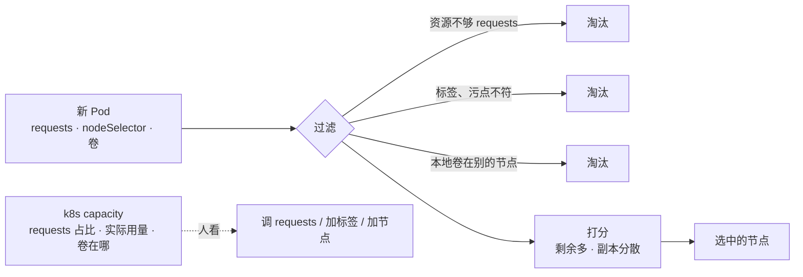
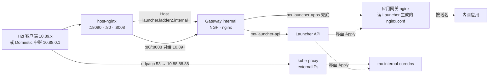
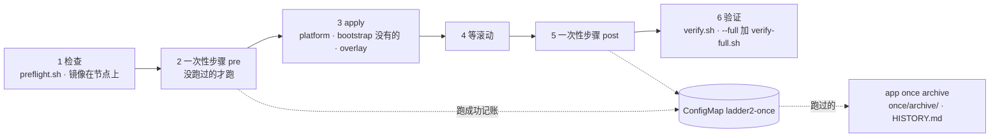

# 47. 服务放哪台交给调度器；Launcher 去掉 Caddy；部署分快路径和一次性步骤；host-runner 和分流 DNS 能在界面上操作

日期：2026-11-22。状态：分三部分。2026-11-22 第二十轮：第 3 条用户选了 A，见 `docs/48`。第二十二轮：第 2 条里"Launcher 信 Pod 网段加 s2 的 LAN 地址"改成只信 Pod 网段，s2 的地址见 `docs/50`。 一次性步骤 0001 原来少写了 `serverDryRun: false`，在 s2 上只做了 dry-run，已修（`docs/55`）。

**设计**：第 1 条（服务放哪台）是设计。

**代码和清单**：写好了，在本机实测过：
- 服务端单元测试 318 项：302 项通过、14 项跳过、2 项失败（和 `docs/46` 同样那两项）；
- 镜像构建，加上一条用 Docker 搭的链路：Launcher 生成配置 → nginx 应用网关转发 → CoreDNS 答复；
- host-nginx 新模板按来源地址的行为；
- 一次性步骤的请求在 API 容器里实际发出去。

**没有在 s2 或任何集群上部署过**，`app deploy`、`app once` 都没对真集群跑过。

**一个需要用户定的发现**：Launcher 的代码把 `10.88.88.88` 当成 Internal 的固定地址（第 3 条，`docs/15` 第 75 项）。

本篇补充 `docs/46`，取代其中这几处：
- Caddy 应用网关和它的可信代理设置：改成 nginx，API 不经过应用网关；
- host-nginx 18090 段里另存的 `X-MX-Edge-Forwarded-For`；
- `MX_PUBLIC_BASE_URL` 用 `.89`；
- "host-runner、分流 DNS 不装"。

回答了 `docs/15` 第 49 项，按建议做了第 74 项。

用户 2026-11-22 的说法：
- 集群架构下，能不能由 k8s 按机器的剩余性能、空间，合理规划新起的服务放哪台；有没有必要，根据什么判断；
- 之前提过 Launcher 要用 nginx 代替 Caddy，可能提升性能；
- 部署脚本日积月累会变慢。一个 deploy 包含所有 migrate、部署很方便，也方便回溯历史改动和设计。可以把已经 deploy 过的 migrate、验证挪到另一个脚本或文档，新功能的 deploy 就快了，原来必要的检查、验证还要保留；
- 补上 host-runner 和 DNS，在界面上能操作。

## 结论

### 1. 服务放哪台：交给调度器，人只定少数几类

**k8s 本来就自动放。** 每建一个 Pod，调度器分两步选节点：
- **先过滤**：资源够不够它的 requests；nodeSelector 和亲和是否满足；污点能不能容忍；它要的本地卷在哪台；
- **再打分**：剩余多的、能把同一服务的副本分散开的优先。

**它看的是 requests，不是实际用量。** 一个 Pod 声明要 4 CPU，哪怕实际只用 0.2，也按 4 算。所以要做的是：
- 每个 Pod 写准 requests，按监控里的实测值调（`docs/28`）；
- limits 防止失控。

**本地盘的卷建好后就绑死在一台上。** local-path 的卷在第一次调度时落到某台，之后用它的 Pod 只能去那台。数据库放哪台，就是这一刻决定的。local-path 还不看磁盘剩余空间，所以数据库要显式指定节点。

**人要定的只有几类：**

| 什么 | 怎么定 | 现在 |
|---|---|---|
| GPU 服务 | 节点标签 `ladder2/gpu=true` 加 nodeSelector | 4 块都在 s1，先不排（`docs/27`） |
| 持有 service peer 的 | 标签 `mx.ladder2/site-peer=true` | s2；host-runner 只在这台跑（第 4 条） |
| 数据库 | 本地卷 + 指定节点 | 单节点时只有 s2 |
| 要分散的副本 | 反亲和或 topologySpread | 网关、Launcher 开 2 副本时再加 |

**有没有必要**：
- 现在只有 s2 一台，没有区别；
- s1 加进来以后有必要，但不用人工排：requests 写准，再加上表里几类的标签就够了；
- 不引进 descheduler（自动搬已在跑的 Pod）：滚动更新和重启时调度器会重新选。

**根据什么判断加机器还是挪服务**：
- `./scripts/manage.sh k8s capacity --context ladder2`（新加的，只读）：每台的可分配资源、被 requests 占了多少、实际用量、标签和污点、每个本地卷在哪台；
- 每台机器上的 `disk record` / `disk trend`：数据目录的余量（`docs/20`）；
- 监控：Prometheus（`docs/28`）。
- 估算的门槛：任一台的 requests 超过 80%，或者实际用量长期超过 70%，就该加节点或挪服务。



### 2. Caddy 换成 nginx：API 少一跳，应用网关换 nginx

`docs/18` 第 3 条、`docs/23` 第 4 条早就定了：Caddy 的职责随 Launcher 迁移一起交给 Gateway `internal`（它本身就是 nginx，NGINX Gateway Fabric）。这次做了两部分。

**Launcher API 不再经过应用网关**：
- HTTPRoute `mx-launcher-api` 直接到 Service `mx-launcher-internal`，路径是 host-nginx → Gateway internal → Launcher。登录、令牌校验这些最热的请求都在这条路上。
- L1 的 Caddy 负责判断"是不是 Domestic 中继转来的"，现在由 host-nginx 的 18090 段来做：
  - 是中继转来的：沿用它带来的 `X-Forwarded-For`；
  - 不是：改写成直连地址，并清掉 `X-MX-Forwarded-By`。
- Launcher 加了 `MX_HTTP_TRUST_PROXY_CIDRS`：按地址段信任代理（Pod 网段加 s2 LAN），Express 取 `X-Forwarded-For` 从右往左第一个不可信的地址。不管网关是改写客户端地址，还是把 host-nginx 的地址追加在最后，都能取对。没设时照旧用 `MX_HTTP_TRUST_PROXY_HOPS`，和 L1 一样。

**内网应用的网关换成 nginx**，Launcher 的代码不用改：
- Launcher 发布路由时，本来就往同一个 ConfigMap 里同时写 `Caddyfile` 和 `nginx.conf`；
- DaemonSet `mx-internal-gateway` 的容器换成 `nginx:1.27.5-alpine`，读 `nginx.conf`；
- 名字不变，Launcher 改完配置后照旧 patch 它触发滚动。

补了三处：
- 生成的配置里，兜底的 `server_name _` 没写 `default_server`，nginx 会把第一个路由当默认站点。启动脚本补一个 `default_server` 回 404。
- 路由的目标是 Launcher 自己时，生成的配置默认写 `127.0.0.1:18090`（L1 宿主机 Nginx 的写法）。设 `GATEWAY_HOST_NGINX_INTERNAL_API_UPSTREAM` 指到 Service。
- 滚动用 `maxSurge: 1`：nginx 遇到解析不了的后端域名会启动失败，这样新 Pod 起不来时旧的继续服务。

**性能**：主要收益是 API 少了一个反向代理，每个请求少一次转发和一次连接。Caddy 和 nginx 本身的差别，在这个请求量级上不大。这是估算，1000 QPS 逐层压测时量（`docs/35`）。

**以后**：让 Launcher 直接写 HTTPRoute，应用网关这一跳也去掉。这要改代码：Launcher 的路由目标可能是集群外的地址，不一定是 Service。

`docs/46` 里 Caddyfile 的可信代理改动保留（默认关）。Launcher 还会生成 Caddyfile，万一切回 Caddy 也是对的。



### 3. 发现：`10.88.88.88` 和 `10.88.0.1` 是 Launcher 的角色地址，不是机器地址

- **Launcher 的代码里有 72 处写死了这两个地址**，分布在：
  - DNS 路由的默认目标；
  - 内部 DNS 记录（`internalDnsServiceRecords`）；
  - 地址规划里 Internal service peer 的 `fixedIp`；
  - 客户端快照里的 `internalControlIp`、`domesticGatewayIp`、`dnsServer`；
  - site-slot 生成的 WireGuard 配置。
- **本地实测也证实了**：Launcher 生成的 Corefile 把 `gateway.internal.mx` 解析到 `10.88.88.88`。
- **所以不改代码，s2 的 service peer 做不到 `.89`**。这是 `docs/36` 和 `docs/15` 第 43 项当初的建议。界面上每台 Domestic 能单独设 `internalServiceIp`，但 DNS、客户端快照这些地方不跟着变。

两条路（`docs/15` 第 75 项，要用户定）：

| | A：照 Launcher 的模型（建议） | B：改 Launcher 的代码 |
|---|---|---|
| 做法 | `.88` 是"当前那台 Internal"的地址，`.1` 是"当前那台 Domestic 中继"的地址，跟着角色走。s2 那套在自己的环境里也用 `.88` | 把这两个地址做成配置，72 处都改，客户端可能也要改 |
| 切换 | 生产 Domestic 上 `.88` 这个对端的公钥从 s1 的换成 s2 的；回退就换回来 | Domestic 的转发目标从 `.88` 改到 `.89`（`docs/15` 第 48 项的建议） |
| 边缘隧道 | 编号要把 `.88` 也保留出来（像 `.1` 一样）。s2 仍是 `.89`；s1 以后加进边缘网要换个号（`docs/44` 的表里 s1 是 `.88`，还没加，没有实际影响） | 不变 |
| 风险 | 切换前两台机器在各自的环境里都有 `.88`，所以 s2 那套绝不能和生产 Domestic 握手 | 改动面大，要回归 MX-H2I 的整个联网流程 |

清单现在按 A 写：`MX_PUBLIC_BASE_URL`、分流 DNS 的 `externalIPs`、初始 Corefile 都是 `.88`，`check` 核对这三处一致。选 B 的话改这三处再改代码。

**不论选哪条，s2 都绝不能用 s1 库里 service peer 的私钥**（`docs/36`）。WireGuard 按密钥认对端：地址一样不要紧，密钥一样会顶掉 s1，H2I 用户断网。s2 在界面上装 service peer 时会生成自己的新密钥。

### 4. host-runner 和分流 DNS：在 Launcher 的管理界面上操作

**host-runner**（在宿主机上替 Launcher 装和管 WireGuard）：
- 由 Launcher 自己建：管理界面 → Foundation → Internal Service Peer → **Ensure K8s Fallback**。它建一个 DaemonSet 和一个 Service：hostNetwork、privileged，监听宿主机 19190。19190 不是 80 / 443，`docs/18` 允许。
- 清单只给权限（`base/host-runner.yaml`，照 L1 的 27 号文件），并在配置里打开 `MX_INTERNAL_HOST_RUNNER_K8S_ENSURE_ENABLED`。清单里不建这个 DaemonSet：否则 `app apply` 和 Launcher 会来回改同一个对象。
- **L2 的代码改动**：`MX_INTERNAL_HOST_RUNNER_NODE_SELECTOR`。Launcher 建的 DaemonSet 只在打了 `mx.ladder2/site-peer=true` 的节点上跑；没设时和 L1 一样，到处都跑。`node prepare s2 cluster` 会给 s2 打这个标签。
- L1 正式环境用的是宿主机上的 native host-runner（systemd，L1 deploy 里的 `native_host_runner_install`）。L2 不装它。
- 镜像里补上了 site-slot 产物：host-runner 装 service peer 要用 qp-tunnel-cli 的降级包，L1 也是这样构建镜像。生成的 WireGuard 配置里是占位，不是真密钥。
- 接着在同一处点 **Install**，装 `mx-internal-svc`。地址是 `.88`，见第 3 条。

**分流 DNS**（`mx-dns/mx-internal-coredns`）：
- 照 L1：Service 用 `externalIPs: [10.88.88.88]`，kube-proxy 把发到 service peer 地址 53 端口的包转给 CoreDNS。不用 hostPort，不占 NodePort，kube-proxy 会一直对账这条转发。
- 这回答了 `docs/15` 第 49 项。和当时"NodePort 加 host-nginx stream"的建议不同：这样少一跳，也不用新端口。
- Corefile 在 `bootstrap/` 里，归 Launcher 改：管理界面 → DNS Center → CoreDNS 的 **Sync**（预览）、**Apply**。CoreDNS 的 reload 插件自己读新配置，不用重启。权限在 `dns/rbac.yaml`。
- 同一页的 Gateway Sync / Apply 改应用网关的配置（第 2 条）。

**H2I 用户访问内网应用**（按 `docs/15` 第 74 项的建议做了）：
- 分流 DNS 把内部域名解析到 service peer 地址，客户端连 80 或 8008；
- host-nginx 只把来自 H2I 网段（`10.0.0.0/8` 去掉 `10.88.0.0/16`）的请求转给 Gateway internal，再由兜底路由 `mx-launcher-apps` 交给应用网关；
- 从边缘（domestic02 的 `10.88.0.2`）来的，80 照旧 404，8008 返回 403。

**防火墙**：s2 上 ufw 开着时由人执行，没实测：
- Pod 网段 `192.168.224.0/20` 到本机 19190/tcp 要放行；
- 53 端口由 kube-proxy 转到 Pod，走转发链，和其他 Service 一样（`docs/35`）。

`app deploy` 的检查里会提示。

### 5. 部署分三种：每次都跑的、只跑一次的、出事了才跑的

L1 的 `ops internal-production deploy` 一次跑约 30 步。读源码分类如下：

| L1 deploy 里的步骤 | 性质 | L2 放哪 |
|---|---|---|
| `k8s_prepare_production_host`、`k8s_configure_proxy_bypass` | 主机准备，做一次 | `node prepare` 的阶段（host、runtime） |
| `k8s_repair_kubeadm_endpoint`、`k8s_recover_production_node`、`k8s_recover_cluster_network`、`k8s_production_recovery_state restore/checkpoint` | 出过事故以后加的修复，之后每次部署都跑一遍 | 不进部署。坏了单独处理，按 `docs/19` 还原 |
| `k8s_require_apiserver_ready`、`k8s_require_production_node_ready` | 前提 | `preflight.sh` |
| `k8s_preflight_secret_bundle`、`k8s_release_oss_secret_dry_run` | 前提 | `preflight.sh` 看必需的 Secret 在不在；`secret plan` |
| `k8s_local_pvs preflight` | hostPath PV 的身份 | L2 没有 hostPath PV，不需要 |
| `k8s_production_disk_preflight` | 磁盘 | `k8s capacity`、`disk trend`，不放进每次部署 |
| `identity_prepare_for_deploy` | 个人 SSO 的地址、端口、持久配置 | Launcher 的 identity 服务还没迁（"还没做的"） |
| `service_operations_ensure` | 装服务运维代理，做一次 | 还没迁；以后放一次性步骤，或单独成项目 |
| `shadow_image_build`、`shadow_image_import_containerd` | 每次部署都重建 | `image build` / `image import`，和部署分开：节点上已有这个版本就不重建 |
| `k8s_preload_runtime_images` | 预拉第三方镜像 | 不需要：`IfNotPresent`，第一次用时拉 |
| `k8s_apply`、`k8s_restart_internal_api` | 每次 | apply；配置变了 ConfigMap 换名字，自动滚动 |
| `native_host_runner_install`、`apply_native_host_runner_url` | 在宿主机上装 systemd 服务 | 不用：界面上建 DaemonSet（第 4 条） |
| `k8s_apply_internal_gateway` 加等滚动 | 每次 | apply 后统一等滚动 |
| `k8s_status`、`gateway_smoke`、`db_summary`、`auth_smoke` | 验证 | `verify.sh`（快的）；登录的冒烟以后放 `verify-full.sh` |
| `ops_insight_hub deploy` | 另一个项目 | Hub 自己的 `app deploy` |

L1 的脚本不改（L1 仓库）。L2 用 `app deploy`：



- **每一段都打印耗时**，慢在哪一眼能看出来。
- **一次性步骤**：`deploy/once/NNNN-pre-*.sh`、`NNNN-post-*.sh`。
  - 跑成功记进集群里的台账（项目命名空间的 ConfigMap `ladder2-once`），以后的部署跳过；
  - 跑失败不记，下次重跑，所以步骤要能重复执行；
  - 所有集群都跑过以后，`app once archive` 把文件挪进 `once/archive/`，在 `once/HISTORY.md` 记一笔。文件留在 Git 里，能回溯当时为什么做、做了什么。
  - 这就是用户说的"deploy 过一次的移到旧的脚本"：不用人去挑，台账自动跳过，归档是手动的一步。
- **必要的检查保留**：`preflight.sh`、`verify.sh` 每次都跑，只放快的；慢的放 `verify-full.sh`，`--full` 时才跑。
- **Schema 迁移不算一次性步骤**：Launcher 的 TypeORM 迁移会跳过执行过的，每次由 API 的 initContainer 跑，很快。
- **第一个一次性步骤**：`0001-post-first-gateway-and-dns-apply`。第一次部署后，让 Launcher 把网关和 DNS 各 Apply 一次，等于在界面上点一次。请求在 API 的 Pod 里发，令牌不离开 Pod。

### 6. 新的命令（`./scripts/manage.sh`）

| 命令 | 做什么 |
|---|---|
| `app deploy <项目> [环境] [--full] --context <名字>` | 第 5 条的六段，每段计时。检查不过就不部署 |
| `app once list\|run\|mark\|archive <项目> [步骤] --context <名字>` | 看台账；重跑一个；只记账不跑（人工做过的）；把跑过的归档 |
| `app status` | 加上项目跨的其他命名空间（mx-launcher 的 `mx-dns`），以及一次性步骤的台账 |
| `k8s capacity --context <名字>` | 第 1 条。只读 |
| `architecture/mx-launcher/scripts/manage.sh bootstrap-render` | 用 Launcher 自己的生成函数重新生成 `bootstrap/` 的两个 ConfigMap |

`app apply` 还在：只 apply，不等滚动、不跑检查。

### 7. 在 s2 上的顺序

前提和 `docs/46` 第 6 条一样：`docs/35` 的集群、网关、CloudNativePG、host-nginx 阶段都做完了。cluster 阶段要重跑一次才会打节点标签，或者手动打。

```bash
PROXY=http://127.0.0.1:7788 ./scripts/manage.sh image build mx-launcher
sudo ./scripts/manage.sh image import mx-launcher --context ladder2
sudo ./scripts/manage.sh secret apply mx-launcher --from /var/lib/ladder2/secrets/mx-launcher --context ladder2
./scripts/manage.sh app deploy mx-launcher --context ladder2
sudo PROXY=http://127.0.0.1:7788 ./scripts/manage.sh node prepare s2 host-nginx
```

然后在管理界面上：
- Internal Service Peer → **Ensure K8s Fallback** → **Install**；
- DNS Center → **Apply**。

## 实测（本机，2026-11-22）

| 做了什么 | 结果 |
|---|---|
| 服务端全部单元测试 | 318 项：302 通过、14 跳过、2 失败（`docs/46` 里那两项：一项读 L1 没拷的脚本，一项在 L1 也失败） |
| 新测试 `l2-proxy-and-host-runner.test.ts`，用 Express 自己的 proxy-addr | 网关 Pod 用 IPv4-mapped 地址（`::ffff:192.168.224.17`）连进来时，三种 XFF 都取对：`10.89.0.23, 10.89.0.23`、`10.89.0.23, 192.168.1.4`、边缘的 `203.0.113.7, 192.168.224.1`；绕过代理直连的，XFF 不算数。没设 node selector 时 DaemonSet 和 L1 一样 |
| `docker build`（带 site-slot 产物） | 镜像里有 `mx-domestic-qp-tunnel-cli-fallback.tar.gz` 等 9 个文件，WireGuard 配置里是占位 |
| Docker 链路：PostgreSQL + Launcher（`l2-2`）+ nginx 应用网关（用 DaemonSet 里那段启动脚本）+ 两个 CoreDNS | 迁移成功。Launcher 生成的 `nginx.conf` 通过 `nginx -t`；`gateway.internal.mx` 转到 Launcher `/healthz` 是 200，不认识的域名 404，8081 健康检查 200。初始 Corefile 和 Launcher 生成的 Corefile 都答 `10.88.88.88` |
| 在 API 容器里跑一次性步骤的请求 | 两个接口都到了，Launcher 返回"not running inside a Kubernetes cluster"，脚本退出码 1（不在集群里，所以失败，台账不会记） |
| host-nginx 新模板，`nginx -t` 加 9 种请求 | 18090：边缘带头的沿用 `203.0.113.7`，边缘没带 XFF 的用 `10.88.0.1`，H2I 客户端伪造的被改写成 `10.89.0.23`；80：H2I 客户端的应用域名转 internal、Host 不变，边缘来的 404，已登记的域名照旧转 public，`/gateway-health` 200；8008：H2I 转 internal，边缘 403 |
| `k8s capacity --context docker-desktop`（只读） | 列出可分配、requests 占比、PV 在哪台；没有 metrics-server 时显示 UNKNOWN |
| `manage.sh check` | 通过。mx-launcher 有 9 项一致性检查：两组信任地址、service peer 地址三处一致、bootstrap 和 config.env 一致、host-runner 的标签、API 路由不经过应用网关、切换前必须关的开关 |

## 还没做的

- **没在集群上部署过**：`app deploy`、`app once`、Launcher 建 host-runner、kube-proxy 的 `externalIPs`、NGF 认客户端地址，都要在 s2 上验。
- **第 3 条的 A / B 要用户定**（`docs/15` 第 75 项）。选 A 的话，tunnel-cli 的 launcher 方案要把 `.88` 也保留出来（L1 仓库的改动）。
- **Launcher 的 identity 服务**（个人 SSO，L1 的 `identity_prepare_for_deploy`）和服务运维代理没迁。
- **两处定时任务没有选主**，仍是 1 副本。
- **`pg-launcher` 没有每日备份。**
- **登录的冒烟测试**（L1 的 `k8s_production_auth_smoke`）还没写进 `verify-full.sh`。
- **防火墙**：只在检查里提示，没写进阶段脚本（`docs/35` 的规矩：防火墙由人执行）。
