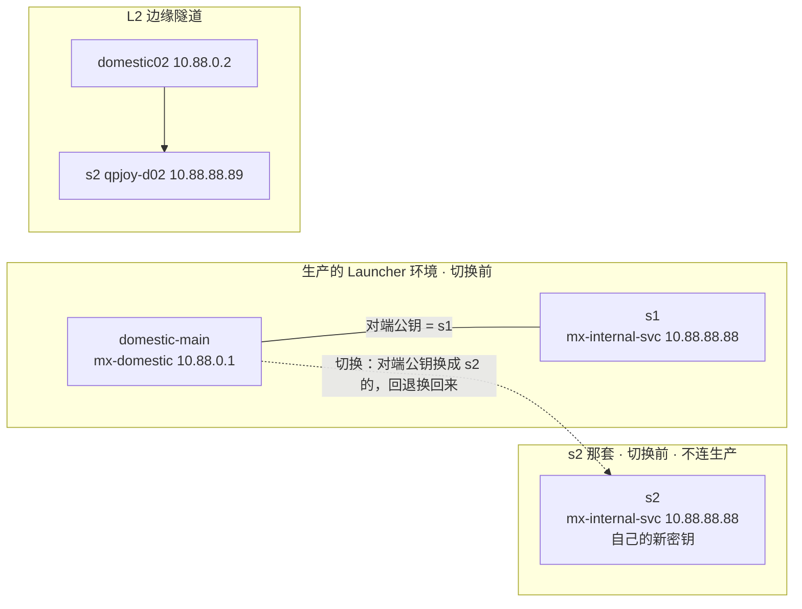

# 48. `10.88.88.88` 和 `10.88.0.1` 是 Launcher 的角色地址，跟着角色走

日期：2026-11-22。状态：决策，用户 2026-11-22 定的（`docs/15` 第 75 项选 A）。

**跟着这个决策改的东西**：
- tunnel-cli 的 launcher 方案把 `10.88.88.88` 保留出来。改在 L1 仓库的 `electron-plugin/packages/tunnel-cli`，没提交，没发 npm 包，要发下一个版本才有；本机测试 170 项：167 项通过、3 项跳过、0 项失败。
- de-ladder2 的清单本来就按这个写（`docs/47`），只把"待定"的字样去掉了。
- 没有在任何机器上执行过。

本篇取代：
- `docs/36`、`docs/15` 第 43 项里"s2 的 service peer 用 `10.88.88.89`"；
- `docs/44` 地址表里"s1 的边缘地址 `10.88.88.88`"；
- `docs/15` 第 48 项的切换建议"Domestic 把转发目标从 `.88` 换成 `.89`"。

`docs/47` 第 3 条的 A / B 就此定为 A。

用户 2026-11-22 的说法：A，保留 `.88`。

## 结论

1. **两个地址代表的是角色，不是机器。**
   - `10.88.88.88` 是"当前那台 Internal"的 service peer `mx-internal-svc`；
   - `10.88.0.1` 是"当前那台 Domestic"的中继 `mx-domestic`。
   - Launcher 的代码里有 72 处写死了它们：DNS 记录、客户端快照的 `internalControlIp` / `domesticGatewayIp` / `dnsServer`、地址规划、site-slot 生成的 WireGuard 配置。这些代码不改。
2. **s2 那套 Launcher 在自己的环境里也用 `.88`。** s2 上会同时有两个 10.88 地址：
   - Launcher 的 service peer `mx-internal-svc`：`10.88.88.88/32`，由管理界面的 Install 装（`docs/47` 第 4 条）；
   - L2 的边缘隧道 `qpjoy-d02`：`10.88.88.89/32`，现在就在，真机已通（`docs/44`）。

   两张网卡各自只路由对端的 `/32`，互不影响。docs/44 在容器里验过这种做法：放了一张替身 Launcher 网卡，验的是同一地址的情形，还没验 `.88` 和 `.89` 并存。
3. **切换之前，s1 和 s2 在各自的环境里都有 `.88`。** 这本身没问题，前提是两个环境不连在一起。所以这几条是硬条件：
   - s2 那套不和生产的 Domestic（domestic-main）握手。site-slot 远程执行保持关闭（`docs/36`）。
   - s2 装 service peer 时用自己新生成的密钥，**绝不用 s1 库快照里的私钥**。WireGuard 按密钥认对端：密钥一样，s2 一连上就会顶掉 s1，H2I 用户断网。
   - s1 上什么都不改（`CLAUDE.md`）。
4. **切换就是换这个角色的持有人**（取代第 48 项的建议，细节以后单独写一篇）：
   - 在生产 Domestic 的 `mx-domestic` 上，把 `10.88.88.88/32` 这个对端的公钥从 s1 的换成 s2 的；
   - s2 的 `mx-internal-svc` 主动连出去，Domestic 上不用改端点；
   - 回退就把公钥换回 s1 的。
   - 客户端那边什么都不变：地址、DNS、快照里还是 `.88` 和 `.1`。
5. **边缘隧道的 launcher 方案把 `.88` 也保留出来**，和 `.1` 一样，任何边缘隧道都不能用这两个地址：
   - Internal 的编号仍是 `10.88.88.(87+N)`。s2（internal02）`.89` 不变，真机上那条不用动。
   - s1（internal01）按公式算出 `.88`，正好是保留的，改给 `.87`。规则：算出来的地址被保留时用 `.(88-N)`，只有 internal01 会碰到，不会和 internal02、03… 冲突。s1 还没加进边缘网（加要用户同意，`docs/43`），所以没有实际改动。
   - `--ip 10.88.88.88`、`--relay-ip 10.88.88.88` 会被拒绝，提示它是 Launcher 的 Internal service peer。
   - isolated 方案（`100.127.200.0/24`）里没有 Launcher 的角色，internal01 照旧是 `.88`。
6. **测试中继（`docs/15` 第 70 项，还没定）**：按这个模型，domestic02 要是当 s2 那套的中继，它在 s2 那套里就是 `10.88.0.1`。
   - 它的边缘隧道 `10.88.0.2/32` 不变；
   - `10.88.88.89/32` 比 `mx-domestic` 的 `/16` 更具体，仍走边缘隧道。
   - 这是按路由规则推的，没实测。

## 改了什么

| 在哪 | 改了什么 |
|---|---|
| L1 `tunnel-cli/src/edge.ts` | launcher 方案的保留地址加 `10.88.88.88/32`；`defaultLocalAddress` 在算出的地址被保留时用 `.(88-N)`；帮助和方案说明改成"s2 `.89`，s1 `.87`" |
| L1 `tunnel-cli/tests/edge.test.cjs` | 原来那条 launcher 方案测试里，替身 `mx-internal-svc` 的地址从 `.89` 改成 `.88`（和这个模型一致）；新增一条：internal01 默认 `.87`，`--ip` / `--relay-ip` 给 `.88` 被拒，同一台推送机的第二条隧道沿用 `.87`，isolated 方案里仍是 `.88` |
| L1 `tunnel-cli/README.md` | 地址方案的表 |
| `architecture/mx-launcher/` | 只改注释："待定"改成按本篇 |
| `inventory/hosts.yaml` | s2 的 `wg_ip` 写成 `10.88.88.89`（边缘隧道，真机已通），并注明 Launcher 的 service peer 在 s2 那套里是 `.88` |
| `docs/15`、`docs/36`、`docs/44`、`docs/47`、`CLAUDE.md` | 状态行和相关条目 |

## 还没做的

- tunnel-cli 的改动没提交、没发版（下一个版本，例如 2.1.20）。已经在用的 2.1.19 照旧能用；只有在 s1 上建边缘隧道时才会用到这次的改动。
- 切换的那一篇（第 48 项）：冻结写入、最后一次复制库、换公钥、回退步骤。
- s2 上 `mx-internal-svc`（`.88`）和 `qpjoy-d02`（`.89`）同时在，要在真机上验一次路由。
