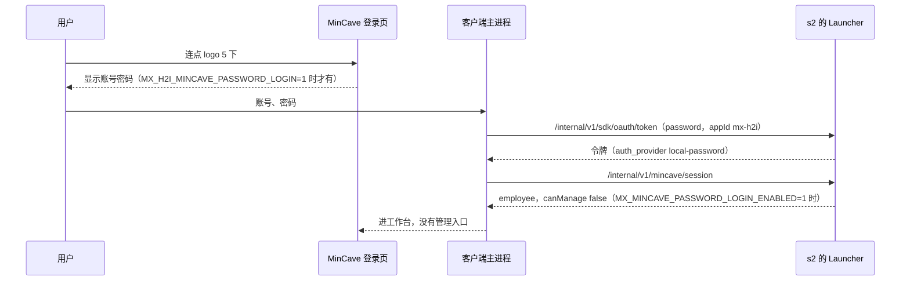

# 49. MinCave 的隐藏账号密码登录：连点 5 下 logo

日期：2026-11-22。状态：已实现，在本机测过（服务端单元测试、客户端界面测试）。没有打安装包，没有在 s2 或任何集群上跑过。

用户 2026-11-22 的说法：之前版本有用户登录，可以移植过来，比如连续点 5 下 logo，再显示用户密码登录。

起因：s2 那套 Launcher 还没定用哪个飞书应用（`docs/15` 第 73 项）。MinCave 的登录页只有飞书，所以测试客户端连上 s2 也登录不了。旧界面一直有账号密码登录（`docs/45`），这次把它接进 MinCave。

## 结论

1. **入口藏在登录页的 logo 上。**
   - 登录页左边那条蛇就是 logo。1.5 秒内连点 5 下，飞书按钮下面出现账号、密码和"账号密码登录"按钮。
   - 点得慢不算，点 4 下不算。展开后光标直接落在账号框。
   - 飞书登录照旧在上面，不受影响。
2. **两边各一个开关，默认都关，关着时和 L1 完全一样**（`CLAUDE.md`：L2 对源码的改动用环境变量开关）。
   - **客户端**：`MX_H2I_MINCAVE_PASSWORD_LOGIN=1`。可以写在进程环境里，也可以写在 `.env` 里：打包后读安装包 `Resources/` 下的，开发时读 `demos/mx-h2i/` 下的。不开时：
     - 登录页里根本没有密码表单，点 logo 没反应；
     - 主进程照旧拒绝 MinCave 里的账号密码登录，报"请使用飞书登录 MinCave。"
   - **服务端**：`MX_MINCAVE_PASSWORD_LOGIN_ENABLED=1`。s2 的 `config.env` 里已经打开。不开时，MinCave 的准入接口照旧只认飞书。
3. **账号密码登录的人只是员工，不是 MinCave 管理员。**
   - 服务端给 `role: employee`、`canManage: false`。用户中心里是管理员也一样。
   - 不建 MinCave 成员记录，因为成员按飞书身份记。
   - 管理接口照旧只认飞书。
   - 客户端也会核对：服务端对账号密码登录回了 admin，就当校验失败。
4. **用户中心的检查一样不少。** 账号停用、禁止使用 `mx-h2i`、在别处被登出，都进不去。签发令牌时也会挡掉停用和被禁止的账号。
5. **工作台的应用列表：**
   - 配了飞书企业（`MX_MINCAVE_FEISHU_TENANT_KEY`）时，用那个企业的工作台和部门策略；
   - 没配时，用默认工作台（Delta、Hub 等六个入口）。
6. **传输要求不变。** 账号密码和飞书一样，不走明文 HTTP 连局域网 IP。测试时先用 SSH 把 s2 的 18090 转发到本机，客户端填 `http://127.0.0.1:18090`（`demos/mx-h2i/ladder2.env.example`）。这样不用域名，和 v1 的 DNS 也不冲突。
7. **客户端源码这次迁进了本工程：** `architecture/mx-launcher/demos/mx-h2i/`，来自 L1 `1d9555e8`，和服务端是同一个提交（`docs/46`）。
   - 只迁了客户端自己的 124 个文件，没迁它依赖的 L1 workspace 包（`electron-launcher`、tunnel 引擎、WireGuard 引擎）。
   - 所以界面能构建、能测，**还打不了安装包**。`scripts/manage.sh client-package` 明说还没实现。

## 改了什么

| 在哪 | 改了什么 |
|---|---|
| `server/src/config.ts`、`types.ts` | 读 `MX_MINCAVE_PASSWORD_LOGIN_ENABLED`，默认关 |
| `server/src/modules/mincave/mincave.service.ts` | `session`、`devices` 先看是不是账号密码令牌，开关打开时按员工放行；其余照旧走飞书 |
| `server/src/modules/mincave/mincave-password-login.test.ts` | 新增 6 项：关着时和 L1 一样拒绝；打开后只给员工、不建成员、管理接口拒绝；停用和禁止的账号进不去；飞书照旧；没配飞书企业时账号密码照样能用 |
| `demos/mx-h2i/src/main-runtime.cjs` | `mincavePasswordLoginEnabled()` 读 `MX_H2I_MINCAVE_PASSWORD_LOGIN`；开关打开时 MinCave 里放行 `login-employee`；把开关的状态告诉界面 |
| `demos/mx-h2i/src/mincave-admin.cjs` | `checkLogin` 在允许时收账号密码登录，并要求服务端回的是员工 |
| `demos/mx-h2i/src/renderer.js` | MinCave 登录 HTML 在允许时多一个密码表单，提交沿用旧界面的处理 |
| `demos/mx-h2i/ui/src/App.tsx`、`bridge.ts`、`styles.css` | logo 连点 5 下展开；表单默认隐藏 |
| `demos/mx-h2i/ui/tests/dom.test.mjs`、`scripts/mincave-password-login.test.mjs` | 新增：不允许时点 logo 没反应；点得慢、只点 4 下都不展开；展开后提交走原来的员工登录；主进程和桥的开关 |
| `deploy/k8s/base/config.env` | `MX_MINCAVE_PASSWORD_LOGIN_ENABLED=1` |
| `.dockerignore` | 不把 `demos/` 打进服务端镜像 |

## 实测（本机）

- 服务端 MinCave 测试 17 项：16 项通过，1 项跳过（要 Postgres）；类型检查通过。
- 客户端 `scripts/manage.sh client-test`：83 项全过。界面测试原来 62 项，加 2 项后 64 项，其余是 L2 加的和原有的策略测试。
- 原有的 `feishu-login-safety` 要读 L1 的 workspace 包，在临时目录里用 L1 的那两个文件加 L2 的客户端源码跑过，通过。
- 没有打包，没有连真的 Launcher 登录过。

## 还没做的

- **打安装包。** 要把 L1 的 workspace 包和 WireGuard 引擎迁进来，或者在 L1 的临时导出里叠上 L2 的客户端再构建。还没定。
- **测试版的独立身份**（第 67 项）。现在和 v1 同一个 appId，同一台电脑上不能和 v1 同时用。
- **s2 上要先有账号。** 新库里没有员工账号，要先在管理界面（Internal Ops Token 登录）的账号页建一个。
- **联网。** 切换前 s2 那套没有中继，登录以后的 WireGuard 联网要等第 70 项。
