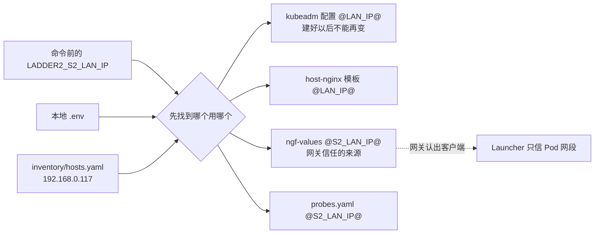

# 50. s2 的地址从环境变量取：现在是 192.168.0.117，会变

日期：2026-11-22。状态：已实现，在本机测过（`check`、改地址的模拟）。没有在 s2 上执行过。

用户 2026-11-22：s2 目前的 IP 是 192.168.0.117，后续可能会变，这个需要在执行前的 env 中可以改。

起因：用户在 s2（主机名 `enine`）上跑 `node verify s2`，一直显示"本机不是 s2"。原来登记的 `192.168.1.4` 不对，所有阶段脚本都按地址认机器，所以都拒绝执行（`docs/15` 第 76 项）。

本篇取代以下文档里"s2 是 `192.168.1.4`"的说法：`CLAUDE.md`、`docs/35`、`docs/41`、`docs/44`、`docs/46`、`docs/47`。也取代 `docs/47` 第 2 条里"Launcher 信 Pod 网段加 s2 的 LAN 地址"。

## 结论

1. **s2 的地址按这个顺序取，先找到哪个用哪个：**
   1. 命令前写的环境变量 `LADDER2_S2_LAN_IP`；
   2. 本工程根目录的 `.env`（不进 Git，模板是 `.env.example`）；
   3. `inventory/hosts.yaml` 的 `lan_ip`，现在是 `192.168.0.117`。

   ```bash
   LADDER2_S2_LAN_IP=192.168.0.120 ./scripts/manage.sh node verify s2
   ```
   要 root 的命令和 `PROXY` 一样，变量写在 `sudo` 后面：`sudo LADDER2_S2_LAN_IP=192.168.0.120 ./scripts/manage.sh node prepare s2 host`。
   - 变量名是 `LADDER2_<主机>_LAN_IP`，以后的 s3 也能这样改。
   - 写错了（不是 IPv4）命令一开始就停，不会带着错地址往下做。
   - `node plan`、`node verify`、`hosts` 都会显示地址从哪来的。
2. **s1 不能这样改。** 所有写操作都靠 s1 的地址认出 s1 并拒绝执行（`CLAUDE.md` 的硬约束）。所以 s1 的地址只认 inventory，设了 `LADDER2_S1_LAN_IP` 只会提示它不起作用。
3. **`.env` 只收 `LADDER2_*` 和 `PROXY` 两类变量。** 逐行读，不当 shell 执行。命令前已经写了的，`.env` 不会盖掉。`manage.sh`、角色脚本、`infra/k8s/platform/install.sh` 读的是同一份（`scripts/lib/site.sh`）。
4. **s2 的地址只写在一个地方。** 除了 inventory 的默认值，别处都用占位或运行时现取，`check` 会查有没有写死的。
   - **网关**：`ngf-values.yaml` 的 `trustedAddresses` 写成 `"@S2_LAN_IP@/32"`，`prepare gateway` 时换成这次的地址再交给 helm。
   - **链路探测**：`inventory/probes.yaml` 写成 `http://@S2_LAN_IP@...`，探测时现换。
   - **kubeadm 配置和 host-nginx 模板**：本来就用 `@LAN_IP@`，从同一个函数取。
5. **Launcher 的配置里去掉了 s2 的地址。** `MX_HTTP_TRUST_PROXY_CIDRS` 和 `GATEWAY_TRUSTED_PROXY_CIDRS` 只写 Pod 网段 `192.168.224.0/20`。
   - 依据是 NGINX Gateway Fabric 的文档：请求来自它信任的地址时，它会改写客户端地址，并放进 `X-Forwarded-For` 和 `X-Real-IP` 交给后端。
   - 所以 Launcher 只要信网关 Pod，从右往左取到的就是真客户端，不用再信 s2 的地址。
   - 网关自己信不信 s2 的地址，仍由上一条的 `trustedAddresses` 决定。
   - 这是按文档推的，没实测。`node verify s2 sample` 会测网关认出的客户端对不对。
6. **集群建好以后，s2 的地址就不能再变。** kubeadm 把它写进了 apiserver 的证书、etcd 的监听地址和 kubelet 的 `node-ip`。
   - 环境变量能改的只是"这次执行用哪个地址"，改不了已经建好的集群。
   - `node verify s2 cluster` 会对比节点地址和这次的地址，不一样就报错，并给出两条路：把机器的地址固定回去，或者确认是设错了。
   - **建议在路由器上给 s2 做 DHCP 保留，或者配成静态地址**，再做 cluster 阶段。
7. **还要核对 NAS 能不能挂。** s2 现在在 `192.168.0.x`，NAS（`192.168.1.3`）和 s1（`192.168.1.2`）在 `192.168.1.x`。NAS 的 NFS 导出要允许 s2 的地址，路由也要通，见 `docs/15` 第 41 项。
   - host-nginx 和网关的放行段是 `192.168.0.0/16`，不受影响。



## 改了什么

| 在哪 | 改了什么 |
|---|---|
| `scripts/lib/site.sh`（新） | 读 `.env`、按优先级取地址、校验、把 `@<主机>_LAN_IP@` 换成地址 |
| `scripts/manage.sh`、`scripts/roles/lib.sh`、`infra/k8s/platform/install.sh` | 启动时读 `.env` 并校验；`host_field` 改用 `site.sh`；`node plan` 和 `hosts` 显示地址的来源；探测地址现换 |
| `scripts/lib/stages.sh` | `node verify` 显示地址来源；本机不是 s2 时列出本机地址；cluster 阶段对比节点地址 |
| `infra/k8s/platform/gateway/ngf-values.yaml` | s2 的地址改成占位，安装时现换 |
| `inventory/hosts.yaml`、`inventory/probes.yaml` | s2 改成 `192.168.0.117`；探测地址用占位 |
| `architecture/mx-launcher/deploy/k8s/base/config.env`、`bootstrap/gateway-config.yaml` | 信任的代理只写 Pod 网段；bootstrap 重新生成 |
| `.env.example`（新） | 本地覆盖的模板 |
| `check` | 查有没有写死 s2 地址；网关占位在；Launcher 只信 Pod 网段 |

## 实测（本机）

- `check` 通过。
- 模拟改地址：`LADDER2_S2_LAN_IP=192.168.0.200` 时，`node plan`、`hosts`、探测地址、网关渲染出来的 `trustedAddresses` 都是 `.200`，并标明来自环境变量。
- `.env` 里写的生效；命令前写的优先于 `.env`；`.env` 里的其它变量不读。
- 写错的地址（`192.168.0.999`）一开始就停，退出码 1；`LADDER2_S1_LAN_IP` 不起作用。

## 还没做的

- 在 s2 上 `git pull` 以后从 `node prepare s2 host` 开始做，一次一个阶段。
- s2 的地址先固定下来（DHCP 保留或静态），再做 cluster 阶段。
- NAS 的导出和路由（第 41 项）。
