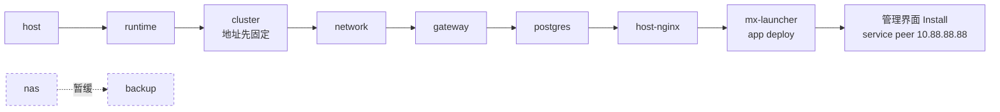

# 51. NAS 先不挂，先把 Launcher 的内部联网在 s2 上跑起来

日期：2026-11-22。状态：计划，加一处脚本改动。改动只在本机容器里跑到 host 阶段的 `swapoff`（非特权容器不能关 swap），没有在 s2 上执行过。

用户 2026-11-22：NAS 暂时不用挂，先把内部 VPN 服务跑起来。

这里的"内部 VPN"指 Launcher 管的 H2I 内部联网：
- service peer `mx-internal-svc`，`10.88.88.88`；
- Launcher API；
- 分流 DNS 和应用网关。

本篇改了 `docs/35` 的阶段顺序：nas、backup 两个阶段往后放。其余不变。

## 结论

1. **nas、backup 两个阶段暂缓。** backup 把 etcd 快照写到 NAS，NAS 没挂就做不了。备份不落本机盘的规矩不变（`docs/22`）。
   - `node verify s2` 里这两项会一直是 ✗。这是真实情况，不是脚本坏了。
2. **cluster 阶段不再无条件要求 NAS。**
   - 只有阶段 nas 做过、kubelet 已经配成等 NAS（`10-requires-nas.conf` 在）时，才要求 `/mnt/nas` 挂着。
   - 没做过时提示"NAS 暂缓"，接着建集群。
   - 原来的要求是为了不让 Pod 把数据写进空的挂载点目录。现在还没有任何东西用 NAS，所以没有这个风险。
3. **暂缓期间的风险：etcd 和 `pg-launcher` 都没有备份。**
   - s2 的盘坏了，就只能重建集群、重新部署。
   - 现在 s2 上的 Launcher 是复刻，生产的 H2I 还在 s1 上，所以能接受。
   - **切换用户流量之前必须补上 nas 和 backup**（`docs/36`）。
4. **跑起内部联网要做的阶段，按顺序，一次一个：**

   | 阶段 | 要不要 | 说明 |
   |---|---|---|
   | host | 要 | |
   | disk | 建议 | 手工分卷。etcd 建好以后再挪卷很麻烦，能分就在 cluster 之前分 |
   | nas | 暂缓 | |
   | runtime | 要 | |
   | cluster | 要 | 做之前先把 s2 的地址固定下来（`docs/50`） |
   | network | 要 | flannel、local-path、存储类 `local-retain` |
   | backup | 暂缓 | 依赖 NAS |
   | metrics | 可选 | `k8s capacity` 的实际用量要它 |
   | gateway | 要 | Gateway internal 是 Launcher API 和应用网关的入口 |
   | postgres | 要 | CloudNativePG。`pg-launcher` 要它的 CRD |
   | host-nginx | 要 | 18090、80、8008 |
   | sample、loadtest | 以后 | 不挡 Launcher |

   然后按 `architecture/mx-launcher/README.md` 往下做：构建并导入镜像，建 Secret，`app deploy`。最后在管理界面上点 Install 装 service peer，再到 DNS 页面点 Apply。
5. **客户端要连进 s2 那套，还缺一条路。** 切换前 s2 不连生产的 Domestic（`docs/36`、`docs/48`），所以客户端的 WireGuard 没有中继可走。两种办法，都还没定：
   - 用 domestic02 当测试中继（`docs/15` 第 70 项）；
   - 办公网里的客户端直连 s2 的 service peer（Launcher 的 h2i-direct 路径）。

   在这之前，能测到的是登录（`docs/49`）、拿快照、管理界面。

## 改了什么

| 在哪 | 改了什么 |
|---|---|
| `scripts/roles/control/40-cluster.sh` | NAS 只在阶段 nas 做过时才要求挂着 |
| `scripts/roles/lib.sh`、`infra/k8s/platform/install.sh` | 修了上一轮的错：`SITE_ROOT=... source` 只在 source 期间有效，`set -u` 下报 unbound。改成先赋值、再 source |

## 还没做的

- NAS 挂载和 backup 阶段：切换前必须补。NAS 的导出规则和跨网段路由见 `docs/15` 第 41 项。
- 客户端连进 s2 的路（第 70 项，或 h2i-direct）。
