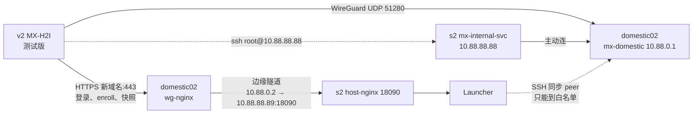

# 52. v2 客户端经 domestic02 连进 s2，照 v1 能 SSH 到 internal02

日期：2026-11-22。状态：设计，加两处改动。第 5 条用户已定：远程执行常开、只能到 domestic02，见 `docs/53`。domestic02 的地址（`47.97.46.168`）怎么登记和替换见 `docs/54`；第 6 条里的 `domestic02.invalid` 已换成占位 `@DOMESTIC02_PUBLIC_IP@`，第 8 条的客户端 `.env` 改用 `client-env` 生成。
- 已在本机测过：Launcher 往外 SSH 的白名单（单元测试）；host-nginx 认 domestic02 边缘地址（nginx 容器里测过）。
- 还没做、也没测：中继、证书、客户端安装包，也没有在任何机器上执行过。

用户 2026-11-22：当前没有域名解析，可以开放 domestic 的 IP 和端口，也可以绑定一个新域名。目的是打开 v2 的 MX-H2I 之后，能经 domestic02 远程 SSH 到 internal02，参照 v1 实现。

这回答了 `docs/15` 第 70 项：s2 那套的测试中继用 domestic02。

## v1 是怎么做的

依据是 L1 `electron-dock/mx-launcher/docs/14` 和 `docs/16`。

- **客户端连进来：** 客户端用 WireGuard 连 Domestic 的中继 `mx-domestic`（`10.88.0.1/16`，UDP 51280）。Internal 的 `mx-internal-svc`（`10.88.88.88/32`）主动连同一个中继。客户端拿到 `10.89.*` 的 lease 后，`10.88.0.0/16` 走中继，所以 `ssh root@10.88.88.88` 能直接到 Internal 那台机器。
- **连上之前：** 登录、enroll、取快照都走 Domestic 上的公网 bootstrap 代理。v1 是 `https://h2i.minsight-ai.com`，转到 `10.88.88.88:18090`。
- **中继由 Launcher 装：** 用 Domestic 的 site-slot plan（经 SSH 推上去）装到 Domestic。
- **每个客户端的 peer：** 由 Launcher 用 SSH 加到 `mx-domestic` 上（`syncDomesticRelayPeer`），用的是管理界面里存的 SSH 配置。

在 s2 那套里，domestic02 就是 Domestic，`10.88.88.88` 是 internal02（`docs/48`）。所以客户端经 domestic02 连上以后，`ssh root@10.88.88.88` 就是 SSH 到 internal02。

## 结论

1. **要绑一个新域名，配 HTTPS；只开 IP 和端口不够。**
   - 客户端在明文 HTTP 下不发任何 lease 请求，游客也不发。它只认三种情况：HTTPS、`127.0.0.1`、已验证的隧道（`assertLiveSecureLauncherCapabilityTransport`，`docs/49`）。
   - 第一次连的时候还没有隧道，所以 `http://<domestic02 IP>:<端口>` 走不通。
   - 只用 IP 的话，只能在本机经 SSH 转发到 `127.0.0.1` 测，这不是远程用的路。
2. **domestic02 要开的端口**，阿里云安全组也要放行（`docs/43` 那次就是 UDP 被安全组挡了）：

   | 端口 | 用途 |
   |---|---|
   | TCP 443 | bootstrap（HTTPS） |
   | TCP 80 | 跳转到 HTTPS；用 HTTP 方式签证书时也要 |
   | UDP 51280 | 中继 `mx-domestic` |

3. **bootstrap 先走已经通了的边缘隧道。** 路径是：新域名 :443 → domestic02 上 L2 的 `wg-nginx` → `10.88.88.89:18090` → s2 的 host-nginx 18090 → Gateway internal → Launcher。
   - 这条路在中继装好之前就能用，可以先单独把登录测通。
   - host-nginx 原来只把 `10.88.0.1` 当 Domestic 边缘，现在 `10.88.0.N` 都认（domestic02 走边缘隧道来的地址是 `10.88.0.2`）。前提是请求带 `X-MX-Forwarded-By: domestic-edge`，这样日志和限速记的是真实的公网用户地址。
   - `wg-nginx` 不自己签证书。证书和私钥放在推送机（s2）的 state 目录里，到期了手工续（Let's Encrypt 90 天）。
4. **中继 `mx-domestic` 装在 domestic02 上，和 L2 的边缘隧道 `qpjoy-relay` 并存。**
   - `mx-domestic`：`10.88.0.1/16`，UDP 51280。
   - `qpjoy-relay`：`10.88.0.2/32`，只路由 `10.88.88.89/32`。
   - `/32` 比 `/16` 更具体，按路由规则不会抢，但没实测（`docs/48` 第 6 条）。
5. **照 v1 装中继，要用 Launcher 的 site-slot 远程执行。这和 `CLAUDE.md` 的硬约束冲突，要用户定。**
   - 硬约束写的是"切换前不开 site-slot 远程执行"，目的是不碰生产的 Domestic。
   - 这次加了白名单（下一条），远程执行可以只对 domestic02 开。但这等于改硬约束，所以没有替用户打开。`SITE_SLOT_*` 仍然是 0。
6. **Launcher 往外 SSH 加了白名单 `MX_SITE_SLOT_SSH_ALLOWED_HOSTS`。**
   - **为什么要：** 每个客户端的 peer 同步不受 `SITE_SLOT_*` 开关管，只要有 Domestic 的 plan 和 SSH 配置就会 SSH 过去。
   - **写入时挡：** SSH 配置只能指向名单里的机器，其他的保存时报错。名单打开时不允许自带 ssh_config，免得用别名绕过去。
   - **读出时也挡：** 库里已有的、不在名单里的 SSH 配置当作不存在，比如从别处拷来的库。
   - **默认值：** s2 的 `config.env` 里是 `domestic02.invalid`，永远解析不了。不换成 domestic02 的公网 IP，Launcher 哪都 SSH 不了。`check` 会提醒这一项还没填。
   - **不设：** 名单为空时和 L1 一样，没有限制。
7. **s2 的 service peer** 在管理界面上点 Install。端点是 domestic02 的公网 IP:51280，用 s2 自己新生成的密钥（`docs/48`）。
8. **测试客户端的 `.env`**（`architecture/mx-launcher/demos/mx-h2i/ladder2.env.example`）：
   - `MX_H2I_BOOTSTRAP_BASE_URL=https://<新域名>`；
   - `MX_H2I_DOMESTIC_RELAY_HOST=<domestic02 公网 IP>`。**一定要设**，客户端默认的中继地址是生产的 `116.62.51.154`。
   - DNS 还没生效时，可以加 `MX_H2I_HOST_RESOLVE=<新域名>=<domestic02 公网 IP>`。
9. **SSH 到 internal02：** 客户端连上以后跑 `ssh root@10.88.88.88`，前提是 s2 的 sshd 听所有地址。分流 DNS 不影响这一步。
10. **客户端安装包还打不出来**（`docs/49`）。要么在 L1 的临时导出里叠上 L2 的客户端源码构建，要么迁 workspace 包，还没定。



## 顺序

1. s2 做完 `docs/51` 的阶段，部署 Launcher。
2. 绑新域名，指向 domestic02 的公网 IP。签证书。domestic02 和安全组放行 443、80、UDP 51280。
3. 在推送机上给 domestic02 的 `wg-nginx` 加 bootstrap 的站点，`edge push domestic02 --stack wg-nginx`。下面是例子，域名和证书文件名换成自己的：
   ```nginx
   server {
       listen 443 ssl;
       server_name <新域名>;
       ssl_certificate     @STATE_DIR@/certs/<新域名>.crt;
       ssl_certificate_key @STATE_DIR@/certs/<新域名>.key;
       location / {
           proxy_pass http://10.88.88.89:18090;
           proxy_set_header Host $host;
           proxy_set_header X-Forwarded-For $remote_addr;
           proxy_set_header X-Forwarded-Proto https;
           proxy_set_header X-MX-Forwarded-By domestic-edge;
       }
   }
   ```
4. config.env 的 `MX_SITE_SLOT_SSH_ALLOWED_HOSTS` 换成 domestic02 的公网 IP，重新部署。在管理界面建 domestic02 的 SSH 配置和 Domestic 站点。Launcher 的 SSH 公钥放进 domestic02 的 `authorized_keys`。
5. 装中继：等用户定第 5 条。
6. 管理界面 Install s2 的 service peer。
7. 测试客户端按第 8 条配 `.env`，连上以后 `ssh root@10.88.88.88`。

## 改了什么

| 在哪 | 改了什么 |
|---|---|
| `architecture/mx-launcher/server/src/config.ts`、`types.ts` | 读 `MX_SITE_SLOT_SSH_ALLOWED_HOSTS` |
| `server/src/store/domain.ts`、`memory.ts`、`postgres.ts` | SSH 配置写入和读出都按白名单检查 |
| `server/src/store/site-slot-ssh-allowlist.test.ts` | 新增 3 项 |
| `deploy/k8s/base/config.env` | `MX_SITE_SLOT_SSH_ALLOWED_HOSTS=domestic02.invalid` |
| `demos/mx-h2i/ladder2.env.example` | 加中继地址和新域名的写法 |
| `infra/nginx/s2/ladder2.conf.tmpl` | 18090 把 `10.88.0.N` 都当 Domestic 边缘 |
| `scripts/lib/apps.sh`（`check`） | 白名单必须有；还是 `.invalid` 时提醒 |

## 实测（本机）

- 服务端全量 327 项：311 项通过，14 项跳过。失败的 2 项（#88、#168）是 `docs/46` 里记过的老问题。白名单新增的 3 项都通过。
- host-nginx 模板在 nginx 1.27.5 容器里 `nginx -t` 通过。
- 边缘判断：`10.88.0.1`、`.2`、`.12` 带头认；不带头、`10.88.1.2`、`10.89.0.2`、`110.88.0.2` 都不认。

## 还要用户定的

- 第 5 条：site-slot 远程执行要不要对 domestic02 打开（改 `CLAUDE.md` 的硬约束）。
- 新域名是什么，证书用哪种方式签。
- domestic02 的公网 IP 要登记进 `inventory/hosts.yaml`（现在没有）。
