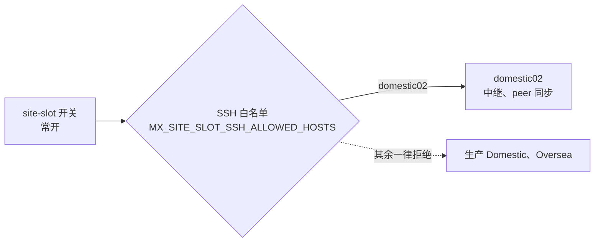

# 53. s2 那套的 site-slot 远程执行常开，只能到 domestic02

日期：2026-11-22。状态：决策，已改清单。`check` 和清单渲染在本机通过，没有部署过。同日：白名单的值从 `domestic02.invalid` 换成占位 `@DOMESTIC02_PUBLIC_IP@`，部署时填 `47.97.46.168`，见 `docs/54`。

用户 2026-11-22：帮我修改打开 site-slot 远程执行这些开关，不用每次手动启。

这回答了 `docs/52` 第 5 条。本篇改了 `CLAUDE.md` 硬约束里的"不开 site-slot 远程执行"，以及 `docs/36` 的同一句：现在是开着，但只能到白名单里的机器。"切换前不连生产的 Domestic"不变，改由白名单保证。

## 结论

1. **四个开关常开**，写在 `architecture/mx-launcher/deploy/k8s/base/config.env`，部署时就带上，不用在界面上每次手动打开：
   - `SITE_SLOT_RUNNER_REMOTE_EXECUTION_ENABLED=1`
   - `SITE_SLOT_WORKER_REMOTE_SSH=1`
   - `SITE_SLOT_CONFIRM_REMOTE_EXECUTION=1`
   - `SITE_SLOT_SSH_READONLY_PROBE_EXECUTE=1`

   L1 生产也是开着的（L1 在 Deployment 里用 env 设成 1）。L2 只写在 `config.env`，`check` 不许 `api.yaml` 再设一遍。
2. **能推到哪台机器，只由 `MX_SITE_SLOT_SSH_ALLOWED_HOSTS` 决定**（`docs/52` 第 6 条）。
   - Launcher 所有的 SSH 都用存下来的 SSH 配置：中继安装、客户端 peer 同步、就绪检查、远程终端、Oversea 推送。白名单在写入和读出两头都检查。
   - s2 那套的名单只写 domestic02，所以碰不到生产的 Domestic，也碰不到 Oversea。
   - 现在的值还是 `domestic02.invalid`：开关开着，但哪都连不上，换成 domestic02 的公网 IP 才生效。
3. **仍然关着的：**
   - `SITE_SLOT_SSH_PASSWORD_BOOTSTRAP_ENABLED=0`：用密码装 SSH 公钥。密码不经过 Launcher，公钥用 `qp-tunnel-cli edge key install` 或手工放（`docs/42`）。
   - `SITE_SLOT_DOMESTIC_WG_SECRET_EXPORT_ENABLED=0`：导出 Domestic 的 WireGuard 私钥。
   - `edge-sync` 模块：打开它会按库里的边缘配置推送（`docs/36`）。
4. **`check` 的规则跟着改：**
   - 远程执行开关可以是 1，但白名单必须有值，空着就报错；
   - 名单还是 `.invalid` 时只提醒，不报错；
   - 密钥导出、用密码装公钥、`edge-sync` 必须关。
5. **`RUNNER_DRY_RUN_DEFAULT=1` 不动。** 它只决定请求没写执行方式时默认用 dry-run 还是 manual，两者都不会 SSH 出去。L1 生产也是 1。

## 改了什么

| 在哪 | 改了什么 |
|---|---|
| `architecture/mx-launcher/deploy/k8s/base/config.env` | 四个远程执行开关改成 1；用密码装公钥、导出密钥仍是 0 |
| `scripts/lib/apps.sh`（`check`） | 远程执行开着时要求有白名单；密钥导出、用密码装公钥、`edge-sync` 必须关 |
| `CLAUDE.md`、`docs/36`、`docs/52`、`docs/15` 第 70 项 | 硬约束和状态行 |

## 还没做的

- 白名单换成 domestic02 的公网 IP（要用户给）。
- 新域名、证书、domestic02 放行端口（`docs/52`）。
