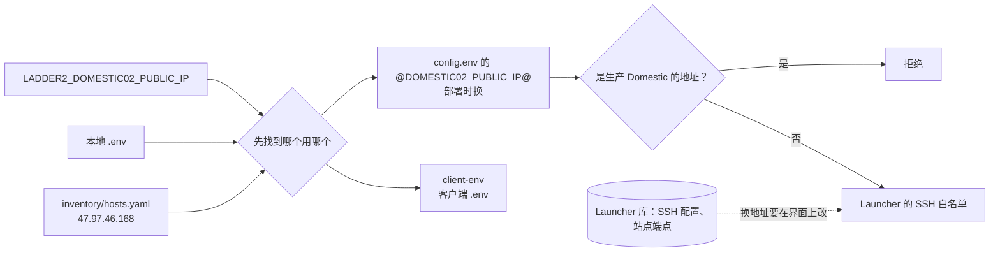

# 54. domestic02 的公网地址：47.97.46.168，只登记一处，会变

日期：2026-11-22。状态：已实现，在本机测过（渲染、改地址的模拟、拒绝生产地址），没有部署过。

用户 2026-11-22：domestic02 的公网 IP 是 47.97.46.168，后续可能会改，要可维护。

做法和 s2 的地址一样（`docs/50`）：只在 inventory 登记一处，执行前可以用环境变量改，别处写占位、用的时候现取。

## 结论

1. **地址按这个顺序取，先找到哪个用哪个：**
   1. 命令前写的 `LADDER2_DOMESTIC02_PUBLIC_IP`；
   2. 本地 `.env`；
   3. `inventory/hosts.yaml` 里 `domestic02` 的 `public_ip`，现在是 `47.97.46.168`。

   `scripts/lib/site.sh` 原来只认 `LADDER2_<主机>_LAN_IP`，现在也认 `LADDER2_<主机>_PUBLIC_IP`。占位相应多了 `@<主机>_PUBLIC_IP@`。
2. **Launcher 的 SSH 白名单写占位。** `config.env` 里是 `MX_SITE_SLOT_SSH_ALLOWED_HOSTS=@DOMESTIC02_PUBLIC_IP@`。
   - `app render`、`diff`、`apply`、`deploy` 先把项目 `deploy/k8s` 拷到临时目录，在拷贝里把 `.env` 的占位换成这次的地址，再交给 kustomize。本工程的文件不改。
   - ConfigMap 的名字带内容的哈希，地址一变名字就变，Pod 会跟着滚动，不会留着旧地址。
   - **换地址只改 inventory 那一行**（或者这次用环境变量），重新 `app deploy`。
3. **任何时候都不许把生产 Domestic 的地址放进白名单。**
   - inventory 里补了生产 Domestic 的 `public_ip`（`116.62.51.154`）和 `former_public_ips`（`121.43.253.179`、`121.43.254.179`），都抄自 L1 客户端的默认中继地址，没登录核对。
   - 换完地址后，名单里有这些地址就拒绝。拒绝发生在四处：`app render` / `diff` / `apply`、`app deploy` 前的检查、`check`、`client-env`。
   - 用 `LADDER2_DOMESTIC02_PUBLIC_IP=116.62.51.154` 试过，都被拒绝。
4. **测试客户端的 `.env` 不用手抄地址。** `architecture/mx-launcher/scripts/manage.sh client-env --domain <新域名>` 按这次的地址打印整份：
   - `MX_H2I_BOOTSTRAP_BASE_URL`
   - `MX_H2I_HOST_RESOLVE`
   - `MX_H2I_DOMESTIC_RELAY_HOST`
   - `MX_H2I_UI`
   - `MX_H2I_MINCAVE_PASSWORD_LOGIN`

   domestic02 换地址后重新生成一份就行。
5. **`check` 查有没有写死。** 除了 inventory，清单和脚本里不许出现 domestic02 的地址（s2 的地址也一样）。
6. **管不到的地方：Launcher 库里的数据。** 管理界面里填的 SSH 配置（host）、Domestic 站点的公网端点、s2 service peer 的端点，存在 Launcher 的库里，不是清单。domestic02 换地址后要在界面上改这几处。
   - 白名单会先挡住：SSH 配置还是旧地址时，它不在新名单里，Launcher 当它不存在，不会连错机器（`docs/52` 第 6 条）。

## 改了什么

| 在哪 | 改了什么 |
|---|---|
| `inventory/hosts.yaml` | 新增 `domestic02`（`public_ip`、`wg_ip`、要放行的端口）；生产 Domestic 补了 `public_ip`、`former_public_ips` |
| `scripts/lib/site.sh` | 认 `PUBLIC_IP` 的覆盖和占位；新增 `site_ssh_allowlist`（换地址，拒绝生产地址） |
| `scripts/lib/apps.sh` | `app_site_overlay`：在临时拷贝里换占位，`render` / `diff` / `apply` / `deploy` 都用它；换完以后检查所有 `*_SSH_ALLOWED_HOSTS` |
| `architecture/mx-launcher/deploy/k8s/base/config.env` | 白名单写 `@DOMESTIC02_PUBLIC_IP@` |
| `architecture/mx-launcher/deploy/preflight.sh` | 部署前检查白名单 |
| `architecture/mx-launcher/scripts/manage.sh` | 新增 `client-env` |
| `scripts/manage.sh`（`check`） | 写死地址的检查加上 domestic02；白名单按换好的地址查 |
| `.env.example`、`demos/mx-h2i/ladder2.env.example` | 加 `LADDER2_DOMESTIC02_PUBLIC_IP`；客户端 `.env` 改用 `client-env` 生成 |

## 实测（本机）

- `app render mx-launcher`：默认渲染出 `47.97.46.168`；设 `LADDER2_DOMESTIC02_PUBLIC_IP=47.97.46.200` 时渲染出 `.200`，ConfigMap 名字也跟着变。
- 用生产地址 `116.62.51.154` 渲染、做部署前检查、跑 `client-env`，都被拒绝，退出码非零。
- `check` 通过；本工程里 `config.env` 仍是占位。

## 还没做的

- 新域名、证书、domestic02 和安全组放行端口（`docs/52`）。
- 在 Launcher 管理界面里建 domestic02 的 SSH 配置和 Domestic 站点：s2 的 Launcher 部署以后做。
