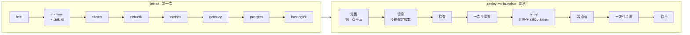

# 55. 两条命令：init（第一次）和 deploy（每次上线）

日期：2026-11-22。状态：已实现。
- 在 Ubuntu 26.04 容器里用假的 kubectl、ctr、buildctl 把 `deploy` 跑通了两遍：生成凭据、算镜像版本、换版本、检查、apply、一次性步骤、验证。
- 没有在 s2 上跑过：`init` 和 buildkit 都没有。

用户 2026-11-22：host-nginx 最后报出 404；README 里后面的部署，能不能整合成 init、deploy 两条。init 包含所有工具、环境等；deploy 是每次业务开发用，包含 migrate、验证等，一个命令上线。

本篇改了 `docs/35` 第 2 条"没有'全部做'的命令"：现在有 `init <主机>`，按顺序做完上线要的准备阶段。单个阶段的 `node prepare` 照旧可用。

## 结论

1. **host-nginx 那个 404 是检查太快了**，配置本身没问题。
   - `systemctl reload nginx` 是异步的。旧的 worker 还会用旧配置（Ubuntu 的默认站点）答一会儿，所以检查拿到了 404。
   - 现在检查最多等 10 秒。重跑这个阶段就好，它可以重复执行。
2. **`init <主机>`：第一次装。** 在那台机器上用 root 跑，按顺序做 8 个阶段：
   1. host
   2. runtime（新增 buildkit）
   3. cluster
   4. network
   5. metrics
   6. gateway
   7. postgres
   8. host-nginx

   做法：
   - 开头确认一次，因为要装平台组件（`CLAUDE.md`：交互确认只留在装平台组件上），后面的阶段不再问。
   - 每个阶段本来就能重复执行，已经是目标状态就不动。所以哪一步失败就停在那里，修好再跑一遍 `init`。
   - 每段计时。
   - 不做的：disk 是手工分卷；nas、backup 暂缓（`docs/51`）；sample、loadtest、edge 不挡上线。
   - 开头会提醒：没设 `PROXY` 国内多半下载失败；集群建好以后地址不能再变（`docs/50`）。
3. **`deploy <项目>`：每次上线。** 在节点上用 root 跑。依次是：

   | 段 | 做什么 |
   |---|---|
   | 0a 凭据 | 必需的 Secret 集群里有就跳过。没有时先找推送机的凭据目录 `/var/lib/ladder2/secrets/<项目>/`；目录里也没有、`secrets.list` 第 5 列写了"生成 hexN"的，就生成一个（`openssl rand -hex N`，文件 600，值不显示），再建 Secret。要人给的（比如飞书）缺了就停下，说清楚放哪 |
   | 0b 镜像 | 版本按 git 提交算：`l2-<12 位提交>`。项目目录里有没提交的改动时，再加 `-dirty-<按改动内容算的 8 位哈希>`，同样的改动再部署不重新构建。本机 containerd 里已有就跳过，没有就用 buildkit 构建，直接进 containerd |
   | 1–6 | 原来 `app deploy` 的六段：检查 → 一次性步骤（apply 前）→ apply → 等滚动 → 一次性步骤（apply 后）→ 验证（`docs/47`） |

   - 数据库表结构的迁移在 Launcher Pod 的 initContainer 里，每次都跑，可以重复执行。只跑一次的修复放 `deploy/once/`。
   - 新的镜像版本只在部署时写进临时拷贝：overlay 的 `newTag`，以及 `config.env` 里同一个镜像的写法（host-runner 的镜像）。本工程的文件不改，不用再手改 `newTag`。
4. **镜像在节点上用 buildkit 构建**（runtime 阶段装，版本在 `versions.env` 的 `BUILDKIT_VERSION`）。
   - `ladder2-buildkitd` 用 containerd 当后端，镜像直接进 `k8s.io` 命名空间，kubelet 马上能用：不用 docker，不用镜像仓库，也不用 import。
   - 它的代理只写在自己的 unit 里，不动 containerd 和 Docker 的守护进程（`docs/31` 的规矩）。
   - 构建里的 `RUN` 用宿主机网络，所以连得上 `127.0.0.1:7788` 的代理。
   - `image build` 有 buildkit 时也用它，没有再用 docker。
5. **多台节点以后要镜像仓库。** 现在只有 s2 一台，镜像建在哪台就只在哪台。加节点时要先解决 `docs/15` 第 45 项。
6. **`kubeconfig 里没有 context ladder2` 这条报错说得更清楚了**：在 s2 上会说"还没建集群，先 init"；建好了但不是 root，会说用 sudo。

## 改了什么

| 在哪 | 改了什么 |
|---|---|
| `scripts/roles/control/60-host-nginx.sh` | reload 后最多等 10 秒再判 |
| `scripts/manage.sh` | 新增 `init`、`deploy`；`confirm` 在 `init` 确认过后不再问；没有 context 时的提示 |
| `scripts/lib/apps.sh` | `app_ship`（deploy）、`app_secrets_ensure`、`app_dirty_hash`、`image_build_buildkit`；`app_image_ref` 认部署时算的版本；部署前的镜像检查先问本机 containerd；临时拷贝里换版本 |
| `scripts/roles/control/30-runtime.sh`、`scripts/lib/stages.sh` | runtime 阶段装 buildkit、建 `ladder2-buildkitd`；`node verify` 查它 |
| `infra/k8s/versions.env` | `BUILDKIT_VERSION=v0.18.2`（按记得的写的，没核对发布页） |
| `architecture/mx-launcher/deploy/secrets.list` | 第 5 列；`mx-internal-ops` 标"生成 hex32" |
| `architecture/mx-launcher/README.md` | 部署那一节换成 `init` + `deploy` |

## 实测（本机容器）

- 第一次 `deploy`：
  - 生成了令牌（64 个十六进制字符，root、600）并建 Secret；
  - 镜像版本 `l2-<提交>-dirty-…`，调了一次 buildctl；
  - 临时拷贝里 `newTag`、host-runner 镜像、SSH 白名单（`47.97.46.168`）都换对了；
  - 检查、apply、等滚动、一次性步骤、验证都按顺序跑了。
- 第二次 `deploy`：Secret 在，镜像在本机已有，不重新构建。
- 验证里"应用网关没有 Pod"那一项是假 kubectl 没返回 Pod 造成的，不是真问题。

## 还没做的

- 在 s2 上跑 `init` 和 `deploy`，尤其是 buildkit：版本号、`--containerd-worker-net=host`、镜像能不能被 kubelet 直接用，都没实测。
- 多节点时的镜像仓库（第 45 项）。
