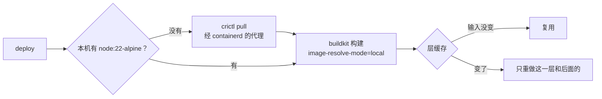

# 56. 基础镜像只拉一次，依赖不每次重装

日期：2026-11-22。状态：已实现，在本机容器里用假的 crictl、ctr、buildctl 测过流程。在 s2 上跑出了第 4 条的问题，已改，改后没在 s2 上跑过。

用户 2026-11-22：s2 上第一次 `deploy mx-launcher`，buildkit 在 `load metadata for docker.io/library/node:22-alpine` 报错；"不用每次都安装吧"。

## 结论

1. **报错的原因：** buildkit 默认每次构建都去 Docker Hub 问基础镜像的元数据。s2 上这一步没通，第一行 `FROM` 就停了。
   - 具体为什么没通（buildkitd 的代理、Docker Hub 被挡）截图里没显示。
   - 下面的改法让 deploy 根本不用连 Docker Hub，所以不管是哪个原因都绕开了。
2. **基础镜像经 containerd 拉一次，之后 buildkit 用本机的。**
   - deploy 构建前先列出 Dockerfile 里 `FROM` 的外部镜像：按 `ARG` 的默认值展开，去掉前面阶段的名字和 `scratch`。mx-launcher 只有 `node:22-alpine`。
   - 本机 containerd 里没有的，用 `crictl pull` 拉。这一步走 containerd 自己的代理（runtime 阶段配的 `10-ladder2-proxy.conf`），`init` 建集群时已经用它拉通过 `registry.k8s.io` 的镜像。
   - 然后 buildkit 加 `image-resolve-mode=local` 构建，按本机的镜像来，不再问 Docker Hub。
   - 想换新的基础镜像时用 `deploy … --pull`，重拉一次。
   - 指定了别的平台（`--platform`）时，本机拉的不一定对，交给 buildkit 自己拉。
3. **依赖不会每次都重装。** buildkit 的层缓存留在 s2 上，只有输入变了的步骤才重做。mx-launcher 的 Dockerfile 本来就是按这个顺序写的：

   | 步骤 | 什么时候重做 |
   |---|---|
   | `apk add`（两处） | 基础镜像换了 |
   | `npm install three` | 版本号改了 |
   | `pnpm install` | `server/package.json` 或 `pnpm-lock.yaml` 改了（源码在它后面才拷进来） |
   | `pnpm build`、`pnpm prune` | `server/` 里任何文件改了 |
   | site-slot 产物 | `server/scripts/`、`site-slots/` 改了 |

   平常只改业务代码时，只重做后两行。同一个提交（或同样的未提交改动）再 deploy，连构建都跳过，因为本机已经有这个版本的镜像（`docs/55`）。

4. **s2 上没有 crictl，第一版跳过了预拉。** 同日在 s2 上跑出来的：
   - 输出"没有 crictl：基础镜像交给 buildkit 自己去拉"，buildkit 随后直连 Docker Hub 失败：`dial tcp …:443: i/o timeout`，`--pull` 时是 IPv6 `connection reset by peer`。
   - 两次都没经过 `127.0.0.1:7788`，说明 `ladder2-buildkitd` 的 unit 里没有代理。可能是 runtime 阶段那一遍是不带 `PROXY` 跑的。
   - **改成：** 没有 crictl 时用 `ctr -n k8s.io images pull` 拉。`ctr` 是 containerd 自带的，s2 上有。它自己发请求，代理取这条 deploy 命令的 `PROXY`，不依赖 buildkitd 的配置。
   - 判断"本机有没有"也先问 `ctr`（k8s.io 命名空间）。
   - 基础镜像不在本机、又要交给 buildkitd 自己拉时，如果它的 unit 里没有代理，会提示用 `PROXY=… node prepare s2 runtime` 补上。

## 改了什么

| 在哪 | 改了什么 |
|---|---|
| `scripts/lib/apps.sh` | `app_base_images`（从 Dockerfile 列外部镜像）、`app_ensure_base_images`（本机没有才 `crictl pull`）；`image_build_buildkit` 在基础镜像都在本机时加 `image-resolve-mode=local`；`deploy` 和 `image build` 多一个 `--pull` |
| `scripts/manage.sh` | 帮助里写上 `--pull` |
| `scripts/lib/apps.sh`（第 4 条） | `app_image_in_containerd`；没有 crictl 时用 ctr 加这条命令的 `PROXY` 拉；buildkitd 没配代理时提示 |

## 实测（本机容器）

- 列基础镜像：mx-launcher 得到 `docker.io/library/node:22-alpine`。另造了一个 Dockerfile 试，`ARG` 默认值、`--platform`、阶段名、`scratch`、`ghcr.io`、`localhost/`、`bitnami/redis` 都处理对了。
- 三次 deploy：
  - 第一次拉了一次基础镜像，buildctl 带了 `image-resolve-mode=local`；
  - 第二次镜像已有，没拉也没构建；
  - `--pull` 又拉了一次、构建了一次。
- 第 4 条：容器里不放 crictl。第一次用 `ctr -n k8s.io images pull` 拉，带上了 `HTTPS_PROXY=http://127.0.0.1:7788`，buildctl 用 `local`；第二次什么都不拉、不构建。

## 还没做的

- 在 s2 上实测：`crictl pull` 走 containerd 的代理，buildkit 的 `local` 模式能读到 CRI 拉下来的镜像。都是按原理推的。
- 如果 s2 上 buildkit 还报错，要看完整的报错（buildctl 最后一行 `error: …`）。
