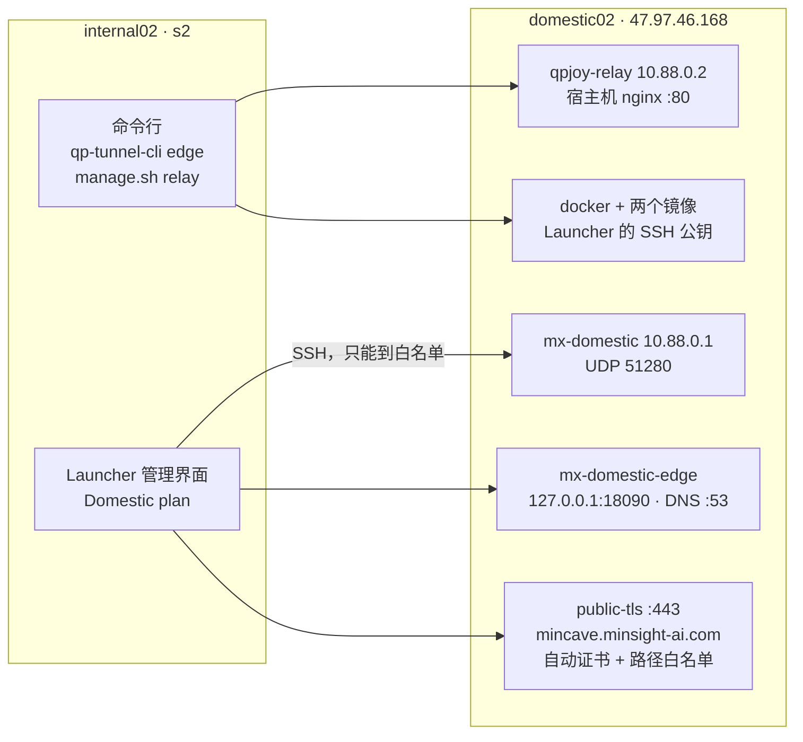

# 57. 从 internal02 往 domestic02 推：命令行和管理界面各管一块

日期：2026-11-22。状态：设计，加两处改动。
- 已在本机测过：白名单接受 SSH Profile bootstrap 写的 ssh_config（单元测试）；`relay` 命令的防护和镜像清单。
- 没有在 domestic02 上执行过，管理界面的推送也没跑过。

用户 2026-11-22：已经把 `mincave.minsight-ai.com` 解析到 domestic02 上了，能不能在命令行和 admin 的 UI 上都可以在 internal02 推送部署到 domestic02。

## 结论

1. **可以，两边各管一块，不管同一个东西。** 两个工具推同一个组件会互相覆盖（`docs/15` 第 71 项），所以按组件分：

   | domestic02 上的东西 | 谁推 | 怎么推 |
   |---|---|---|
   | 边缘隧道 `qpjoy-relay`（10.88.0.2）、宿主机 nginx（80） | 命令行：L2 的边缘工具 | `qp-tunnel-cli edge push domestic02 --stack wg-nginx`（`docs/38`–`docs/44`） |
   | docker、Launcher 的 Domestic 包要用的两个镜像、Launcher 的 SSH 公钥 | 命令行：本工程新增的 `relay` | `./scripts/manage.sh relay domestic02 docker / images / launcher-key` |
   | 中继 `mx-domestic`（10.88.0.1，UDP 51280）、边缘 `mx-domestic-edge`（127.0.0.1:18090）、分流 DNS（10.88.0.1:53）、443 上的 `public-tls` | 管理界面：Launcher 的 Domestic plan | Materialize Domestic WG → Remote SSH install/sync（v1 的做法，L1 `docs/14`） |
   | 每个客户端的 WireGuard peer | 管理界面：Launcher 自动 | 客户端连上时 Launcher 用 SSH 加到 `mx-domestic` 上（`docs/52`） |

2. **证书由 Launcher 推的 `public-tls` 自动签，不用另外配。**
   - v1 的 Domestic 包里有一个可选的 Caddy（`Caddyfile.public-tls`）。它在 443 上终结 `MX_DOMESTIC_BOOTSTRAP_HOST` 的 TLS，用 ACME 的 TLS-ALPN 方式签证书（`disable_http_challenge`，只用 443，不用 80），到期自动续。
   - 它只放行客户端要用的 method 加 path：健康检查、飞书和 MX 的登录、enroll、快照、MinCave 的接口等。管理界面、Config Center、DNS 这些在公网上一律不通。
   - v1 生产上这一层由 Compass 的 nginx 担任，所以这个 Caddy 是可选的。domestic02 上没有 Compass，就用它。
   - 管理界面 Domestic 配置里的 bootstrap 域名**要改成 `mincave.minsight-ai.com`**。默认是生产的 `h2i.minsight-ai.com`，不改的话 Caddy 会去给生产域名签证书。
3. **443 留给 Launcher，边缘工具不在 domestic02 上配 443。** 宿主机 nginx（`wg-nginx`）只用 80 和别的端口。
4. **边缘工具之后往 domestic02 推要加 `--shared-host`。**
   - Launcher 推的包会落在同一套 `current/` 目录里。边缘工具看到有不是它推的组件，会拒绝整台（`docs/39` 第 3 条）。
   - 生产的 Domestic 照旧不用 `--shared-host`，`CLAUDE.md` 已写上 domestic02 这个例外。
5. **docker 和镜像由 s2 推过去，domestic02 不用自己连 Docker Hub。**
   - 包里用的是 `caddy:2.8.4-alpine`、`coredns/coredns:1.11.3`，清单从 Launcher 的生成器里读，换版本时跟着走。
   - `relay images` 在 s2 上用 `ctr` 经代理拉，导出，经边缘工具的 SSH 送到 domestic02 上 `docker load`。
   - 用的是单独的 containerd 命名空间 `ladder2-relay`，不混进 kubelet 用的 `k8s.io`。数据从内往外推（`CLAUDE.md`）。
6. **Launcher 的 SSH 公钥。**
   - 在管理界面上给站点做一次 SSH Profile bootstrap（不填密码：密码登录在 s2 上关着，`docs/53`），Launcher 会生成 `artifacts/ssh/<站点>_rsa`。
   - 然后跑 `relay domestic02 launcher-key --context ladder2`：它从 Pod 里读出公钥，经边缘工具放进 domestic02 的 `authorized_keys`。私钥不出 Pod。
7. **修了白名单的一个问题。** SSH Profile bootstrap 会写一份 ssh_config（`Host <站点>` / `HostName <地址>`），上一版白名单一律拒绝带 ssh_config 的配置，界面推送会被挡住。
   - 现在读这份文件：所有 `HostName` 都在名单里才放行；`ProxyJump`、`ProxyCommand`、`Include`、`Match` 一律拒绝，因为它们能连到别的机器。
8. **要放行的端口**（阿里云安全组）：TCP 443、UDP 51280。80 不用开，签证书不走 80。

## 顺序

都在 s2 上做，命令行用 root。

1. `./scripts/manage.sh relay domestic02 docker`：装 docker 和 compose。
2. `PROXY=http://127.0.0.1:7788 ./scripts/manage.sh relay domestic02 images`：送两个镜像过去。
3. 管理界面 → Config Center → Domestic 的 SSH Profile bootstrap：站点 `domestic02`，host `47.97.46.168`，不填密码。
4. `./scripts/manage.sh relay domestic02 launcher-key --context ladder2`，然后回界面点 SSH Profile 的检查。
5. 管理界面 → Domestic 配置：bootstrap 域名 `mincave.minsight-ai.com`，公网端点 `47.97.46.168:51280`。依次点 Save Config → Materialize Domestic WG → Remote SSH install/sync。
6. 起 `public-tls`：在 Domestic 包的目录里跑 `./manage.sh up-public-tls`。可以用界面的远程终端，也可以 `qp-tunnel-cli edge ssh domestic02`。
7. 管理界面 → Internal Service Peer → Install：s2 的 `mx-internal-svc` 连到 domestic02:51280。
8. `./scripts/manage.sh relay domestic02 check`：看 docker、镜像、域名解析、443、UDP 51280。
9. 客户端：`architecture/mx-launcher/scripts/manage.sh client-env > .env`，域名默认就是 `mincave.minsight-ai.com`。

## 改了什么

| 在哪 | 改了什么 |
|---|---|
| `architecture/mx-launcher/server/src/store/domain.ts` | 白名单读 ssh_config：`HostName` 都要在名单里，不许 `ProxyJump` / `ProxyCommand` / `Include` / `Match` |
| `architecture/mx-launcher/server/src/store/site-slot-ssh-allowlist.test.ts` | 改了一项、加了一项：bootstrap 写的 ssh_config 放行；指向别处、跳板、Include、文件读不到都拒绝 |
| `scripts/lib/relay.sh`（新）、`scripts/manage.sh` | `relay <主机> check / docker / images / launcher-key`；拒绝生产的 Domestic、不是 edge 的机器、地址是生产的 |
| `inventory/hosts.yaml` | domestic02 加 `bootstrap_domain: mincave.minsight-ai.com`，端口说明改成 443 和 UDP 51280 |
| `architecture/mx-launcher/scripts/manage.sh` | `client-env` 的域名默认取 inventory |
| `CLAUDE.md` | domestic02 是 `--shared-host` 的例外；443 留给 Launcher |

## 还没做的

- 第 5、6 步在界面上的具体按钮和 Domestic 包的目录是按 L1 `docs/14` 和生成器推的，没在界面上走过一遍。
- `relay images` 用 `ctr export` 加 `docker load`。docker 太旧时可能读不了，要实测。
- domestic02 的系统版本还是"待确认"；`relay docker` 只处理 apt 系的系统。
