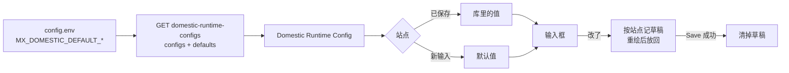

# 58. 管理界面的 Domestic Runtime Config：站点能输入，默认值是测试中继，改了不丢

日期：2026-11-22。状态：已实现。本机测过：管理界面的契约测试和其它界面测试、服务端单元测试。没有部署到 s2，要 `deploy mx-launcher` 才看得到。

用户 2026-11-22（附 s2 上 Config Center → Domestic Runtime Config 的截图）：配置把线上信息页拷贝过来了么？Domestic Site 只能下拉不能输入，其他框也是，可以有默认值，但是也要能修改。

## 结论

1. **没有拷线上的配置。**
   - s2 的 Launcher 是自己的新库（`docs/36`）。不拷 s1 的库是有意的：那里面有生产 Domestic 的 SSH 密钥（`docs/48`）。
   - 截图里的 `domestic-main`、`h2i.minsight-ai.com`、`10.88.88.88:18090`、`10.88.0.1:53` 是 Launcher 代码里写死的默认值，正好和生产一样。右边 HOST、SSH PROFILE 都是"-"，说明还什么都没配。
2. **Domestic Site 改成能输入。**
   - 原来是 `<select>`，选项只有已保存的站点加上 `domestic-main`，新站点根本填不进去。
   - 现在是带候选的输入框：可以选已有的站点，也可以直接输入新的站点名（比如 `domestic02`），回车或离开输入框就切过去。
   - 新站点没有保存过，就显示默认值，并提示"改好后 Save Config"。原来的行为是拿第一个已保存站点的配置来顶。
   - 站点名只许字母、数字、点、下划线、横线，最长 63 个字符。
3. **改了不丢。** 原来每次界面重绘（切站点、数据刷新、保存失败）都会把输入框重置成库里的值，看上去就像"改不了"。
   - 现在每个站点的未保存修改单独记着，重绘后放回去。保存成功才清掉。
4. **默认值可以按环境设。** 服务端多了两个环境变量，不设时和 L1 一样：
   - `MX_DOMESTIC_DEFAULT_SITE_ID`：新站点的默认名；
   - `MX_DOMESTIC_DEFAULT_BOOTSTRAP_HOST`：新站点的 bootstrap 域名。

   s2 的 `config.env` 设成 `domestic02` / `mincave.minsight-ai.com`，不会一不小心又填上生产的域名。
   - 列表接口 `GET /internal/v1/config-center/domestic-runtime-configs` 多返回一个 `defaults`，界面用它做默认值。
   - Oversea 订阅链接的兜底地址也跟着用这个默认域名。
   - 默认域名要和 inventory 里 domestic02 的 `bootstrap_domain` 一致，`check` 会核对。

## 改了什么

| 在哪 | 改了什么 |
|---|---|
| `architecture/mx-launcher/desktop/renderer.js` | Domestic Site 改成输入框加候选（`datalist`），校验站点名；新站点用默认值，不借别的站点的配置；按站点记未保存的修改；默认值取服务端的 `defaults`，没有就用 L1 的 |
| `architecture/mx-launcher/desktop/scripts/domestic-runtime-config.test.mjs` | 新增：服务端默认值生效、没有时是 L1、站点能输入、校验、草稿记住和放回、新站点不借配置 |
| `server/src/config.ts`、`types.ts`、`store/domain.ts` | `MX_DOMESTIC_DEFAULT_SITE_ID`、`MX_DOMESTIC_DEFAULT_BOOTSTRAP_HOST`；`domesticRuntimeDefaults`；新建配置时用它 |
| `server/src/modules/config-center/config-center.controller.ts` | 列表接口多返回 `defaults` |
| `server/src/store/domestic-runtime-defaults.test.ts` | 新增 3 项：不设时是 L1；设了以后新配置用它，输入的值优先；值不合法时退回 L1 |
| `deploy/k8s/base/config.env` | `domestic02`、`mincave.minsight-ai.com` |
| `scripts/lib/apps.sh`（`check`） | 默认域名和 inventory 一致 |

## 实测（本机）

- 管理界面：`domestic-runtime-config.test.mjs` 通过；其余界面测试（SSH Profile、service peer、订阅、Oversea、运维令牌、AppCenter、Release 等 11 个）都通过。
- 服务端：新增 3 项通过，类型检查通过。

## 还没做的

- 部署到 s2（`deploy mx-launcher`，管理界面的文件打在镜像里）以后，在界面上实际输入一次 `domestic02`。
