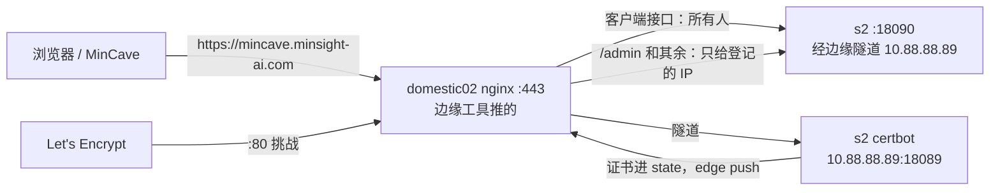

# 59. 用 mincave.minsight-ai.com 进管理后台、做 bootstrap；MinCave 两端的包

日期：2026-11-22。状态：域名这部分已实现，站点配置在 nginx 1.27.5 容器里测过（路由、白名单、管理后台开关、签证书的路径），没有推到 domestic02 上，证书也没签过。打包这部分是方案，没实现。 第 3 条（管理后台默认关着、按 IP 放行）已被 `docs/60` 取代：默认全部放行。

用户 2026-11-22：`https://mincave.minsight-ai.com` 要用这个域名访问 Launcher 后台，并且做 bootstrap url 等设置，怎么操作。还有 V2 里面的 MinCave 怎么打两个端的包。

本篇改了 `docs/57` 第 2、3 条："443 留给 Launcher 推的 public-tls"改成"domestic02 自己的 nginx（边缘工具推）管 443"。Launcher 的 Domestic 包照旧推中继、边缘和 DNS，不开 public-tls。

## 结论：域名

1. **为什么改成 domestic02 自己的 nginx 管 443。**
   - 要用域名进后台，就得在 Launcher 的 Domestic 包推上去之前，443 已经能用。
   - 后台还得按来源 IP 放行，而 Launcher 的 public-tls 只有客户端接口的白名单，没有"给哪些 IP 开后台"。
   - domestic02 的 nginx 由边缘工具推，经已经通了的边缘隧道转到 s2 的 18090，不依赖 Launcher 的中继。
   - 这正好是 v1 生产的样子：443 由外面一层 nginx 担任（v1 是 Compass 的 nginx），Domestic 包只在本机 `127.0.0.1:18090` 上。
2. **路由**（站点模板 `infra/edge/bootstrap-site.conf.tmpl`）：

   | 请求 | 谁能用 | 去哪 |
   |---|---|---|
   | `GET /healthz` | 所有人 | domestic02 自己回 200 |
   | `GET /bootstrap-healthz`、`/internal-healthz` | 所有人 | s2 Launcher 的 `/healthz` |
   | 客户端接口：登录、飞书、enroll、快照、lease 操作、MinCave、订阅，照 v1 的 `Caddyfile.public-tls` 按 method 加 path 收口 | 所有人 | s2 的 18090 |
   | 其它一切：`/admin/`、Config Center、DNS、User Center 等 | 只有登记的来源 IP | s2 的 18090；没登记的一律 404 |
   | `:80` 的 `/.well-known/acme-challenge/` | Let's Encrypt | s2 上临时监听的 certbot |
   | `:80` 的其它 | 所有人 | 301 跳到 https |

   - 转给 s2 时，`X-Forwarded-For` 用 domestic02 看到的真实地址覆盖，不追加；并带上 `X-MX-Forwarded-By: domestic-edge`，s2 的 host-nginx 认它，Launcher 记的就是真实的公网用户地址（`docs/52`）。
3. **管理后台默认在公网上关着。** `relay domestic02 site --admin-allow <你的公网 IP>` 才开，只放到 /16 以内的具体来源，`--admin-allow none` 关掉。
   - 来源记在推送机上（`/var/lib/qp-tunnel/edge/state/domestic02/wg-nginx/ladder2-admin-allow`），不进 Git。
   - 地址会变的网络，变了重跑这条。或者不开，继续用 SSH 隧道。
   - 后台本身还要 Internal Ops Token 登录。白名单是在令牌外面再加的一层。
4. **证书在 s2 上签、在 s2 上续，推过去。**
   - `relay domestic02 cert --agree-tos`：在 s2 上装 certbot，用 standalone 方式听在边缘隧道地址 `10.88.88.89:18089`。Let's Encrypt 来访问 `domestic02:80` 的挑战路径，domestic02 的 nginx 经隧道转给它。
   - 签好以后，把证书拷进边缘工具的 state，重新生成带 443 的站点，`edge push`。
   - 再装一个每天跑的 `ladder2-acme-renew.timer`：快到期时续期，有新证书就自动推。
   - 证书和私钥只在 s2 和 domestic02 上，不进 Git，这是边缘工具原来的做法（`docs/38`）。
   - **`--agree-tos` 表示同意 Let's Encrypt 的用户协议**，由用户自己加。`--email` 可选，填了会收到到期提醒。
5. **要放行的端口**（阿里云安全组）：TCP 443、TCP 80（签证书用）、UDP 51280（中继）。
6. **在 Launcher 里设 bootstrap：**
   - 管理界面 → Config Center → Domestic Runtime Config：站点 `domestic02`，Protocol `https`，Bootstrap Host `mincave.minsight-ai.com`，Port 443，点 Save Config。`docs/58` 部署以后，前两个就是默认值。
   - Save & Apply 会把配置推给 domestic02 上的 Domestic 包，要等它推上去以后才能用（`docs/57` 第 5 步）。它的健康检查访问 `https://mincave.minsight-ai.com/bootstrap-healthz`，上面第 2 条已经接好。
   - 客户端：`architecture/mx-launcher/scripts/manage.sh client-env > .env`。

## 结论：MinCave 两端的包（方案，没实现）

1. **现在本工程里打不出包。** 客户端源码在 `architecture/mx-launcher/demos/mx-h2i/`，但它依赖的 L1 workspace 包（`electron-launcher`、tunnel 和 WireGuard 引擎）和 L1 的打包脚本没迁过来（`docs/49`）。
2. **打法：在 L1 的临时导出上叠 L2 的客户端源码再打。**
   - 用 `git archive` 导出 L1 那个提交，L1 本身不改。
   - 把 L2 的 `demos/mx-h2i` 叠上去。
   - 把 `client-env` 生成的 `.env` 放进安装包的 `Resources/`。
   - 然后跑 L1 原来的打包命令。
3. **两端要分开打：**
   - **macOS：** 在 Mac 上跑 `make:mac:dmg`（universal），用的就是 v1 的打包配置。有 Developer ID 证书时签名加公证；没有时打出来是不签名的，系统会提示"无法验证开发者"，要在系统设置里允许。
     - **v1 实际上也是要手动允许的。** 2026-11-22 在用户的 Mac 上看到：`/Applications/MinCave.app`（3.0.0，从飞书下载，带 `com.apple.quarantine`）只是 ad-hoc 签名，没有 Team ID，没有公证票据，`spctl` 判为 rejected；`MX-H2I.app` 一样。这台 Mac 上也没有任何签名证书。
     - v1 的配置和 L1 `docs/03` 都写了签名和公证的路子：hardened runtime、entitlements，设了 `APPLE_ID` / `APPLE_API_KEY` 才公证。但发出去的包没走这一步。
     - 想不用手动允许，要先有 Apple Developer Program 的 Developer ID Application 证书（装进打包那台 Mac 的钥匙串），再配公证的凭据（App Store Connect API key，或者 Apple ID 加 App 专用密码加 Team ID）。凭据只放在打包机本地，不进 Git。`docs/15` 第 77 项。
     - 手动允许的办法：第一次打开被拦以后，到"系统设置 → 隐私与安全性"点"仍要打开"。或者装好后在终端里执行 `xattr -dr com.apple.quarantine /Applications/MinCave.app`。
   - **Windows：** 要在 Windows 上打。完整的包要编译 MinCave Network Service（需要 Go 1.26 以上），还要跑 PowerShell 的检查（`check:windows-network`），Mac 上做不了。需要一台装了 Node 22、pnpm、Go 的 Windows 机器。
4. **最要紧的一点：测试包和正式的 MinCave 是同一个应用身份**（appId `dev.qpjoy.mx-h2i`，`docs/15` 第 67 项）。
   - 装在已经有正式版的电脑上，会覆盖正式版。
   - 而且共用数据目录、WireGuard 服务和 Windows 的网络服务。
   - 要么只装在没有正式版的电脑上，要么先给测试版换一套身份（appId、产品名、数据目录、服务名都换）再打。

## 第一次在 domestic02 上跑（2026-11-22，用户贴的截图）

- `relay domestic02 site`、`cert` 都执行完了。`https://mincave.minsight-ai.com/admin/` 返回 404：`Content-Length: 10`、`Server: nginx/1.28.3 (Ubuntu)`、远端 `47.97.46.168:443`。
  - 证书和 443 都好了；这个 404 是站点自己按管理后台白名单拒的（正文就是 `not found\n`），不是 s2 回的。
  - 说明 domestic02 看到的来源地址不在 `--admin-allow` 里。用户的 Mac 上开着 MX-H2I 和代理，浏览器出去的地址可能不是自己以为的那个。
- **加了 `/ladder2-whoami`。** 在要进后台的那个浏览器里打开，它显示 domestic02 看到的来源地址，把它填进 `--admin-allow`。代理按规则分流或轮换出口时，这个地址会变：要么让这个域名走直连，要么放一个 /24。
- 站点本机回的内容改成 `text/plain`。原来拒绝的 404 是 `application/octet-stream`，Chrome 会显示成"无法访问此网站 / ERR_INVALID_RESPONSE"，看着像是连不上。

## 改了什么

| 在哪 | 改了什么 |
|---|---|
| `infra/edge/bootstrap-site.conf.tmpl`（新） | domestic02 上 bootstrap 域名的 nginx 站点 |
| `scripts/lib/relay.sh` | `relay <主机> site [--admin-allow …]`、`cert --agree-tos [--email]`、`cert-renew`（给定时器用） |
| `scripts/manage.sh` | 帮助 |
| `inventory/hosts.yaml` | domestic02 的端口说明：443、80、UDP 51280、UDP 51820 |
| `CLAUDE.md` | domestic02 的 443 归边缘工具，Launcher 的包不开 public-tls |

## 实测（本机）

- 站点模板分两种情况渲染：没证书时只有 80；有证书时带 443。管理后台的来源行也写对了。
- nginx 1.27.5 容器，用自签证书和两个假的上游：
  - 管理后台没开时：`/healthz` 200（本机回）；`/bootstrap-healthz` 转到上游 `/healthz`；客户端的 POST 转过去，带着 `X-Forwarded-For` 和 `domestic-edge`；`/admin/` 和 Config Center 返回 404。
  - 开了以后：这两个也转过去了。
  - 80 上的挑战路径转给了 certbot 的上游。
- 第一版有两处在容器里测出来、已改：awk 的 `-v` 传多行在 BSD awk 上报错；正则 location 里的 `proxy_pass` 不能带 URI。

## 还没做的

- 在 s2 上跑 `relay domestic02 site`、`cert`：边缘推送、certbot 经隧道签证书、定时续期，都没在真机上跑过。
- MinCave 打包：等用户定测试版要不要换一套身份，再写 `client-package`。
